# Appendix: the studied sites and the hiring-side evidence

Supporting evidence for [`../site-redesign.md`](../site-redesign.md) §3. It has one section per site in the full set of 29, a short section for Brett's current site, two set-level checks, and the hiring-side sources. Method, the full candidate pool and the rubric are in [`README.md`](README.md); verifier outcomes are in [`verification-log.md`](verification-log.md).

## How to read this appendix

- **Only verified claims.** Every "what works" and "what doesn't" bullet, memorable thing, role quote and time-to-key-info value below survived an independent verifier who reloaded the site. Where the verifier corrected a claim, the corrected wording is shown. Per-site sections are generated from the verified score files.
- **Order.** Sites are grouped as in spec §3 (data, new-grad, software and design, interactive, cautionary), then sorted by slug. Each heading is the slug, so `appendix.md#<slug>` links straight to it.
- **Each site section has:** owner and URL, how the site was found, the role quote that confirms the owner works in a relevant role, both fold shots, the 15 scores, the memorable thing, what works and what doesn't (each with a citation), a measured line, time to key info at both sizes, and the verification count.
- **Citation format.** `[slug:desktop-fold.webp]` and `[slug:mobile-fold.webp]` are the committed fold shots in `sites/<slug>/`. `[slug:record.<dotted.path>]` is a field in the full capture record; the committed `sites/<slug>/record.json` is a trimmed copy that keeps the main fields. `tiles/…` (crops of full-page shots), `inner-desktop-fold.png`, `inner-mobile-fold.png`, `*-full.png`, `probe-*.json`, `index-html.txt` and `verify/…` are scratch-only captures, kept out of git (README, "What is not committed").
- **Measured numbers** come from one unthrottled load in the capture container (Chromium through the session proxy; sizes are CDP `encodedDataLength`). They are indicative and comparable only with each other. Where the verifier re-measured a number outside tolerance, both values are given.
- **Time to key info** counts full-screen scrolls and clicks from landing. "not on site" means the item does not exist. "corrected, see below" means the verifier changed that cell; the corrected value follows the table.
- **Pronouns.** Every site owner is "they".

**Scores legend.** 1–5 per criterion, anchors in [`README.md#rubric`](README.md#rubric). Columns: First screen = first-screen clarity; Proof = proof of skill; Projects = project presentation; Experience = experience presentation; Craft = visual craft; Motion = interaction and motion; Nav/IA = navigation and information architecture; Mobile = mobile quality; Perf = performance; A11y = accessibility; Copy; Recruiter, Engineer, Business = persona fit; Memorable = memorability. A `*` would mark a score settled by a third agent after the blind re-score; no score in this set needed one. Means are **measured**: the arithmetic mean of the 15 integer scores.

## Summary scores

| Site | Group | First screen | Proof | Projects | Experience | Craft | Motion | Nav/IA | Mobile | Perf | A11y | Copy | Recruiter | Engineer | Business | Memorable | Mean | Captured (UTC) |
|---|---|---|---|---|---|---|---|---|---|---|---|---|---|---|---|---|---|---|
| [beingbrute](#beingbrute) | data | 4 | 5 | 5 | 4 | 4 | 4 | 3 | 3 | 3 | 4 | 5 | 4 | 5 | 5 | 4 | 4.13 | 2026-10-21 16:24 |
| [deshraj-jogiya](#deshraj-jogiya) | data | 4 | 5 | 4 | 4 | 3 | 3 | 3 | 4 | 4 | 3 | 3 | 4 | 4 | 3 | 4 | 3.67 | 2026-10-21 13:35 |
| [eugeneyan](#eugeneyan) | data | 4 | 4 | 4 | 3 | 3 | 3 | 4 | 3 | 3 | 4 | 4 | 3 | 4 | 4 | 4 | 3.60 | 2026-10-21 13:35 |
| [mehdio](#mehdio) | data | 3 | 4 | 5 | 4 | 4 | 2 | 4 | 4 | 4 | 3 | 4 | 3 | 4 | 4 | 4 | 3.73 | 2026-10-21 13:41 |
| [mujtabasaqib](#mujtabasaqib) | data | 2 | 3 | 2 | 4 | 3 | 1 | 4 | 2 | 1 | 3 | 2 | 2 | 2 | 2 | 2 | 2.33 | 2026-10-21 13:35 |
| [pahasara](#pahasara) | data | 3 | 4 | 4 | 3 | 4 | 3 | 4 | 3 | 3 | 2 | 3 | 3 | 3 | 3 | 3 | 3.20 | 2026-10-21 13:40 |
| [shaundataanalytics](#shaundataanalytics) | data | 3 | 4 | 3 | 4 | 3 | 3 | 3 | 4 | 4 | 4 | 2 | 2 | 3 | 3 | 3 | 3.20 | 2026-10-21 13:37 |
| [ssp](#ssp) | data | 4 | 3 | 2 | 2 | 4 | 4 | 4 | 4 | 4 | 3 | 3 | 2 | 4 | 3 | 4 | 3.33 | 2026-10-21 13:39 |
| [wisl](#wisl) | data | 5 | 5 | 4 | 3 | 5 | 4 | 5 | 4 | 4 | 3 | 4 | 3 | 5 | 3 | 4 | 4.07 | 2026-10-21 13:43 |
| **Mean, data (9)** | | 3.56 | 4.11 | 3.67 | 3.44 | 3.67 | 3.00 | 3.78 | 3.44 | 3.33 | 3.22 | 3.33 | 2.89 | 3.78 | 3.33 | 3.56 | **3.47** | |
| [damian](#damian) | new-grad | 5 | 3 | 1 | 4 | 3 | 3 | 4 | 3 | 4 | 2 | 4 | 5 | 2 | 4 | 4 | 3.40 | 2026-10-21 16:24 |
| [darshshah](#darshshah) | new-grad | 4 | 3 | 2 | 4 | 3 | 3 | 4 | 4 | 5 | 2 | 3 | 3 | 3 | 2 | 3 | 3.20 | 2026-10-21 16:25 |
| [florea](#florea) | new-grad | 3 | 3 | 3 | 4 | 2 | 3 | 4 | 3 | 3 | 2 | 4 | 4 | 3 | 4 | 3 | 3.20 | 2026-10-21 21:31 |
| [kushalgoel](#kushalgoel) | new-grad | 4 | 3 | 3 | 5 | 3 | 3 | 4 | 4 | 4 | 3 | 4 | 4 | 3 | 3 | 3 | 3.53 | 2026-10-21 21:28 |
| [richardshuai](#richardshuai) | new-grad | 4 | 3 | 4 | 4 | 4 | 2 | 4 | 4 | 3 | 4 | 3 | 4 | 3 | 4 | 5 | 3.67 | 2026-10-21 21:24 |
| [shao](#shao) | new-grad | 4 | 4 | 3 | 3 | 4 | 3 | 3 | 4 | 3 | 4 | 4 | 4 | 4 | 4 | 4 | 3.67 | 2026-10-21 16:23 |
| **Mean, new-grad (6)** | | 4.00 | 3.17 | 2.67 | 4.00 | 3.17 | 2.83 | 3.83 | 3.67 | 3.67 | 2.83 | 3.67 | 4.00 | 3.00 | 3.50 | 3.67 | **3.44** | |
| [antfu](#antfu) | software/design | 4 | 5 | 4 | 2 | 4 | 3 | 3 | 4 | 4 | 3 | 4 | 3 | 5 | 3 | 4 | 3.67 | 2026-10-21 16:24 |
| [brittanychiang](#brittanychiang) | software/design | 4 | 4 | 4 | 4 | 4 | 4 | 4 | 4 | 3 | 4 | 4 | 4 | 4 | 4 | 4 | 3.93 | 2026-10-21 13:35 |
| [danluu](#danluu) | software/design | 1 | 3 | 1 | 1 | 1 | 3 | 2 | 2 | 5 | 3 | 5 | 1 | 4 | 2 | 3 | 2.47 | 2026-10-21 13:41 |
| [emilkowal](#emilkowal) | software/design | 4 | 5 | 3 | 2 | 4 | 4 | 4 | 5 | 3 | 4 | 5 | 2 | 4 | 3 | 4 | 3.73 | 2026-10-21 13:39 |
| [rauno](#rauno) | software/design | 3 | 3 | 3 | 2 | 5 | 3 | 2 | 2 | 4 | 2 | 3 | 2 | 3 | 2 | 4 | 2.87 | 2026-10-21 13:42 |
| [shud](#shud) | software/design | 4 | 4 | 3 | 4 | 4 | 3 | 4 | 4 | 4 | 2 | 4 | 3 | 4 | 3 | 4 | 3.60 | 2026-10-21 13:39 |
| [taniarascia](#taniarascia) | software/design | 4 | 4 | 4 | 4 | 4 | 4 | 4 | 4 | 4 | 3 | 5 | 4 | 5 | 3 | 5 | 4.07 | 2026-10-21 13:35 |
| **Mean, software/design (7)** | | 3.43 | 4.00 | 3.14 | 2.71 | 3.71 | 3.43 | 3.29 | 3.57 | 3.86 | 3.00 | 4.29 | 2.71 | 4.14 | 2.86 | 4.00 | **3.48** | |
| [ciechanow](#ciechanow) | interactive | 2 | 5 | 2 | 1 | 5 | 4 | 4 | 4 | 3 | 3 | 5 | 1 | 4 | 2 | 5 | 3.33 | 2026-10-21 13:37 |
| [madebyevan](#madebyevan) | interactive | 4 | 5 | 4 | 3 | 3 | 4 | 4 | 4 | 3 | 4 | 5 | 2 | 5 | 4 | 5 | 3.93 | 2026-10-21 13:36 |
| [redblobgames](#redblobgames) | interactive | 4 | 5 | 4 | 2 | 4 | 4 | 4 | 4 | 4 | 3 | 5 | 2 | 5 | 3 | 5 | 3.87 | 2026-10-21 13:35 |
| [robinlinacre](#robinlinacre) | interactive | 2 | 4 | 2 | 2 | 3 | 4 | 4 | 3 | 4 | 3 | 5 | 2 | 5 | 3 | 4 | 3.33 | 2026-10-21 13:35 |
| [samwho](#samwho) | interactive | 3 | 5 | 4 | 2 | 4 | 4 | 4 | 4 | 5 | 3 | 5 | 2 | 5 | 3 | 5 | 3.87 | 2026-10-21 13:39 |
| **Mean, interactive (5)** | | 3.00 | 4.80 | 3.20 | 2.00 | 3.80 | 4.00 | 4.00 | 3.80 | 3.80 | 3.20 | 5.00 | 1.80 | 4.80 | 3.00 | 4.80 | **3.67** | |
| [bruno-simon](#bruno-simon) | cautionary | 1 | 2 | 1 | 1 | 4 | 1 | 1 | 2 | 1 | 1 | 3 | 1 | 3 | 1 | 3 | 1.73 | 2026-10-21 13:39 |
| [henryheffernan](#henryheffernan) | cautionary | 2 | 3 | 2 | 2 | 5 | 1 | 2 | 1 | 2 | 2 | 3 | 1 | 3 | 1 | 3 | 2.20 | 2026-10-21 16:26 |
| **Mean, cautionary (2)** | | 1.50 | 2.50 | 1.50 | 1.50 | 4.50 | 1.00 | 1.50 | 1.50 | 1.50 | 1.50 | 3.00 | 1.00 | 3.00 | 1.00 | 3.00 | **1.97** | |
| **Mean, all 29** | | 3.38 | 3.90 | 3.10 | 3.00 | 3.66 | 3.10 | 3.55 | 3.45 | 3.48 | 2.97 | 3.90 | 2.76 | 3.83 | 3.03 | 3.86 | **3.40** | |
| **[brettadams0 (current)](#brettadams0)** | self | 4 | 4 | 4 | 3 | 4 | 4 | 3 | 3 | 4 | 4 | 4 | 4 | 4 | 3 | 3 | **3.67** | 2026-10-21 04:00 |

## Brett's current site

### brettadams0

**Brett Adams** · <https://brettadams0.github.io/> · scored from the baseline audit, not by the capture agents. Full audit: [`baseline/audit.md`](baseline/audit.md); measured reports: `baseline/measure-<page>.json`.

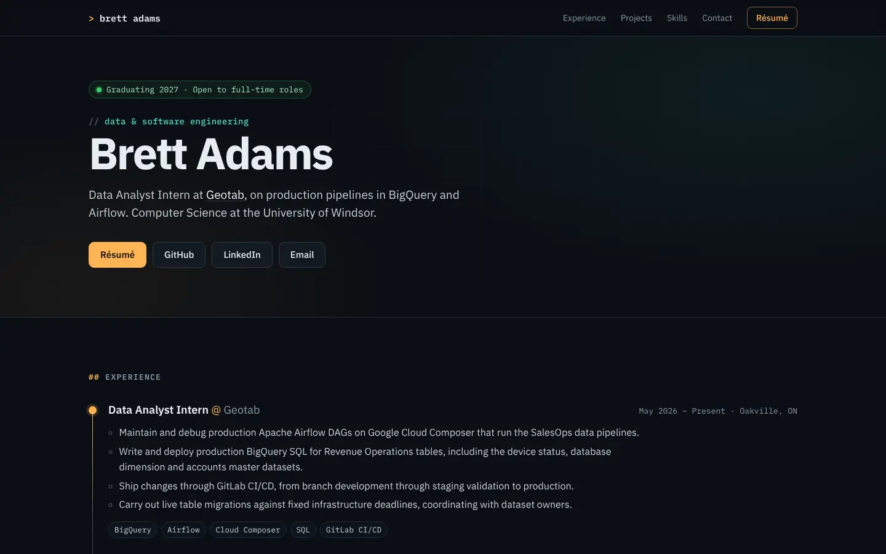
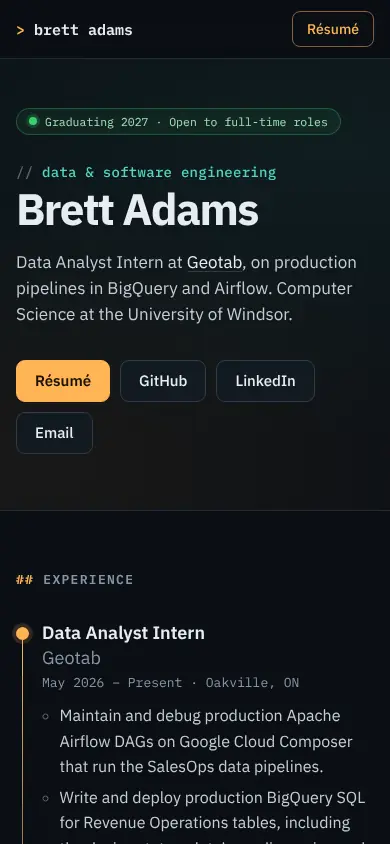

| First screen | Proof | Projects | Experience | Craft | Motion | Nav/IA | Mobile | Perf | A11y | Copy | Recruiter | Engineer | Business | Memorable |
|---|---|---|---|---|---|---|---|---|---|---|---|---|---|---|
| 4 | 4 | 4 | 3 | 4 | 4 | 3 | 3 | 4 | 4 | 4 | 4 | 4 | 3 | 3 |

**Memorable:** the neuronet-arena demo, forty agents evolving in the browser (serves the content, but sits 3 screens down on a phone and behind a click).

**Measured** (throttled mobile, median of 3 runs, 2026-10-21; audit §1): homepage 389.6 KB in 13 requests after a full scroll, 2.5 KB JS excluding GA, LCP 744 ms, CLS 0.0011; axe 0 violations at both sizes.

| Time to key info | 390×844 | 1440×900 |
|---|---|---|
| current role | 0 scrolls, 0 clicks | 0 scrolls, 0 clicks |
| resume | 0 scrolls, 1 clicks | 0 scrolls, 1 clicks |
| contact | 0 scrolls, 1 clicks | 0 scrolls, 1 clicks |
| best project | 3 scrolls, 0 clicks | 2 scrolls, 0 clicks (or 1 click on "Projects") |
| shipped work | 3 scrolls, 0 clicks | 1 scrolls, 0 clicks (or 1 click on "Projects") |

The numbered issue list is in spec §2.5 and audit §5.

## Data, analytics and ML engineering

### beingbrute

**Aditya Ranjan** · <https://beingbrute.github.io/> · group: data (data-analyst)

Found via: colorlib.com roundup https://colorlib.com/wp/?p=383945 (surfaced by WebSearch 'Show HN data engineering portfolio personal site live dashboard pipeline'; page read with WebFetch) (listed as 'Data analyst')

Role, from the site: “I'm a data analyst who works across the full pipeline — raw files and SQL at one end, a dashboard someone actually opens at the other.” (https://beingbrute.github.io/)

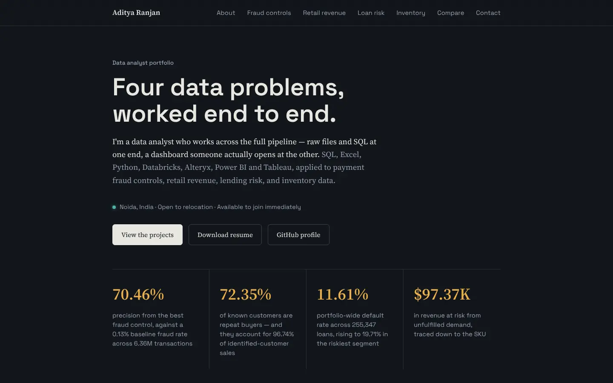
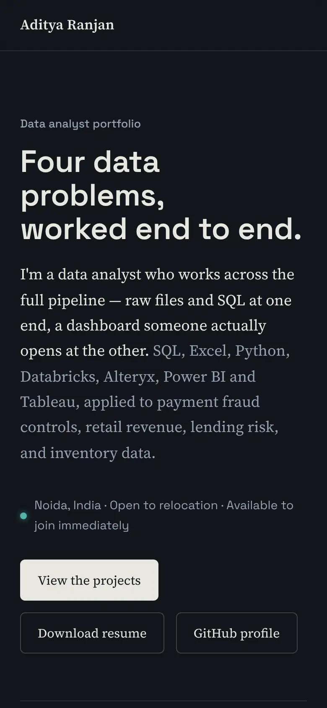

| First screen | Proof of skill | Projects | Experience | Visual craft | Motion | Nav/IA | Mobile | Performance | Accessibility | Copy | Recruiter | Engineer | Business | Memorability |
|---|---|---|---|---|---|---|---|---|---|---|---|---|---|---|
| 4 | 5 | 5 | 4 | 4 | 4 | 3 | 3 | 3 | 4 | 5 | 4 | 5 | 5 | 4 |

**Memorable:** A row of four headline results (70.46%, 72.35%, 11.61%, $97.37K) right under the intro, each a link into its case study (serves the content).

**What works**

- One hero line states location, relocation and availability, next to résumé and GitHub buttons. [beingbrute:desktop-fold.webp]
- Results first: four headline numbers under the intro, each linking to the case study that produced it. [beingbrute:probe-home-links.json]
- Repeatable order: question with public dataset and size, stat tiles, captioned dashboards, 'What this shows' (build steps, caveated findings), recommendation, chips, repo/docs links; Tableau on two of four. [beingbrute:tiles/d-02.png]
- Negative or awkward results are reported (a perfect model flagged as leakage), which makes the positive numbers more credible. [beingbrute:tiles/d-02.png]
- A closing at-a-glance table (business question / dataset / primary tool / headline result) summarises all projects for a skimmer. [beingbrute:tiles/d-06.png]

**What doesn't**

- No navigation at all on mobile (links hidden, no menu button) on a ~22-viewport page. Contact is at the very bottom. [beingbrute:record.home.mobile.dom.menu_button]
- The one job is a sentence of prose with no dates or outcomes. There is no experience list. [beingbrute:tiles/m-01.png]
- Layout shift 0.115 measured on mobile; desktop CLS was 0.010 on reload (0.114 at capture), on an otherwise very light, script-free page. [beingbrute:record.summary.cls_mobile]
- Everything lives on one page. Dashboards are on Tableau Public and write-ups on GitHub, so there is no on-site case-study or demo page to link to directly. [beingbrute:probe-home-links.json]

**Measured** (one unthrottled load, 2026-10-21): desktop 10 requests, 690 KB total, 0 KB JS, LCP 652 ms, CLS 0.1138; mobile LCP 1976 ms; axe (desktop) critical 0, serious 1. Record: [sites/beingbrute/record.json](sites/beingbrute/record.json).
- Re-measured by the verifier: cls_desktop = 0.1138 → cls_desktop = 0.0098 on reload (0.1138 at capture); the 0.11 shift reproduces on mobile (0.1146). (Reload desktop CLS 0.0098 is 91% below the claim, outside a 50% band; mobile 0.1146 matches the original 0.114.)

| Time to key info | 390×844 | 1440×900 |
|---|---|---|
| current role | 2 scrolls, 0 clicks | 1 scrolls, 0 clicks |
| resume | 0 scrolls, 1 clicks | 0 scrolls, 1 clicks |
| contact | 21 scrolls, 0 clicks | 0 scrolls, 1 clicks |
| best project | 0 scrolls, 1 clicks | 0 scrolls, 1 clicks |
| shipped work | 0 scrolls, 1 clicks | 0 scrolls, 1 clicks |

Verification: 41 claims confirmed, 3 corrected, 0 removed, by V5.1.

### deshraj-jogiya

**Deshraj Jogiya** · <https://deshraj-jogiya.github.io/> · group: data (de-ae-practitioner)

Found via: colorlib.com roundup https://colorlib.com/wp/?p=383945 (surfaced by WebSearch 'Show HN data engineering portfolio personal site live dashboard pipeline'; page read with WebFetch) (listed as 'Data engineering graduate')

Role, from the site: “Data Engineer & Machine Learning Engineer · Tempe, AZ · open to relocation” (https://deshraj-jogiya.github.io/)

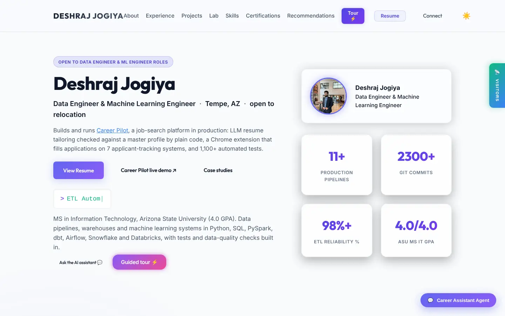
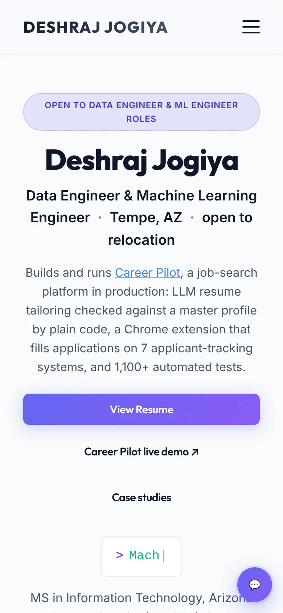

| First screen | Proof of skill | Projects | Experience | Visual craft | Motion | Nav/IA | Mobile | Performance | Accessibility | Copy | Recruiter | Engineer | Business | Memorability |
|---|---|---|---|---|---|---|---|---|---|---|---|---|---|---|
| 4 | 5 | 4 | 4 | 3 | 3 | 3 | 4 | 4 | 3 | 3 | 4 | 4 | 3 | 4 |

**Memorable:** The hero links to a live, running demo of their own job-search platform (Career Pilot). (serves the content).

**What works**

- Hero states title, city, relocation and the roles wanted in plain words, with a primary résumé button on both screen sizes. [deshraj-jogiya:mobile-fold.webp]
- The hero's demo link runs a real public instance of their own product, with automation off and a sample profile, so it is safe to click. [deshraj-jogiya:record.home.desktop.dom.features.demo_links]
- The Lakehouse case study follows how it works, data, problems and decisions, testing, results, limits and next steps, stack; the homepage promises this outline for all four. [deshraj-jogiya:record.inner.desktop.dom.headings]
- The Lakehouse case study opens with a dated 'For:' line naming the user and their question, and its summary says the 60,000 postings are synthetic. [deshraj-jogiya:inner-desktop-fold.png]
- Experience cards show employer, dates and engagement type (Part-Time, Contract) in a pill, with tool chips under each role. [deshraj-jogiya:tiles/d-05.png]

**What doesn't**

- Stat tiles ('98%+ ETL Reliability %', '2300+ Git Commits', '11+ Production Pipelines') have no source or link, so they read as vanity metrics. [deshraj-jogiya:desktop-fold.webp]
- Experience bullets follow a résumé template where nearly every line ends in an unsourced percentage. [deshraj-jogiya:tiles/d-05.png]
- Fold clutter: typing effect, guided tour, 'Ask the AI assistant', a chat bubble and a visitors tab compete with the résumé and demo CTAs. [deshraj-jogiya:desktop-fold.webp]
- 30 project cards on one desktop page (4 featured, 21 more, 5 team; 19.8k px tall) bury the four strong case studies. [deshraj-jogiya:record.home.desktop.dom.scroll_height]
- Contrast failures on 50 nodes, including the green typing text and purple card badges. [deshraj-jogiya:record.home.desktop.axe.violations]

**Measured** (one unthrottled load, 2026-10-21): desktop 17 requests, 730 KB total, 44 KB JS, LCP 2352 ms, CLS 0.0154; mobile LCP 1288 ms; axe (desktop) critical 0, serious 2. Record: [sites/deshraj-jogiya/record.json](sites/deshraj-jogiya/record.json).
- Re-measured by the verifier: has_resume_link = false → has_resume_link = false is a detector miss: 'Resume' and 'View Resume' are buttons opening an HTML résumé modal with Print / Save PDF, so no href exists. (Field reproduces as false, but resume_links is empty only because both résumé controls are buttons; modal text 'Professional Resume Print / Save PDF' is in the DOM. Do not read as 'no résumé'.)

| Time to key info | 390×844 | 1440×900 |
|---|---|---|
| current role | 0 scrolls, 0 clicks | 0 scrolls, 0 clicks |
| resume | 0 scrolls, 1 clicks | 0 scrolls, 1 clicks |
| contact | 0 scrolls, 2 clicks | 0 scrolls, 1 clicks |
| best project | 2 scrolls, 0 clicks | 1 scrolls, 0 clicks |
| shipped work | 0 scrolls, 1 clicks | 0 scrolls, 1 clicks |

Verification: 43 claims confirmed, 5 corrected, 0 removed, by V3.4.

### eugeneyan

**Eugene Yan** · <https://eugeneyan.com/> · group: data (ml-researcher-writer)

Found via: Brett's seed list (brief §4.1)

Role, from the site: “Currently, I'm a Member of Technical Staff at Anthropic.” (https://eugeneyan.com/)

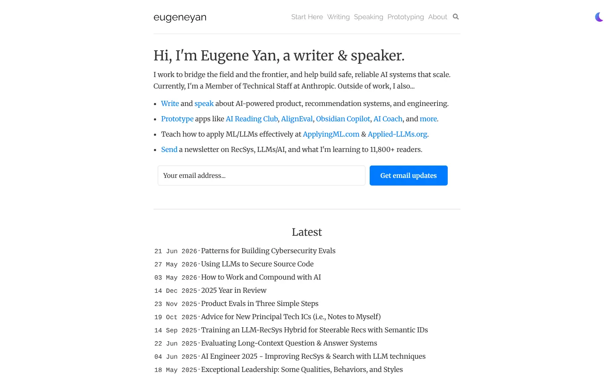
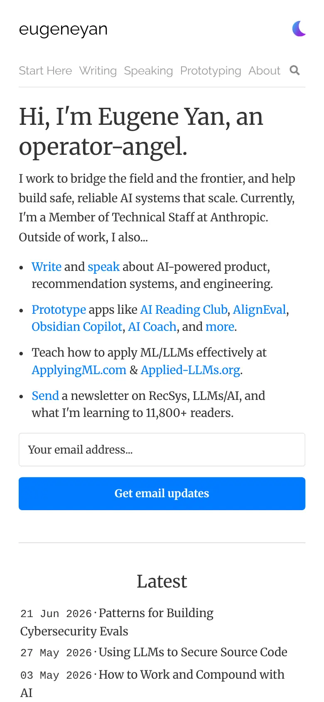

| First screen | Proof of skill | Projects | Experience | Visual craft | Motion | Nav/IA | Mobile | Performance | Accessibility | Copy | Recruiter | Engineer | Business | Memorability |
|---|---|---|---|---|---|---|---|---|---|---|---|---|---|---|
| 4 | 4 | 4 | 3 | 3 | 3 | 4 | 3 | 3 | 4 | 4 | 3 | 4 | 4 | 4 |

**Memorable:** The four verb bullets under the greeting, each verb itself a link to the evidence (Write, speak, Prototype, Send), plus the output tally line (serves the content).

**What works**

- Hero lists roles as four verb bullets; Write, speak, Prototype and Send link to the matching pages ('Teach' links its two sites instead), so the intro doubles as navigation. [eugeneyan:desktop-fold.webp]
- Project list entries are title, one grey one-liner, date, then iconed Source / Demo / Website links: scannable and directly verifiable. [eugeneyan:inner-desktop-fold.png]
- Monospace date column in front of every list item gives a clear recency signal and visual rhythm in a text-only layout. [eugeneyan:desktop-fold.webp]
- One-line output tally ('212 posts, 31 talks, 19 prototypes, 426,673 words') where the posts, talks and prototypes counts link to their indexes: a compact facts-as-numbers row. [eugeneyan:tiles/d-01.png]
- Five plain nav labels, one per content type, each one click from every page. [eugeneyan:mobile-fold.webp]

**What doesn't**

- Headline descriptor rotates within and between loads ('an ML engineer', 'an applied scientist', 'an operator-angel'); some values are vague, and the current role is only in the paragraph below. [eugeneyan:record.summary.hero_text_mobile]
- Nav row is wider than a 390 px phone, so the whole page is laid out at 453 px and shrunk. [eugeneyan:record.home.mobile.dom.vw]
- Grey nav and heading text fails contrast (28 nodes, serious). [eugeneyan:record.home.desktop.axe.violations]
- No résumé and contact only as footer icons, several screens down on mobile. [eugeneyan:record.summary.key_info_positions_mobile.contact]
- 87% of JS is third-party (tag manager, search widget); a 'Trending This Week' heading rendered empty after an Algolia error. [eugeneyan:record.home.desktop.network_initial.top_hosts]

**Measured** (one unthrottled load, 2026-10-21): desktop 32 requests, 539 KB total, 374 KB JS, LCP 1532 ms, CLS 0.0275; mobile LCP 2460 ms; axe (desktop) critical 0, serious 1. Record: [sites/eugeneyan/record.json](sites/eugeneyan/record.json).
- Re-measured by the verifier: cls_desktop = 0.0275 → cls_desktop about 0.01-0.03 (0.0119 on reload, 0.0275 at capture); both well under 0.05. (Reload CLS 0.0119 is 57% below the claimed 0.0275, outside a 50% band; the rubric bucket (<0.05) is unchanged.)
- Re-measured by the verifier: horizontal_overflow_mobile = false → horizontal_overflow_mobile = true under the current rule: no scrollbar overflow, but the mobile layout viewport is 453 px, wider than the 390 px screen (see D2). (Reload: summary.horizontal_overflow_mobile true, mobile_layout_width 453, dom.horizontal_overflow false. The original record used an older rule that ignored layout width; booleans must match exactly.)

| Time to key info | 390×844 | 1440×900 |
|---|---|---|
| current role | 0 scrolls, 0 clicks | 0 scrolls, 0 clicks |
| resume | not on site | not on site |
| contact | 4 scrolls, 0 clicks | 3 scrolls, 0 clicks |
| best project | 0 scrolls, 1 clicks | 0 scrolls, 1 clicks |
| shipped work | corrected, see below | 0 scrolls, 1 clicks |

- Verifier correction, mobile shipped work: mobile shipped_work: {scrolls 0, clicks 1, note: 'Prototyping nav: entries carry Github, Demo or Website links; whether Demo links are recordings was not checked.'} (Prototyping fold shows Github, Demo (play icon) and Website links; I did not open a Demo link, so 'recorded-demo' is not verified. One entry (AI Coach) has only a phone number.)

Verification: 40 claims confirmed, 6 corrected, 0 removed, by V3.4.

### mehdio

**Mehdi Ouazza** · <https://www.mehdio.com/> · group: data (de-ae-practitioner)

Found via: colorlib.com roundup https://colorlib.com/wp/?p=383945 (surfaced by WebSearch 'Show HN data engineering portfolio personal site live dashboard pipeline'; page read with WebFetch) (listed as 'Data engineer and developer advocate at MotherDuck')

Role, from the site: “Now the first DevRel at MotherDuck (DuckDB in the cloud).” (https://www.mehdio.com/about)

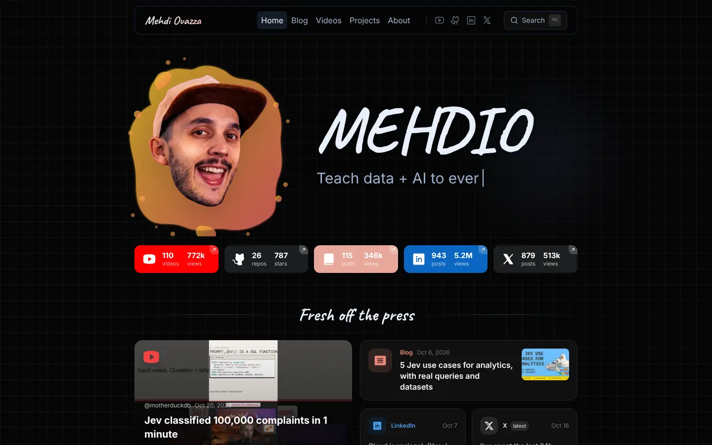

| First screen | Proof of skill | Projects | Experience | Visual craft | Motion | Nav/IA | Mobile | Performance | Accessibility | Copy | Recruiter | Engineer | Business | Memorability |
|---|---|---|---|---|---|---|---|---|---|---|---|---|---|---|
| 3 | 4 | 5 | 4 | 4 | 2 | 4 | 4 | 4 | 3 | 4 | 3 | 4 | 4 | 4 |

**Memorable:** A photo cut-out face in an orange sticker blob next to hand-lettered 'MEHDIO', above a row of brand-coloured audience counters. (serves the content).

**What works**

- Project cards pair a real screenshot with a what-it-does paragraph, tech chips and a 'Visit project' button; open-source ones add a GitHub link, some with a star count. [mehdio:tiles/id-00.png]
- First-screen counters turn reach into numbers and each one links to the channel it counts (GitHub repos/stars, videos/views). [mehdio:desktop-fold.webp]
- Separate About page lists employer, title, years and location per role, with numbers on three of five roles, plus a 'Want a 1-pager PDF?' link to /resume. [mehdio:probe-about.txt]
- Light: about 446 KB total and 201 KB JS (measured); LCP 2.1 s desktop, 2.5 s mobile in the verifier reload; ⌘K search button in the header. [mehdio:record.summary.total_bytes_desktop]

**What doesn't**

- The visible first screen never states the role or employer. The plain description is visually hidden text, readable by crawlers and agents but not by people. [mehdio:record.summary.hero_text]
- A typewriter tagline is the only visible descriptive line and is mid-phrase whenever you look ('Te|' desktop, 'Build' mobile), with no reduced-motion handling. [mehdio:mobile-fold.webp]
- The Contact page link sits only in the footer (header carries social icons on desktop), and the résumé is two clicks deep: About, then 'Want a 1-pager PDF?'. [mehdio:record.summary.nav_items]
- An icon-only mobile button has no accessible name (axe critical), and 7 mobile targets are 20 px. [mehdio:record.home.mobile.axe.violations]

**Measured** (one unthrottled load, 2026-10-21): desktop 31 requests, 435 KB total, 197 KB JS, LCP 1068 ms, CLS 0.0036; mobile LCP 1164 ms; axe (desktop) critical 0, serious 1. Record: [sites/mehdio/record.json](sites/mehdio/record.json).
- Re-measured by the verifier: lcp_ms_desktop = 1068 → lcp_ms_desktop = 2140 in the verifier reload (1068 originally); report as about 1–2 s. (+1,072 ms, +100%: outside ±50% and ±500 ms.)

| Time to key info | 390×844 | 1440×900 |
|---|---|---|
| current role | 0 scrolls, 2 clicks | 0 scrolls, 1 clicks |
| resume | – scrolls, 3 clicks | – scrolls, 2 clicks |
| contact | 1 scrolls, 1 clicks | 1 scrolls, 1 clicks |
| best project | 0 scrolls, 2 clicks | 0 scrolls, 1 clicks |
| shipped work | 0 scrolls, 1 clicks | 0 scrolls, 1 clicks |

Verification: 31 claims confirmed, 10 corrected, 0 removed, by V3.3.

### mujtabasaqib

**Mujtaba Saqib** · <https://www.mujtabasaqib.com/> · group: data (de-ae-practitioner)

Found via: emmabostian/developer-portfolios README (raw.githubusercontent.com/emmabostian/developer-portfolios/master/README.md), grep for 'Data Engineer'/'Data Analyst' (listed as 'Data Engineer | Data Scientist')

Role, from the site: “May 2026 – Present / Data Scientist / Genix Pharma (Private) Limited · Full-time” (https://www.mujtabasaqib.com/)

| First screen | Proof of skill | Projects | Experience | Visual craft | Motion | Nav/IA | Mobile | Performance | Accessibility | Copy | Recruiter | Engineer | Business | Memorability |
|---|---|---|---|---|---|---|---|---|---|---|---|---|---|---|
| 2 | 3 | 2 | 4 | 3 | 1 | 4 | 2 | 1 | 3 | 2 | 2 | 2 | 2 | 2 |

**Memorable:** Cut-out suit portrait in front of an animated neural-network diagram with a giant scrolling name (does not serve the content).

**What works**

- Experience cards put date range, title, employer and employment type (full-time, part-time, internship) together, with tech chips, so level and recency are scannable. [mujtabasaqib:tiles/m-02.png]
- Projects show a real artefact (a dashboard screenshot with KPI tiles) rather than a stock image. [mujtabasaqib:tiles/m-01.png]
- Location and availability are stated in the hero as small status chips. [mujtabasaqib:mobile-fold.webp]
- Plain nav labels (About, Experience, Projects, Contact) and visible keyboard focus on every nav link. [mujtabasaqib:record.home.desktop.focus_check]

**What doesn't**

- A splash greeting gates the whole page. Text was still 6 characters at 3 s and LCP measured 8.7 s on desktop. [mujtabasaqib:record.home.desktop.splash_check]
- Project items have no repo, demo or write-up links and no problem/result line. They are titles, a category and a picture. [mujtabasaqib:record.home.desktop.dom.features.project_links]
- Vanity stat counters ('2+ years', '10+ projects', '5 stacks mastered') that the dated roles shown don't support. [mujtabasaqib:tiles/id-01.png]
- The hero spends the first screen on a full-height portrait and animated network art. The real current job sits ~5 mobile viewports down. [mujtabasaqib:mobile-fold.webp]
- 4.2 MB first load, 3.8 MB of it images (7 files); the LCP element is the SVG portrait (per-file size not re-measured). [mujtabasaqib:record.home.desktop.network_initial.by_type]
- Mobile layout is 27 px wider than the phone (417 px layout viewport at 390 px), so the header's Menu label is cut off. [mujtabasaqib:record.home.mobile.dom.vw]

**Measured** (one unthrottled load, 2026-10-21): desktop 40 requests, 4,074 KB total, 302 KB JS, LCP 8716 ms, CLS 0; mobile LCP 6828 ms; axe (desktop) critical 0, serious 2. Record: [sites/mujtabasaqib/record.json](sites/mujtabasaqib/record.json).
- Re-measured by the verifier: horizontal_overflow_mobile = false → horizontal_overflow_mobile = true under the current rule: no scrollbar overflow, but the mobile layout viewport is 417 px on a 390 px phone. (Reload summary.horizontal_overflow_mobile true, mobile_layout_width 417; dom.horizontal_overflow false because scroll_width equals the 417 px viewport. The original false used the older scroll-width-only check.)

| Time to key info | 390×844 | 1440×900 |
|---|---|---|
| current role | 5 scrolls, 0 clicks | 4 scrolls, 0 clicks |
| resume | not on site | not on site |
| contact | 0 scrolls, 2 clicks | 0 scrolls, 1 clicks |
| best project | 2 scrolls, 0 clicks | 2 scrolls, 0 clicks |
| shipped work | 3 scrolls, 0 clicks | 4 scrolls, 1 clicks |

Verification: 39 claims confirmed, 2 corrected, 0 removed, by V5.1.

### pahasara

**Pahasara Ridmaka** · <https://www.pahasara.me/> · group: data (de-ae-practitioner)

Found via: emmabostian/developer-portfolios README (raw.githubusercontent.com/emmabostian/developer-portfolios/master/README.md), grep for 'Data Engineer'/'Data Analyst' (listed as 'Aspiring Data Engineer')

Role, from the site: “Linux enthusiast and software/data engineer building full-stack apps and scalable data pipelines across open-source environments.” (https://www.pahasara.me/)

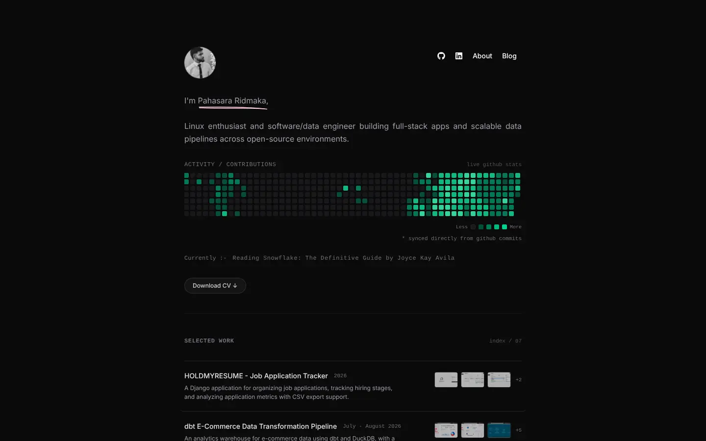
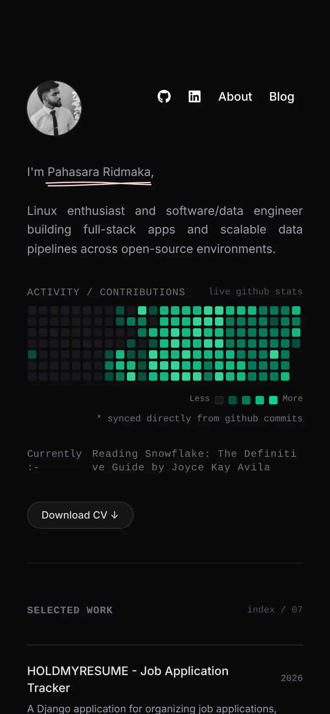

| First screen | Proof of skill | Projects | Experience | Visual craft | Motion | Nav/IA | Mobile | Performance | Accessibility | Copy | Recruiter | Engineer | Business | Memorability |
|---|---|---|---|---|---|---|---|---|---|---|---|---|---|---|
| 3 | 4 | 4 | 3 | 4 | 3 | 4 | 3 | 3 | 2 | 3 | 3 | 3 | 3 | 3 |

**Memorable:** A green GitHub contribution heatmap labelled 'live github stats' in the middle of the hero. (does not serve the content).

**What works**

- Whole homepage is about two desktop screens (1791 px, 2.7 phone screens): intro, CV button, then a dated work index; nothing to hunt for. [pahasara:tiles/d-00.png]
- Work index rows pair a title, a date range and one plain sentence with a thumbnail strip of real screenshots. [pahasara:desktop-fold.webp]
- Project page leads with a screenshot carousel of the actual dashboard, then stack chips and a key-features list. [pahasara:inner-desktop-fold.png]
- Previous/next links at the foot of each project page keep a reader moving through the work. [pahasara:tiles/id-mid.png]

**What doesn't**

- Zoom is disabled by the viewport meta and two icon links have no names; outlines are set to none, and the CV button shows no visible focus. [pahasara:record.home.desktop.axe.violations]
- Homepage never says 'undergraduate' or a graduation year; level (ICT undergraduate, BSc 2023-2026) is only on About, and no page checked states availability. [pahasara:mobile-fold.webp]
- Project write-up uses boilerplate ('production-grade solution', 'leverages', 'intelligently parses') and gives no results or decisions. [pahasara:record.inner.desktop.dom.hero_text]
- 2.9 MB of page weight, 2.5 MB of it images shown as small thumbnails, and 4 failed requests on load (5 after scrolling). [pahasara:record.home.desktop.network_initial]
- Generic page title 'Portfolio' and meta description 'Personal Portfolio'. [pahasara:record.summary.meta_description]

**Measured** (one unthrottled load, 2026-10-21): desktop 49 requests, 2,823 KB total, 276 KB JS, LCP 2952 ms, CLS 0.0978; mobile LCP 1796 ms; axe (desktop) critical 1, serious 3. Record: [sites/pahasara/record.json](sites/pahasara/record.json).

| Time to key info | 390×844 | 1440×900 |
|---|---|---|
| current role | 0 scrolls, 1 clicks | 0 scrolls, 1 clicks |
| resume | 0 scrolls, 1 clicks | 0 scrolls, 1 clicks |
| contact | 0 scrolls, 1 clicks | 0 scrolls, 1 clicks |
| best project | 1 scrolls, 0 clicks | 0 scrolls, 0 clicks |
| shipped work | 1 scrolls, 1 clicks | 0 scrolls, 1 clicks |

Verification: 41 claims confirmed, 4 corrected, 0 removed, by V3.4.

### shaundataanalytics

**Shaun Lin** · <https://shaundataanalytics.github.io/> · group: data (de-ae-practitioner)

Found via: colorlib.com roundup https://colorlib.com/wp/?p=383945 (surfaced by WebSearch 'Show HN data engineering portfolio personal site live dashboard pipeline'; page read with WebFetch) (listed as 'Data engineer')

Role, from the site: “Data Engineering & ML Analytics Portfolio ... Building high-performance data pipelines, predictive machine learning models, and interactive analytical dashboards.” (https://shaundataanalytics.github.io/)

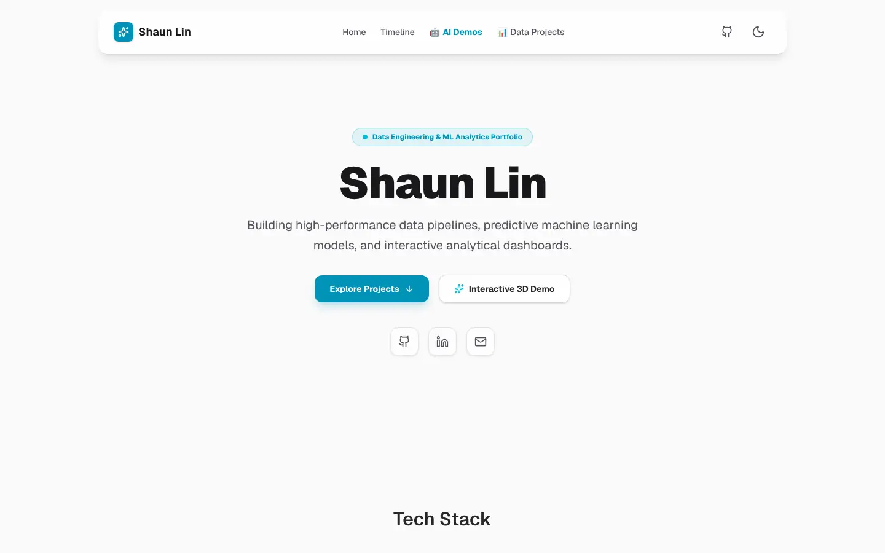
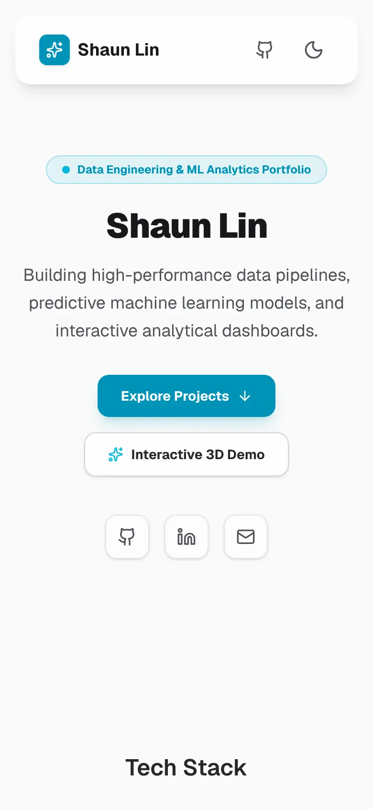

| First screen | Proof of skill | Projects | Experience | Visual craft | Motion | Nav/IA | Mobile | Performance | Accessibility | Copy | Recruiter | Engineer | Business | Memorability |
|---|---|---|---|---|---|---|---|---|---|---|---|---|---|---|
| 3 | 4 | 3 | 4 | 3 | 3 | 3 | 4 | 4 | 4 | 2 | 2 | 3 | 3 | 3 |

**Memorable:** The filterable vertical experience timeline with a tool-chip row under every role. (serves the content).

**What works**

- Experience timeline gives each role a date, employer badge, outcome bullets and tool chips, with filter chips to show only one track. [shaundataanalytics:tiles/m-01.png]
- Case-study page opens with a business problem statement before architecture, then schema tables and the SQL that produced a finding. [shaundataanalytics:record.inner.desktop.dom.headings]
- Case-study header puts source and demo as the two primary buttons, followed by a stack chip row. [shaundataanalytics:inner-desktop-fold.png]
- Light page: 191 KB JS and 303 KB in total (measured), with no console errors and zero small tap targets on mobile. [shaundataanalytics:record.summary.total_bytes_desktop]

**What doesn't**

- 3 of the 7 'Live Demo' buttons (across 8 project cards) open GitHub repositories, not running demos, so the label overpromises. [shaundataanalytics:record.home.desktop.dom.features.demo_links]
- No résumé, no availability and no current role on the first screen; the hero is a name plus a generic tagline. [shaundataanalytics:mobile-fold.webp]
- Buzzword-heavy copy ('Production-grade', 'Socratic sparring engines', 'Quantifiable Impact & Verified Outcomes') reads as AI-written. [shaundataanalytics:tiles/d-02.png]
- Metric tiles like 'Data Integrity 100% Passed' and 'Orders Analyzed 100,000+' are unsourced, and the linked demo reports 4,000 orders. [shaundataanalytics:inner-desktop-fold.png]
- Mobile hides all section links without a menu button, leaving only GitHub and theme icons in the header. [shaundataanalytics:record.home.mobile.dom.nav]

**Measured** (one unthrottled load, 2026-10-21): desktop 19 requests, 296 KB total, 187 KB JS, LCP 1688 ms, CLS 0.0283; mobile LCP 924 ms; axe (desktop) critical 0, serious 1. Record: [sites/shaundataanalytics/record.json](sites/shaundataanalytics/record.json).

| Time to key info | 390×844 | 1440×900 |
|---|---|---|
| current role | 2 scrolls, 0 clicks | 1 scrolls, 0 clicks |
| resume | not on site | not on site |
| contact | 0 scrolls, 1 clicks | 0 scrolls, 1 clicks |
| best project | 6 scrolls, 0 clicks | 4 scrolls, 0 clicks |
| shipped work | 0 scrolls, 1 clicks | 0 scrolls, 1 clicks |

Verification: 45 claims confirmed, 3 corrected, 0 removed, by V3.4.

### ssp

**Simon Späti** · <https://www.ssp.sh/> · group: data (de-ae-practitioner)

Found via: colorlib.com roundup https://colorlib.com/wp/?p=383945 (surfaced by WebSearch 'Show HN data engineering portfolio personal site live dashboard pipeline'; page read with WebFetch); also WebSearch 'data engineer personal website blog projects DuckDB dbt "data engineer" about me site' (MotherDuck author page)

Role, from the site: “My name is Simon Späti, author & educator, 20+ years of experience in data, writing online here since 2015.” (https://www.ssp.sh/)

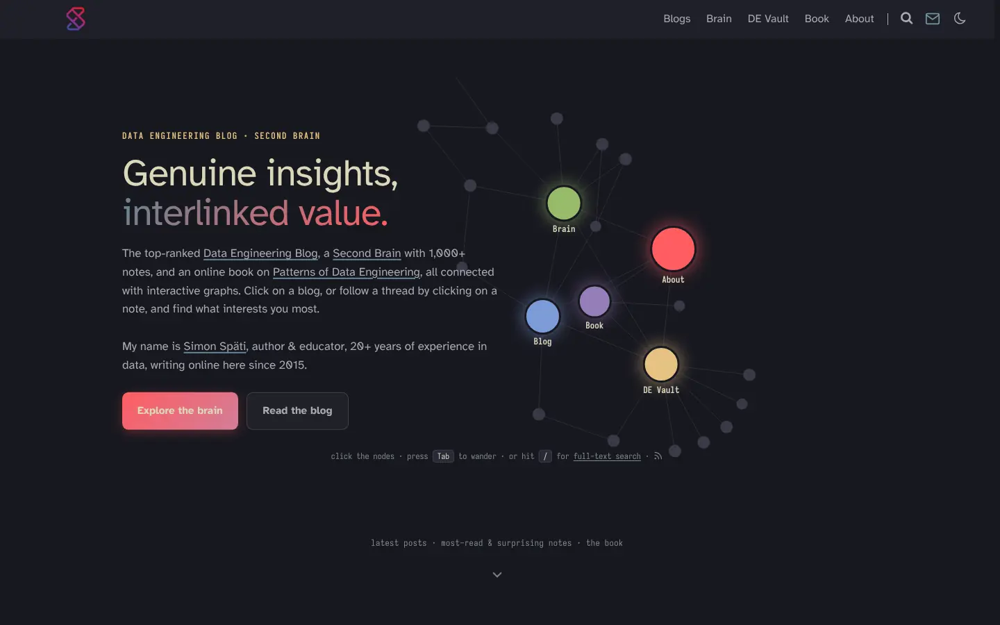
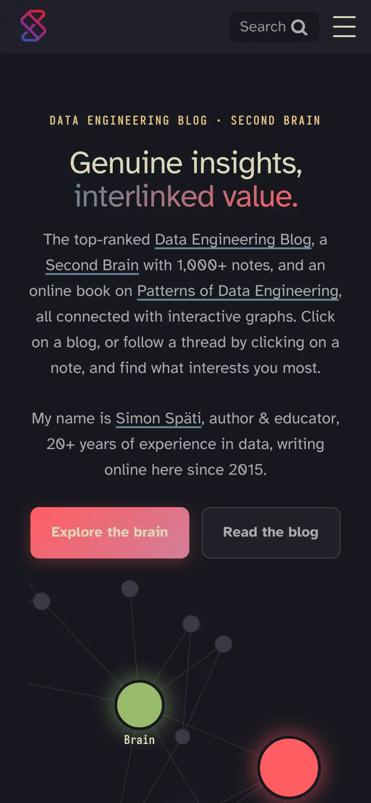

| First screen | Proof of skill | Projects | Experience | Visual craft | Motion | Nav/IA | Mobile | Performance | Accessibility | Copy | Recruiter | Engineer | Business | Memorability |
|---|---|---|---|---|---|---|---|---|---|---|---|---|---|---|
| 4 | 3 | 2 | 2 | 4 | 4 | 4 | 4 | 4 | 3 | 3 | 2 | 4 | 3 | 4 |

**Memorable:** The glowing colour-coded node graph beside the intro, whose labelled nodes are the site's sections (serves the content).

**What works**

- First-party only, 150 KB JS, LCP 0.84 s measured, initial load 353 KB; a 1.9 MB fetch after scrolling takes it to 2.6 MB. [ssp:record.home.desktop.network_initial]
- Graph is secondary to a complete text column; it repeats nav and is keyboard-reachable with visible focus and a one-line usage hint. [ssp:desktop-fold.webp]
- Small monospace eyebrow above the headline states the site type in plain words before any slogan. [ssp:desktop-fold.webp]
- Row of four product cards, each a one-liner and an arrow link, explains what each nav label means. [ssp:tiles/d-00.png]
- Dark palette with coral-red and gold accents and Iosevka monospace for eyebrow, dates and hints; distinctive through type, colour and the node graph, not photos. [ssp:tiles/d-00.png]

**What doesn't**

- Headline is a slogan; job title and contact sit in an about card about 8 phone screens down. [ssp:tiles/m-04.png]
- On mobile the graph and its hint fill about 680 px (0.8 of a screen) between the CTAs and the first content card. [ssp:tiles/m-00.png]
- Graph wrapper #entry-graph has focusable nodes nested inside it (axe nested-interactive, serious); the exact role (img) is not confirmed by the record. [ssp:record.home.desktop.axe.violations]
- Dark homepage and light note pages look like two different sites. [ssp:inner-desktop-fold.png]
- Unsourced superlative and inconsistent note counts between pages undercut otherwise concrete copy. [ssp:tiles/id-02.png]

**Measured** (one unthrottled load, 2026-10-21): desktop 17 requests, 344 KB total, 147 KB JS, LCP 964 ms, CLS 0.0013; mobile LCP 536 ms; axe (desktop) critical 0, serious 2. Record: [sites/ssp/record.json](sites/ssp/record.json).

| Time to key info | 390×844 | 1440×900 |
|---|---|---|
| current role | 0 scrolls, 0 clicks | 0 scrolls, 0 clicks |
| resume | not on site | not on site |
| contact | 8 scrolls, 0 clicks | 3 scrolls, 0 clicks |
| best project | 0 scrolls, 1 clicks | 0 scrolls, 1 clicks |
| shipped work | 1 scrolls, 0 clicks | 1 scrolls, 0 clicks |

Verification: 41 claims confirmed, 4 corrected, 0 removed, by V5.1.

### wisl

**Wisaroot Lertthaweedech** · <https://wisl.dev/> · group: data (de-ae-practitioner)

Found via: emmabostian/developer-portfolios README (raw.githubusercontent.com/emmabostian/developer-portfolios/master/README.md), grep for 'Data Engineer'/'Data Analyst' (listed as 'Senior Data Engineer')

Role, from the site: “senior data engineer · data platforms, infrastructure, developer tools” (https://wisl.dev/)

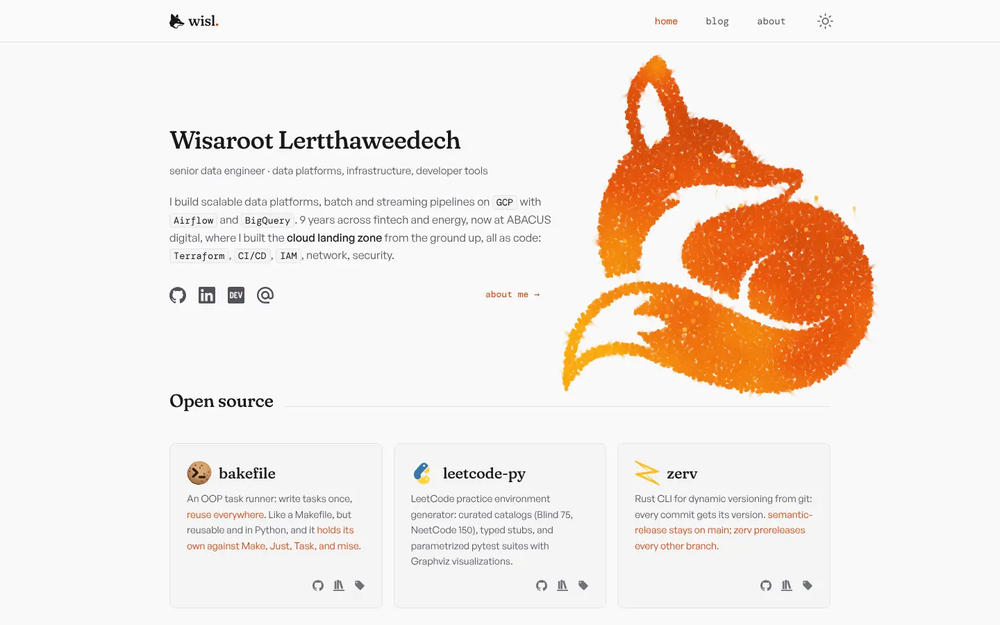
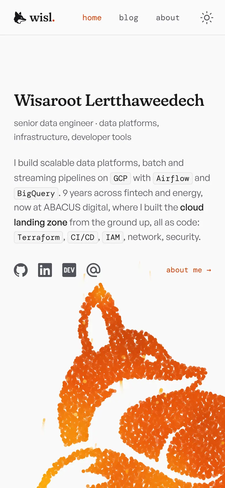

| First screen | Proof of skill | Projects | Experience | Visual craft | Motion | Nav/IA | Mobile | Performance | Accessibility | Copy | Recruiter | Engineer | Business | Memorability |
|---|---|---|---|---|---|---|---|---|---|---|---|---|---|---|
| 5 | 5 | 4 | 3 | 5 | 4 | 5 | 4 | 4 | 3 | 4 | 3 | 5 | 3 | 4 |

**Memorable:** An orange particle fox, matching the logo mark, beside a serif name and a one-paragraph bio with tech names set as code chips. (serves the content).

**What works**

- One-paragraph hero packs seniority, stack, years, sectors, current employer and one concrete achievement, with tool names styled as code chips. [wisl:desktop-fold.webp]
- Open-source cards link each project to its repo, its docs site and the blog posts about it, so code and write-up are one click apart. [wisl:tiles/d-00.png]
- Project docs page shows live CI, coverage and package-version badges: verifiable proof instead of claimed numbers. [wisl:inner-desktop-fold.png]
- Three-item lowercase nav that is identical on mobile, with no hamburger needed. [wisl:mobile-fold.webp]
- Very light page: about 12 KB of JS and 296 KB in total (measured), with reduced-motion handling in the CSS. [wisl:record.home.desktop.network_initial]

**What doesn't**

- No résumé or dated role history on the homepage; experience is a single sentence. [wisl:record.summary.has_resume_link]
- Card links are bare GitHub/docs/tag icons with no visible labels, so their meaning is a guess. [wisl:desktop-fold.webp]
- Orange inline links fail contrast and rely on colour alone to stand out from body text. [wisl:record.home.desktop.axe.violations]
- Fox canvas is cut off at the right edge on mobile; the fade-in pitch paragraph is the LCP element (5.0 s desktop, 4.4 s mobile in the reload). [wisl:mobile-fold.webp]
- Blog thumbnails are generic illustrative room scenes unrelated to the post topics. [wisl:tiles/d-00.png]

**Measured** (one unthrottled load, 2026-10-21): desktop 17 requests, 289 KB total, 11 KB JS, LCP 2168 ms, CLS 0.0459; mobile LCP 1240 ms; axe (desktop) critical 0, serious 2. Record: [sites/wisl/record.json](sites/wisl/record.json).
- Re-measured by the verifier: lcp_ms_desktop = 2168 → lcp_ms_desktop = 5020 in the verifier reload (2168 originally); treat as 2–5 s, delayed by the fade-in paragraph. (5,020 vs 2,168 ms: +2,852 ms, +132%, outside ±50%/±500 ms.)

| Time to key info | 390×844 | 1440×900 |
|---|---|---|
| current role | 0 scrolls, 0 clicks | 0 scrolls, 0 clicks |
| resume | not on site | not on site |
| contact | 0 scrolls, 1 clicks | 0 scrolls, 1 clicks |
| best project | 1 scrolls, 0 clicks | 0 scrolls, 0 clicks |
| shipped work | 1 scrolls, 1 clicks | 0 scrolls, 1 clicks |

Verification: 45 claims confirmed, 3 corrected, 0 removed, by V3.3.

## New-grad and intern portfolios

### damian

**Damian Reiter** · <https://damian.bio/> · group: newgrad (uw-se-2023-landed-role)

Found via: https://se-webring.xyz/ (member list loaded 2026-10-21T03:52:18Z), then a one-page-per-site keyword scan of member homepages for data/infra employers (d2work/scan_out.jsonl, 2026-10-21T04:01-04:05Z)

Role, from the site: “I am a UWaterloo Software Engineering Graduate (class of 2023). I'm currently working at Citadel as a full-time Software Engineer” (https://damian.bio/)

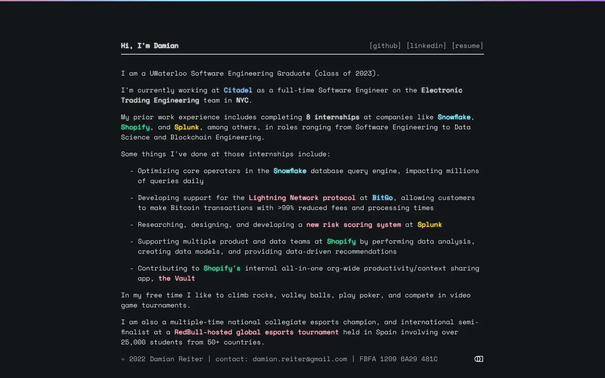
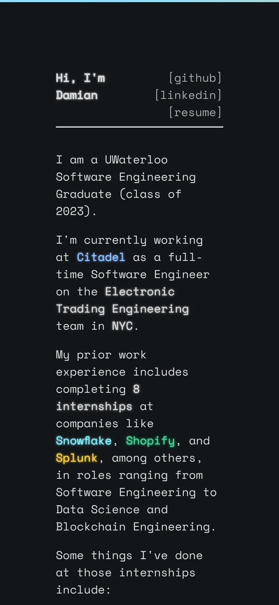

| First screen | Proof of skill | Projects | Experience | Visual craft | Motion | Nav/IA | Mobile | Performance | Accessibility | Copy | Recruiter | Engineer | Business | Memorability |
|---|---|---|---|---|---|---|---|---|---|---|---|---|---|---|
| 5 | 3 | 1 | 4 | 3 | 3 | 4 | 3 | 4 | 2 | 4 | 5 | 2 | 4 | 4 |

**Memorable:** Employer names (Citadel, Snowflake, Shopify, Splunk) glow in different colours inside a dark monospace bio. (serves the content).

**What works**

- Graduation class, current full-time title, employer, team and city in the first two sentences. [damian:desktop-fold.webp]
- Résumé is a plain text link in the top row next to GitHub and LinkedIn, reachable in one tap on a phone. [damian:mobile-fold.webp]
- States '8 internships', then five bullets of internship work (two at Shopify); only two pair the work with an outcome: millions of queries daily, >99% reduced fees. [damian:desktop-fold.webp]
- The whole site is one desktop screen: no nav, nothing to hunt for. [damian:record.home.desktop.dom.scroll_height]

**What doesn't**

- No projects or code on the site; skill is described, not shown. [damian:record.home.desktop.dom.features.project_section_heading]
- No headings and no main landmark; colour-only links and an unlabelled image link fail axe (1 critical, 2 serious). [damian:record.home.desktop.axe.violations]
- On a phone the monospace column uses about 60% of the width, stretching a short bio to nearly three screens. [damian:mobile-fold.webp]
- Staleness signals: footer year 2022 and a résumé file named 2023 on a page describing a current job. [damian:tiles/m-01.png]
- Email is plain text in the footer rather than a link. [damian:record.home.desktop.dom.features.contact_links]

**Measured** (one unthrottled load, 2026-10-21): desktop 8 requests, 249 KB total, 225 KB JS, LCP 1344 ms, CLS 0.0437; mobile LCP 1156 ms; axe (desktop) critical 1, serious 2. Record: [sites/damian/record.json](sites/damian/record.json).

| Time to key info | 390×844 | 1440×900 |
|---|---|---|
| current role | 0 scrolls, 0 clicks | 0 scrolls, 0 clicks |
| resume | 0 scrolls, 1 clicks | 0 scrolls, 1 clicks |
| contact | 0 scrolls, 1 clicks | 0 scrolls, 0 clicks |
| best project | not on site | not on site |
| shipped work | 1 scrolls, 0 clicks | 0 scrolls, 0 clicks |

Verification: 45 claims confirmed, 3 corrected, 0 removed, by V5.1.

### darshshah

**Darsh Shah** · <https://darshshah.ca/> · group: newgrad (uw-se-student-data-stack)

Found via: https://se-webring.xyz/ (member list loaded 2026-10-21T03:52:18Z), then a one-page-per-site keyword scan of member homepages for data/infra employers (d2work/scan_out.jsonl, 2026-10-21T04:01-04:05Z)

Role, from the site: “Software Engineering Student at the University of Waterloo. ... Software Engineer Intern Wealthsimple Sep 2025 - Present” (https://darshshah.ca/)

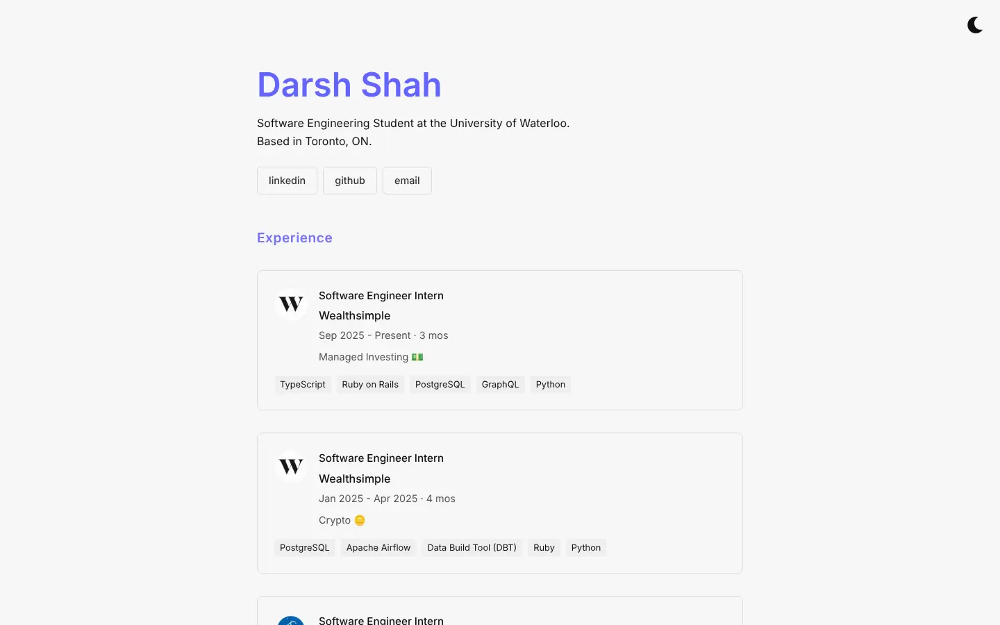
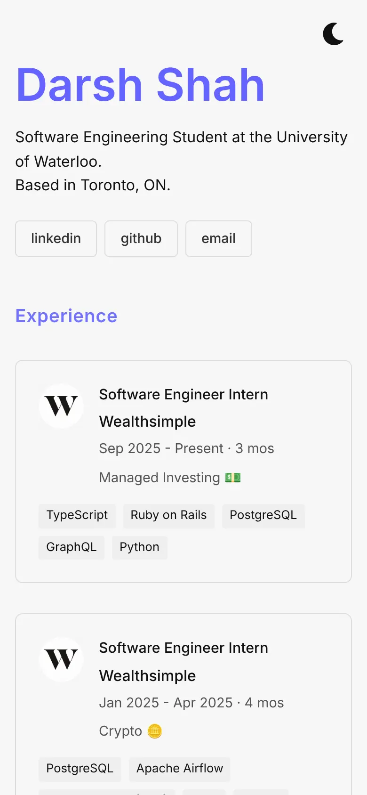

| First screen | Proof of skill | Projects | Experience | Visual craft | Motion | Nav/IA | Mobile | Performance | Accessibility | Copy | Recruiter | Engineer | Business | Memorability |
|---|---|---|---|---|---|---|---|---|---|---|---|---|---|---|
| 4 | 3 | 2 | 4 | 3 | 3 | 4 | 4 | 5 | 2 | 3 | 3 | 3 | 2 | 3 |

**Memorable:** The footer line 'Accurate as of December 15, 2025' dating the whole page. (serves the content).

**What works**

- Experience as compact cards: title, employer, date range with duration, team, then the stack as chips. [darshshah:desktop-fold.webp]
- Tech chips use full tool names a recruiter can keyword-match (PostgreSQL, Apache Airflow, Data Build Tool). [darshshah:desktop-fold.webp]
- A dated footer line tells readers how current the page is. [darshshah:tiles/d-00.png]
- Lean build: one 63 KB script, six requests, 232 KB total (measured); LCP 1.6 s desktop, 0.5 s mobile on reload, not sub-1.1 s. [darshshah:record.summary.requests_desktop]
- Mobile layout reflows properly: full-width cards, one-column projects, large contact buttons. [darshshah:mobile-fold.webp]

**What doesn't**

- No outcome or one-line description for any internship or project; cards are labels and chips only. [darshshah:tiles/d-00.png]
- No graduation year, no availability and no résumé for a student who is job-hunting age. [darshshah:record.summary.has_resume_link]
- Stale 'Present' role with a frozen '3 mos' duration, ten months after the footer date. [darshshah:mobile-fold.webp]
- Theme toggle is an unnamed icon button with no visible focus (axe critical). [darshshah:record.home.desktop.axe.violations]

**Measured** (one unthrottled load, 2026-10-21): desktop 6 requests, 226 KB total, 62 KB JS, LCP 1072 ms, CLS 0.0016; mobile LCP 728 ms; axe (desktop) critical 1, serious 1. Record: [sites/darshshah/record.json](sites/darshshah/record.json).
- Re-measured by the verifier: lcp_ms_desktop = 1072 → lcp_ms_desktop = 1628 on reload (mobile 548); outside the ±50% / ±500 ms tolerance of 1072, still under 2.5 s. (My reload LCP element p at 1628 ms desktop; 1072 + 500 = 1572 and 1072 × 1.5 = 1608 are both exceeded.)

| Time to key info | 390×844 | 1440×900 |
|---|---|---|
| current role | 0 scrolls, 0 clicks | 0 scrolls, 0 clicks |
| resume | not on site | not on site |
| contact | 0 scrolls, 1 clicks | 0 scrolls, 1 clicks |
| best project | 1 scrolls, 1 clicks | 1 scrolls, 1 clicks |
| shipped work | 1 scrolls, 1 clicks | 1 scrolls, 1 clicks |

Verification: 44 claims confirmed, 3 corrected, 0 removed, by V5.2.

### florea

**Laura Florea** · <https://www.florea.ca/> · group: newgrad (uw-se-intern-to-fulltime-google-sites)

Found via: https://se-webring.xyz/ (member list loaded 2026-10-21T03:52:18Z), then a one-page-per-site keyword scan of member homepages for data/infra employers (d2work/scan_out.jsonl, 2026-10-21T04:01-04:05Z)

Role, from the site: “I'm a Software Engineer at Datadog who loves designing, building, and automating systems.” (https://www.florea.ca/)

| First screen | Proof of skill | Projects | Experience | Visual craft | Motion | Nav/IA | Mobile | Performance | Accessibility | Copy | Recruiter | Engineer | Business | Memorability |
|---|---|---|---|---|---|---|---|---|---|---|---|---|---|---|
| 3 | 3 | 3 | 4 | 2 | 3 | 4 | 3 | 3 | 2 | 4 | 4 | 3 | 4 | 3 |

**Memorable:** The Capital One line: a real-time fraud-notification pipeline that 'recovers 100% of $165000 in annual losses from fraud'. (serves the content).

**What works**

- Email, LinkedIn and GitHub written out as visible text under a plain 'Contact Information' heading next to the intro. [florea:desktop-fold.webp]
- Four of five role paragraphs state a concrete outcome (95%, 100x, $165000, days to 5 minutes); the current Datadog role gives scope (100+ PB) but no outcome. [florea:tiles/d-exp.png]
- An internship entry links to the employer's own engineering blog post about the system built, which lets a reader check the claim. [florea:tiles/d-exp.png]
- Intern and full-time entries at the same company are listed one after another, so the conversion reads at a glance. [florea:tiles/d-exp.png]
- Short page: about 2.6 screens on desktop (2382 px) and 4.6 on mobile (3918 px). [florea:record.home.mobile.dom.scroll_height]

**What doesn't**

- No dates on any role, so tenure, order and graduation have to be guessed or read from the résumé. [florea:tiles/d-exp.png]
- Mobile first screen is a banner and a large photo; the role sentence starts at the bottom edge, with a floating info button over the lines just below it. [florea:mobile-fold.webp]
- Builder overhead: 714 KB JS and 2.1 MB to show one page of text (measured). [florea:record.summary.total_bytes_desktop]
- Two images lack alt text (axe image-alt critical); the résumé, write-up and project links are labelled "here", though employer and contact links have real text. [florea:record.home.desktop.axe.violations]

**Measured** (one unthrottled load, 2026-10-21): desktop 31 requests, 2,048 KB total, 697 KB JS, LCP 1576 ms, CLS 0.0019; mobile LCP 1152 ms; axe (desktop) critical 1, serious 1. Record: [sites/florea/record.json](sites/florea/record.json).
- Re-measured by the verifier: lcp_ms_desktop = 1576 → lcp_ms_desktop = 4636 on reload (mobile 1996); outside the band around 1576. (LCP element div.IFuOkc (banner) at 4636 ms; 1576 + 500 = 2076 and 1576 × 1.5 = 2364 are exceeded.)
- Re-measured by the verifier: has_resume_link = false → has_resume_link = false in the record is a detector miss: the intro's "here" link opens a résumé on Google Drive. (Record field reproduces false, but the page text says "check out my resume here!" linking drive.google.com; résumé exists.)

| Time to key info | 390×844 | 1440×900 |
|---|---|---|
| current role | 0 scrolls, 0 clicks | 0 scrolls, 0 clicks |
| resume | 1 scrolls, 1 clicks | 0 scrolls, 1 clicks |
| contact | 1 scrolls, 1 clicks | 0 scrolls, 1 clicks |
| best project | 2 scrolls, 1 clicks | 1 scrolls, 1 clicks |
| shipped work | corrected, see below | 1 scrolls, 1 clicks |

- Verifier correction, mobile shipped work: mobile shipped_work: {"scrolls": 2, "clicks": 1, "note": "Tailscale heading at y 1643, its 'here' blog link about y 1825 (estimated from tile), past the 1688 px two-screen mark"} (Mobile tile m-01 (1 px = 1.25 CSS px from y 1500) puts "Read about it here." near y 1825; one scroll shows only to 1688.)

Verification: 41 claims confirmed, 7 corrected, 0 removed, by V5.2.

### kushalgoel

**Kushal Goel** · <https://www.kushalgoel.com/> · group: newgrad (uw-cs-student-data-pipeline-intern)

Found via: https://cs.uwatering.com/ (Waterloo CS webring member list loaded 2026-10-21T03:52:22Z), then a one-page-per-site keyword scan of member homepages for data/infra employers (d2work/scan_out.jsonl, 2026-10-21T04:01-04:05Z)

Role, from the site: “I'm a senior at the University of Waterloo studying Computer Science. ... I recently completed a Software Engineering Internship at Citadel” (https://www.kushalgoel.com/)

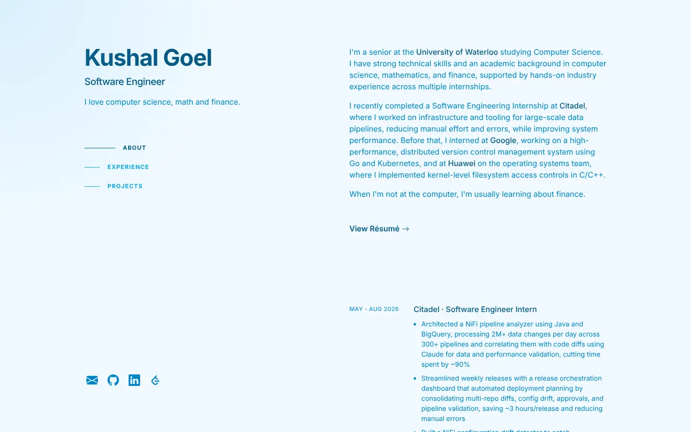

| First screen | Proof of skill | Projects | Experience | Visual craft | Motion | Nav/IA | Mobile | Performance | Accessibility | Copy | Recruiter | Engineer | Business | Memorability |
|---|---|---|---|---|---|---|---|---|---|---|---|---|---|---|
| 4 | 3 | 3 | 5 | 3 | 3 | 4 | 4 | 4 | 3 | 4 | 4 | 3 | 3 | 3 |

**Memorable:** The Citadel bullet: a NiFi + BigQuery analyzer over 2M+ data changes a day across 300+ pipelines. (serves the content).

**What works**

- Most internship bullets carry a number (2M+, ~90%, 95%, 6-7x) and a named tool; each role ends in a row of keyword chips. [kushalgoel:tiles/m-01.png]
- Résumé link and contact icons sit in the first screen on both sizes. [kushalgoel:mobile-fold.webp]
- About paragraph names school, level ("senior") and three of four employers (Citadel, Google, Huawei), each with a one-clause summary of the work. [kushalgoel:desktop-fold.webp]
- Follows the OS dark setting with a matching dark palette. [kushalgoel:desktop-fold-dark.png]
- Footer shows a 'Last updated' date. [kushalgoel:tiles/d-02.png]

**What doesn't**

- Projects are text-only and look the same as jobs; only two, with links hidden in the titles. [kushalgoel:tiles/d-01.png]
- No graduation date or availability on either first screen; "Software Engineer" under the name and "senior" in About are the only role and level signals. [kushalgoel:mobile-fold.webp]
- Contact and profile links are icon-only with no accessible names (axe link-name, 6 nodes). [kushalgoel:record.home.desktop.axe.violations]
- Layout is a near-exact copy of Brittany Chiang's portfolio, credited "Inspired by" in the footer; dark mode reuses its navy look, light mode is recoloured blue. [kushalgoel:tiles/d-02.png]

**Measured** (one unthrottled load, 2026-10-21): desktop 19 requests, 274 KB total, 130 KB JS, LCP 612 ms, CLS 0; mobile LCP 572 ms; axe (desktop) critical 0, serious 2. Record: [sites/kushalgoel/record.json](sites/kushalgoel/record.json).
- Re-measured by the verifier: lcp_ms_desktop = 612 → lcp_ms_desktop = 1528 on reload (mobile 944); outside the band around 612. (LCP element p.mb-4 at 1528 ms; 612 + 500 = 1112 is exceeded.)

| Time to key info | 390×844 | 1440×900 |
|---|---|---|
| current role | 0 scrolls, 0 clicks | 0 scrolls, 0 clicks |
| resume | 0 scrolls, 1 clicks | 0 scrolls, 1 clicks |
| contact | 0 scrolls, 1 clicks | 0 scrolls, 1 clicks |
| best project | 4 scrolls, 0 clicks | 0 scrolls, 1 clicks |
| shipped work | corrected, see below | corrected, see below |

- Verifier correction, mobile shipped work: mobile shipped_work: {"scrolls": 4, "clicks": 1, "note": "Investo title links to investo-app.vercel.app at y 4105 (not loaded, so liveness unverified); first project links to code on gitfront.io"} (Link targets from verifier probe; neither target page was loaded, so "live app" rests on the URL alone.)

- Verifier correction, desktop shipped work: desktop shipped_work: {"scrolls": 0, "clicks": 2, "note": "Side-nav PROJECTS, then Investo title (investo-app.vercel.app, not loaded) at y 3226"} (Click path holds; the Vercel target was not loaded by any verifier, so "live app" is unverified.)

Verification: 39 claims confirmed, 7 corrected, 0 removed, by V5.2.

### richardshuai

**Richard Shuai** · <https://www.richardshuai.app/> · group: newgrad (uw-cs-student-data-infra-interns)

Found via: https://cs.uwatering.com/ (Waterloo CS webring member list loaded 2026-10-21T03:52:22Z), then a one-page-per-site keyword scan of member homepages for data/infra employers (d2work/scan_out.jsonl, 2026-10-21T04:01-04:05Z)

Role, from the site: “4th-Year CS Student @ UWaterloo S26 SWE @ Databricks Spark Streaming F26 SWE @ Google GCloud AI ... Seeking 2027 New Grad Roles” (https://www.richardshuai.app/)

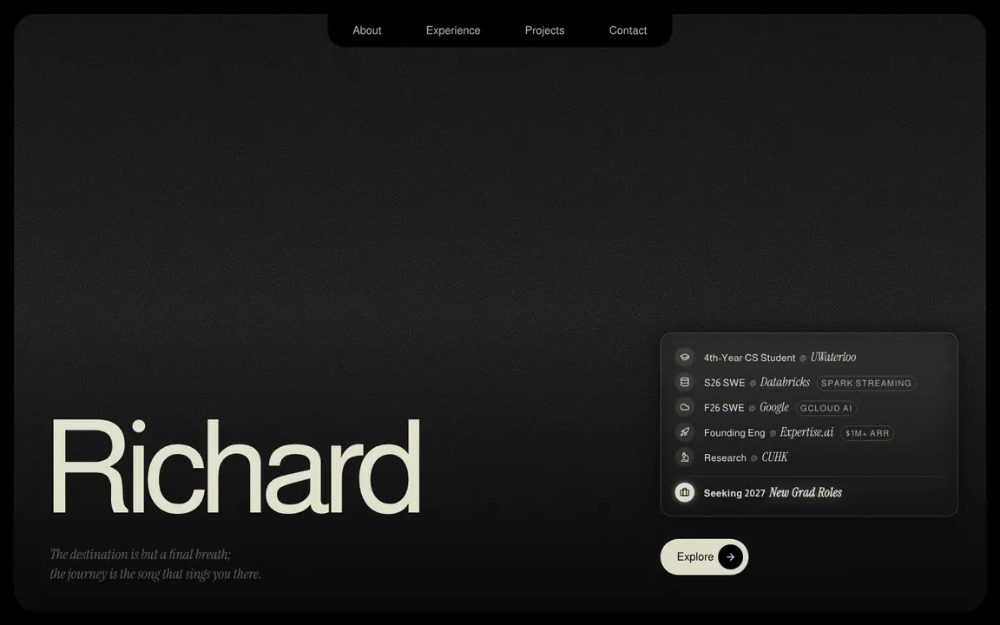
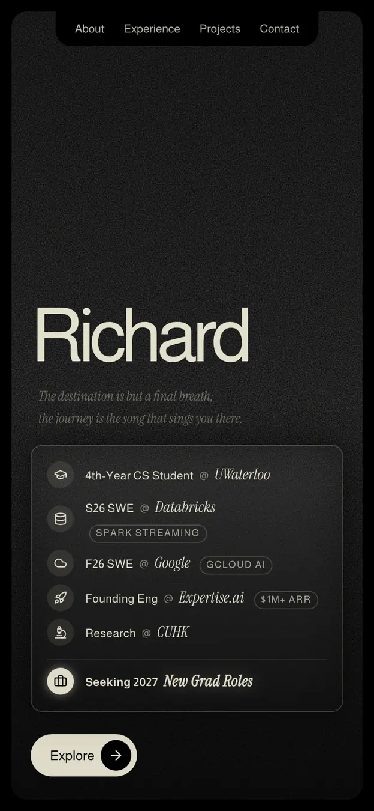

| First screen | Proof of skill | Projects | Experience | Visual craft | Motion | Nav/IA | Mobile | Performance | Accessibility | Copy | Recruiter | Engineer | Business | Memorability |
|---|---|---|---|---|---|---|---|---|---|---|---|---|---|---|
| 4 | 3 | 4 | 4 | 4 | 2 | 4 | 4 | 3 | 4 | 3 | 4 | 3 | 4 | 5 |

**Memorable:** The hero chip card: one row per role with a season code (S26, F26), the employer in italic serif and a topic chip, ending in 'Seeking 2027 New Grad Roles'. (serves the content).

**What works**

- Hero states level, current and recent internships with term codes, and an explicit new-grad target year in one compact card. [richardshuai:mobile-fold.webp]
- Each internship has one impact line, often concrete or checkable, plus topic chips (Streaming, Big Data, Data Engineering). [richardshuai:tiles/d-03.png]
- Project cards pair a screenshot, a one-liner, a stack line and a hackathon-winner badge; each card links out, mostly to GitHub (Vanguard to Devpost). [richardshuai:tiles/m-07.png]
- Awards end in a three-number "By the numbers" panel ($200K+, 15+, 30+), shown after two full award lists, not instead of them. [richardshuai:tiles/d-05.png]
- Distinctive type pairing: big grotesque name, italic serif for employer names. [richardshuai:desktop-fold.webp]

**What doesn't**

- No résumé anywhere, and the only contact is a LinkedIn button at the bottom of a 14-to-19-screen page. [richardshuai:record.home.desktop.dom.features.contact_links]
- A 250dvh hero and scroll-reveal sections delay content; in the desktop full shot the projects and contact are blank. [richardshuai:tiles/d-06.png]
- Ornamental copy around the facts: poetic hero quote, 'builder and innovator', an aphorism under About. [richardshuai:tiles/d-01.png]
- Card body text is small and dim grey on black; nav links are 16 px tall on mobile. [richardshuai:record.home.mobile.dom.a11y_manual.small_target_examples]

**Measured** (one unthrottled load, 2026-10-21): desktop 21 requests, 373 KB total, 164 KB JS, LCP 1752 ms, CLS 0.0049; mobile LCP 2948 ms; axe (desktop) critical 0, serious 1. Record: [sites/richardshuai/record.json](sites/richardshuai/record.json).
- Re-measured by the verifier: lcp_ms_desktop = 1752 → lcp_ms_desktop = 4920 on reload (mobile 3736); outside the band around 1752. (Reload LCP element span.inline-block at 4920 ms; 1752 + 500 = 2252 and 1752 × 1.5 = 2628 are both exceeded.)

| Time to key info | 390×844 | 1440×900 |
|---|---|---|
| current role | 0 scrolls, 0 clicks | 0 scrolls, 0 clicks |
| resume | not on site | not on site |
| contact | 19 scrolls, 1 clicks | 14 scrolls, 1 clicks |
| best project | 12 scrolls, 0 clicks | 12 scrolls, 0 clicks |
| shipped work | 12 scrolls, 1 clicks | 12 scrolls, 1 clicks |

Verification: 47 claims confirmed, 3 corrected, 0 removed, by V5.2.

### shao

**George Shao** · <https://shao.zip/> · group: newgrad (uw-cs-2026-landed-role)

Found via: https://cs.uwatering.com/ (Waterloo CS webring member list loaded 2026-10-21T03:52:22Z), then a one-page-per-site keyword scan of member homepages for data/infra employers (d2work/scan_out.jsonl, 2026-10-21T04:01-04:05Z)

Role, from the site: “Graduated from University of Waterloo Computer Science in 2026. ... Currently at Tesla ... Previously xAI / X High-performance distributed storage systems powering Grok.” (https://shao.zip/)

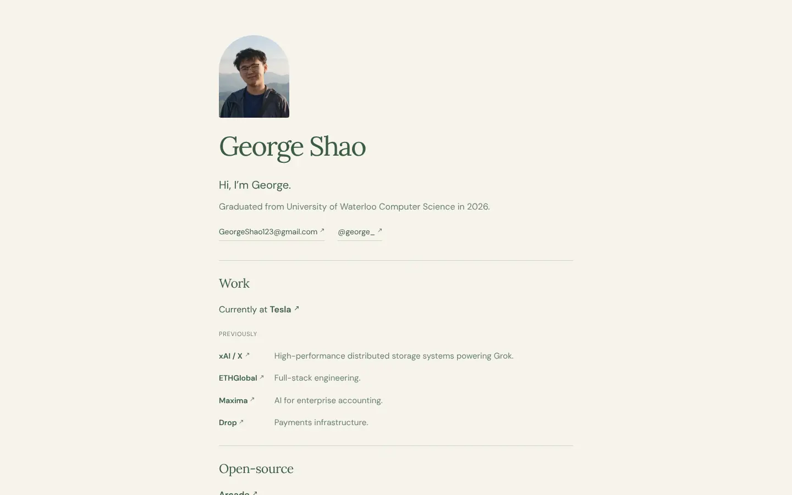
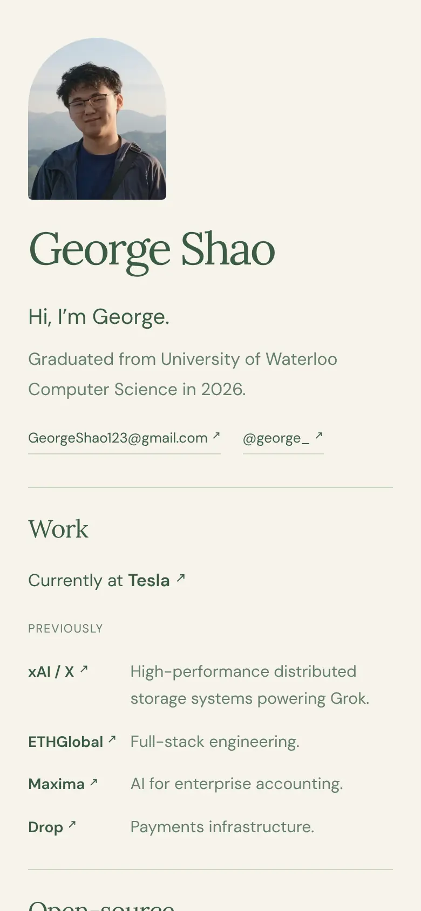

| First screen | Proof of skill | Projects | Experience | Visual craft | Motion | Nav/IA | Mobile | Performance | Accessibility | Copy | Recruiter | Engineer | Business | Memorability |
|---|---|---|---|---|---|---|---|---|---|---|---|---|---|---|
| 4 | 4 | 3 | 3 | 4 | 3 | 3 | 4 | 3 | 4 | 4 | 4 | 4 | 4 | 4 |

**Memorable:** An internship turned into a dated, sectioned engineering write-up with a dashboard chart and before/after numbers (240 h to 72 h). (serves the content).

**What works**

- Graduation year and school sit in one plain sentence directly under the name, so level is clear in the first second. [shao:mobile-fold.webp]
- Current employer on its own line, then a 'previously' list with one short phrase per employer: a whole career in five rows. [shao:desktop-fold.webp]
- An internship is backed by a long-form write-up: context for non-experts, the problem, each technical decision, a metrics chart and an Impact section with numbers. [shao:tiles/id-03.png]
- Open-source entries carry a small-caps category label and one impact line each; only Arcade's has a number (1500% FPS); Immich says 'Minor contributions.' [shao:tiles/d-00.png]
- Email is a visible, full mailto address at 0 scrolls on a phone. [shao:record.home.mobile.dom.features.contact_links]

**What doesn't**

- The two on-site write-ups are linked only by a company/project name with the same external arrow as other links; nothing says 'write-up' or 'case study'. [shao:desktop-fold.webp]
- No résumé, no job titles and no dates for any role. [shao:record.summary.has_resume_link]
- Secondary grey-green text fails contrast (axe serious, 18 nodes). [shao:record.home.desktop.axe.violations]
- 366 KB of JavaScript in 15 scripts (measured) for a short static page (about 1.6 desktop screens); LCP is the portrait, 1.3 s on reload (2.2 s at capture). [shao:record.summary.js_bytes_desktop]

**Measured** (one unthrottled load, 2026-10-21): desktop 22 requests, 441 KB total, 357 KB JS, LCP 2228 ms, CLS 0.0001; mobile LCP 1732 ms; axe (desktop) critical 0, serious 1. Record: [sites/shao/record.json](sites/shao/record.json).

| Time to key info | 390×844 | 1440×900 |
|---|---|---|
| current role | 0 scrolls, 0 clicks | 0 scrolls, 0 clicks |
| resume | not on site | not on site |
| contact | 0 scrolls, 0 clicks | 0 scrolls, 0 clicks |
| best project | 0 scrolls, 1 clicks | 0 scrolls, 1 clicks |
| shipped work | 1 scrolls, 1 clicks | 1 scrolls, 1 clicks |

Verification: 44 claims confirmed, 4 corrected, 0 removed, by V5.1.

## Software and design engineers

### antfu

**Anthony Fu** · <https://antfu.me/> · group: software-design (minimal)

Found via: seed

Role, from the site: “Hey! I'm Anthony Fu, a fanatical open sourceror and design engineer. Working at Vercel / Nuxt” (https://antfu.me/)

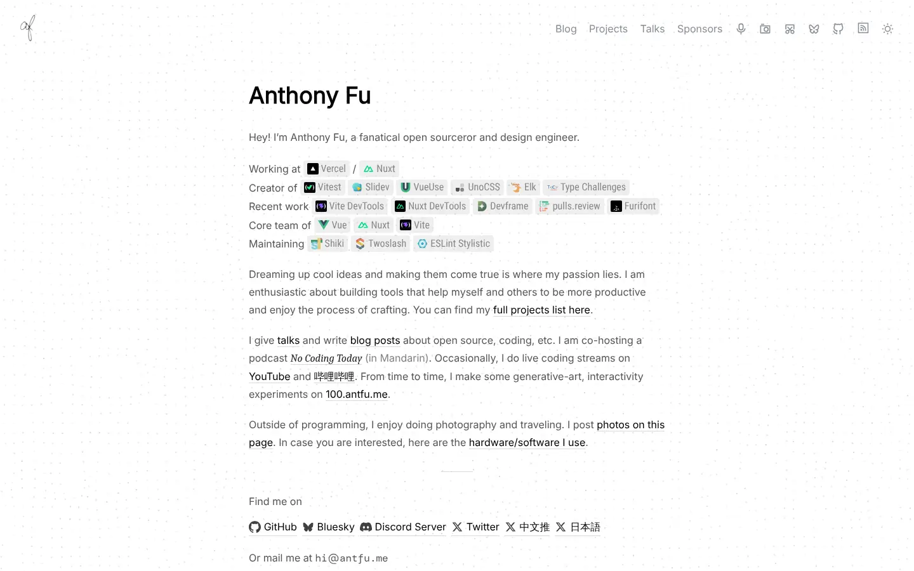
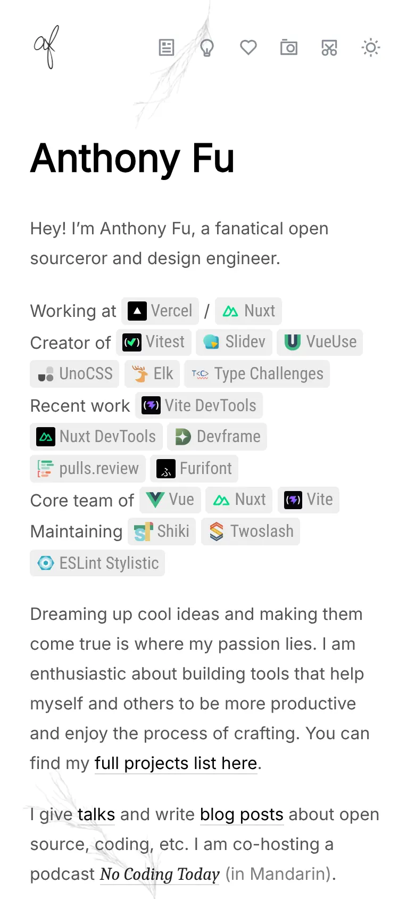

| First screen | Proof of skill | Projects | Experience | Visual craft | Motion | Nav/IA | Mobile | Performance | Accessibility | Copy | Recruiter | Engineer | Business | Memorability |
|---|---|---|---|---|---|---|---|---|---|---|---|---|---|---|
| 4 | 5 | 4 | 2 | 4 | 3 | 3 | 4 | 4 | 3 | 4 | 3 | 5 | 3 | 4 |

**Memorable:** Labelled rows of logo chips: 'Creator of', 'Core team of', 'Maintaining', each followed by the actual projects. (serves the content).

**What works**

- Relationship labels (created, recent work, core team, maintaining) each followed by logo chips: proof on the first screen without paragraphs. [antfu:desktop-fold.webp]
- A long project list scales on its own page: category groups, then icon + name + one plain line per project. [antfu:tiles/id-02.png]
- Social links carry text labels next to their icons, and the email address is written out. [antfu:desktop-fold.webp]
- Theme follows the OS with a toggle, and the dark version keeps the same layout and accents. [antfu:desktop-fold-dark.png]
- Homepage fits almost in one desktop screen (page height 1,259 px at 900 px viewport). [antfu:record.home.desktop.dom.scroll_height]

**What doesn't**

- Mobile nav is six unlabeled icons; desktop adds seven more icons beside four text links. [antfu:mobile-fold.webp]
- Pale grey text fails contrast in 30 places, and nav links show no focus indicator. [antfu:record.home.desktop.axe.violations]
- No résumé, role history or dates anywhere on the pages seen. [antfu:record.summary.has_resume_link]
- /projects category names are decorative outlined text, not headings; the page has one heading. [antfu:record.inner.desktop.dom.headings]

**Measured** (one unthrottled load, 2026-10-21): desktop 42 requests, 904 KB total, 271 KB JS, LCP 2300 ms, CLS 0.0998; mobile LCP 3668 ms; axe (desktop) critical 0, serious 1. Record: [sites/antfu/record.json](sites/antfu/record.json).
- Re-measured by the verifier: js_bytes_desktop = 277512 → js_bytes_desktop varies between loads: 131,667 B (9 scripts) in the verifier reload vs 277,512 B (18 scripts) originally; report as about 130–280 KB. (Reload 131,667 is -53%, outside ±30%. Script count halved, so lazily loaded chunks differ between loads.)

| Time to key info | 390×844 | 1440×900 |
|---|---|---|
| current role | 0 scrolls, 0 clicks | 0 scrolls, 0 clicks |
| resume | n/a | n/a |
| contact | 1 scrolls, 0 clicks | 0 scrolls, 0 clicks |
| best project | 0 scrolls, 1 clicks | 0 scrolls, 1 clicks |
| shipped work | 0 scrolls, 1 clicks | 0 scrolls, 1 clicks |

Verification: 49 claims confirmed, 2 corrected, 0 removed, by V3.3.

### brittanychiang

**Brittany Chiang** · <https://brittanychiang.com/> · group: software-design (design-forward)

Found via: seed

Role, from the site: “Currently, I'm a Senior Frontend Engineer at Klaviyo, where I work on our design system and help build new products” (https://brittanychiang.com/)

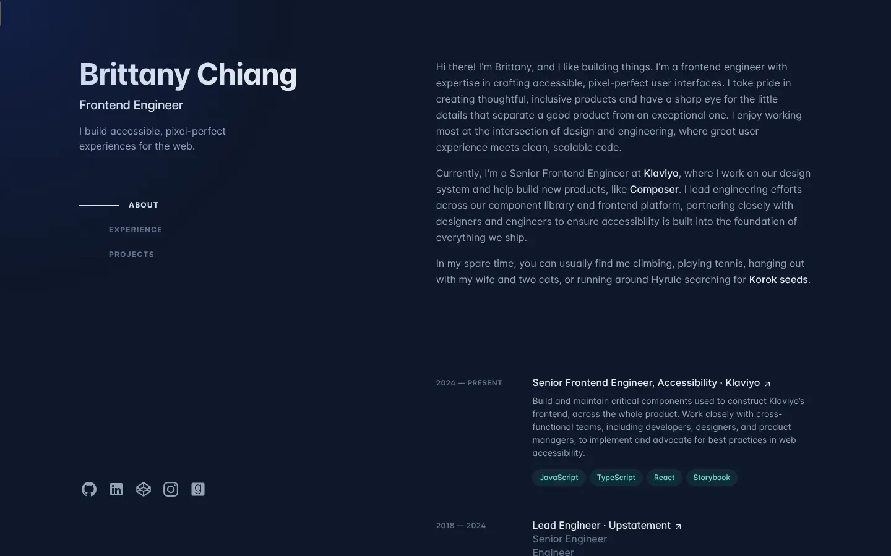
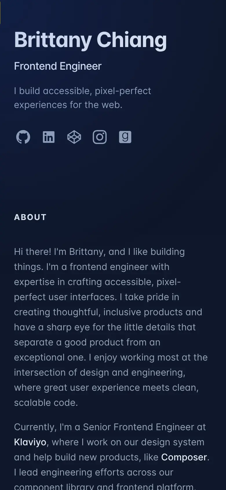

| First screen | Proof of skill | Projects | Experience | Visual craft | Motion | Nav/IA | Mobile | Performance | Accessibility | Copy | Recruiter | Engineer | Business | Memorability |
|---|---|---|---|---|---|---|---|---|---|---|---|---|---|---|
| 4 | 4 | 4 | 4 | 4 | 4 | 4 | 4 | 3 | 4 | 4 | 4 | 4 | 4 | 4 |

**Memorable:** The sticky left column (name, title, three-item nav) beside a scrolling dated timeline in navy and teal. (serves the content).

**What works**

- Sticky left column keeps name, title and a three-item anchor nav in view while the dated experience list scrolls beside it. [brittanychiang:desktop-fold.webp]
- Each job is one compact block: date range, 'Role · Company' link, a short 2–7 line summary, tech chips; co-op internships share the same timeline as senior roles. [brittanychiang:tiles/m-01.png]
- Project rows show proof as small facts beside the link (star count, install count) instead of adjectives. [brittanychiang:tiles/d-01.png]
- A separate archive page turns the long tail of work into a scannable table: year, project, where it was made, stack chips, link. [brittanychiang:inner-desktop-fold.png]
- Solid basics: skip link, visible focus outlines, alt text on every image, zero layout shift. [brittanychiang:record.home.mobile.dom.a11y_manual]

**What doesn't**

- Mobile removes the section nav with no replacement, so résumé and projects are about three scrolls away with no shortcut. [brittanychiang:record.home.mobile.dom.nav]
- Résumé link sits only at the end of the experience list, not in the header or nav. [brittanychiang:record.home.desktop.dom.features.resume_links]
- No email or contact form; contact is a row of five icon-only social links (GitHub, LinkedIn, CodePen, Instagram, Goodreads) with no visible text labels. [brittanychiang:record.home.desktop.dom.features.contact_links]
- Page weight is high for a text site: 1.19 MB of fonts in 9 files and 1.46 MB of images, LCP 2.8 s (measured). [brittanychiang:record.home.desktop.network_initial.by_type]
- Role descriptions list duties rather than outcomes; almost no numbers in the experience blocks. [brittanychiang:tiles/d-00.png]

**Measured** (one unthrottled load, 2026-10-21): desktop 40 requests, 2,924 KB total, 313 KB JS, LCP 2800 ms, CLS 0; mobile LCP 3336 ms; axe (desktop) critical 0, serious 1. Record: [sites/brittanychiang/record.json](sites/brittanychiang/record.json).

| Time to key info | 390×844 | 1440×900 |
|---|---|---|
| current role | 0 scrolls, 0 clicks | 0 scrolls, 0 clicks |
| resume | 3 scrolls, 1 clicks | 2 scrolls, 1 clicks |
| contact | 0 scrolls, 1 clicks | 0 scrolls, 1 clicks |
| best project | 3 scrolls, 0 clicks | 0 scrolls, 1 clicks |
| shipped work | corrected, see below | 0 scrolls, 1 clicks |

- Verifier correction, mobile shipped work: mobile shipped_work: {"scrolls": 3, "clicks": 0, "note": "Project rows with star and install counts from y≈3086; job rows start y≈1218 and some link to shipped work"} (My reload puts the first job row at y=1218 on mobile, not y≈850; project section at 3086 (3 scrolls) holds.)

Verification: 47 claims confirmed, 4 corrected, 0 removed, by V3.1.

### danluu

**Dan Luu (name not shown on the captured pages; taken from the domain and social handles in the footer)** · <https://danluu.com/> · group: software-design (minimal-counterexample)

Found via: seed (minimal counterexample)

Role, from the site: “Wave is a $1.7B company with 70 engineers ... our architecture is a standard CRUD app architecture, a Python monolith on top of Postgres.” (https://danluu.com/simple-architectures/)

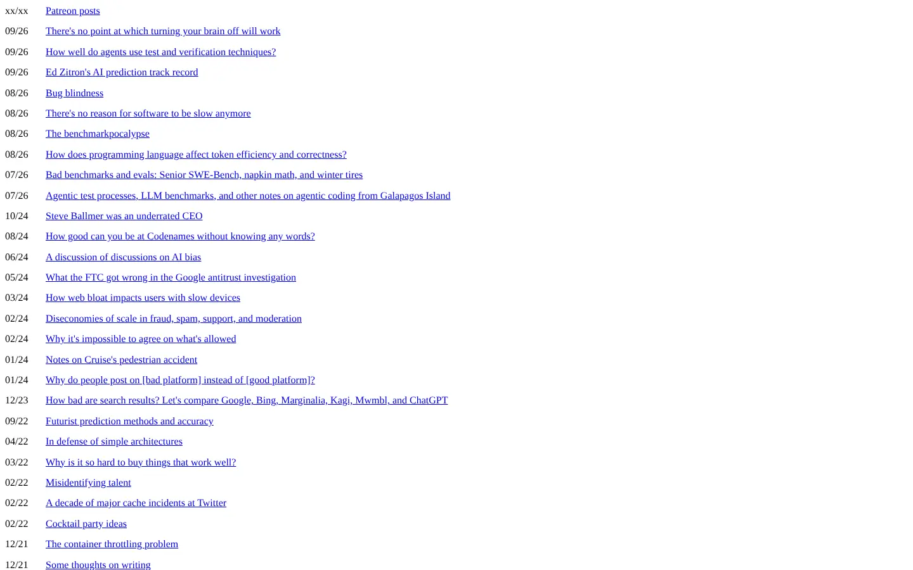
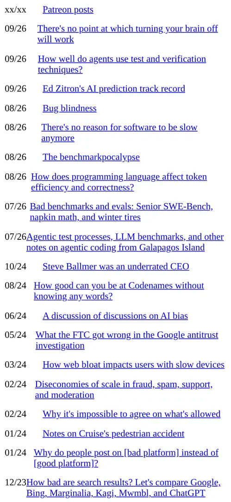

| First screen | Proof of skill | Projects | Experience | Visual craft | Motion | Nav/IA | Mobile | Performance | Accessibility | Copy | Recruiter | Engineer | Business | Memorability |
|---|---|---|---|---|---|---|---|---|---|---|---|---|---|---|
| 1 | 3 | 1 | 1 | 1 | 3 | 2 | 2 | 5 | 3 | 5 | 1 | 4 | 2 | 3 |

**Memorable:** No name or bio anywhere: the homepage is a dated list of about 200 essay titles in default Times and blue links. (does not serve the content).

**What works**

- Weight floor for comparison: about 20 KB and 5 requests per page, LCP about 0.9 s on the homepage (1.4 s on an essay), zero layout shift (measured). [danluu:record.summary.total_bytes_desktop]
- A compact MM/YY date column in front of each title makes recency and volume obvious at a glance. [danluu:desktop-fold.webp]
- The captured essay opens with concrete facts ($1.7B company, 70 engineers, a Python monolith on Postgres) before its argument; only one essay was checked. [danluu:inner-desktop-fold.png]
- Most titles are plain and specific, so the list largely works as its own table of contents; a few are coined or vague ('The benchmarkpocalypse', 'Attrition'). [danluu:mobile-fold.webp]

**What doesn't**

- No name, role, bio or page title: a first-time visitor cannot tell whose site this is. [danluu:record.summary.title]
- No résumé, experience, projects or email; social links are the only contact and sit at the very bottom. [danluu:tiles/d-03.png]
- No max-width on essays, so desktop lines run the full window width (far beyond a readable measure). [danluu:inner-desktop-fold.png]
- Missing document title and html lang plus invalid list markup (3 serious axe violations). [danluu:record.home.desktop.axe.violations]
- On mobile, 29 inline links are under 24 px tall and the title column is ragged. [danluu:record.home.mobile.dom.a11y_manual.small_targets_under_24px]

**Measured** (one unthrottled load, 2026-10-21): desktop 5 requests, 19 KB total, 10 KB JS, LCP 564 ms, CLS 0; mobile LCP 752 ms; axe (desktop) critical 0, serious 3. Record: [sites/danluu/record.json](sites/danluu/record.json).

| Time to key info | 390×844 | 1440×900 |
|---|---|---|
| current role | not on site | not on site |
| resume | not on site | not on site |
| contact | 9 scrolls, 1 clicks | 7 scrolls, 1 clicks |
| best project | not on site | not on site |
| shipped work | not on site | not on site |

Verification: 39 claims confirmed, 3 corrected, 0 removed, by V3.1.

### emilkowal

**Emil Kowalski** · <https://emilkowal.ski/> · group: software-design (design-forward)

Found via: seed

Role, from the site: “Design Engineer ... I work on the Web team at Linear. ... Previously, I worked on the design team at Vercel.” (https://emilkowal.ski/)

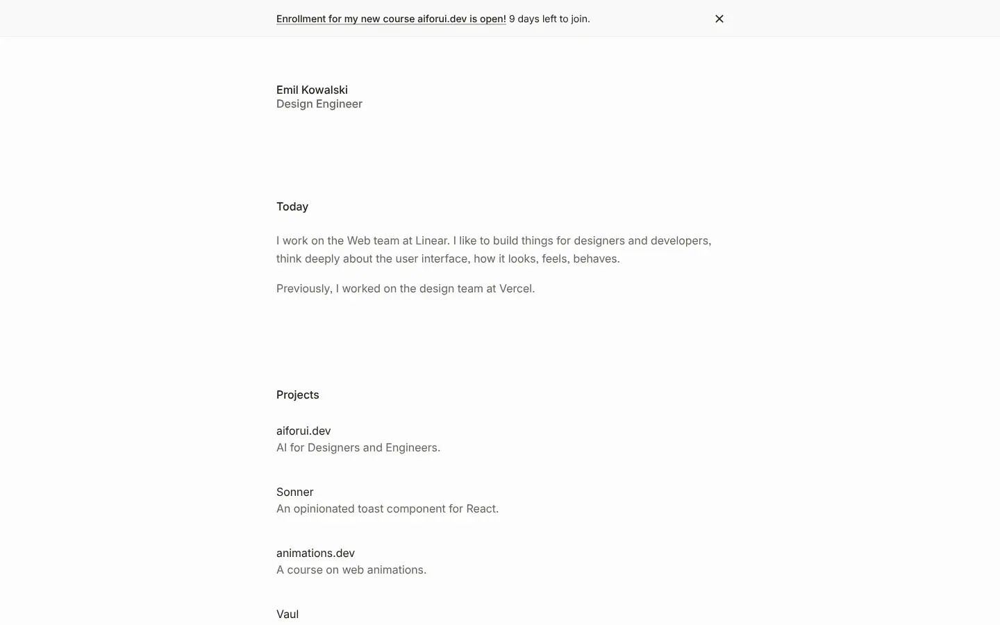
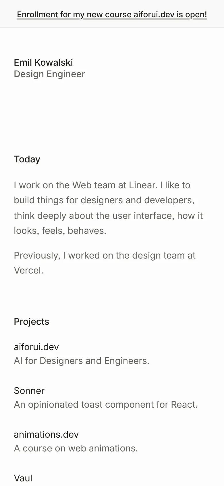

| First screen | Proof of skill | Projects | Experience | Visual craft | Motion | Nav/IA | Mobile | Performance | Accessibility | Copy | Recruiter | Engineer | Business | Memorability |
|---|---|---|---|---|---|---|---|---|---|---|---|---|---|---|
| 4 | 5 | 3 | 2 | 4 | 4 | 4 | 5 | 3 | 4 | 5 | 2 | 4 | 3 | 4 |

**Memorable:** The Sonner page, where the hero's main button renders a real toast and each option row demonstrates itself. (serves the content).

**What works**

- Homepage only lists: each project is a name plus one plain line; the running demo lives on the project's own page. [emilkowal:desktop-fold.webp]
- Project page leads with the working component and a primary 'try it' button, then install, usage and option rows that each show the matching code. [emilkowal:tiles/id-00.png]
- Writing list pairs each title with a one-line claim, so the list is skimmable without dates or tags. [emilkowal:tiles/d-00.png]
- Current employer and team stated in one plain sentence near the top, followed by one 'previously' sentence. [emilkowal:mobile-fold.webp]
- Mobile is the same single column at the same type sizes, with no small targets and no overflow. [emilkowal:record.summary.small_targets_mobile]

**What doesn't**

- A course-enrollment banner is the first element on both pages, ahead of the owner's name. [emilkowal:desktop-fold.webp]
- No résumé, dates or role history beyond two sentences; contact is two social links at the very bottom. [emilkowal:record.home.desktop.dom.features]
- Homepage has no heading elements, so its labelled groups are invisible to heading navigation. [emilkowal:record.home.desktop.dom.headings]
- 887 KB of JS and 1.09 MB of fonts for a page of text, plus a React hydration error in the console (measured). [emilkowal:record.home.desktop.network_initial.by_type]

**Measured** (one unthrottled load, 2026-10-21): desktop 44 requests, 1,975 KB total, 866 KB JS, LCP 1544 ms, CLS 0; mobile LCP 956 ms; axe (desktop) critical 0, serious 0. Record: [sites/emilkowal/record.json](sites/emilkowal/record.json).
- Re-measured by the verifier: lcp_ms_desktop = 1544 → lcp_ms_desktop = 2492 (verifier reload; mobile 2700) (Reload LCP 2,492 ms vs claim 1,544: +948 ms, outside both ±50% (772 ms) and ±500 ms.)

| Time to key info | 390×844 | 1440×900 |
|---|---|---|
| current role | 0 scrolls, 0 clicks | 0 scrolls, 0 clicks |
| resume | n/a | n/a |
| contact | 2 scrolls, 1 clicks | 2 scrolls, 1 clicks |
| best project | 0 scrolls, 1 clicks | 0 scrolls, 1 clicks |
| shipped work | 0 scrolls, 1 clicks | 0 scrolls, 1 clicks |

Verification: 43 claims confirmed, 4 corrected, 0 removed, by V3.1.

### rauno

**Rauno Freiberg** · <https://rauno.me/> · group: software-design (design-forward)

Found via: seed

Role, from the site: “Rauno Freiberg is an Estonian interaction designer working with Vercel and Devouring Details” (https://rauno.me/)

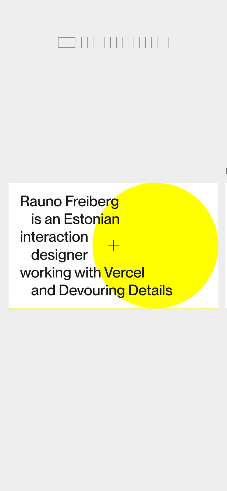

| First screen | Proof of skill | Projects | Experience | Visual craft | Motion | Nav/IA | Mobile | Performance | Accessibility | Copy | Recruiter | Engineer | Business | Memorability |
|---|---|---|---|---|---|---|---|---|---|---|---|---|---|---|
| 3 | 3 | 3 | 2 | 5 | 3 | 2 | 2 | 4 | 2 | 3 | 2 | 3 | 2 | 4 |

**Memorable:** A sideways strip of poster-like cards opening with the identity sentence over a big yellow circle. (serves the content).

**What works**

- Identity in one plain sentence at poster scale: name, discipline, and who they work with, before anything else. [rauno:desktop-fold.webp]
- Dated index of work (month + year on every tile); many tiles carry one action (View Production, View Prototype, Read Essay), but some, e.g. Posters, Vercel Agent, Combobox, have none. [rauno:inner-desktop-fold.png]
- Strong, consistent visual system from very few parts: one typeface, grey/white/yellow, cropped oversized words. [rauno:tiles/m-overview.png]
- Older versions of the site stay reachable as labelled year links instead of being deleted. [rauno:tiles/m-overview.png]
- Homepage is light: 186 KB JS, 660 KB total (measured); LCP about 2.0 s desktop and 2.7 s mobile in the verifier reload. [rauno:record.summary.total_bytes_desktop]

**What doesn't**

- No nav bar: every destination sits in a sideways strip, mostly off-screen at load; contact is on the seventh card, about five wheel-scrolls on desktop. [rauno:tiles/d-overview.png]
- Pinch-zoom is disabled and card links show no focus indicator. [rauno:record.home.desktop.axe.violations]
- /craft autoplays 68 muted videos and pulled 24 MB (desktop) to 44 MB (mobile) of media on first load; 68 of 81 images lack alt (measured). [rauno:record.inner.desktop.network_initial.by_type.media]
- No résumé and no dated role history; the only role information is the hero sentence. Work tiles on /craft are dated. [rauno:record.summary.has_resume_link]
- Mobile layout is 2,994 px wide; the card row floats mid-screen with large empty bands. [rauno:mobile-fold.webp]

**Measured** (one unthrottled load, 2026-10-21): desktop 32 requests, 645 KB total, 182 KB JS, LCP 1360 ms, CLS 0; mobile LCP 980 ms; axe (desktop) critical 1, serious 1. Record: [sites/rauno/record.json](sites/rauno/record.json).

| Time to key info | 390×844 | 1440×900 |
|---|---|---|
| current role | 0 scrolls, 0 clicks | 0 scrolls, 0 clicks |
| resume | n/a | n/a |
| contact | 6 scrolls, 1 clicks | corrected, see below |
| best project | 2 scrolls, 1 clicks | 2 scrolls, 1 clicks |
| shipped work | 2 scrolls, 2 clicks | 2 scrolls, 2 clicks |

- Verifier correction, desktop contact: desktop contact: {"scrolls": 5, "clicks": 1, "note": "Measured by wheel test: links card in view after 5 scrolls (Twitter enters after 4); Email is a copy button"} (Wheel steps of 900 px: Twitter x=1,254 at step 4, whole card (Twitter, Email, GitHub) in view at step 5.)

Verification: 40 claims confirmed, 7 corrected, 0 removed, by V3.3.

### shud

**Shu Ding** · <https://shud.in/> · group: software-design (minimal)

Found via: https://brianlovin.com/sites (Brian Lovin's curated list of well-designed websites, loaded in Chromium 2026-10-21T03:52Z)

Role, from the site: “Making things at Vercel. ... In 2018, I joined Vercel (ZEIT) and worked on the core platform, Next.js, AI SDK, v0, and more.” (https://shud.in/)

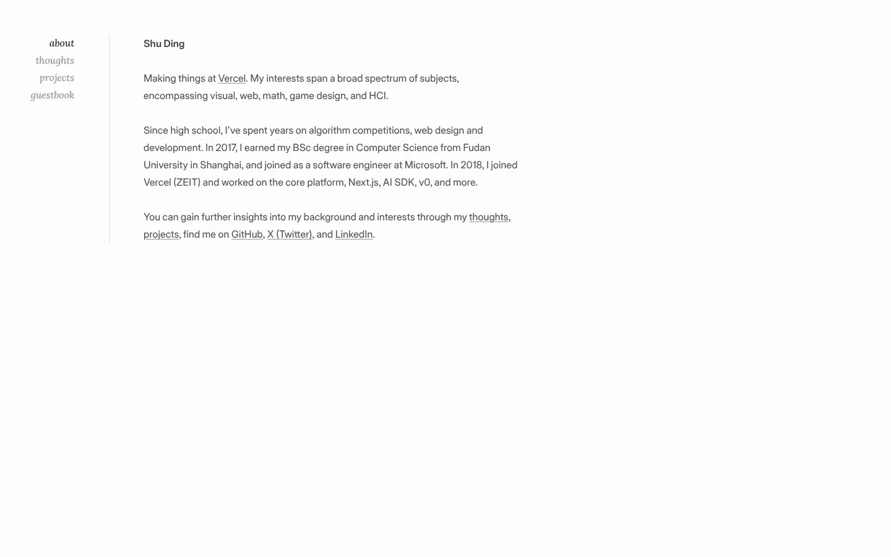
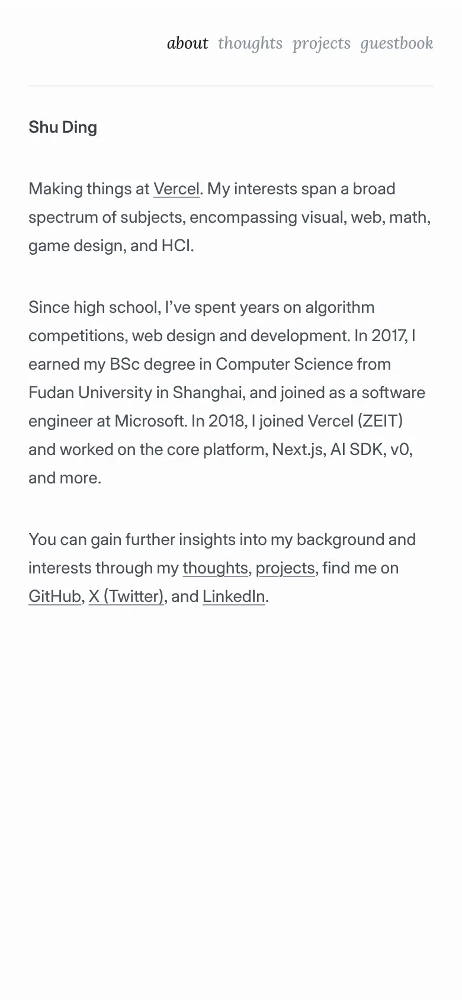

| First screen | Proof of skill | Projects | Experience | Visual craft | Motion | Nav/IA | Mobile | Performance | Accessibility | Copy | Recruiter | Engineer | Business | Memorability |
|---|---|---|---|---|---|---|---|---|---|---|---|---|---|---|
| 4 | 4 | 3 | 4 | 4 | 3 | 4 | 4 | 4 | 2 | 4 | 3 | 4 | 3 | 4 |

**Memorable:** Each main /projects entry is a product wordmark plus a short paragraph, mostly first-person on what the owner led or built (a few are plain descriptions). (serves the content).

**What works**

- Homepage is a three-paragraph bio that works as a compact résumé: degree and year, first employer and year, current employer and products. [shud:desktop-fold.webp]
- On team projects, one first-person sentence states the owner's own part (led X, co-created Y, designed Z), with a link to the contribution list. [shud:inner-desktop-fold.png]
- Four-item text nav stays fully visible on a phone with no hamburger, and the whole homepage fits one screen at both sizes. [shud:mobile-fold.webp]
- Some smaller projects are framed as problem then outcome (Nextra filled a gap; Wrap Balancer was built for the Vercel blog, later ported); others are plain descriptions. [shud:tiles/id-01.png]

**What doesn't**

- The viewport meta tag disables pinch-zoom (axe critical). [shud:record.home.desktop.axe.violations]
- Inactive nav items are light grey italic and fail contrast (axe serious, 3 nodes). [shud:record.home.desktop.axe.violations]
- No résumé and no email; contact is three social links in the final sentence. [shud:record.home.desktop.dom.features.contact_links]
- After the main entries, about 25 projects are bare names in bullet lists with no one-liner. [shud:tiles/id-01.png]

**Measured** (one unthrottled load, 2026-10-21): desktop 23 requests, 1,359 KB total, 182 KB JS, LCP 1280 ms, CLS 0.0008; mobile LCP 644 ms; axe (desktop) critical 1, serious 1. Record: [sites/shud/record.json](sites/shud/record.json).
- Re-measured by the verifier: total_bytes_desktop = 1391873 → total_bytes_desktop = 305456 (verifier reload; fonts 65 KB) (Reload 305,456 B vs claim 1,391,873 B: −78%, outside ±30%. Font bytes fell from 1.16 MB to 65 KB.)

| Time to key info | 390×844 | 1440×900 |
|---|---|---|
| current role | 0 scrolls, 0 clicks | 0 scrolls, 0 clicks |
| resume | not on site | not on site |
| contact | 0 scrolls, 1 clicks | 0 scrolls, 1 clicks |
| best project | 0 scrolls, 1 clicks | 0 scrolls, 1 clicks |
| shipped work | 0 scrolls, 0 clicks | 0 scrolls, 0 clicks |

Verification: 40 claims confirmed, 3 corrected, 1 removed, by V3.1.

### taniarascia

**Tania Rascia** · <https://www.taniarascia.com/> · group: software-design (content-heavy)

Found via: seed

Role, from the site: “Principal software engineer, writer, all-around nerd.” (https://www.taniarascia.com/)

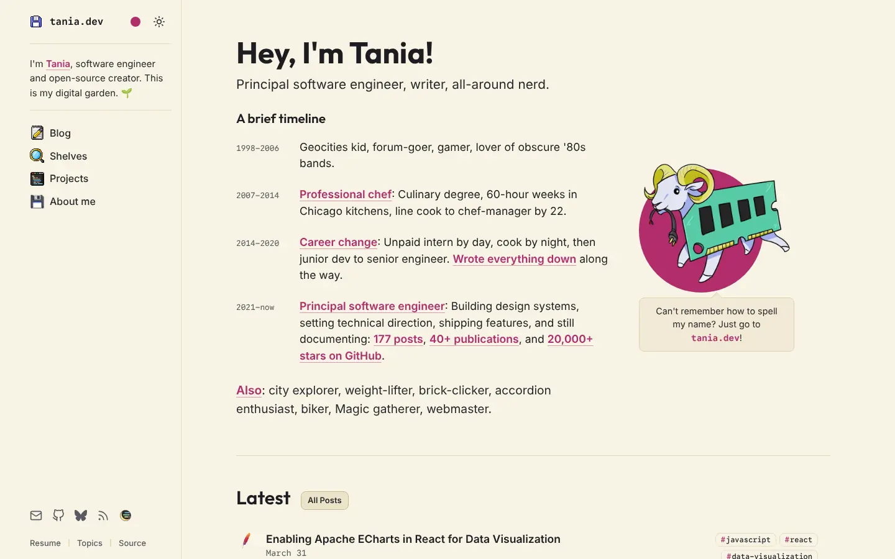
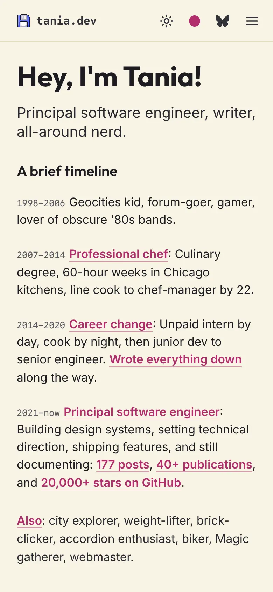

| First screen | Proof of skill | Projects | Experience | Visual craft | Motion | Nav/IA | Mobile | Performance | Accessibility | Copy | Recruiter | Engineer | Business | Memorability |
|---|---|---|---|---|---|---|---|---|---|---|---|---|---|---|
| 4 | 4 | 4 | 4 | 4 | 4 | 4 | 4 | 4 | 3 | 5 | 4 | 5 | 3 | 5 |

**Memorable:** The dated four-row timeline right under the name, from Geocities kid and professional chef to principal software engineer. (serves the content).

**What works**

- A four-row dated timeline under the name gives level and career path at a glance; three of the four rows link out (chef story, career-change writing, résumé). [taniarascia:desktop-fold.webp]
- Proof as linked counts in the hero (posts, publications, GitHub stars) instead of adjectives. [taniarascia:record.summary.hero_text]
- Project cards carry year, one-line what, star count and Article / Demo / Source links where they exist; every card has Source, so each is verifiable. [taniarascia:inner-desktop-fold.png]
- Theme follows the OS (cream light, near-black dark) with the same layout; the accent shifts from deep magenta to coral in dark mode. [taniarascia:desktop-fold-dark.png]
- Light build for a content-heavy site: 119 KB JS, 23 requests, CLS near zero (measured). [taniarascia:record.summary.js_bytes_desktop]

**What doesn't**

- Header theme and colour icon buttons have no accessible name (axe critical button-name, 2 nodes). [taniarascia:record.home.desktop.axe.violations]
- On the homepage, projects come after Latest, Shelves and Series; on a phone that is nearly four screens of writing first. [taniarascia:tiles/m-02.png]
- Project cards have no screenshot and no stack or language facts, so the 'what is it built with' question needs a click. [taniarascia:inner-desktop-fold.png]
- No email address; the envelope icon is a newsletter signup, which a recruiter could mistake for contact. [taniarascia:record.home.desktop.dom.nav]
- The current role is stated without an employer, and the labelled résumé link is a small secondary item (hidden in the menu on mobile). [taniarascia:record.home.mobile.dom.features.resume_links]

**Measured** (one unthrottled load, 2026-10-21): desktop 23 requests, 768 KB total, 117 KB JS, LCP 1664 ms, CLS 0.0043; mobile LCP 468 ms; axe (desktop) critical 1, serious 0. Record: [sites/taniarascia/record.json](sites/taniarascia/record.json).

| Time to key info | 390×844 | 1440×900 |
|---|---|---|
| current role | 0 scrolls, 0 clicks | 0 scrolls, 0 clicks |
| resume | 0 scrolls, 2 clicks | 0 scrolls, 1 clicks |
| contact | 0 scrolls, 1 clicks | 0 scrolls, 1 clicks |
| best project | 3 scrolls, 0 clicks | 0 scrolls, 1 clicks |
| shipped work | 0 scrolls, 0 clicks | 0 scrolls, 0 clicks |

Verification: 44 claims confirmed, 4 corrected, 0 removed, by V3.1.

## Interactive and live-demo sites

### ciechanow

**Bartosz Ciechanowski** · <https://ciechanow.ski/> · group: interactive (interactive-articles-counterexample-demo-on-homepage)

Found via: Brett's seed list (brief §4.1, Interactive). Also linked from maggieappleton.com/design-engineers (#10) and samwho.dev/links ('Internal Combustion Engine'), both loaded.

Role, from the site: “Interactive articles about science and engineering.” (https://ciechanow.ski/)

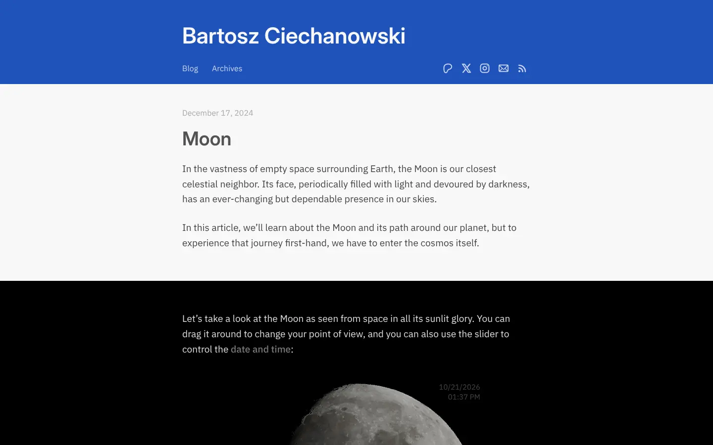
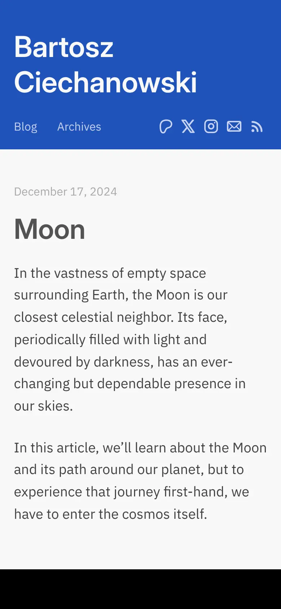

| First screen | Proof of skill | Projects | Experience | Visual craft | Motion | Nav/IA | Mobile | Performance | Accessibility | Copy | Recruiter | Engineer | Business | Memorability |
|---|---|---|---|---|---|---|---|---|---|---|---|---|---|---|
| 2 | 5 | 2 | 1 | 5 | 4 | 4 | 4 | 3 | 3 | 5 | 1 | 4 | 2 | 5 |

**Memorable:** Dragging the sunlit Moon and scrubbing the date slider, introduced by one sentence that says what you can do (serves the content).

**What works**

- One sentence directly above each widget says what to drag and which slider controls what. [ciechanow:desktop-fold.webp]
- Words in the prose are coloured to match the objects and sliders they refer to in the widget below. [ciechanow:tiles/d-03.png]
- Simulations wait behind a play button rather than running continuously. [ciechanow:tiles/d-03.png]
- Prose is server-rendered and readable before widgets initialise (94,717 characters at 500 ms, measured). [ciechanow:record.home.desktop.splash_check]
- Every article shows its publish date above the title. [ciechanow:inner-desktop-fold.png]

**What doesn't**

- Live WebGL demos run on the homepage at load (120 canvases, 7.08 MB measured) — the exact case Brett's rule avoids. [ciechanow:record.home.desktop.network_initial]
- The page shows only the author's name; it never says what they do. 'Interactive articles about science and engineering' exists only in the meta description. [ciechanow:record.summary.meta_description]
- Contact and social links are icon-only in the header. [ciechanow:desktop-fold.webp]
- About three quarters of the JS is an analytics tag (286 KB from googletagmanager.com, measured). [ciechanow:record.home.desktop.network_initial.top_hosts]
- No reduced-motion handling and 10 of 13 images without alt text. [ciechanow:record.home.mobile.dom.a11y_manual]

**Measured** (one unthrottled load, 2026-10-21): desktop 23 requests, 6,909 KB total, 371 KB JS, LCP 1420 ms, CLS 0.0008; mobile LCP 1328 ms; axe (desktop) critical 0, serious 1. Record: [sites/ciechanow/record.json](sites/ciechanow/record.json).

| Time to key info | 390×844 | 1440×900 |
|---|---|---|
| current role | n/a | n/a |
| resume | n/a | n/a |
| contact | 0 scrolls, 0 clicks | 0 scrolls, 0 clicks |
| best project | 0 scrolls, 0 clicks | 0 scrolls, 0 clicks |
| shipped work | 1 scrolls, 0 clicks | 0 scrolls, 0 clicks |

Verification: 43 claims confirmed, 3 corrected, 0 removed, by V3.2.

### madebyevan

**Evan Wallace** · <https://madebyevan.com/> · group: interactive (graphics-and-tools-engineer)

Found via: Web search 'Evan Wallace WebGL water demo personal website' (first result madebyevan.com). Honest note: I had the name in mind and used the search to locate and confirm the site.

Role, from the site: “I'm one of the cofounders of Figma, a collaborative browser-based interface design tool. My main contributions were to the rendering engine” (https://madebyevan.com/)

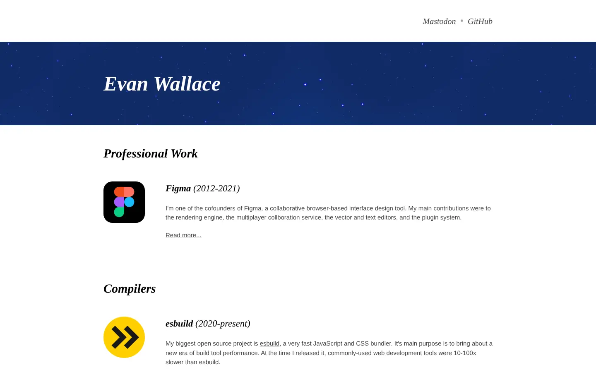
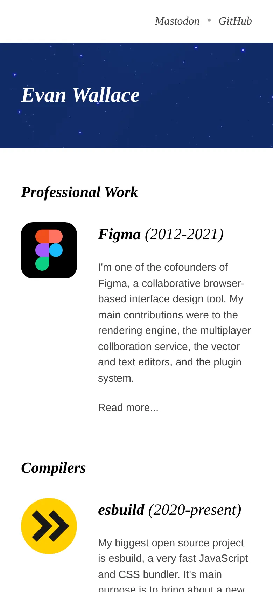

| First screen | Proof of skill | Projects | Experience | Visual craft | Motion | Nav/IA | Mobile | Performance | Accessibility | Copy | Recruiter | Engineer | Business | Memorability |
|---|---|---|---|---|---|---|---|---|---|---|---|---|---|---|
| 4 | 5 | 4 | 3 | 3 | 4 | 4 | 4 | 3 | 4 | 5 | 2 | 5 | 4 | 5 |

**Memorable:** The full-window WebGL water pool, with a side panel that says what hardware it needs, how to interact and a video fallback (serves the content).

**What works**

- Static homepage list; each live demo runs only on its own page, reached by a link labelled with what you get ('View demo', 'Use app', 'Visit website'). [madebyevan:tiles/d-00.png]
- Demo page states what it needs (a decent GPU) and offers a video fallback before anything else. [madebyevan:inner-desktop-fold.png]
- Controls and features listed as short bullets beside the canvas, including the browser extensions each feature requires. [madebyevan:inner-desktop-fold.png]
- Year ranges on every entry make the timeline scannable without a separate experience section. [madebyevan:record.home.desktop.dom.headings]
- Follows the OS light/dark setting with no toggle and no JS. [madebyevan:desktop-fold-dark.png]

**What doesn't**

- No email, résumé, current title or About text; contact is two social links. [madebyevan:record.summary.nav_items]
- Demo page is desktop-only in layout: on a phone the canvas is a 250 px strip beside the text. [madebyevan:inner-mobile-fold.png]
- Demo animates on load with no reduced-motion handling (pause is keyboard-only via SPACEBAR). [madebyevan:record.inner.desktop.code_scan]
- Missing lang attribute; demo page images have no alt text. [madebyevan:record.home.desktop.axe.violations]

**Measured** (one unthrottled load, 2026-10-21): desktop 18 requests, 279 KB total, 0 KB JS, LCP 1500 ms, CLS 0; mobile LCP 3416 ms; axe (desktop) critical 0, serious 1. Record: [sites/madebyevan/record.json](sites/madebyevan/record.json).

| Time to key info | 390×844 | 1440×900 |
|---|---|---|
| current role | 0 scrolls, 0 clicks | 0 scrolls, 0 clicks |
| resume | n/a | n/a |
| contact | 0 scrolls, 0 clicks | 0 scrolls, 0 clicks |
| best project | 0 scrolls, 1 clicks | 0 scrolls, 1 clicks |
| shipped work | 2 scrolls, 1 clicks | 1 scrolls, 1 clicks |

Verification: 44 claims confirmed, 1 corrected, 0 removed, by V3.2.

### redblobgames

**Amit Patel** · <https://www.redblobgames.com/> · group: interactive (interactive-tutorials)

Found via: Brett's seed list (brief §4.1, Interactive).

Role, from the site: “Hi! I make interactive visual explanations of math and algorithms, using motivating examples from computer games and other projects I've worked on.” (https://www.redblobgames.com/)

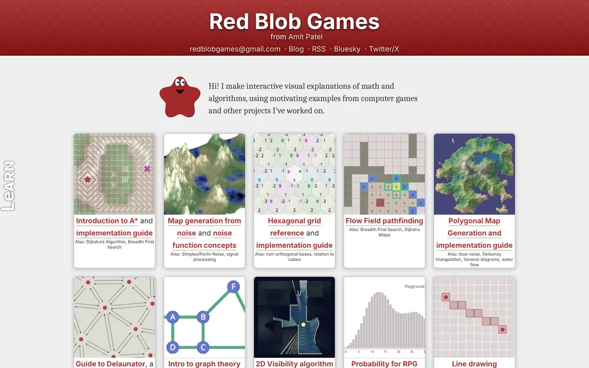
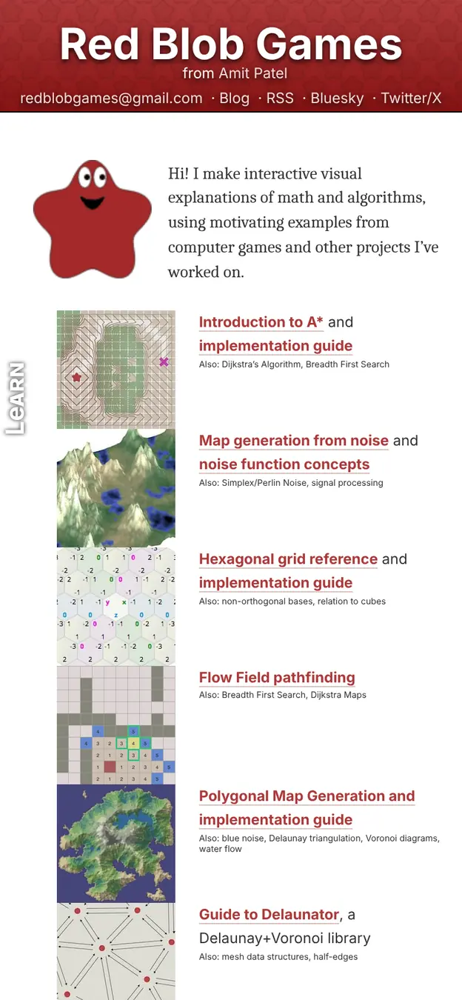

| First screen | Proof of skill | Projects | Experience | Visual craft | Motion | Nav/IA | Mobile | Performance | Accessibility | Copy | Recruiter | Engineer | Business | Memorability |
|---|---|---|---|---|---|---|---|---|---|---|---|---|---|---|
| 4 | 5 | 4 | 2 | 4 | 4 | 4 | 4 | 4 | 3 | 5 | 2 | 5 | 3 | 5 |

**Memorable:** Dragging the blob and the cross on the A* map, set up by a single instruction sentence right above it (serves the content).

**What works**

- One sentence directly above the first widget names what to drag and what will happen, so the demo needs no separate help text. [redblobgames:inner-desktop-fold.png]
- Homepage is a static catalogue with no JS; each demo runs only on its own page, and that page is tiny (15 KB JS, 73 KB total, measured). [redblobgames:record.inner.desktop.network_initial]
- Step animations wait for a Start button and a scrubber slider instead of autoplaying. [redblobgames:tiles/id-01.png]
- A homepage 'Meta' section links how-I-built-these pages, starter code and the open-source licence, answering 'how was it built' for engineers. [redblobgames:tiles/d-02.png]
- Created and updated dates sit under each tutorial title, signalling maintenance. [redblobgames:inner-desktop-fold.png]

**What doesn't**

- Current work and past collaborators appear only in undated prose at the bottom of the homepage. [redblobgames:tiles/d-03.png]
- No résumé or availability anywhere on the homepage. [redblobgames:record.summary.has_resume_link]
- Rotated vertical section labels cause aria-hidden-focus and contrast violations. [redblobgames:record.home.mobile.axe.violations]
- 21 text-link tap targets under 24 px on mobile. [redblobgames:record.home.mobile.dom.a11y_manual.small_targets_under_24px]

**Measured** (one unthrottled load, 2026-10-21): desktop 45 requests, 443 KB total, 0 KB JS, LCP 612 ms, CLS 0.0031; mobile LCP 412 ms; axe (desktop) critical 0, serious 1. Record: [sites/redblobgames/record.json](sites/redblobgames/record.json).

| Time to key info | 390×844 | 1440×900 |
|---|---|---|
| current role | 8 scrolls, 0 clicks | 6 scrolls, 0 clicks |
| resume | n/a | n/a |
| contact | 0 scrolls, 0 clicks | 0 scrolls, 0 clicks |
| best project | 0 scrolls, 1 clicks | 0 scrolls, 1 clicks |
| shipped work | 0 scrolls, 1 clicks | 0 scrolls, 1 clicks |

Verification: 47 claims confirmed, 0 corrected, 0 removed, by V3.2.

### robinlinacre

**Robin Linacre** · <https://www.robinlinacre.com/> · group: interactive (de-ae-practitioner)

Found via: Web search 'interactive introduction to probabilistic record linkage Fellegi Sunter interactive', which returned the minifeed.net/blogs/thFeW5PW listing (loaded) that links robinlinacre.com and 'Live DuckDB WASM Splink model'. Honest note: I had the name in mind; the search and listing confirmed it.

Role, from the site: “I’m a data scientist, software developer, data engineer, dad, and economist. I’m the lead author of Splink, a Python library for record linkage” (https://www.robinlinacre.com/about/)

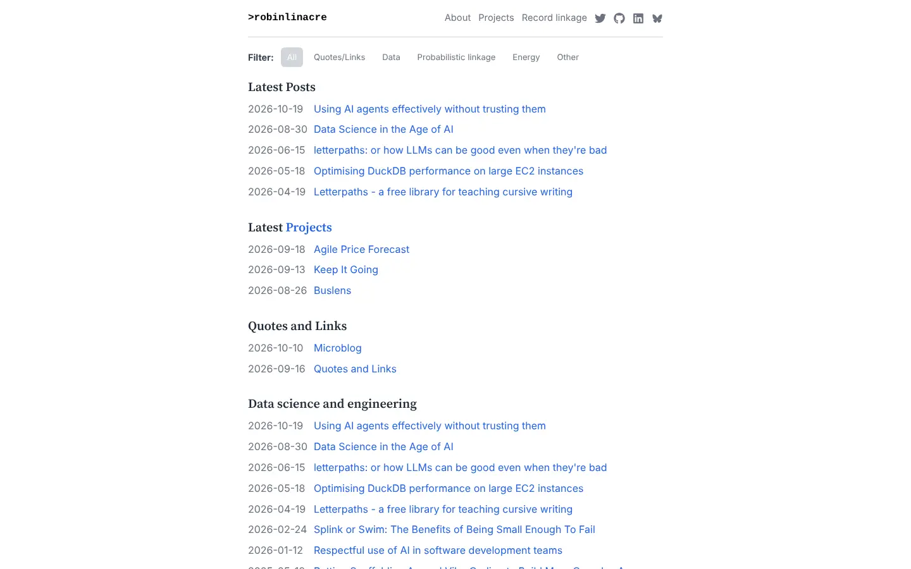
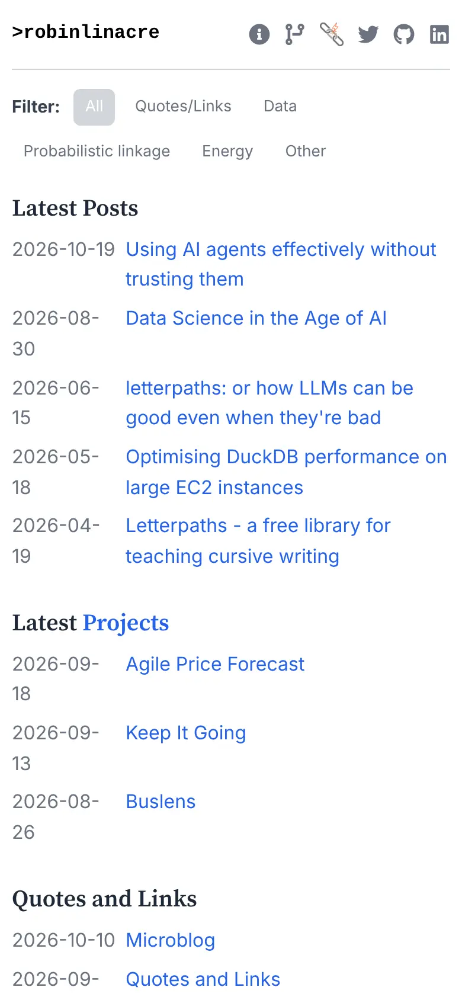

| First screen | Proof of skill | Projects | Experience | Visual craft | Motion | Nav/IA | Mobile | Performance | Accessibility | Copy | Recruiter | Engineer | Business | Memorability |
|---|---|---|---|---|---|---|---|---|---|---|---|---|---|---|
| 2 | 4 | 2 | 2 | 3 | 4 | 4 | 3 | 4 | 3 | 5 | 2 | 5 | 3 | 4 |

**Memorable:** A real record-linkage model from their own library running live in the browser via DuckDB-WASM: edit two records and watch the match weight and waterfall update. (serves the content).

**What works**

- Demo page explains the build in two plain sentences (single-file app, one CDN dependency), links the source, then embeds the working tool with example records. [robinlinacre:inner-desktop-fold.png]
- The specialty has its own nav item and its own homepage section, so a reader finds the core topic in one click. [robinlinacre:desktop-fold.webp]
- Topic filter chips above dated lists let a reader narrow to one subject without a search box. [robinlinacre:desktop-fold.webp]
- Light homepage: no first-party JS (174 KB third-party analytics), 237 KB total; LCP measured 1.0 s in the first capture but 1.8 s desktop / 1.5 s mobile on reload. [robinlinacre:record.summary.total_bytes_desktop]
- Interactive demo uses real sample data and shows the model's output (probability and waterfall), not a mock-up. [robinlinacre:inner-mobile-fold.png]

**What doesn't**

- No line saying who they are or what they do on the homepage; role and achievements live only on About. [robinlinacre:desktop-fold.webp]
- Projects are bare dated titles, indistinguishable from blog posts: no one-liner, visual or tech chips. [robinlinacre:desktop-fold.webp]
- Mobile nav turns text links into small unlabelled icons (18px targets). [robinlinacre:record.home.mobile.dom.a11y_manual.small_target_examples]
- ISO dates wrap across two lines on a phone, cluttering the list. [robinlinacre:mobile-fold.webp]
- No résumé anywhere and the best demo is about 3 phone screens down a long list. [robinlinacre:record.home.mobile.dom.features.demo_links]

**Measured** (one unthrottled load, 2026-10-21): desktop 9 requests, 232 KB total, 170 KB JS, LCP 1000 ms, CLS 0; mobile LCP 1380 ms; axe (desktop) critical 0, serious 2. Record: [sites/robinlinacre/record.json](sites/robinlinacre/record.json).
- Re-measured by the verifier: lcp_ms_desktop = 1000 → lcp_ms_desktop = 1824 on reload (claimed 1000; outside ±500 ms / ±50%). Network variance: DCL 1764 vs 985 ms. (Reload lcp 1824 ms, same element (div, 9300 px²); +824 ms exceeds tolerance.)

| Time to key info | 390×844 | 1440×900 |
|---|---|---|
| current role | 0 scrolls, 1 clicks | 0 scrolls, 1 clicks |
| resume | n/a | n/a |
| contact | 0 scrolls, 0 clicks | 0 scrolls, 0 clicks |
| best project | 0 scrolls, 1 clicks | 0 scrolls, 1 clicks |
| shipped work | 0 scrolls, 0 clicks | 0 scrolls, 0 clicks |

Verification: 41 claims confirmed, 3 corrected, 0 removed, by V3.2.

### samwho

**Sam Rose** · <https://samwho.dev/> · group: interactive (visual-essays-developer-educator)

Found via: Brett's seed list (brief §4.1, Interactive).

Role, from the site: “I also now write posts like this in my full-time job as a developer educator at ngrok” (https://samwho.dev/)

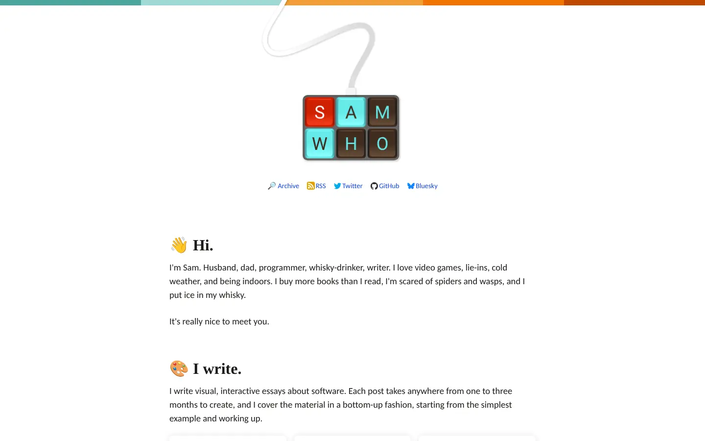
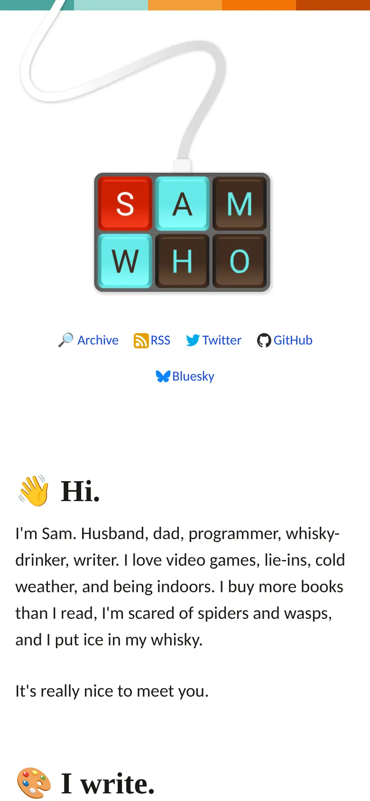

| First screen | Proof of skill | Projects | Experience | Visual craft | Motion | Nav/IA | Mobile | Performance | Accessibility | Copy | Recruiter | Engineer | Business | Memorability |
|---|---|---|---|---|---|---|---|---|---|---|---|---|---|---|
| 3 | 5 | 4 | 2 | 4 | 4 | 4 | 4 | 5 | 3 | 5 | 2 | 5 | 3 | 5 |

**Memorable:** Cartoon-dog asides that voice the reader's question right next to a widget where you type a value and watch which bits light up (serves the content).

**What works**

- Homepage is a static, tiny page (4.4 KB JS, 56 KB, measured); every interactive essay runs on its own page reached from an illustrated card. [samwho:record.home.desktop.network_initial]
- A prerequisite callout at the top of the essay says what you need to know and links to the post that teaches it. [samwho:inner-desktop-fold.png]
- Widgets are driven by the reader: type a value, press Add or Check, drag a slider, with a one-line instruction just above each. [samwho:tiles/id-02.png]
- An author aside offers an alternate colour palette for readers who find the figures hard to read. [samwho:tiles/id-01.png]
- Essay page has a skip link, dates under the title, and reduced-motion rules. [samwho:record.inner.desktop.dom.a11y_manual.skip_link]

**What doesn't**

- Job title and employer are below the fold (4 scrolls on mobile); no résumé or email anywhere on the homepage. [samwho:record.summary.key_info_positions_mobile.current_role]
- The decorative logo's keys are the first five keyboard tab stops and show no focus indicator. [samwho:record.home.desktop.focus_check]
- Essay cards have titles only, with no one-line description of what each covers. [samwho:tiles/d-00.png]
- Homepage has no h1 and no main landmark, and inline links rely on colour alone. [samwho:record.home.desktop.axe.violations]

**Measured** (one unthrottled load, 2026-10-21): desktop 20 requests, 55 KB total, 4 KB JS, LCP 1160 ms, CLS 0.0006; mobile LCP 616 ms; axe (desktop) critical 0, serious 1. Record: [sites/samwho/record.json](sites/samwho/record.json).
- Re-measured by the verifier: lcp_ms_desktop = 1160 → lcp_ms_desktop = 3516 on reload (claimed 1160; +2356 ms, outside tolerance). Slow network on reload: TTFB 1020 ms, DCL 3609 ms. (Same LCP element (p); bytes identical, so the gap is network timing, but it does not reproduce.)

| Time to key info | 390×844 | 1440×900 |
|---|---|---|
| current role | 4 scrolls, 0 clicks | 1 scrolls, 0 clicks |
| resume | n/a | n/a |
| contact | 0 scrolls, 0 clicks | 0 scrolls, 0 clicks |
| best project | 1 scrolls, 1 clicks | 1 scrolls, 1 clicks |
| shipped work | 1 scrolls, 1 clicks | 1 scrolls, 1 clicks |

Verification: 46 claims confirmed, 4 corrected, 0 removed, by V3.2.

## Cautionary "wow" sites

### bruno-simon

**Bruno Simon** · <https://bruno-simon.com/> · group: cautionary (webgl-world-portfolio)

Found via: Brett's seed list (brief §4.1, Interactive, marked cautionary).

Role, from the site: “My name is Bruno Simon, and I'm a creative developer (mostly for the web). This is my portfolio.” (https://bruno-simon.com/)

| First screen | Proof of skill | Projects | Experience | Visual craft | Motion | Nav/IA | Mobile | Performance | Accessibility | Copy | Recruiter | Engineer | Business | Memorability |
|---|---|---|---|---|---|---|---|---|---|---|---|---|---|---|
| 1 | 2 | 1 | 1 | 4 | 1 | 1 | 2 | 1 | 1 | 3 | 1 | 3 | 1 | 3 |

**Memorable:** The whole portfolio is a drivable 3D world (in this capture: a long glowing loading ring). (does not serve the content).

**What works**

- Even the loading state is designed (glowing ring over a perspective grid), so the wait looks deliberate rather than broken. [bruno-simon:desktop-fold.webp]
- A hidden behind-the-scenes panel credits Three.js and its authors and the composer (Kounine), links the music files, and links the full source on GitHub under MIT. [bruno-simon:index-html.txt]
- Controls are mapped for keyboard, mouse, touch and gamepad, with a respawn for stuck players and a quality toggle. [bruno-simon:index-html.txt]
- Distinctive even while loading (glowing ring on a perspective grid), but the world itself never rendered in two reloads, so only the loader's identity was seen. [bruno-simon:desktop-fold-30s.png]

**What doesn't**

- Zero readable characters at 3, 6, 12, 20 and ~35 s on desktop (measured, software GL); the 12 s phone fold is a loader too. [bruno-simon:fold-30s-probe.json]
- Heavy: 1.23 MB JS; 5.5 MB desktop and 7.6 MB mobile transfer on load, 97 to 146 requests (verifier reload). [bruno-simon:record.summary.js_bytes_desktop]
- Name, role and contact sit only in hidden panels (Welcome; Discord / Private messages); no projects heading or list in the page text; no résumé. [bruno-simon:record.summary.hero_text]
- Icon buttons have no accessible names, focus is not visible, and there is no reduced-motion path. [bruno-simon:record.home.desktop.axe.violations]
- No HTML fallback or text route for visitors who cannot or will not run the 3D world. [bruno-simon:record.home.desktop.dom.headings]

**Measured** (one unthrottled load, 2026-10-21): desktop 97 requests, 3,715 KB total, 1,202 KB JS, LCP None ms, CLS 0; mobile LCP None ms; axe (desktop) critical 2, serious 0. Record: [sites/bruno-simon/record.json](sites/bruno-simon/record.json).
- Re-measured by the verifier: total_bytes_desktop = 3804549 → total_bytes_desktop = 5503256 in the verifier reload (3804549 originally); report as about 3.8–5.5 MB. (+45%, outside ±30%; fetch requests carried 4.1 MB of world assets this time.)

| Time to key info | 390×844 | 1440×900 |
|---|---|---|
| current role | not on site | not on site |
| resume | n/a | n/a |
| contact | not on site | not on site |
| best project | not on site | not on site |
| shipped work | not on site | not on site |

Verification: 34 claims confirmed, 5 corrected, 0 removed, by V3.3.

### henryheffernan

**Henry Heffernan** · <https://henryheffernan.com/> · group: cautionary (new-grad-3d-portfolio)

Found via: Web search (news.ycombinator.com only) 'Show HN: My portfolio website is a 3D', which returned news.ycombinator.com/item?id=31313187 ('Show HN: 3D Portfolio website with late 90s aesthetic, made with Three and React', May 2022; loaded).

Role, from the site: “I'm Henry, a Software Engineer based in NY. Rensselaer Polytechnic Institute Graduate with my B.S. in Computer Science, currently looking for a full time role.” (https://henryheffernan.com/)

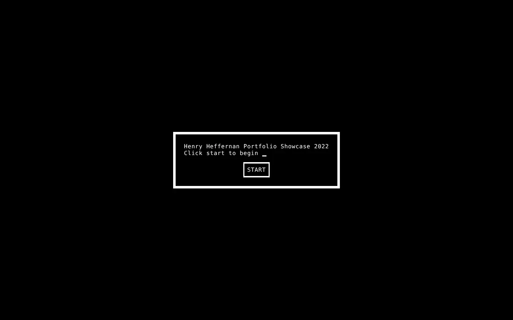

| First screen | Proof of skill | Projects | Experience | Visual craft | Motion | Nav/IA | Mobile | Performance | Accessibility | Copy | Recruiter | Engineer | Business | Memorability |
|---|---|---|---|---|---|---|---|---|---|---|---|---|---|---|
| 2 | 3 | 2 | 2 | 5 | 1 | 2 | 1 | 2 | 2 | 3 | 1 | 3 | 1 | 3 |

**Memorable:** The camera flies into a 3D 90s office desk and the portfolio is a fake Windows-95-style OS on the CRT, complete with desktop game icons. (does not serve the content).

**What works**

- One idea carried through every layer (boot screen, office desk, CRT, retro OS), so the site is instantly recognisable. [henryheffernan:x-desktop-after-2nd-click.png]
- Inside the OS the nav is four plain words (About, Experience, Projects, Contact) under the name and role. [henryheffernan:inner-desktop-fold.png]
- A plain 2D version exists at its own URL and paints the name and role in about 2 s, a ready-made fallback. [henryheffernan:record.inner.desktop.lcp]
- The phone landing is honest: it warns that the experience suits a desktop before you start. [henryheffernan:mobile-fold.webp]

**What doesn't**

- Two click gates (START, then "Click anywhere") and a camera move before the role is readable: ~32 s desktop in the verifier harness; phone not re-measured. [henryheffernan:click-through-probe.json]
- Nothing on the first screen says what they do. Role, RPI degree and Vercel job appear only inside the OS; the meta job-seeking line is stale. [henryheffernan:record.summary.meta_description]
- Heavy: 4.8 MB initial, 5.3 MB after scroll on desktop (measured), mostly images (3.1 MB) and fetched 3D assets (1.3 MB); video bytes 0 at capture. [henryheffernan:record.home.desktop.network_initial.total_bytes]
- The OS page overflows a phone (873 px layout) and cuts the name off; the 3D monitor shrinks nav labels to a few pixels. [henryheffernan:inner-mobile-fold.png]
- START is a plain 
 (no role or tabindex), focus never visibly changes (Tab lands only on the OS iframe), and the landing has zero links. [henryheffernan:record.home.mobile.dom.a11y_manual.interactive_first_2_viewports]

**Measured** (one unthrottled load, 2026-10-21): desktop 33 requests, 7,481 KB total, 418 KB JS, LCP 2996 ms, CLS 0.0164; mobile LCP 2344 ms; axe (desktop) critical 0, serious 0. Record: [sites/henryheffernan/record.json](sites/henryheffernan/record.json).
- Re-measured by the verifier: total_bytes_desktop = 7660986 → total_bytes_desktop = 4800056 initial (5298850 after scroll) on reload; -37% vs 7660986, outside ±30%. (network_initial.total_bytes 4800056; network_after_scroll 5298850.)
- Re-measured by the verifier: lcp_ms_desktop = 2996 → lcp_ms_desktop = 7948 on reload (LCP is the boot-log text); mobile 1656. Far outside the band around 2996. (Reload LCP element p at 7948 ms desktop.)
- Re-measured by the verifier: cls_desktop = 0.0164 → cls_desktop = 0.0062 on reload (0.0164 at capture); both far below 0.05. (0.0062 is 62% below the claim, outside a 50% band; rubric bucket unchanged.)

| Time to key info | 390×844 | 1440×900 |
|---|---|---|
| current role | corrected, see below | 0 scrolls, 2 clicks |
| resume | corrected, see below | corrected, see below |
| contact | 0 scrolls, 3 clicks | 0 scrolls, 3 clicks |
| best project | 0 scrolls, 3 clicks | 0 scrolls, 3 clicks |
| shipped work | 0 scrolls, 1 clicks | 0 scrolls, 1 clicks |

- Verifier correction, mobile current role: mobile current_role: {"scrolls": 0, "clicks": 2, "note": "START gate confirmed on phone; second tap and ~42 s timing not re-measured; role sentence in meta, Vercel role in OS About"} (Phone fold shows the START gate; desktop click-through needed START plus a second click. No mobile click-through in my evidence.)

- Verifier correction, mobile resume: mobile resume: {"scrolls": 0, "clicks": 4, "note": "START, tap, ABOUT, then 'Click here to download it!' (2022 PDF) on the OS About page; estimated"} (OS About text: "Looking for my resume? Click here to download it!" linking to Henry_Heffernan_S22_Resume...pdf. The null claim is wrong.)

- Verifier correction, desktop resume: desktop resume: {"scrolls": 0, "clicks": 4, "note": "START, click, ABOUT, then 'Click here to download it!' (2022 PDF) on the OS About page"} (OS About page links "Click here to download it!" to a résumé PDF; the claim that none was seen is out of date.)

Verification: 29 claims confirmed, 11 corrected, 0 removed, by V5.2.

## Set-level checks

Two checks across the whole verified set, which spec §4.3 and §14.1 rely on. Both were computed from
the 29 verified score files after the verifier's corrections, during the synthesis phase. "Steps"
means scrolls plus clicks.

### Set-level time to key info

**Method.** Each site's verified `time_to_key_info` (the per-site tables above), with the four
verifier corrections applied. Medians are taken over the sites where the item exists; sites where it
doesn't exist are counted separately. Brett's values are from `baseline/audit.md` §3; on Brett's site
the "0" for the résumé and contact means 0 scrolls, with one tap to open the link. Spec §4.3 sets the
targets.

**390 × 844**

| Item | Sites with it | Missing | Median scrolls / clicks | 0 scrolls and ≤ 1 click | Best in set | Worst in set | Brett today |
|---|---|---|---|---|---|---|---|
| Current role | 26 | 3 (bruno-simon, ciechanow, danluu) | 0 / 0 | 19 | 0 / 0 (17 sites) | redblobgames 8 / 0 | 0 / 0 |
| Résumé | 10 | **19** | 0 / 1 | 5 | 0 / 1 (beingbrute, damian, deshraj-jogiya, kushalgoel, pahasara) | brittanychiang 3 / 1, henryheffernan 0 / 4 | 0 scrolls, 1 tap (header) |
| Contact | 28 | 1 (bruno-simon) | 0 / 1 | 15 | 0 / 0 (6 sites, e.g. shao's visible mailto) | beingbrute 21 / 0 | 0 scrolls, 1 tap (hero buttons) |
| Best project | 26 | 3 (bruno-simon, damian, danluu) | 0.5 / 1 | 11 | 0 / 0 (ciechanow, by running it on the homepage) | richardshuai 12 / 0 | **3 / 0**, no nav shortcut |
| Shipped work | 27 | 2 (bruno-simon, danluu) | 1 / 1 | 12 | 0 / 0 (robinlinacre, shud, taniarascia) | richardshuai 12 / 1 | **3 / 0** |

**1440 × 900**

| Item | Sites with it | Missing | Median scrolls / clicks | 0 scrolls and ≤ 1 click | Best in set | Worst in set | Brett today |
|---|---|---|---|---|---|---|---|
| Current role | 26 | 3 | 0 / 0 | 20 | 0 / 0 (17 sites) | redblobgames 6 / 0 | 0 / 0 |
| Résumé | 10 | 19 | 0 / 1 | 7 | 0 / 1 | henryheffernan 0 / 4 | 0 scrolls, 1 click |
| Contact | 28 | 1 | 0 / 1 | 20 | 0 / 0 (8 sites) | richardshuai 14 / 1 | 0 scrolls, 1 click |
| Best project | 26 | 3 | 0 / 1 | 17 | 0 / 0 (ciechanow, pahasara, wisl) | richardshuai 12 / 0 | 2 / 0, or 1 click on "Projects" |
| Shipped work | 27 | 2 | 0 / 1 | 17 | 0 / 0 (5 sites) | richardshuai 12 / 1 | 1 / 0, or 1 click |

**Reading the tables.**
- The set's median is already at or near Brett's value for current role, résumé and contact. Brett
  is behind only on best project and on shipped work at 390: 3 scrolls against a set median of
  0.5–1 scrolls plus 1 click.
- Every 0 / 0 best case comes with a cost. ciechanow runs its demo on the homepage, which Brett's
  standing rules forbid. The shipped-work 0 / 0 sites (robinlinacre, shud, taniarascia) show proof
  inline in a text list. So 0 / 1 is the best the set shows that keeps the rules.

### Set-level check for the new project

How the 10 data sites (spec §3.2) show pipeline work, checked against the verified files. Only
patterns with 3 or more sites count as support.

- **Case studies are the common form.** Four sites use one: deshraj-jogiya
  `[deshraj-jogiya:record.inner.desktop.dom.headings]`, shaundataanalytics
  `[shaundataanalytics:record.inner.desktop.dom.headings]`, beingbrute `[beingbrute:tiles/d-02.png]`,
  and pahasara, a project page with a screenshot carousel, chips and a features list
  `[pahasara:inner-desktop-fold.png]`.
- **Running artefacts are rarer.** Three examples: robinlinacre runs a real record-linkage model from
  their own library in the browser through DuckDB-WASM `[robinlinacre:inner-desktop-fold.png]`;
  deshraj-jogiya hosts a public instance of their own product
  `[deshraj-jogiya:record.home.desktop.dom.features.demo_links]`; beingbrute has live Tableau Public
  dashboards on two of four projects `[beingbrute:tiles/d-02.png]`.
- **Verification status shown as proof** appears once: wisl's live CI, coverage and version badges
  `[wisl:inner-desktop-fold.png]`.
- **What no verified claim in the 29 files describes:** a scheduled pipeline whose freshness or
  data-test status a visitor can see. This is a statement about the verified set, not about the web.
- **No site in the set labels a demo's download size.** The nearest is idea I2 (2 sites): madebyevan
  states the hardware a demo needs and offers a video fallback before anything loads
  `[madebyevan:inner-desktop-fold.png]`, and henryheffernan's phone landing warns that the experience
  suits a desktop `[henryheffernan:mobile-fold.webp]`. redblobgames keeps its demo pages tiny
  instead: 15 KB JS and 73 KB in total `[redblobgames:record.inner.desktop.network_initial]`.

## Hiring-side evidence

What recruiters and hiring managers say they look for, especially for data engineering and new grads. Every quote was copied from page text loaded in Chromium in this session and checked word for word against the loaded text by script (quotes of at most 40 words). Nothing here was measured by this workflow: every number is the source's own.

**Grades.** *Evidence* is a survey or study with a stated method, or a named person in a hiring role (S01–S08). *Evidence (pseudonymous, self-stated role)* is a forum comment whose author says they hire or recruit (S09–S16); it is unverifiable, so no finding rests on these alone. *Opinion* is advice with no method or hiring role (S17, S18). Evidence and opinion are kept in separate groups below.

### Source table

| id | title | URL | publisher | date | author + stated role | type | sample / method | loaded_utc |
|---|---|---|---|---|---|---|---|---|
| S01 | Are recruiters better than a coin flip at judging resumes? Here's the data. | https://interviewing.io/blog/are-recruiters-better-than-a-coin-flip-at-judging-resumes | interviewing.io (with Learning Collider) | 2024-05-01 (updated 2025-07-22) | Aline Lerner and Peter Bergman (co-authors Tushar Kundu, Kadeem Noray) — Lerner: CEO of interviewing.io, former recruiter (as stated in post); Bergman, Kundu, Noray: Learning Collider researchers | survey/study (evidence) | 76 technical recruiters (agency and in-house), 30 resumes each; ~2,200 evaluations of >1,000 resumes; judgments compared with the engineers' interviewing.io mock-interview outcomes. Recruiters were paid per accurate prediction. Run by a vendor with a stake in the answer. | 2026-10-21T03:53:18Z |
| S02 | Eye tracking study shows recruiters look at resumes for 7 seconds (reporting Ladders 2018 Eye-Tracking Study); plus Ladders' own summary "You have 7.4 seconds to make an impression" | https://www.hrdive.com/news/eye-tracking-study-shows-recruiters-look-at-resumes-for-7-seconds/541582/ https://www.theladders.com/career-advice/you-only-get-6-seconds-of-fame-make-it-count | HR Dive (Informa TechTarget); Ladders, Inc. | HR Dive 2018-11-08; Ladders article 2020-01-30 | Riia O'Donnell (HR Dive); Meredith Lepore (Ladders) — HR Dive: "Contributor"; Ladders: no role stated | survey/study (evidence (method only partly disclosed)) | Ladders 2018 two-stage study (per S08): a speed stage, then an eye-tracking stage. Sample size not stated on either loaded page (S08 notes the report omits it). Original PDF returned HTTP 403, so findings are cited only as reported by these two pages. | 2026-10-21T03:53:06Z; 2026-10-21T03:52:58Z |
| S03 | 2018 Developer Skills Report | https://www.hackerrank.com/research/developer-skills/2018 | HackerRank | 2018 (fieldwork 2017-10-16 to 2017-11-01) | HackerRank (no named author) — vendor research | survey/study (evidence) | Online SurveyMonkey survey of 39,441 professional and student developers recruited from the HackerRank community and social media (self-selected); hiring-manager questions answered by a subset the report calls "7,000+ employers". Significance tested at .01. Dated; vendor sells skills assessments. | 2026-10-21T03:53:50Z |
| S04 | What Are Employers Looking for When Reviewing College Students' Resumes? (Job Outlook 2025) and Internship Experience Often the Deciding Factor Between Equal Candidates (Job Outlook 2026) | https://www.naceweb.org/talent-acquisition/candidate-selection/what-are-employers-looking-for-when-reviewing-college-students-resumes https://www.naceweb.org/talent-acquisition/candidate-selection/internship-experience-often-the-deciding-factor-between-equal-candidates | National Association of Colleges and Employers (NACE) | 2024-12-09; 2026-02-09 | Kevin Gray — Senior editor at NACE (as stated) | survey/study (evidence) | Job Outlook 2025: 237 employer respondents, 2024-08-05 to 2024-09-16. Job Outlook 2026: 183 respondents, 2025-08-07 to 2025-09-22. NACE employer members plus nonmember companies; all industries, not tech-specific. | 2026-10-21T03:53:25Z; 2026-10-21T03:53:41Z |
| S05 | Employers' Perceptions of the Benefits of Employment Electronic Portfolios | https://files.eric.ed.gov/fulltext/EJ1159830.pdf | International Journal of ePortfolio, 7(2), 217-223 (via ERIC, EJ1159830) | 2017 | Ronda L. Leahy and Ariana Filiatrault — University of Wisconsin-La Crosse (affiliation as stated) | survey/study (evidence) | Survey of 85 recruiters (37 at two Midwestern career fairs, 48 online); 5-point Likert items, t tests by experience. Employers included Target, Walmart, Hormel (not tech-specific). Self-reported intent, not observed clicks. | 2026-10-21T03:58:47Z |
| S06 | How to Succeed in Data Engineering Interviews; The Data Engineer's GitHub Portfolio (2026 Edition) | https://pipeline2insights.substack.com/p/how-to-succeed-in-data-engineering-interviews-with-yordan-ivanov https://pipeline2insights.substack.com/p/how-to-create-data-engineering-data-engineers-github-portfolio-in-2026 | Pipeline To Insights (Substack) | 2025-08-31; 2026-02-24 | Yordan Ivanov (with Erfan Hesami / Pipeline To Insights) — Head of Data Engineering at Dext; "has run hundreds of interviews for software, data, and analytics engineers" (2025 page); "data engineering leader" (2026 page) | hiring-staff statement (evidence (named hiring staff)) | First-person statements by a named data-engineering hiring manager; no sample. | 2026-10-21T03:54:23Z; 2026-10-21T03:59:06Z |
| S07 | Interviewing for Analytics Engineering at Monzo | https://monzo.com/blog/interviewing-for-analytics-engineering-at-monzo | Monzo (company blog) | 2026-05-25 | Aisha Shofoluwe — Technical Recruiter, Monzo (as signed) | hiring-staff statement (evidence (named hiring staff)) | Published description of a real AE interview loop (recruiter call, initial call, 1-week take-home, case study, behavioural); no sample. | 2026-10-21T03:59:14Z |
| S08 | Is the 6-Second Resume Scan a Myth? | https://www.ere.net/articles/is-the-6-second-resume-scan-a-myth | ERE Media | 2020-10-20 | Susan Gygax — Talent acquisition professional who "has led large teams" (self-described in article) | hiring-staff statement (evidence (named hiring staff)) | Practitioner critique of the Ladders figure plus an informal poll of a recruiter Facebook group (no numbers). | 2026-10-21T03:54:33Z |
| S09 | Hiring Managers, how should we structure our cvs and projects readme? (r/dataengineering) | https://www.reddit.com/r/dataengineering/comments/14d52mz/hiring_managers_how_should_we_structure_our_cvs/ | Reddit r/dataengineering | 2023-06-19 | u/Acrobatic-Orchid-695; u/gwax — Acrobatic-Orchid-695: "When I hire data engineers"; gwax: describes screening CVs and moving candidates to interviews (role implied) | hiring-staff statement (evidence (pseudonymous, self-stated role)) | Forum replies; roles unverifiable. Loaded on www.reddit.com (old.reddit.com requires login). | 2026-10-21T03:50:55Z |
| S10 | New DE advice from a Principal (r/dataengineering) | https://www.reddit.com/r/dataengineering/comments/1au9s4s/new_de_advice_from_a_principal/ | Reddit r/dataengineering | 2024-02-19 | u/ithinkiboughtadingo — Principal data engineer; "I've hired and trained dozens of people in this field" (self-stated) | hiring-staff statement (evidence (pseudonymous, self-stated role)) | Forum post; role unverifiable. | 2026-10-21T03:51:36Z |
| S11 | The talk of hundreds of applicants for roles sounds terrifying. Here's what it actually looked like from the hiring side (r/dataengineering) | https://www.reddit.com/r/dataengineering/comments/1vgh158/the_talk_of_hundreds_of_applicants_for_roles/ | Reddit r/dataengineering | 2026-08-05 | u/Crafty_Donut589 — "I'm a senior data engineer at a UK organisation" on the hiring side (self-stated) | hiring-staff statement (evidence (pseudonymous, self-stated role)) | Forum post with the poster's own funnel counts (~300 applicants per role, one week); unverifiable. | 2026-10-21T03:51:22Z |
| S12 | What type of Portoflio projects do employers want to see? (r/dataengineering) | https://www.reddit.com/r/dataengineering/comments/1k5jnat/what_type_of_portoflio_projects_do_employers_want/ | Reddit r/dataengineering | 2025-04-22 | u/justanator101; u/sunder_and_flame; u/Firm_Bit — justanator101: "leading the technical round of some hiring"; sunder_and_flame: sets up phone screens (implied); Firm_Bit: "interviewed a lot of new grads" | hiring-staff statement (evidence (pseudonymous, self-stated role)) | Forum replies; roles unverifiable; thread is mostly sceptical of portfolios. | 2026-10-21T03:51:43Z |
| S13 | Is it true that recruiters only spend about 7 seconds reviewing a resume? (r/recruiting) | https://www.reddit.com/r/recruiting/comments/y9tkok/is_it_true_that_recruiters_only_spend_about_7/ | Reddit r/recruiting ("Ask Recruiters" flair) | 2022-10-21 | u/TMutaffis; u/MoonInTheDaySky — MoonInTheDaySky: "Recruiter here"; TMutaffis: answering as a recruiter in an Ask Recruiters thread (implied) | hiring-staff statement (evidence (pseudonymous, self-stated role)) | Forum replies; estimates given by commenters range from about 5 s to 1 min; unverifiable. | 2026-10-21T04:03:15Z |
| S14 | Tech recruiters: how to make your life easier in a developer portfolio website? (r/recruiting) | https://www.reddit.com/r/recruiting/comments/zx1kiz/tech_recruiters_how_to_make_your_life_easier_in_a/ | Reddit r/recruiting | 2022-12-28 | u/Workhorse5November; u/illhamaliyev; u/Wasting-tim3 — Workhorse5November: "As a recruiter"; illhamaliyev: screens candidates (implied); Wasting-tim3: "I lead an internal talent team at a startup" | hiring-staff statement (evidence (pseudonymous, self-stated role)) | Forum replies; unverifiable. | 2026-10-21T04:02:53Z |
| S15 | Are recruiters even looking at my GitHub or portfolio website? (r/cscareerquestions) | https://www.reddit.com/r/cscareerquestions/comments/1btmeqx/are_recruiters_even_looking_at_my_github_or/ | Reddit r/cscareerquestions | 2024-04-02 | u/DisneyLegalTeam; u/Maury_poopins; u/healydorf — DisneyLegalTeam: "10+ years hiring in NYC"; Maury_poopins: "I've been a hiring manager"; healydorf: no role stated | hiring-staff statement (evidence (pseudonymous, self-stated role)) | Forum replies; mixed answers; unverifiable. | 2026-10-21T04:03:42Z |
| S16 | Ask HN: Should I use React for a personal portfolio? | https://news.ycombinator.com/item?id=40860643 | Hacker News | 2024-07-02 | sontek; troyforster; gamegoblin — sontek: "As a hiring manager"; troyforster: "a manager who has hired hundreds of developers"; gamegoblin: candidate, not hiring staff | hiring-staff statement (evidence (pseudonymous, self-stated role) + opinion) | Forum replies; 48 comments; unverifiable roles; one quote is a candidate's opinion. | 2026-10-21T03:57:19Z |
| S17 | What Employers Look For in Junior Data Engineers | https://www.northcoders.com/blog/what-employers-look-for-in-junior-data-engineers/ | Northcoders (coding bootcamp) | 2026-07-27 | marine.brenier (page author metadata) — no role stated; bootcamp marketing | opinion (opinion) | No method; promotes the publisher's bootcamp. | 2026-10-21T03:59:22Z |
| S18 | Bruno Simon – 3D Portfolio (bruno-simon.com) discussion | https://news.ycombinator.com/item?id=46206531 | Hacker News | 2025-12-09 | vegabook; sech8420; hahn-kev — general HN commenters; no hiring roles stated | opinion (opinion) | Forum reactions (777 points, 188 comments); some report it runs fine on phones. | 2026-10-21T13:36:06Z |

Counts (measured, from this table): 18 sources; 8 evidence-grade with a stated method or a named hiring person (S01–S08: 5 surveys/studies, 3 named hiring staff); 8 pseudonymous hiring-staff threads (S09–S16, S16 also carries opinion); 2 opinion (S17, S18).

### Evidence: surveys and studies (S01–S05)

#### S01

**Are recruiters better than a coin flip at judging resumes? Here's the data.**

- URL: https://interviewing.io/blog/are-recruiters-better-than-a-coin-flip-at-judging-resumes
- Publisher / date: interviewing.io (with Learning Collider) — 2024-05-01 (updated 2025-07-22)
- Author + stated role: Aline Lerner and Peter Bergman (co-authors Tushar Kundu, Kadeem Noray) — Lerner: CEO of interviewing.io, former recruiter (as stated in post); Bergman, Kundu, Noray: Learning Collider researchers
- Type: **survey/study** (evidence). Method: 76 technical recruiters (agency and in-house), 30 resumes each; ~2,200 evaluations of >1,000 resumes; judgments compared with the engineers' interviewing.io mock-interview outcomes. Recruiters were paid per accurate prediction. Run by a vendor with a stake in the answer.
- Loaded (UTC): 2026-10-21T03:53:18Z; HTTP 200
- Quotes:
  - "In our study, the median time spent on resume evaluations was just 31 seconds." — study authors
  - "Most predictive for Question #1 (whether a recruiter would want to interview that candidate) was experience at a top company — these candidates were 35% more likely to be picked." — study authors
  - "It turns out that recruiters chose correctly 55% of the time, which is just slightly better than a coin flip." — study authors
- Paraphrase: Recruiters spend about half a minute per resume, lean hardest on brand-name employers, and predict interview success barely better than chance.
- Tags: first-scan time, recruiter checklist, new-grad credibility

#### S02

**Eye tracking study shows recruiters look at resumes for 7 seconds (reporting Ladders 2018 Eye-Tracking Study); plus Ladders' own summary "You have 7.4 seconds to make an impression"**

- URL: https://www.hrdive.com/news/eye-tracking-study-shows-recruiters-look-at-resumes-for-7-seconds/541582/ ; https://www.theladders.com/career-advice/you-only-get-6-seconds-of-fame-make-it-count
- Publisher / date: HR Dive (Informa TechTarget); Ladders, Inc. — HR Dive 2018-11-08; Ladders article 2020-01-30
- Author + stated role: Riia O'Donnell (HR Dive); Meredith Lepore (Ladders) — HR Dive: "Contributor"; Ladders: no role stated
- Type: **survey/study** (evidence (method only partly disclosed)). Method: Ladders 2018 two-stage study (per S08): a speed stage, then an eye-tracking stage. Sample size not stated on either loaded page (S08 notes the report omits it). Original PDF returned HTTP 403, so findings are cited only as reported by these two pages.
- Loaded (UTC): 2026-10-21T03:53:06Z; 2026-10-21T03:52:58Z; HTTP 200, 200
- Quotes:
  - "Today’s recruiters skim resumes for an average of 7.4 seconds." — HR Dive
  - "Resumes that succeeded in capturing recruiters’ attention featured simple layouts, with clear sections and heading titles." — HR Dive
  - "recruiters look at your current title and company on your resume then your previous one before moving to the right to see the dates of your jobs to make sure you have made a steady progression." — Ladders
- Paraphrase: The first screen is a seconds-long skim of current title/company, previous role, dates and education; simple layouts with clear headings hold attention.
- Tags: first-scan time, recruiter checklist

#### S03

**2018 Developer Skills Report**

- URL: https://www.hackerrank.com/research/developer-skills/2018
- Publisher / date: HackerRank — 2018 (fieldwork 2017-10-16 to 2017-11-01)
- Author + stated role: HackerRank (no named author) — vendor research
- Type: **survey/study** (evidence). Method: Online SurveyMonkey survey of 39,441 professional and student developers recruited from the HackerRank community and social media (self-selected); hiring-manager questions answered by a subset the report calls "7,000+ employers". Significance tested at .01. Dated; vendor sells skills assessments.
- Loaded (UTC): 2026-10-21T03:53:50Z; HTTP 200
- Quotes:
  - "An overwhelming majority of hiring managers said they look for proven skill, such as previous work, years of experience, and projects/GitHub." — report
  - "Small companies place a higher value on the portfolio: 80% versus 66% of large companies." — report
  - "Our survey found that 81% of hiring managers use resumes as the first step in the applicant screening process." — report
- Paraphrase: Hiring managers rank previous work and projects/GitHub above degree prestige, yet most still screen on the resume first.
- Tags: recruiter checklist, new-grad credibility, portfolio clicks

#### S04

**What Are Employers Looking for When Reviewing College Students' Resumes? (Job Outlook 2025) and Internship Experience Often the Deciding Factor Between Equal Candidates (Job Outlook 2026)**

- URL: https://www.naceweb.org/talent-acquisition/candidate-selection/what-are-employers-looking-for-when-reviewing-college-students-resumes ; https://www.naceweb.org/talent-acquisition/candidate-selection/internship-experience-often-the-deciding-factor-between-equal-candidates
- Publisher / date: National Association of Colleges and Employers (NACE) — 2024-12-09; 2026-02-09
- Author + stated role: Kevin Gray — Senior editor at NACE (as stated)
- Type: **survey/study** (evidence). Method: Job Outlook 2025: 237 employer respondents, 2024-08-05 to 2024-09-16. Job Outlook 2026: 183 respondents, 2025-08-07 to 2025-09-22. NACE employer members plus nonmember companies; all industries, not tech-specific.
- Loaded (UTC): 2026-10-21T03:53:25Z; 2026-10-21T03:53:41Z; HTTP 200, 200
- Quotes:
  - "nearly 90% of employers responding to NACE’s Job Outlook 2025 survey indicated they are seeking evidence of a student’s ability to solve problems and nearly 80% are seeking candidates who have strong teamwork skills." — NACE
  - "Employers regard having an internship with their organization or within their industry to be the most influential factors when choosing between two otherwise equally qualified job candidates" — NACE
  - "having a GPA of 3.0 or higher is down on the list of preferred attributes, falling below gaining general work experience, holding a leadership position, and being involved in extracurricular activities" — NACE
- Paraphrase: For new grads, internship experience in the industry is the strongest tie-breaker; employers want evidence of problem solving and teamwork; GPA matters less.
- Tags: recruiter checklist, new-grad credibility

#### S05

**Employers' Perceptions of the Benefits of Employment Electronic Portfolios**

- URL: https://files.eric.ed.gov/fulltext/EJ1159830.pdf
- Publisher / date: International Journal of ePortfolio, 7(2), 217-223 (via ERIC, EJ1159830) — 2017
- Author + stated role: Ronda L. Leahy and Ariana Filiatrault — University of Wisconsin-La Crosse (affiliation as stated)
- Type: **survey/study** (evidence). Method: Survey of 85 recruiters (37 at two Midwestern career fairs, 48 online); 5-point Likert items, t tests by experience. Employers included Target, Walmart, Hormel (not tech-specific). Self-reported intent, not observed clicks.
- Loaded (UTC): 2026-10-21T03:58:47Z; HTTP 200
- Quotes:
  - "85 percent (72/85) of recruiters reported that if students followed up with them via e-mail with a link to a relevant part of their ePortfolio, they would visit the link." — paper
  - "72% (61/85) of recruiters reported that, if students put a link to their ePortfolio on the top of their resume, they would visit it;" — paper
  - "Recruiters with less than two years of recruiting experience were significantly more likely to visit ePortfolio links on students’ cover letters or e-mail signatures than recruiters with three or more years of experience recruiting." — paper
- Paraphrase: Most campus recruiters say they would open a portfolio link placed at the top of a resume or sent in a follow-up; newer recruiters say so more often.
- Tags: portfolio clicks, new-grad credibility, mobile

### Evidence: named hiring staff (S06–S08)

#### S06

**How to Succeed in Data Engineering Interviews; The Data Engineer's GitHub Portfolio (2026 Edition)**

- URL: https://pipeline2insights.substack.com/p/how-to-succeed-in-data-engineering-interviews-with-yordan-ivanov ; https://pipeline2insights.substack.com/p/how-to-create-data-engineering-data-engineers-github-portfolio-in-2026
- Publisher / date: Pipeline To Insights (Substack) — 2025-08-31; 2026-02-24
- Author + stated role: Yordan Ivanov (with Erfan Hesami / Pipeline To Insights) — Head of Data Engineering at Dext; "has run hundreds of interviews for software, data, and analytics engineers" (2025 page); "data engineering leader" (2026 page)
- Type: **hiring-staff statement** (evidence (named hiring staff)). Method: First-person statements by a named data-engineering hiring manager; no sample.
- Loaded (UTC): 2026-10-21T03:54:23Z; 2026-10-21T03:59:06Z; HTTP 200, 200
- Quotes:
  - "Then I look for business fluency. Tell me which metric your work moves. Tell me how your pipeline changed revenue, speed, or decisions." — Yordan Ivanov (Head of Data Engineering, Dext)
  - "As a hiring manager, if I see an interesting CV, I immediately check GitHub because it is the only place where I can verify your technical taste." — Yordan Ivanov (Head of Data Engineering, Dext)
  - "If I cannot see the system flow in five seconds, I assume you do not understand the system yourself. No diagram means no project." — Yordan Ivanov (Head of Data Engineering, Dext)
- Paraphrase: A DE hiring manager checks GitHub after the CV passes, wants one end-to-end pipeline with an architecture diagram up top, tests, clean commits, scale and a business result, and discounts NYC-taxi/Titanic tutorial projects.
- Tags: data-eng hiring, new-grad credibility, portfolio clicks, first-scan time

#### S07

**Interviewing for Analytics Engineering at Monzo**

- URL: https://monzo.com/blog/interviewing-for-analytics-engineering-at-monzo
- Publisher / date: Monzo (company blog) — 2026-05-25
- Author + stated role: Aisha Shofoluwe — Technical Recruiter, Monzo (as signed)
- Type: **hiring-staff statement** (evidence (named hiring staff)). Method: Published description of a real AE interview loop (recruiter call, initial call, 1-week take-home, case study, behavioural); no sample.
- Loaded (UTC): 2026-10-21T03:59:14Z; HTTP 200
- Quotes:
  - "Come prepared with one or two projects you’ve worked on end-to-end, and be ready to talk about:" — Aisha Shofoluwe (Technical Recruiter, Monzo)
  - "Strong submissions are clear, well-reasoned, and pragmatic—not over-engineered." — Aisha Shofoluwe (Technical Recruiter, Monzo)
  - "Our current stack includes tools like DBT, BigQuery, Looker, SQL, and some Python—but more important than specific tools is how you think about modelling, transformation, and usability." — Aisha Shofoluwe (Technical Recruiter, Monzo)
- Paraphrase: Monzo screens AE candidates on one or two end-to-end projects: the problem, impact, trade-offs, downstream use, and their own contribution; modelling judgement beats tool lists.
- Tags: data-eng hiring, new-grad credibility

#### S08

**Is the 6-Second Resume Scan a Myth?**

- URL: https://www.ere.net/articles/is-the-6-second-resume-scan-a-myth
- Publisher / date: ERE Media — 2020-10-20
- Author + stated role: Susan Gygax — Talent acquisition professional who "has led large teams" (self-described in article)
- Type: **hiring-staff statement** (evidence (named hiring staff)). Method: Practitioner critique of the Ladders figure plus an informal poll of a recruiter Facebook group (no numbers).
- Loaded (UTC): 2026-10-21T03:54:33Z; HTTP 200
- Quotes:
  - "the Ladders 2018 report does not specify the types of positions or lengths of resumes that recruiters were scanning. It also doesn’t state how many recruiters were in the study" — Susan Gygax (talent acquisition leader)
  - "My simple point is that the factors that determine how long a recruiter spends on a resume are as varied as resumes themselves." — Susan Gygax (talent acquisition leader)
- Paraphrase: A TA leader warns that the 6/7.4-second figure is a first-pass number with undisclosed method; time spent varies by role and complexity.
- Tags: first-scan time

### Evidence, pseudonymous: self-stated hiring staff on forums (S09–S16)

Roles are as the commenters state them and cannot be checked. In S16, the third quote (gamegoblin) is a candidate's opinion, not hiring staff.

#### S09

**Hiring Managers, how should we structure our cvs and projects readme? (r/dataengineering)**

- URL: https://www.reddit.com/r/dataengineering/comments/14d52mz/hiring_managers_how_should_we_structure_our_cvs/
- Publisher / date: Reddit r/dataengineering — 2023-06-19
- Author + stated role: u/Acrobatic-Orchid-695; u/gwax — Acrobatic-Orchid-695: "When I hire data engineers"; gwax: describes screening CVs and moving candidates to interviews (role implied)
- Type: **hiring-staff statement** (evidence (pseudonymous, self-stated role)). Method: Forum replies; roles unverifiable. Loaded on www.reddit.com (old.reddit.com requires login).
- Loaded (UTC): 2026-10-21T03:50:55Z; HTTP 200
- Quotes:
  - "Keep bullet points short, with numbers, and include the impact not the work." — u/Acrobatic-Orchid-695 (hires data engineers (self-stated))
  - "If you're lucky, I'm reading your CV/resume for 30 seconds (if you're lucky). I'm looking for a reason to look again and read for 1 minute." — u/gwax (screens CVs (implied))
  - "For a project, I am going to click in to start viewing code. If the code is a disaster, we're done." — u/gwax (screens CVs (implied))
- Paraphrase: DE hiring managers want short, numeric impact bullets and a project section only if the linked GitHub has real content; one reads 30 s, then 1 min, then opens the code.
- Tags: first-scan time, data-eng hiring, portfolio clicks

#### S10

**New DE advice from a Principal (r/dataengineering)**

- URL: https://www.reddit.com/r/dataengineering/comments/1au9s4s/new_de_advice_from_a_principal/
- Publisher / date: Reddit r/dataengineering — 2024-02-19
- Author + stated role: u/ithinkiboughtadingo — Principal data engineer; "I've hired and trained dozens of people in this field" (self-stated)
- Type: **hiring-staff statement** (evidence (pseudonymous, self-stated role)). Method: Forum post; role unverifiable.
- Loaded (UTC): 2026-10-21T03:51:36Z; HTTP 200
- Quotes:
  - "Have a clear Definition of Done for your projects that includes quality controls and ongoing monitoring." — u/ithinkiboughtadingo (principal DE, hires)
  - "being conscientious of the financial impact/risk of your projects makes the jobs of people who do have to make those decisions (the ones who hire and promote you) much easier." — u/ithinkiboughtadingo (principal DE, hires)
  - "I strongly caution against inflating your work experience in this field. Trust me, they'll know." — u/ithinkiboughtadingo (principal DE, hires)
- Paraphrase: A principal DE screens for data-quality controls and monitoring, durable modelling patterns, cost awareness, tool trade-offs, and honest scope.
- Tags: data-eng hiring, new-grad credibility

#### S11

**The talk of hundreds of applicants for roles sounds terrifying. Here's what it actually looked like from the hiring side (r/dataengineering)**

- URL: https://www.reddit.com/r/dataengineering/comments/1vgh158/the_talk_of_hundreds_of_applicants_for_roles/
- Publisher / date: Reddit r/dataengineering — 2026-08-05
- Author + stated role: u/Crafty_Donut589 — "I'm a senior data engineer at a UK organisation" on the hiring side (self-stated)
- Type: **hiring-staff statement** (evidence (pseudonymous, self-stated role)). Method: Forum post with the poster's own funnel counts (~300 applicants per role, one week); unverifiable.
- Loaded (UTC): 2026-10-21T03:51:22Z; HTTP 200
- Quotes:
  - "Around 90% (not an exaggeration) didn't have the right to work in the UK and needed visa sponsorship, which we don't offer." — u/Crafty_Donut589 (senior DE on hiring panel)
  - "Of what was left, about half had no relevant experience or qualifications and clearly hadn't read the spec." — u/Crafty_Donut589 (senior DE on hiring panel)
  - "an internal candidate from a fairly low-level ops role who'd taught themselves Python and SQL and actually applied it to their day job." — u/Crafty_Donut589 (senior DE on hiring panel)
- Paraphrase: Most applicants were cut on right-to-work before skills were read; the hire who won had applied SQL/Python to real work.
- Tags: recruiter checklist, data-eng hiring, new-grad credibility

#### S12

**What type of Portoflio projects do employers want to see? (r/dataengineering)**

- URL: https://www.reddit.com/r/dataengineering/comments/1k5jnat/what_type_of_portoflio_projects_do_employers_want/
- Publisher / date: Reddit r/dataengineering — 2025-04-22
- Author + stated role: u/justanator101; u/sunder_and_flame; u/Firm_Bit — justanator101: "leading the technical round of some hiring"; sunder_and_flame: sets up phone screens (implied); Firm_Bit: "interviewed a lot of new grads"
- Type: **hiring-staff statement** (evidence (pseudonymous, self-stated role)). Method: Forum replies; roles unverifiable; thread is mostly sceptical of portfolios.
- Loaded (UTC): 2026-10-21T03:51:43Z; HTTP 200
- Quotes:
  - "I’m leading the technical round of some hiring. I don’t care what you built or how you built it, I want to know why you built it like you did" — u/justanator101 (technical interviewer)
  - "I personally almost always look if I'm setting up a phone screen. However, they're more often a detriment than a plus" — u/sunder_and_flame (sets up phone screens)
  - "I’ve interviewed a lot of new grads and I’ve seen the same cookie cutter projects a million times. It’s simply not worth even looking 99% of the time." — u/Firm_Bit (interviews new grads)
- Paraphrase: DE interviewers value the reasoning and trade-offs behind a project, see most new-grad projects as cookie-cutter, and say a weak portfolio can hurt.
- Tags: data-eng hiring, new-grad credibility, portfolio clicks

#### S13

**Is it true that recruiters only spend about 7 seconds reviewing a resume? (r/recruiting)**

- URL: https://www.reddit.com/r/recruiting/comments/y9tkok/is_it_true_that_recruiters_only_spend_about_7/
- Publisher / date: Reddit r/recruiting ("Ask Recruiters" flair) — 2022-10-21
- Author + stated role: u/TMutaffis; u/MoonInTheDaySky — MoonInTheDaySky: "Recruiter here"; TMutaffis: answering as a recruiter in an Ask Recruiters thread (implied)
- Type: **hiring-staff statement** (evidence (pseudonymous, self-stated role)). Method: Forum replies; estimates given by commenters range from about 5 s to 1 min; unverifiable.
- Loaded (UTC): 2026-10-21T04:03:15Z; HTTP 200
- Quotes:
  - "Most initial reviews are <30 seconds, and if you look at a 'heat map' the recruiter is scanning for basic details:" — u/TMutaffis (recruiter (implied))
  - "In many cases just looking for the country of residence if relocation is not a concern and/or the role is remote; most companies cannot or will not consider candidates who are currently abroad" — u/TMutaffis (recruiter (implied))
  - "Recruiter here, yes, 7 to 10 seconds." — u/MoonInTheDaySky (recruiter (self-stated))
- Paraphrase: Recruiters describe a sub-30-second first pass that checks location/country, current company, position and tenure, education, and the tech stack, in that order.
- Tags: first-scan time, recruiter checklist

#### S14

**Tech recruiters: how to make your life easier in a developer portfolio website? (r/recruiting)**

- URL: https://www.reddit.com/r/recruiting/comments/zx1kiz/tech_recruiters_how_to_make_your_life_easier_in_a/
- Publisher / date: Reddit r/recruiting — 2022-12-28
- Author + stated role: u/Workhorse5November; u/illhamaliyev; u/Wasting-tim3 — Workhorse5November: "As a recruiter"; illhamaliyev: screens candidates (implied); Wasting-tim3: "I lead an internal talent team at a startup"
- Type: **hiring-staff statement** (evidence (pseudonymous, self-stated role)). Method: Forum replies; unverifiable.
- Loaded (UTC): 2026-10-21T04:02:53Z; HTTP 200
- Quotes:
  - "As a recruiter, I’ve never looked at an applicant or prospect’s portfolio website or GitHub profile. My colleagues and I go by what’s asserted on the resume." — u/Workhorse5November (recruiter)
  - "add a short, one phrase summary like “senior full stack engineer specializing in ReactJS” so that recruiters can quickly scan." — u/illhamaliyev (recruiter (implied))
  - "Portfolio links are helpful as we share them with hiring managers who know what to look for." — u/Wasting-tim3 (internal talent lead)
- Paraphrase: Recruiters mostly judge from the resume and forward portfolio links to hiring managers; a one-phrase role summary helps the recruiter scan.
- Tags: portfolio clicks, recruiter checklist, first-scan time

#### S15

**Are recruiters even looking at my GitHub or portfolio website? (r/cscareerquestions)**

- URL: https://www.reddit.com/r/cscareerquestions/comments/1btmeqx/are_recruiters_even_looking_at_my_github_or/
- Publisher / date: Reddit r/cscareerquestions — 2024-04-02
- Author + stated role: u/DisneyLegalTeam; u/Maury_poopins; u/healydorf — DisneyLegalTeam: "10+ years hiring in NYC"; Maury_poopins: "I've been a hiring manager"; healydorf: no role stated
- Type: **hiring-staff statement** (evidence (pseudonymous, self-stated role)). Method: Forum replies; mixed answers; unverifiable.
- Loaded (UTC): 2026-10-21T04:03:42Z; HTTP 200
- Quotes:
  - "10+ years hiring in NYC - I at least glance at both. But only on the few resumes that have been already narrowed down by HR/Assistants." — u/DisneyLegalTeam (hiring 10+ years)
  - "I’ve been a hiring manager in the past and I’ve never looked at someone’s GitHub repo and been left with a positive impression." — u/Maury_poopins (former hiring manager)
  - "Recruiters and HRBPs are likely not looking at your GitHub or portfolio website. An engineering manager, tech lead, or staff+/senior engineer might." — u/healydorf (no role stated)
- Paraphrase: Recruiters rarely open GitHub or a site; some hiring managers glance at them after the shortlist, and some find them a negative signal.
- Tags: portfolio clicks, new-grad credibility

#### S16

**Ask HN: Should I use React for a personal portfolio?**

- URL: https://news.ycombinator.com/item?id=40860643
- Publisher / date: Hacker News — 2024-07-02
- Author + stated role: sontek; troyforster; gamegoblin — sontek: "As a hiring manager"; troyforster: "a manager who has hired hundreds of developers"; gamegoblin: candidate, not hiring staff
- Type: **hiring-staff statement** (evidence (pseudonymous, self-stated role) + opinion). Method: Forum replies; 48 comments; unverifiable roles; one quote is a candidate's opinion.
- Loaded (UTC): 2026-10-21T03:57:19Z; HTTP 200
- Quotes:
  - "As a hiring manager -- I very much disagree. If there is a link to a personal site, github, or anything else on the resume I will visit it" — sontek (hiring manager (self-stated))
  - "As a manager who has hired hundreds of developers I always ask for a portfolio, with links to live sites." — troyforster (hiring manager (self-stated))
  - "the content of the projects is an order of magnitude more important than the design of the personal site, unless you want frontend roles" — gamegoblin (candidate (opinion))
- Paraphrase: Some hiring managers do open every linked site and want live links; commenters agree the site's framework and styling matter far less than project content outside frontend roles.
- Tags: portfolio clicks, flashy-site attitudes

### Opinion (S17, S18)

#### S17

**What Employers Look For in Junior Data Engineers**

- URL: https://www.northcoders.com/blog/what-employers-look-for-in-junior-data-engineers/
- Publisher / date: Northcoders (coding bootcamp) — 2026-07-27
- Author + stated role: marine.brenier (page author metadata) — no role stated; bootcamp marketing
- Type: **opinion** (opinion). Method: No method; promotes the publisher's bootcamp.
- Loaded (UTC): 2026-10-21T03:59:22Z; HTTP 200
- Quotes:
  - "Your GitHub profile is often the first thing a hiring manager actually looks at, sometimes even before your CV even gets a proper read." — Northcoders (vendor)
  - "Good practice: tests, a decent README, and evidence you didn’t just copy-paste a tutorial" — Northcoders (vendor)
  - "a couple of solid, well-documented projects will do far more for you than a long list of tutorials completed." — Northcoders (vendor)
- Paraphrase: Bootcamp advice: end-to-end projects, tidy GitHub with tests and README, cloud/orchestration exposure; claims GitHub is often read before the CV (contradicted by S03, S13-S15).
- Tags: data-eng hiring, new-grad credibility, portfolio clicks

#### S18

**Bruno Simon – 3D Portfolio (bruno-simon.com) discussion**

- URL: https://news.ycombinator.com/item?id=46206531
- Publisher / date: Hacker News — 2025-12-09
- Author + stated role: vegabook; sech8420; hahn-kev — general HN commenters; no hiring roles stated
- Type: **opinion** (opinion). Method: Forum reactions (777 points, 188 comments); some report it runs fine on phones.
- Loaded (UTC): 2026-10-21T13:36:06Z; HTTP 200
- Quotes:
  - "as far as conveying useful information, it's actually quite cumbersome with high effort for low signal." — vegabook (commenter)
  - "Awesome concept, but loading took 30 seconds and too many studders/lag on my phone." — sech8420 (commenter)
  - "I think it's not a website you make to get hired to make business websites like this to display information (unless maybe it's a gaming company)" — hahn-kev (commenter)
- Paraphrase: Readers admire the 3D craft but call it slow to reach information and heavy on some phones; they see it as fitting game/WebGL roles, not information-first ones.
- Tags: flashy-site attitudes, mobile

### Supplementary loads (X01–X13)

Corroborating, not counted in the 18. Same load and quote rules. X01 is a study of general web users, not recruiters; X02–X12 are forum or HN comments by self-stated or implied hiring staff (pseudonymous); X13 is opinion.

- **X01** Scrolling and Attention (NN/g, Therese Fessenden, 2018-04-15) — eye-tracking study of general web users (120 participants, 130,000+ fixations); not recruiters. https://www.nngroup.com/articles/scrolling-and-attention/ (loaded 2026-10-21T13:35:56Z): "In our most recent study, users spent about 57% of their page-viewing time above the fold. 74% of the viewing time was spent in the first two screenfuls"
- **X02** r/dataengineering "What do you look for on a resume when hiring for a Data Engineer (Junior/fresh out of college)?" (2023-12-16), u/daripious, self-stated hiring manager. https://www.reddit.com/r/dataengineering/comments/18k208t/what_do_you_look_for_on_a_resume_when_hiring_for/ (loaded 2026-10-21T03:50:47Z): "As a hiring manager. Things I look for in a junior in a cv. SQL, it is an essential skill. willingness to learn. Some evidence of cloud skills."
- **X03** r/dataengineering "Am I expecting too much when trying to hire a Junior Data Engineer?" (2025-03-27), u/lebadoo, self-stated data manager (UK). https://www.reddit.com/r/dataengineering/comments/1jlfanl/am_i_expecting_too_much_when_trying_to_hire_a/ (loaded 2026-10-21T03:51:08Z): "others have great CVs but have just done copy & paste pipelines."
- **X04** r/dataengineering "347 Applicants for One Data Engineer Position" (2025-08-27), u/throwngarbage521, self-stated hiring manager. https://www.reddit.com/r/dataengineering/comments/1n1i8mt/347_applicants_for_one_data_engineer_position/ (loaded 2026-10-21T03:51:14Z): "~4 of my hours for resume screening"
- **X05** r/dataengineering "Are portfolios meaningless now that anyone can build anything?" (2026-09-16), u/Evilcanary (interviewer, self-stated). https://www.reddit.com/r/dataengineering/comments/1wi4n4w/are_portfolios_meaningless_now_that_anyone_can/ (loaded 2026-10-21T03:51:29Z): "I have interviewed for a long time and haven't ever looked at a portfolio."
- **X06** r/dataengineering "How important are portfolios when applying for Junior/Entry DE roles?" (2023-02-17), u/kenfar, self-stated hiring manager. https://www.reddit.com/r/dataengineering/comments/114qlzh/how_important_are_portfolios_when_applying_for/ (loaded 2026-10-21T03:51:01Z): "As a hiring manager I will definitely consider all of this."
- **X07** r/cscareerquestions "Dear Hiring Managers: Portfolio Questions" (2022-09-12), u/iamgrzegorz (screens candidates, implied). https://www.reddit.com/r/cscareerquestions/comments/xcihn4/dear_hiring_managers_portfolio_questions/ (loaded 2026-10-21T04:03:35Z): "Good portfolio is better than no portfolio. No portfolio is better than bad portfolio."
- **X08** r/cscareerquestions "What do hiring managers look for in portfolio websites?" (2026-04-07), u/lhorie (role implied). https://www.reddit.com/r/cscareerquestions/comments/1sf7lsp/what_do_hiring_managers_look_for_in_portfolio/ (loaded 2026-10-21T04:03:29Z): "If a project in your portfolio is noteworthy, describe it in the resume. The portfolio website itself, we generally couldn't care less."
- **X09** r/recruiting "Embedded links on a resume" (2023-05-22), u/eighchr (recruiter, implied). https://www.reddit.com/r/recruiting/comments/13obqtn/embedded_links_on_a_resume/ (loaded 2026-10-21T04:03:08Z): "I recommend showing the full link though, some ATSs strip or hide formatting"
- **X10** r/recruiting "Internal & Agency Recruiters - What is your thought process..." (2025-12-13), u/nuki6464, self-stated agency recruiter. https://www.reddit.com/r/recruiting/comments/1plw60w/internal_agency_recruiters_what_is_your_thought/ (loaded 2026-10-21T04:03:22Z): "The very first thing I look at are job title, company, tenure and responsibilities to determine if you could be a fit in the first 5-10 seconds."
- **X11** Ask HN: Hey recruiters, do you look at my personal website? (2016-08-18), liquidcool (recruiter with CS degree, self-stated). https://news.ycombinator.com/item?id=12310671 (loaded 2026-10-21T03:57:09Z): "I suppose you could sum that up with one question: "Where is this on the spectrum between homework and a real product?""
- **X12** Ask HN: Hiring managers, describe the best developer portfolio / personal site (2019-10-08), Jemaclus, self-stated startup hiring manager. https://news.ycombinator.com/item?id=21191906 (loaded 2026-10-21T03:57:03Z): "Maybe some snippets that demonstrate your skills, maybe a full project with links to demos or live sites."
- **X13** Tech Interview Handbook résumé guide (Yangshun Tay, "ex-Meta Staff Engineer"; updated 2026-08-07) — opinion. https://www.techinterviewhandbook.org/resume/ (loaded 2026-10-21T03:54:39Z): "Just enough for recruiters to determine if you are a local or international candidate"

X04 arithmetic (estimated, derived from the post): ~4 hours for 347 resumes = 14,400 s / 347 ≈ 41 s per resume, the same order as S01's measured 31 s median.

### Failed, gated or excluded loads

- coderpad.io/state-of-tech-hiring-2026/: 200 but report gated behind an email form; no figures cited
- theladders.com .../TheLadders-EyeTracking-StudyC2.pdf: HTTP 403; study cited only via S02 pages
- press.careerbuilder.com 2018 social-media screening release: HTTP 502; not cited
- staffingindustry.com CareerBuilder 2018 summary: HTTP 403 (bot challenge); not cited
- research-repository.griffith.edu.au ePortfolio scoping review: HTTP 403; not cited
- uab.edu AAC&U "It Takes More Than a Major" PDF: TLS chain error (verification not disabled); not cited
- wku.edu AAC&U 2013 key-findings sheet: loaded, but no sample/method on page; excluded
- naceweb.org press release (Job Outlook 2025): redirected to 404; used the two NACE pages in S04 instead
- old.reddit.com: login wall ("accounts are required to access old Reddit"); threads loaded on www.reddit.com instead
- getdbt.com "How to find a role in analytics engineering": loaded; candidate-side account, excluded as not hiring-side
- reddit r/recruiting vv59d9 (portfolio URL in ATS): loaded; no roles stated, not used
- news.ycombinator.com item 22129204: loaded; no comments, not used

### What the evidence agrees on

How claims are counted: a claim is listed only if at least two independent evidence sources support it. Two posts by the same person (S06) count once, and NACE's two survey years (S04) count once. **Tier 1** means at least two surveys/studies or named hiring staff (S01–S08). **Tier 2** means one named or survey source plus self-identified hiring staff on forums, or self-identified hiring staff in two or more separate threads only. All numbers below are quoted from the sources, which measured them; none were measured by D5.

1. **The first screen is short, and its job is to rule people out.** *Tier 1: S01, S02, S08; supported by S09, S13, X04, X10.* In the S01 study the median was 31 s per résumé. Ladders reported a 7.4 s average for the first screen (S02). A named TA leader agrees the first pass can be quick but disputes any single figure (S08). Forum recruiters give anything from about 5 s to 1 min. The exact number is disputed. Every source puts it well under a minute.
2. **The first pass reads background facts in a set order.** It looks at current title and employer, then the previous role, then dates, then education. Brand names carry a lot of weight. *Tier 1: S02, S01; supported by S13, X10.* Ladders' gaze path matches that order. In S01, a top-company name was the strongest predictor of "interview", and the real rejection reasons were background ("no top firm", "no top school"), not missing skills.
3. **The résumé is the gate. A site or GitHub comes later, and the hiring manager or an engineer reads it, not the recruiter.** *Tier 1: S03, S06, S01; supported by S14, S15, X08.* In S03, 81% of hiring managers screened on the résumé first. Ivanov checks GitHub only after a CV interests them (S06). Recruiters on forums say they judge from the résumé and forward portfolio links to hiring managers (S14). The one counterweight is S05: 72% of campus recruiters said they would open a portfolio link placed at the top of a résumé. That is stated intent, not observed behaviour.
4. **Hiring managers weigh proof of work above credentials. For new grads, internship experience is the strongest single signal.** *Tier 1: S03, S04, S06, S07.* In S03, previous work and projects/GitHub ranked above degree prestige and certificates. In S04, an internship with the employer or in its industry was the most influential tie-breaker, and GPA fell below general work experience. S06 and S07 ask for one or two real end-to-end projects.
5. **Data and analytics hiring checks the reasoning, not the tool list.** That means the problem, the trade-offs, why each tool was chosen, how the output was used downstream, and which business metric moved. *Tier 1: S06, S07; supported by S10, S12, S09.* Monzo's initial call asks for problem, impact, trade-offs, downstream use and the candidate's own part (S07). Ivanov wants "which metric your work moves" (S06). A forum interviewer wants to know "why you built it like you did" (S12).
6. **Tutorial and copied projects count for little or nothing.** *Tier 2: S06 (named), plus S12, X03, X07.* Ivanov reads NYC-taxi and Titanic datasets as "follow a syllabus". Forum hiring staff report "cookie cutter projects" and "copy & paste pipelines".
7. **Engineering hygiene is checked when someone opens the repo.** That covers tests, data-quality controls and monitoring, a README that opens with an architecture diagram, and clean commits. *Tier 2: S06 (named), plus S10, S09.* The bootcamp in S17 says the same, but it is opinion.
8. **Cost awareness is a plus.** *Tier 2: S10, S06.* The principal in S10 says it outright. Ivanov's model impact line is a cost cut ("Reduced compute costs by 30%" appears as their example wording, not as a real result).
9. **A weak or empty portfolio hurts more than having none.** *Tier 2, forum hiring staff only: S09, S12, S15, X07.*
10. **Right to work and location are checked before skills.** *Tier 2, forum hiring staff only: S11, S13.* In S11, about 90% of UK applicants were cut on right to work. In S13, a recruiter checks country of residence first. The Tech Interview Handbook (X13, opinion) says the same about location.

### Where opinion diverges

- **Does anyone open the site?** Northcoders (S17, opinion) claims GitHub is often read before the CV. S03 and every recruiter thread (S14, S15) contradict that. Hiring managers on forums are split three ways: some always open the links and want live sites (S16), some glance only after a shortlist (S15), and some never look (X05, plus comments in S12 whose authors give no role). Two candidates in S15 shared their own link analytics: about 10 visits from hundreds of applications, and roughly one site view per ten applications. Those figures are anecdote, not measurement. Set against them, S05's 72–85% is what recruiters say they would do.
- **How long is the first scan?** Estimates run from 7.4 s (S02) to a 31 s median (S01), and S08 argues it depends on the role. Planning for "seconds, not minutes" is safe whichever figure is right.
- **Flashy or 3D sites.** No evidence-grade source looked at design-heavy portfolios for data roles. The only opinion available (S18, S16) says content matters an order of magnitude more than design outside frontend and game roles. It also says a 3D site like bruno-simon.com is slow to get information from and lags on some phones, though one commenter said it ran fine on Android.
- **Do portfolios still mean anything now that AI can build them?** The 2026 r/dataengineering thread (X05) is split. Some hiring staff never look. Others say a project that taught you something "can carry a technical interview".
- **Mobile is a gap.** No loaded source measures how often recruiters or hiring managers open candidate links on a phone. The only device-related data point is S05, where 69% of recruiters said they would look at an ePortfolio on a tablet at a job fair. That was in person and is stated intent. Any mobile requirement in the spec is a hedge, not something these sources support.

How these findings are used in the spec (H1–H10) is in spec §3.8.
