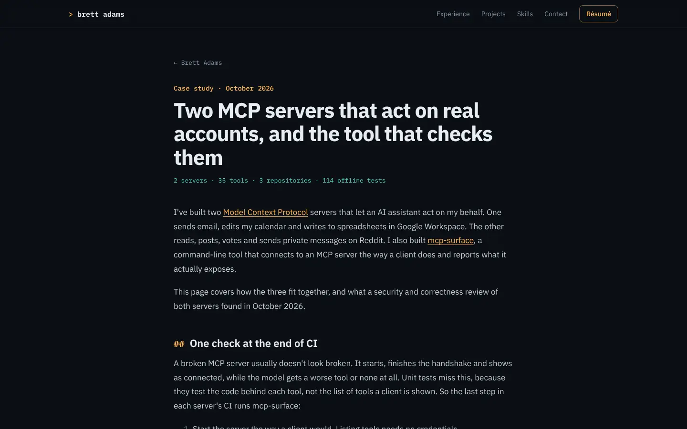
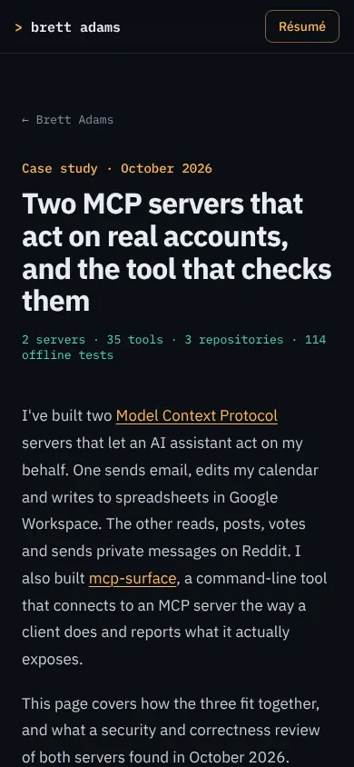
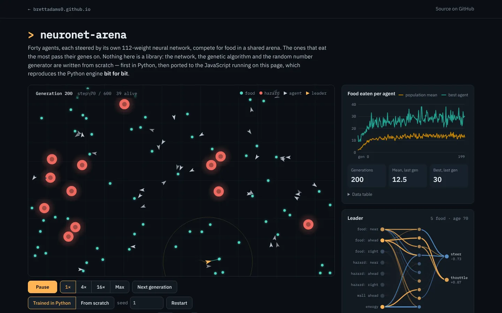
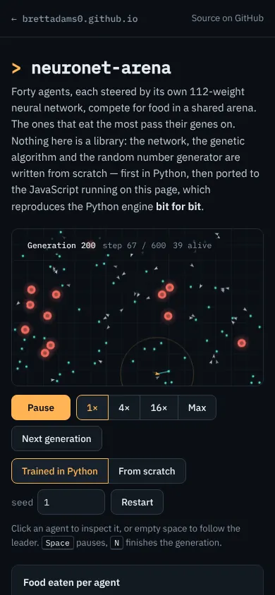
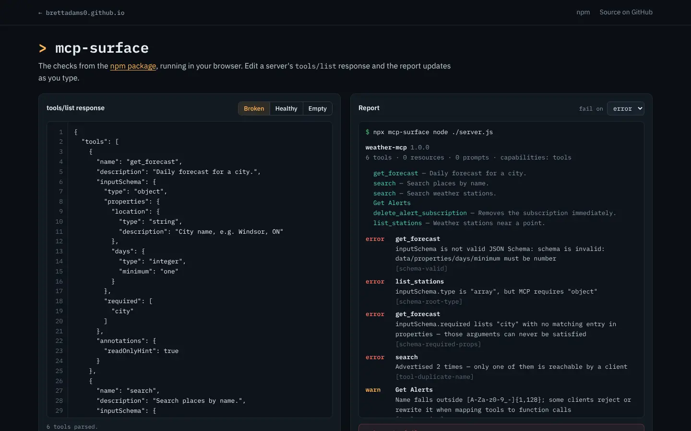
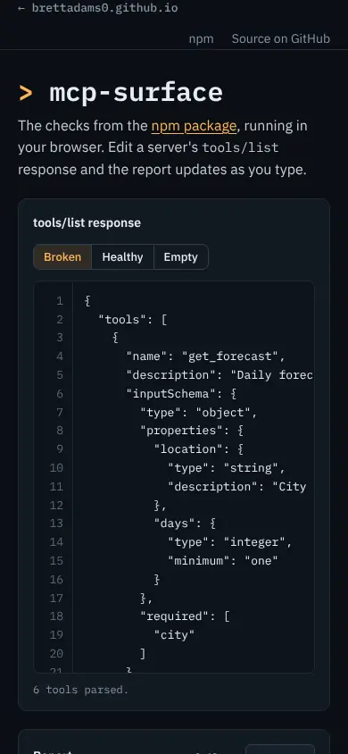

# Site redesign spec

The redesign of brettadams0.github.io, written to be built PR by PR (§16) by someone who wasn't in
the research. It changes how the site looks, reads and works for three audiences: a recruiter
scanning on a phone, an engineer checking depth, and a business reader looking for outcomes.

Nothing here has been built. This file, the research it rests on and the first-screen mock live
under `handoff/`, which `_config.yml` keeps out of the published site.

| | |
|---|---|
| Research | 29 personal sites captured and scored on 2026-10-21, every cited claim re-checked by a second agent. Method and candidate pool: [`research/README.md`](research/README.md). Per-site evidence: [`research/appendix.md`](research/appendix.md). Scores: [`research/scores.csv`](research/scores.csv). Verification: [`research/verification-log.md`](research/verification-log.md) |
| Facts about Brett | [`research/fact-sheet.md`](research/fact-sheet.md): every role, date, tool and number, with its source line. No other source is used for facts about Brett |
| Current site | [`research/baseline/audit.md`](research/baseline/audit.md): measured baseline, scores and the issue list |
| First-screen mock | [`mocks/first-screen.html`](mocks/first-screen.html) and its screenshots (§6) |
| Measuring tool | [`tools/measure.mjs`](tools/measure.mjs): screenshots, axe, performance budget and analytics check for any URL or a local build |
| New project brief | [`border-waits-pipeline.md`](border-waits-pipeline.md) (§14) |
| Decisions for Brett | §18. Each entry has a default the builder uses if Brett doesn't answer |

Citation formats used throughout:
- `[src: index.html:31]` is a line in this repository. Every fact about Brett carries one, taken
  from the fact sheet.
- `[eugeneyan:desktop-fold.webp]` and `[eugeneyan:record.performance.desktop.lcp_ms]` point at a
  research capture or record field for another site, committed under `research/sites/<slug>/`.
  `.png` names point at full-page or inner-page captures, which were kept out of git (see the
  research README).
- `[brettadams0:measure-home.json.perf.mobile.lcp]` points at a baseline measurement of the current
  site in `research/baseline/`.
- `P1`–`P20`, `A1`–`A23` and `S01`–`S18` are the patterns, anti-patterns and hiring-side sources in
  §3 and the appendix.
- **measured** means measured in this research, with method and date. **estimated** means a
  judgement. `[BRETT: …]` marks a fact only Brett can supply. Each one is listed in §18 with the
  wording to ship until he answers.

## Contents

0. [Ground rules](#0-ground-rules)
1. [Summary](#1-summary)
2. [Current-site audit](#2-current-site-audit)
3. [Research findings](#3-research-findings)
4. [Goals and personas](#4-goals-and-personas)
5. [Information architecture](#5-information-architecture)
6. [First screen](#6-first-screen)
7. [Visual system](#7-visual-system)
8. [Component specs](#8-component-specs)
9. [Motion](#9-motion)
10. [Accessibility](#10-accessibility)
11. [Performance budget](#11-performance-budget)
12. [SEO and sharing](#12-seo-and-sharing)
13. [Analytics](#13-analytics)
14. [New project proposal](#14-new-project-proposal)
15. [File-by-file change list](#15-file-by-file-change-list)
16. [Implementation plan](#16-implementation-plan)
17. [Risks and open questions](#17-risks-and-open-questions)
18. [Decisions for Brett](#18-decisions-for-brett)

## 0. Ground rules

Everything in this spec sits inside these rules. They restate `CLAUDE.md`, the README and Brett's brief
so the builder has them in one place. A PR that breaks one of them is wrong even if CI is green.

### Stack and CI

- Jekyll on GitHub Pages with exactly two plugins: `jekyll-seo-tag` and `jekyll-sitemap`
  (`_config.yml:13-15`). **Never add a `Gemfile`.** It changes how Pages resolves dependencies
  (`README.md:34`).
- No build step that Pages won't run. Site pages and demos are plain HTML, CSS and ES modules, with no
  bundler and no framework. Any extra plugin, bundler, framework or custom deploy workflow is a
  decision for Brett (§18), never a default.
- CI (`.github/workflows/ci.yml`) builds with `actions/jekyll-build-pages@v1`, then runs
  `node .github/scripts/check-links.mjs` over `_site`. Every PR keeps it green. Local check:
  `gem install jekyll jekyll-seo-tag jekyll-sitemap && jekyll build && node .github/scripts/check-links.mjs`.
  Local `gem install jekyll` gives Jekyll 4.x while Pages builds with 3.x. Use no Liquid or config
  feature that 3.x lacks, and treat CI as the final word.
- Playwright and Chromium are preinstalled. **Don't run `playwright install`.** The Node `playwright`
  module resolves globally; `handoff/tools/measure.mjs` shows how. axe-core isn't installed:
  `measure.mjs` fetches a pinned `axe.min.js` at runtime. **Never commit `node_modules`. Never add a
  `package.json` outside `handoff/`** (Jekyll would publish a root one). If a manifest is unavoidable,
  it goes in `handoff/tools/`.

### Folders not to reshape

- `neuronet-arena/` is a verbatim copy of the neuronet-arena repo's `web/` directory, with one local
  difference (the "How it was built" link is removed; `README.md:75-76`). Don't edit its files here.
  Any change to it is written as an upstream change in that repo (§18).
- `mcp-surface/checks.js` is generated from the npm package with esbuild (`README.md:78-92`). Don't
  hand-edit it. `mcp-surface/index.html`, `styles.css`, `app.js` and `examples.js` are this repo's own
  files and may change.

### Analytics (GA4 `G-Z3KW627PQQ`, `_config.yml:11`)

- Every event in `assets/js/analytics-events.js` keeps working: `section_view`, `section_dwell`,
  `project_click` (any link inside an element with `[data-project]`), `resume_download`,
  `contact_click` (`[data-contact]` on the link) and `scroll_depth`. §13 maps each one to its new
  element.
- `section_view` and `section_dwell` observe only `section[id]` (`analytics-events.js:68`). Today they
  fire for `experience`, `projects`, `skills` and `contact`. The hero has no id, and `#education` is a
  `div` inside `#skills` (`index.html:172`), so neither fires, although the script's comment mentions
  `#education` (`analytics-events.js:6`). Those four `section_id` values stay, or each is mapped
  explicitly. Renaming or merging them breaks GA report continuity. Any new value (such as `hero` or
  `education`) is a decision (§18).
- `resume_download` matches the href against `/Resume_BrettAdams\.pdf$/` (`analytics-events.js:108`).
  The file stays at `assets/resume/Resume_BrettAdams.pdf`. No query string or fragment goes on the
  link, or the event stops firing without any error.
- Do Not Track behaviour stays as it is (`analytics-events.js:12`). **Never restore `G-EBYB5MK388`**
  (`_config.yml:9-10`). It belongs to someone else's property.
- When a PR runs `measure.mjs` against the live site, GA requests are blocked by default so tests
  don't send hits to Brett's property.

### Résumé

- The PDF is built from `resume/resume.tex` with XeLaTeX on Overleaf, and its format stays exactly as
  it is. The site links to it. This spec doesn't redesign it. Wording points that disagree with the
  site or the code are listed as decisions (§18).

### Brett's standing rules (a change needs his sign-off; every default below keeps them)

- neuronet-arena's live demo is his favourite thing on the site. More live in-browser showcases of
  real projects are welcome, built from the project's actual code and never mocked up.
- **Nothing live runs on the homepage, and each project appears there once.** A demo is reached from
  its project card (screenshot, "Live demo" badge, link) and starts only on its own page. The hero demo
  preview and the separate demos section were removed as duplicates. Neither comes back.
- **No blog posts.** Copy stays short and factual: one line per project, facts as chips. `/mcp/` is
  the only long-form page.
- Dark only. The tokens (`--bg #0b0f14`, `--surface #131a22`, `--border #222c38`, `--amber #ffb454`,
  `--teal #4fd6c4`, `--red #ef6a5f`, `--good #3ccf6e`) are shared with the demos. IBM Plex Sans and
  IBM Plex Mono, with terminal touches: the `> brett adams` brand, `## ` section titles, `// `
  kickers. §7 evolves these and says how each change reaches the demo pages.

### Honesty and copy

- **Never invent metrics, employers, titles, dates, results, testimonials, user counts or quotes.**
  Every factual line of copy in this spec carries its source (`[src: resume/resume.tex:106]`). A line
  that needs a fact only Brett has uses a visible placeholder such as `[BRETT: rows/day migrated?]`.
  Each placeholder is also listed in §18. The builder ships no placeholder. Until Brett answers, the
  line ships in its fallback form (given next to each placeholder) or is left out.
- Where sources disagree (`index.html`, `resume.tex`, `/mcp/`), copy uses the wording named in that
  §18 entry's default. A claim contradicted by code, a README or a handoff file is never repeated as
  fact.
- Plain and specific. No hype words ("passionate", "cutting-edge", "leveraging", "seamless"), no
  buzzword walls, nothing that reads as AI-written.
- Every number in this spec is labelled **measured** (with method and date) or **estimated**.

### Process for every PR in §16

- Change only the files that PR lists. Run `jekyll build`, `check-links.mjs`, and
  `node handoff/tools/measure.mjs` (screenshots at 390, 768 and 1440 compared with the before state,
  axe, the budget, and the analytics check) before pushing.
- Open PRs against `main` (CI runs only on PRs to `main`).

## 1. Summary

The current site is already lean, accessible and honest. It scores a mean of 3.67 on the rubric,
joint 10th of the 30 sites scored, with 0 axe violations on the homepage (measured, §2). It loses
most to the set on three criteria. Navigation scores 3, and 20 of the 29 sites score higher. Mobile
scores 3 (18 higher), and memorability scores 3 (20 higher) (measured, §3.3). The redesign keeps
what works and fixes what costs Brett with each audience: a recruiter on a phone, an engineer or
hiring manager looking for depth, and a business reader looking for outcomes.

### The changes that matter most

| # | Change | Who it's for | Evidence | Where |
|---|---|---|---|---|
| 1 | **The first screen reads like a résumé header.** The sourced hero copy stays. A new "At a glance" card lists now, before, studying, tools, what he's looking for and where he's based. Résumé is the primary button, with Email · LinkedIn · GitHub beside it. The card fills the empty right half of the 1440 fold and sits under the buttons on a phone. | Recruiter (6-second scan, then the 30-second skim) | P1, P3, P19 (§3.4). The first pass reads title, employer, dates and school in that order (H2: S01, S02). Audit issues 9, 10 and 25 | §6, §8.2–8.3 |
| 2 | **Phones get the section links back.** Below 860 px, Experience · Projects · Skills · Contact stay visible as a second row of 44 px text links, with no menu and no JS. Today, phones show only the brand and Résumé. | Everyone on a phone | A3: 4 sites plus Brett's have no phone nav. P4. Audit issue 1 (high) | §5.3, §8.1 |
| 3 | **Proof of work is one tap away, and Experience stays first.** A hero link "Projects and live demos ↓" and the nav's Projects link reach the featured demo card in 1 tap. Today that takes 3 scrolls at 390. Experience is tightened to lead bullets, and the rest move into a native disclosure. | Engineer, recruiter | P5, P6, P7. The internship is the strongest new-grad signal (H4: S04), so the order stays. Audit issue 2. Targets in §4.3 | §4.3–4.5, §5.2, §8.4 |
| 4 | **Every project card says what each link opens.** Cards get a kind line ("Live demo · runs in your browser", "Case study", "npm package") and links named by destination. "Live demo" is used only for pages that run the project's code. Cryptic chips become sourced plain facts. Screenshots get `srcset` and 800 px variants (105,646 B against 307,644 B today, measured). | Engineer, business reader | P12, P13; A12, A21 (§3.6). Audit issues 8, 23, 24 and 26 | §7.9, §8.5–8.10 |
| 5 | **Demo pages lead back to the person.** `/mcp-surface/` and future demo pages share one header: "← Brett Adams", project name, Source, Résumé, a short "How it works" block and contact in the footer. neuronet-arena gets the same through an upstream PR in its own repo. | Recruiter arriving from a shared demo link, engineer | P8, P9, P10. Audit issue 13 | §8.20, §16 |
| 6 | **The visual system is written down and the remaining accessibility gaps close.** A `tokens.css` holds the existing palette plus text-safe `--dim`, type, space and motion tokens. Plex is self-hosted with metric-matched fallbacks (70,472 B, measured), and the 6 failing contrast pairs are fixed (§7.3). Terminal prefixes stay on screen but leave accessible names, and code scrollers become keyboard-reachable. | Engineer judging craft, screen-reader and keyboard users | P16, P20; A14: 20 of 29 sites fail contrast. Audit issues 3, 4, 6, 7 | §7, §10 |
| 7 | **`/mcp/` follows one case-study outline.** For, problem, a diagram on the first screen, decisions, tests, result and limits. It is still the only long-form page. | Engineer, business reader | P11 (§3.4). Hiring managers ask how and why, not just what (H5: S06, S07) | §8.18 |
| 8 | **One new project closes the data-engineering gap.** border-waits is an hourly pipeline over the Canadian and U.S. border wait-time feeds, modelled and tested with dbt on DuckDB, that a visitor can query with SQL in the browser on click. It gets one card and its own page, and nothing live on the homepage. It is queued as a brief, not built. | Data-engineering hiring manager, recruiter | No verified site in the set shows a scheduled pipeline with visible freshness or test status (§3.9). Prototype parity measured (§14) | §14, `handoff/border-waits-pipeline.md` |

Copy stays sourced throughout. Every fact on the page traces to `index.html` or `resume.tex` through
the fact sheet. Numbers only Brett has, such as impact figures, target roles and location, are
`[BRETT: …]` placeholders, each with a sourced line that ships until he answers (§18).

### What changes, what stays

**Changes**
- The hero gains the At-a-glance card and a jump link to Projects (§6).
- A second nav row appears on phones (§8.1).
- Experience shows lead bullets, with the rest behind a disclosure (§4.5, §8.4).
- Project cards get kind lines, named links, clearer chips and responsive screenshots (§8.5–8.10).
- `/mcp/` is reordered onto the case-study outline (§8.18).
- `/mcp-surface/` gets the shared demo shell plus contrast and keyboard fixes (§8.20).
- The design tokens move into `assets/css/tokens.css`; fonts are self-hosted (§7).
- Footer contact links get `data-contact` (Decision, default yes, §13, §18).
- `measure.mjs` gains an `--a11y` mode, and `handoff/tools/contrast.py` is added (§10.15, §7.3).

**Stays**
- The section order (Experience, Projects, Skills with Education, Contact) and every `section[id]`
  value GA reports on: `experience`, `projects`, `skills` and `contact` (§13).
- The résumé at `assets/resume/Resume_BrettAdams.pdf`, linked with no query string, and the résumé
  itself.
- GA4 `G-Z3KW627PQQ`, every existing event and the Do Not Track behaviour (§13).
- Nothing live on the homepage, each project once, one line per project with facts as chips, and no
  blog (§0).
- Dark only, the palette values, IBM Plex, and the terminal touches as visual details (§7).
- Jekyll on Pages with the same two plugins, no Gemfile, no build step, and CI as it is (§0).
- `neuronet-arena/` untouched in this repo; changes to it go upstream (§0, §8.20).

## 2. Current-site audit

This is the site as it stood on 2026-10-21, before any redesign work. The full audit is
[`research/baseline/audit.md`](research/baseline/audit.md), and the per-page reports are
`research/baseline/measure-<page>.json`. Every number in this section is **measured** unless it says
**estimated**. Later PRs re-run the same command and compare against these tables.

### 2.1 How it was measured

- **When:** 2026-10-21, main runs 04:00–04:07 UTC, spot checks 13:35–16:25 UTC.
- **Tool:** `handoff/tools/measure.mjs` with Playwright Chromium 141.0.7390.37 and axe-core 4.10.2,
  pinned by SHA-256. Command:
  `node handoff/tools/measure.mjs https://brettadams0.github.io/ --path / --path /mcp/ --path /neuronet-arena/ --path /mcp-surface/ --path /404.html --shots --axe --perf --runs 3 --budget --analytics --dnt`.
  The same run against a local `jekyll build` (Jekyll 4.4.1) used `--site _site`.
- **Profiles:**
  - Throttled mobile: 390×844, DPR 2, `isMobile`, 150 ms latency, 1.6 Mbps down, 750 kbps up,
    CPU 4×.
  - Unthrottled desktop: 1440×900.
  - Three runs each. The run with the median LCP is reported.
  - CLS is the largest session window after a slow scroll to the bottom and back.
- **Sizes:** CDP `encodedDataLength`, so headers are included. 1 KB = 1,024 B. "Images" counts
  everything loaded during a full scroll.
- **Google Analytics was blocked** in every measured run, so GA bytes are not in the tables. gtag.js
  was fetched once with `curl` and is 180,868 B.
- **One GA test hit.** A development run of `measure.mjs` at 03:57 UTC used `--allow-ga` against
  the local build. It probably sent one `page_view` with a `127.0.0.1` page location to
  `G-Z3KW627PQQ`. Every later run blocked GA.
- **Caveat:** the live site was loaded through the session's HTTPS proxy, so live timings include
  proxy latency. The local-build table has no proxy in the path.

### 2.2 Rubric scores (1–5)

Scores use the rubric in [`research/README.md`](research/README.md#rubric) and come from audit §2.
The mean is **3.67** (measured: the arithmetic mean of the 15 integer scores). That puts the current
site joint 10th of the 30 scored sites (29 others plus this one). Nine sites score higher.

| # | Criterion | Score | Why |
|---|---|---|---|
| 1 | First-screen clarity | **4** | Name, "Data Analyst Intern at Geotab", school and "Graduating 2027 · Open to full-time roles" are in both folds, with Résumé and contact buttons `[brettadams0:home-390-fold.webp]` (`index.html:7-16`). Missing: role family (the kicker only says "data & software engineering", `index.html:8`), graduation month, any sign of the projects. The right ~55% of the 1440 hero is empty (estimated from the screenshot). |
| 2 | Proof of skill | **4** | Two live demos built from the projects' own code, a case study with real CI output (`mcp/index.html:44-58`), source links on every card. Slow to reach: the first "Live demo" badge is at y=1771 at 1440 and y=2761 at 390 `[brettadams0:measure-home.json.viewport.390.key_info.shipped_work]`. |
| 3 | Project presentation | **4** | Consistent cards: screenshot, one line, chips, links; neuronet-arena spans the full row (`index.html:85-96`). The chip "13.4 food vs 1.0 for the control" needs context (`index.html:91`). The MCP card's screenshot links to GitHub, not `/mcp/` (`index.html:99`). |
| 4 | Experience presentation | **3** | Clear timeline: title, employer, dates, place, 2–4 bullets and chips (`index.html:24-77`). Of 13 bullets only "hours to minutes" (`:46`) and "over 20 employees" (`:61`) carry a measure. The section is about 2.3 screens long at 390 (estimated from measured positions, y ≈ 560 to 2496). |
| 5 | Visual craft | **4** | Coherent dark tokens, IBM Plex Sans and Mono, terminal touches (`> `, `## `, `// `, `@ `), restrained amber `[brettadams0:home-1440-fold.webp]`. It sits in the familiar dark developer-portfolio idiom. The empty half of the desktop hero and the faint grid (`site.css:231-243`) add little. |
| 6 | Interaction and motion | **4** | Only hover transitions of 0.15–0.2 s (`site.css:172`, `:436`) and smooth anchor scrolling, turned off under reduced motion (`site.css:38-42`). neuronet-arena starts paused under reduced motion (`neuronet-arena/ui/app.js:60`). |
| 7 | Navigation and IA | **3** | Four anchors plus Résumé on desktop. Under 860 px the section links are `display: none` with no menu (`site.css:859-862`) `[brettadams0:measure-home.json.viewport.390.header_links]`. Demo pages use a different header whose back link reads "brettadams0.github.io", with no résumé or contact link. |
| 8 | Mobile quality | **3** | A real one-column layout with no horizontal scroll. But: no section nav, projects 3 screens down, footer links 18 px and `.also` links 19 px tall `[brettadams0:measure-home.json.viewport.390.small_targets_24]`, CLS 0.1643 on `/neuronet-arena/`. |
| 9 | Performance | **4** | Homepage 2.5 KB of JS, LCP 744 ms throttled, CLS 0.0011 `[brettadams0:measure-home.json.perf.mobile]`. Minus: render-blocking Google Fonts CSS, 304 KB of screenshots with no `srcset`, CLS 0.1643 on the favourite demo. |
| 10 | Accessibility | **4** | 0 axe violations on `/` and `/404.html` at both sizes, a skip link (`_layouts/default.html:38`), landmarks, a 2 px amber focus ring on every Tab stop. Minus: serious violations on `/mcp/` (1) and `/mcp-surface/` (2); screen readers hear "## Experience" and "Data Analyst Intern @ Geotab". |
| 11 | Copy | **4** | Plain and specific: "Checkout is one transaction, so the last unit can't sell twice" (`index.html:145`). Weak spots: a generic kicker, duty-style Geotab bullets, cryptic result chips. |
| 12a | Persona: recruiter | **4** | A 6-second phone scan gets name, role, employer, school, graduation year, "Open to full-time roles" and a Résumé button. A 30-second skim can't find graduation month, location, work authorization or target roles, and a phone has no nav past the hero. |
| 12b | Persona: engineer | **4** | Real demos, source links, `/mcp/` with concrete security fixes (`mcp/index.html:92-150`), a lean site. Depth starts 2–3 screens down, and the homepage doesn't surface decisions such as bit-for-bit parity or snapshot checks in CI. |
| 12c | Persona: business | **3** | Plain language but few outcomes: "replaced manual reporting", "hours to minutes" (`index.html:45-46`), "over 20 employees" (`:61`). Project lines are technical. No problem-to-outcome framing. |
| 13 | Memorability | **3** | The neuronet-arena demo: forty agents evolving in the browser `[brettadams0:neuronet-arena-390-fold.webp]`. It serves the content but sits 3 screens down on a phone and behind a click. |

Against the 29 other sites ([§3.3](#33-comparison-table)), measured by comparing columns:

- **Already at the top of the set:** interaction and motion (4; no site scores higher),
  accessibility (4; no site scores higher), recruiter persona (4; only damian scores 5).
- **Furthest behind:** navigation and IA (20 of 29 score higher), memorability (20), mobile (18),
  experience (13), business persona (9).

### 2.3 Measured baseline

**Throttled mobile, 390×844, live site**

| Page | Total | JS excl. GA | CSS | Fonts | Images | Requests | LCP (element) | CLS |
|---|---|---|---|---|---|---|---|---|
| `/` | 389.6 KB | 2.5 KB | 6.1 KB | 71.8 KB | 304.0 KB | 13 | 744 ms (`p.lede`) | 0.0011 |
| `/mcp/` | 86.0 KB | 2.5 KB | 6.1 KB | 71.8 KB | 0 | 8 | 844 ms (first body `p`) | 0.0234 |
| `/neuronet-arena/` | 119.8 KB | 28.1 KB | 5.5 KB | 61.2 KB | 0 | 19 | 692 ms (`p.lede`) | **0.1643** |
| `/mcp-surface/` | 125.7 KB | 46.9 KB | 4.7 KB | 71.9 KB | 0 | 10 | 1752 ms (report text) | 0.0021 |
| `/404.html` | 72.1 KB | 2.5 KB | 6.1 KB | 61.3 KB | 0 | 7 | 592 ms (`h1`) | 0.0001 |

Source: `[brettadams0:measure-<page>.json.perf.mobile]`.

**Unthrottled desktop, 1440×900, live site**

| Page | Total | JS excl. GA | CSS | Fonts | Images | Requests | LCP (element) | CLS |
|---|---|---|---|---|---|---|---|---|
| `/` | 409.6 KB | 2.5 KB | 6.1 KB | 91.8 KB | 304.0 KB | 13 | 408 ms (first Geotab bullet) | 0.0040 |
| `/mcp/` | 106.0 KB | 2.5 KB | 6.1 KB | 91.8 KB | 0 | 8 | 480 ms (`h1`) | 0.0431 |
| `/neuronet-arena/` | 134.3 KB | 28.1 KB | 5.4 KB | 75.8 KB | 0 | 19 | 440 ms (`p.lede`) | 0.0152 |
| `/mcp-surface/` | 145.9 KB | 46.9 KB | 4.9 KB | 91.8 KB | 0 | 10 | 636 ms (report text) | 0.0010 |
| `/404.html` | 87.5 KB | 2.5 KB | 6.1 KB | 76.7 KB | 0 | 7 | 328 ms (`h1`) | 0.0001 |

**Local `jekyll build`, served gzipped by `measure.mjs`**

| Page | Mobile total | Mobile LCP | Mobile CLS | Desktop LCP | Desktop CLS |
|---|---|---|---|---|---|
| `/` | 385.2 KB | 604 ms | 0.0011 | 192 ms | 0.0034 |
| `/mcp/` | 84.4 KB | 596 ms | 0.0205 | 268 ms | 0.0423 |
| `/neuronet-arena/` | 104.2 KB | 508 ms | 0.1643 | 104 ms | 0.0198 |
| `/mcp-surface/` | 122.8 KB | 1156 ms | 0.0012 | 272 ms | 0.0010 |
| `/404.html` | 70.5 KB | 504 ms | 0.0001 | 172 ms | 0.0001 |

**axe-core 4.10.2 violations (critical / serious / moderate / minor)**

| Page | 390×844 | 1440×900 | Rules (nodes) |
|---|---|---|---|
| `/` | 0 / 0 / 0 / 0 | 0 / 0 / 0 / 0 | none; 32 `color-contrast` "incomplete" at 390 (axe can't resolve the hero gradient) |
| `/mcp/` | 0 / **1** / 0 / 0 | 0 / 0 / 0 / 0 | `scrollable-region-focusable` (the `<pre>`) at 390 |
| `/neuronet-arena/` | 0 / 0 / 0 / 1 | 0 / 0 / 0 / 1 | `empty-table-header` (1) |
| `/mcp-surface/` | 0 / **2** / 0 / 0 | 0 / **2** / 0 / 0 | `color-contrast` (17: `#gutter`, `.rule-tag`), `scrollable-region-focusable` (`.term`) |
| `/404.html` | 0 / 0 / 0 / 0 | 0 / 0 / 0 / 0 | none |

The pass bar for the redesign is zero serious or critical violations (§10). `/mcp/` and
`/mcp-surface/` fail it today.

**Contrast.** Every text token passes 4.5:1 on every background except `--faint` #5a6878: 3.37:1
on `--bg`, 3.25:1 on `--bg-2`, 3.08:1 on `--surface`, 2.85:1 on `--surface-2` (computed from
`assets/css/site.css:4-24` with the WCAG 2.x formula). The lowest body-text pair is `--muted` on
`--surface-2` at 5.32:1. §7 has the full table for the new tokens.

**Notes on the numbers**

- The default budget (homepage JS < 15 KB excluding GA, LCP < 2000 ms throttled, CLS < 0.05, no
  framework) **passes** on live and local `[brettadams0:measure-home.json.budget]`.
- Before any scroll, the throttled homepage transfers 85.5 KB in 8 requests
  `[brettadams0:measure-home.json.perf.mobile.initial_transfer_bytes]`. The five lazy screenshots
  (304 KB) arrive while scrolling: 78% of a full-scroll visit.
- Real visitors also download gtag.js (180,868 B), about 72 times the site's own JS. It loads
  `async`.
- `checks.js` is 41.4 KB of `/mcp-surface/`'s 46.9 KB of JS. Its LCP is report text that `app.js`
  paints after the checks load.
- The homepage is 6,346 px tall at 390 (7.5 screens) and 4,445 px at 1440 (4.9 screens)
  `[brettadams0:measure-home.json.viewport.390.page_height]`. Time to key info for today's site is
  in §4.3.

**Analytics today** (audit §4, run with `--analytics --dnt`, GA blocked):

- `gtag('config', 'G-Z3KW627PQQ')` only. `G-EBYB5MK388` is absent.
- `section_view` and `section_dwell` fire for `experience`, `projects`, `skills`, `contact`. The hero
  (no id, `index.html:4`) and `div#education` (`index.html:172`) never fire.
- `scroll_depth` 25/50/75/100, `project_click` ×18, `resume_download` ×3 (header, hero, contact),
  `contact_click` ×6 (hero and contact section).
- Nothing fires for the footer links (`_layouts/default.html:61-63`, no `data-contact`), "More on
  GitHub →" (`index.html:156`, no `data-project`) or `data-project="nhl-arena"` (no link inside).
- `/neuronet-arena/` and `/mcp-surface/` load no gtag at all.
- With Do Not Track set, 0 custom events fire. gtag's own page view still runs. That is today's
  behaviour, and it stays.

### 2.4 Screenshots

Fold shots at full resolution. Full-page shots are linked (downscaled to stay under 80 KB, so text
is soft).

**Homepage `/`.** At 1440 the hero is one column and the right side is blank apart from the faint
grid. The fold ends on the Geotab bullets and chips. At 390 the header holds only the brand and
Résumé, and "Email" wraps onto its own row.


Full page: [1440](research/baseline/home-1440-full.webp) · [390](research/baseline/home-390-full.webp)

**`/mcp/`.** Back link "← Brett Adams", eyebrow, a three-line `h1` at 1440 (four at 390), the fact
line, then prose. The first screen is text only; the first figure (CI output,
`mcp/index.html:44-58`) is below it.




Full page: [1440](research/baseline/mcp-1440-full.webp) · [390](research/baseline/mcp-390-full.webp)

**`/neuronet-arena/`.** A different header ("← brettadams0.github.io", "Source on GitHub"). The
arena runs in the first screen at both sizes, with the chart and the leader's network beside it at
1440.




Full page: [1440](research/baseline/neuronet-arena-1440-full.webp) · [390](research/baseline/neuronet-arena-390-full.webp)

**`/mcp-surface/`.** Editor and report side by side at 1440. At 390 the header wraps onto two rows
(back link, then "npm" and "Source on GitHub"), and the editor fills the fold.




Full page: [1440](research/baseline/mcp-surface-1440-full.webp) · [390](research/baseline/mcp-surface-390-full.webp)

### 2.5 Issues

Severity: **critical** blocks a core task; **high** hurts a persona's main path or fails the
accessibility pass bar; **medium** is a visible quality or measurement gap; **low** is polish.
"Upstream" means the fix belongs in the neuronet-arena repo. Numbers 1–28 match audit §5; 29 is new
in this spec, from the baseline screenshot. "Fixed in" names the spec section that specifies the fix;
§16 assigns each one to a PR.

| # | Sev. | Issue | Where | Evidence (measured) | Fixed in |
|---|---|---|---|---|---|
| 1 | High | No section navigation on phones | `assets/css/site.css:859-862` hides `.nav-section` under 860 px; `_layouts/default.html:43-49` has no menu | At 390 the header shows only "brett adams" and "Résumé"; Projects start at y=2496, 3 screens down `[brettadams0:measure-home.json.viewport.390.key_info.projects_heading]` | §5.3, §8 header/nav (`.nav-sections`) |
| 2 | High | Proof of work is below the fold at every size | Experience (`index.html:21-79`, 13 bullets) comes before Projects (`:81`) | First "Live demo" at y=1771 (1440) and y=2761 (390); nothing in either fold points to a project | §4.3 targets, §5.2 hero link to `#projects`, §4.5 and §8 tightened timeline |
| 3 | High | `/mcp-surface/` fails axe, 2 serious rules | `#gutter` (`mcp-surface/styles.css:98`) and `.rule-tag` (`:161`) use `--faint` on `--term` (3.25:1); `.term` scroll region not focusable (`mcp-surface/index.html:69`, `styles.css:134-137`) | 17 contrast nodes `[brettadams0:measure-mcp-surface.json.axe.1440.by_impact.serious]` | §7 `--dim`, §10, §8 demo shell |
| 4 | Medium | `/mcp/` fails axe at 390, 1 serious rule | `<pre>` (`mcp/index.html:45`, `site.css:707-716`, `overflow-x: auto`) has no `tabindex` | `[brettadams0:measure-mcp.json.axe.390.by_impact.serious]` | §10, §8 `/mcp/` template |
| 5 | Medium (upstream) | Layout shift on the favourite demo, CLS 0.1643 on mobile | Font CSS loads with `media="print" onload` (`neuronet-arena/index.html:18-20`) | When Plex replaces the fallback, `.lede` shrinks 209 → 186 px and the arena moves up 23 px; reproduces locally `[brettadams0:measure-neuronet-arena.json.perf.mobile.shifts]` | §7 metric-matched fallback; upstream PR (§16) |
| 6 | Medium | Screen readers hear the terminal prefixes | CSS `content` on `.section-title::before` (`site.css:323-326`) and `.job-org::before` (`:394-397`); same technique at `:121-124`, `:278-281`, `:683-688` | Accessible names "## Experience", "Data Analyst Intern @ Geotab" (`ariaSnapshot`) | §7 terminal touches, §10 |
| 7 | Medium | Render-blocking third-party font CSS on every default-layout page | `_layouts/default.html:31-33`, 7 faces requested, 4 files downloaded | FCP = LCP = 744 ms on `/` and 844 ms on `/mcp/`; fonts are 71.8 of 86.0 KB of `/mcp/`; desktop `/mcp/` CLS 0.0431, most likely the font swap (inferred) | §7 font loading (self-host is a Decision) |
| 8 | Medium | Oversized screenshots, no `srcset` | `index.html:87, 100, 114, 129, 142` | `mcp-servers.webp` and `mcp-surface.webp` are 2200×1376 and render at 524×294 at 1440, 4.2× the width needed; images are 304 of 389.6 KB on mobile | §7 screenshot treatment, §8 project cards |
| 9 | Medium | The desktop first screen is half empty | One-column hero (`site.css:245-247`), lede capped at 34em (`:292`) | Right ~55% of the 1440 hero blank (estimated from the screenshot) | §6 At-a-glance card, §8 hero |
| 10 | Medium | The status line leaves out what a recruiter checks | `index.html:7`, kicker `:8` | No month or term, role family, location or work authorization (fact sheet D4, D5) | §6 copy with `[BRETT: …]` placeholders, §18 |
| 11 | Medium | Demo visits are unmeasured | No gtag in `neuronet-arena/index.html:1-23` or `mcp-surface/index.html:1-21` | `[brettadams0:measure-mcp-surface.json.analytics.gtag_present]` | §13 (Decision; neuronet-arena is upstream) |
| 12 | Medium | Footer contact links aren't tracked | `_layouts/default.html:61-63`, no `data-contact` | They are the only contact links on `/mcp/` and `/404.html` `[brettadams0:measure-mcp.json.analytics.failed_clicks]` | §8 footer, §13 (Decision) |
| 13 | Medium | Demo pages don't share the site shell | Back link "brettadams0.github.io" (`neuronet-arena/index.html:28`, absolute; `mcp-surface/index.html:26`, `/`) vs "← Brett Adams" on `/mcp/` (`mcp/index.html:10`); no résumé, contact or skip link; different favicons (`neuronet-arena/index.html:15`), font sets (`mcp-surface/index.html:18`), container (1320 vs 1200 px), radius (10 vs 12 px); neuronet-arena links use the browser focus ring (`neuronet-arena/styles.css:158`) | `[brettadams0:measure-neuronet-arena.json.viewport.1440.focus_walk]` | §8 shared demo shell; neuronet-arena parts upstream |
| 14 | Medium | Experience bullets read as duties | `index.html:31-34`; only `:46` and `:61` carry a measure | — | §4.5 internship story, §8 timeline entry, `[BRETT: …]` numbers |
| 15 | Low | Small tap targets at 390 | Footer links 18 px (`site.css:832-840`), `.also` 19 px (`:546-549`), project links 24 px (`:513-521`), mcp-surface segmented buttons 27 px (`mcp-surface/styles.css:71-79`) | All pass WCAG 2.2 SC 2.5.8 by size or spacing, all well under 44 px `[brettadams0:measure-home.json.viewport.390.small_targets_24]` | §10 target sizes, §8 footer and "also" list |
| 16 | Low | `--faint` text under 4.5:1 | Site uses it only for decorative glyphs (`site.css:280`, `:417`, `:672`); demos use it for text (`neuronet-arena/styles.css:261`, upstream; mcp-surface, issue 3) | 3.37:1 on `--bg`, 2.85:1 on `--surface-2` | §7 `--dim` |
| 17 | Low | UI borders below 3:1 | `.btn` outline (`site.css:166`), card edges | `--border` 1.36:1 and `--border-strong` 1.69:1 on `--bg`. Not an SC 1.4.11 failure, since buttons are identified by text | §7 borders |
| 18 | Low | GA dominates the JS weight | `_includes/analytics.html` | gtag.js 180,868 B vs 2.5 KB of site JS; async, and excluded from the budget by definition | §11 (noted, not changed) |
| 19 | Low | Heavy social cards | `_config.yml:25` | `social-card.png` 211,878 B; demo `og.png` 144,842 B and 109,961 B; a tuned image would be well under 100 KB (estimated) | §12 |
| 20 | Low | Demo titles don't name Brett | `neuronet-arena/index.html:6`, `mcp-surface/index.html:6`; no canonical link | — | §12, §8 demo shell |
| 21 | Low | The 404 page is a dead end with generic meta | `404.html:11` offers only "Back to the homepage" | Site-default description; `canonical: /404.html` `[brettadams0:measure-404.json.page.canonical]` | §8 404 page, §12 |
| 22 | Low | JSON-LD is thin | `_layouts/default.html:11-30` | `Person` has no `image`, `knowsAbout` or `email`; `alumniOf` for a current student (fact sheet D19); `/mcp/` has only `WebPage` | §12 |
| 23 | Low | The live badge sits inside the heading | `index.html:89`, `:116` | Accessible names "neuronet-arena Live demo", "mcp-surface Live demo" | §8 Live demo badge |
| 24 | Low | Off-site first click on the MCP card | Screenshot links to the google-workspace-mcp repo (`index.html:99`), first text link to `/mcp/` (`:106`) | — | §8 standard project card |
| 25 | Low | Hero buttons wrap on phones | `index.html:11-16` | "Email" alone on a second row at 390 `[brettadams0:home-390-fold.webp]` | §6, §8 buttons |
| 26 | Low | Cryptic result chip | `index.html:91` | "13.4 food vs 1.0 for the control" needs the demo page to make sense | §8 featured project card |
| 27 | Low (upstream) | Empty table header | `neuronet-arena/index.html:118` | axe minor `empty-table-header` | Upstream PR (§16) |
| 28 | Low | mcp-surface has the site's slowest LCP | Report paints after `checks.js` (41.4 KB) loads | 1752 ms throttled `[brettadams0:measure-mcp-surface.json.perf.mobile.lcp_runs_ms]`; under 2 s | §11 (watch) |
| 29 | Low | mcp-surface header wraps onto two rows at 390 | `mcp-surface/index.html:24-32` | Back link on one row, "npm" and "Source on GitHub" on the next `[brettadams0:mcp-surface-390-fold.webp]` | §8 demo shell |

### 2.6 What works today (keep)

- **Lean, framework-free pages.** 2.5 KB of site JS on the homepage, LCP 744 ms throttled, CLS
  0.0011, default budget passes.
- **The first screen already states what a recruiter scans for:** name, current role and employer,
  school, graduation year and availability, with Résumé and contact buttons in both folds
  (`index.html:7-16`).
- **Real live demos reached from their cards,** never on the homepage (`index.html:85-125`).
  neuronet-arena works on a phone and starts paused under reduced motion.
- **Analytics work as documented:** all six events, the four `section_id` values, DNT suppresses
  every custom event `[brettadams0:measure-home.json.analytics.counts]`.
- **Accessibility basics on the homepage:** zero axe violations, skip link, landmarks, one focus ring,
  body text at 5.32:1 or better.
- **One token system across site and demos:** `--bg`, `--surface`, `--border`, `--amber`, `--teal`,
  `--red` and `--good` match in `assets/css/site.css:4-24`, `neuronet-arena/styles.css:5-27` and
  `mcp-surface/styles.css:4-22`.
- **Plain, specific copy:** one line per project, facts as chips; `/mcp/` shows real CI output and
  names each fix.
- **Correct 404 handling and indexing:** missing URLs return a real 404 with the custom page; the
  sitemap and `robots.txt` are in place.

## 3. Research findings

Twenty-nine personal sites were captured, scored on the rubric and checked by an independent
verifier. Every claim below about another site comes from a page loaded in this session and survived
verification. Each site's full entry, with fold screenshots, scores, what works and what doesn't, is
in the appendix: [`research/appendix.md`](research/appendix.md). Method, the full candidate pool and
the rubric are in [`research/README.md`](research/README.md). Verification outcomes are in
[`research/verification-log.md`](research/verification-log.md).

**How to read the citations.** `[slug:desktop-fold.webp]` is a committed fold shot in
`research/sites/<slug>/`. `[slug:record.<path>]` is a field in that site's capture record (the
committed `record.json` is a trimmed copy). `tiles/…`, `inner-desktop-fold.png` and `*-full.png`
are scratch-only captures that the verifier reloaded; they are not in git. S-ids and X-ids are
hiring sources, listed in the [appendix](research/appendix.md#hiring-side-evidence).

### 3.1 What was done (measured counts)

- **Pool:** 79 entries from four discovery agents (77 distinct sites; henryheffernan and mitchivin
  were found twice). 29 were captured in full. The rest are listed with the reason in the README.
- **Capture:** each homepage at 1440×900 and 390×844 (fold and full page), one inner page, a
  `record.json` with performance, axe-core 4.10.2 and time to key info. Captured 2026-10-21,
  13:35–21:32 UTC.
- **Verification:** an agent that did not capture each site reloaded it and tried to disprove every
  claim. Result: 1,212 confirmed, 121 corrected, 1 removed, 0 unverifiable. Corrected claims carry
  the verifier's wording.
- **Blind re-score:** 8 of 29 sites (25%, rounded up, drawn with a fixed seed). Of 120 criterion
  pairs, none differed by 2 or more, so no tie-break ran.
- **Memory check:** for every seed site the capture agent wrote what it expected before looking, then
  compared it with the capture (`memory_check` in each score file).

### 3.2 Coverage against the brief's minimums

| Minimum (PROMPT §4.1) | Result | Sites |
|---|---|---|
| ≥ 8 data, analytics or ML sites | **10** | beingbrute, deshraj-jogiya, eugeneyan, mehdio, mujtabasaqib, pahasara, shaundataanalytics, ssp, wisl, plus robinlinacre (in the interactive group; their /about page says data engineer) |
| ≥ 4 DE/AE practitioners, not counting blog-first ML seeds | **9** | deshraj-jogiya, mehdio, mujtabasaqib, pahasara, shaundataanalytics, ssp, wisl, robinlinacre, beingbrute. Four are early-career by their own pages: beingbrute, deshraj-jogiya, mujtabasaqib, pahasara |
| ≥ 6 new-grad or intern portfolios that clearly worked | **7** | damian (Citadel full-time), florea (Datadog after an internship), shao (Tesla), kushalgoel (Citadel internship), richardshuai (Databricks S26, Google F26), darshshah (Wealthsimple intern; the weakest signal), henryheffernan (built for a job search, now at Vercel) |
| Software and design engineers, design-forward and minimal | met | design-forward: brittanychiang, emilkowal, rauno; minimal: antfu, shud; minimal counterexample: danluu; content-heavy: taniarascia |
| Interactive and live-demo sites | **5** | ciechanow, madebyevan, redblobgames, robinlinacre, samwho |
| Cautionary "wow" examples | met | bruno-simon, henryheffernan; also weighed: ciechanow (demo on the homepage), ssp (graph landing), mujtabasaqib (splash gate) |

### 3.3 Comparison table

Scores 1–5 per the [rubric](research/README.md#rubric). Means are **measured**: the arithmetic mean
of the integer scores. No cell is tie-broken. Source: [`research/scores.csv`](research/scores.csv),
generated from the verified score files. Brett's row is from §2.2.

| Site | Group | First screen | Proof | Projects | Experience | Craft | Motion | Nav/IA | Mobile | Perf | A11y | Copy | Recruiter | Engineer | Business | Memorable | Mean |
|---|---|---|---|---|---|---|---|---|---|---|---|---|---|---|---|---|---|
| [beingbrute](research/appendix.md#beingbrute) | data | 4 | 5 | 5 | 4 | 4 | 4 | 3 | 3 | 3 | 4 | 5 | 4 | 5 | 5 | 4 | 4.13 |
| [deshraj-jogiya](research/appendix.md#deshraj-jogiya) | data | 4 | 5 | 4 | 4 | 3 | 3 | 3 | 4 | 4 | 3 | 3 | 4 | 4 | 3 | 4 | 3.67 |
| [eugeneyan](research/appendix.md#eugeneyan) | data | 4 | 4 | 4 | 3 | 3 | 3 | 4 | 3 | 3 | 4 | 4 | 3 | 4 | 4 | 4 | 3.60 |
| [mehdio](research/appendix.md#mehdio) | data | 3 | 4 | 5 | 4 | 4 | 2 | 4 | 4 | 4 | 3 | 4 | 3 | 4 | 4 | 4 | 3.73 |
| [mujtabasaqib](research/appendix.md#mujtabasaqib) | data | 2 | 3 | 2 | 4 | 3 | 1 | 4 | 2 | 1 | 3 | 2 | 2 | 2 | 2 | 2 | 2.33 |
| [pahasara](research/appendix.md#pahasara) | data | 3 | 4 | 4 | 3 | 4 | 3 | 4 | 3 | 3 | 2 | 3 | 3 | 3 | 3 | 3 | 3.20 |
| [shaundataanalytics](research/appendix.md#shaundataanalytics) | data | 3 | 4 | 3 | 4 | 3 | 3 | 3 | 4 | 4 | 4 | 2 | 2 | 3 | 3 | 3 | 3.20 |
| [ssp](research/appendix.md#ssp) | data | 4 | 3 | 2 | 2 | 4 | 4 | 4 | 4 | 4 | 3 | 3 | 2 | 4 | 3 | 4 | 3.33 |
| [wisl](research/appendix.md#wisl) | data | 5 | 5 | 4 | 3 | 5 | 4 | 5 | 4 | 4 | 3 | 4 | 3 | 5 | 3 | 4 | 4.07 |
| **Mean, data (9)** | | 3.56 | 4.11 | 3.67 | 3.44 | 3.67 | 3.00 | 3.78 | 3.44 | 3.33 | 3.22 | 3.33 | 2.89 | 3.78 | 3.33 | 3.56 | **3.47** |
| [damian](research/appendix.md#damian) | new-grad | 5 | 3 | 1 | 4 | 3 | 3 | 4 | 3 | 4 | 2 | 4 | 5 | 2 | 4 | 4 | 3.40 |
| [darshshah](research/appendix.md#darshshah) | new-grad | 4 | 3 | 2 | 4 | 3 | 3 | 4 | 4 | 5 | 2 | 3 | 3 | 3 | 2 | 3 | 3.20 |
| [florea](research/appendix.md#florea) | new-grad | 3 | 3 | 3 | 4 | 2 | 3 | 4 | 3 | 3 | 2 | 4 | 4 | 3 | 4 | 3 | 3.20 |
| [kushalgoel](research/appendix.md#kushalgoel) | new-grad | 4 | 3 | 3 | 5 | 3 | 3 | 4 | 4 | 4 | 3 | 4 | 4 | 3 | 3 | 3 | 3.53 |
| [richardshuai](research/appendix.md#richardshuai) | new-grad | 4 | 3 | 4 | 4 | 4 | 2 | 4 | 4 | 3 | 4 | 3 | 4 | 3 | 4 | 5 | 3.67 |
| [shao](research/appendix.md#shao) | new-grad | 4 | 4 | 3 | 3 | 4 | 3 | 3 | 4 | 3 | 4 | 4 | 4 | 4 | 4 | 4 | 3.67 |
| **Mean, new-grad (6)** | | 4.00 | 3.17 | 2.67 | 4.00 | 3.17 | 2.83 | 3.83 | 3.67 | 3.67 | 2.83 | 3.67 | 4.00 | 3.00 | 3.50 | 3.67 | **3.44** |
| [antfu](research/appendix.md#antfu) | software/design | 4 | 5 | 4 | 2 | 4 | 3 | 3 | 4 | 4 | 3 | 4 | 3 | 5 | 3 | 4 | 3.67 |
| [brittanychiang](research/appendix.md#brittanychiang) | software/design | 4 | 4 | 4 | 4 | 4 | 4 | 4 | 4 | 3 | 4 | 4 | 4 | 4 | 4 | 4 | 3.93 |
| [danluu](research/appendix.md#danluu) | software/design | 1 | 3 | 1 | 1 | 1 | 3 | 2 | 2 | 5 | 3 | 5 | 1 | 4 | 2 | 3 | 2.47 |
| [emilkowal](research/appendix.md#emilkowal) | software/design | 4 | 5 | 3 | 2 | 4 | 4 | 4 | 5 | 3 | 4 | 5 | 2 | 4 | 3 | 4 | 3.73 |
| [rauno](research/appendix.md#rauno) | software/design | 3 | 3 | 3 | 2 | 5 | 3 | 2 | 2 | 4 | 2 | 3 | 2 | 3 | 2 | 4 | 2.87 |
| [shud](research/appendix.md#shud) | software/design | 4 | 4 | 3 | 4 | 4 | 3 | 4 | 4 | 4 | 2 | 4 | 3 | 4 | 3 | 4 | 3.60 |
| [taniarascia](research/appendix.md#taniarascia) | software/design | 4 | 4 | 4 | 4 | 4 | 4 | 4 | 4 | 4 | 3 | 5 | 4 | 5 | 3 | 5 | 4.07 |
| **Mean, software/design (7)** | | 3.43 | 4.00 | 3.14 | 2.71 | 3.71 | 3.43 | 3.29 | 3.57 | 3.86 | 3.00 | 4.29 | 2.71 | 4.14 | 2.86 | 4.00 | **3.48** |
| [ciechanow](research/appendix.md#ciechanow) | interactive | 2 | 5 | 2 | 1 | 5 | 4 | 4 | 4 | 3 | 3 | 5 | 1 | 4 | 2 | 5 | 3.33 |
| [madebyevan](research/appendix.md#madebyevan) | interactive | 4 | 5 | 4 | 3 | 3 | 4 | 4 | 4 | 3 | 4 | 5 | 2 | 5 | 4 | 5 | 3.93 |
| [redblobgames](research/appendix.md#redblobgames) | interactive | 4 | 5 | 4 | 2 | 4 | 4 | 4 | 4 | 4 | 3 | 5 | 2 | 5 | 3 | 5 | 3.87 |
| [robinlinacre](research/appendix.md#robinlinacre) | interactive | 2 | 4 | 2 | 2 | 3 | 4 | 4 | 3 | 4 | 3 | 5 | 2 | 5 | 3 | 4 | 3.33 |
| [samwho](research/appendix.md#samwho) | interactive | 3 | 5 | 4 | 2 | 4 | 4 | 4 | 4 | 5 | 3 | 5 | 2 | 5 | 3 | 5 | 3.87 |
| **Mean, interactive (5)** | | 3.00 | 4.80 | 3.20 | 2.00 | 3.80 | 4.00 | 4.00 | 3.80 | 3.80 | 3.20 | 5.00 | 1.80 | 4.80 | 3.00 | 4.80 | **3.67** |
| [bruno-simon](research/appendix.md#bruno-simon) | cautionary | 1 | 2 | 1 | 1 | 4 | 1 | 1 | 2 | 1 | 1 | 3 | 1 | 3 | 1 | 3 | 1.73 |
| [henryheffernan](research/appendix.md#henryheffernan) | cautionary | 2 | 3 | 2 | 2 | 5 | 1 | 2 | 1 | 2 | 2 | 3 | 1 | 3 | 1 | 3 | 2.20 |
| **Mean, cautionary (2)** | | 1.50 | 2.50 | 1.50 | 1.50 | 4.50 | 1.00 | 1.50 | 1.50 | 1.50 | 1.50 | 3.00 | 1.00 | 3.00 | 1.00 | 3.00 | **1.97** |
| **Mean, all 29** | | 3.38 | 3.90 | 3.10 | 3.00 | 3.66 | 3.10 | 3.55 | 3.45 | 3.48 | 2.97 | 3.90 | 2.76 | 3.83 | 3.03 | 3.86 | **3.40** |
| **[brettadams0 (current)](research/baseline/audit.md)** | self | 4 | 4 | 4 | 3 | 4 | 4 | 3 | 3 | 4 | 4 | 4 | 4 | 4 | 3 | 3 | **3.67** |

**What the table says** (measured by comparing columns):

- **Brett is joint 10th of 30.** Nine sites score higher: beingbrute, taniarascia, wisl,
  brittanychiang, madebyevan, redblobgames, samwho, emilkowal, mehdio.
- **The sites that impress engineers mostly fail the recruiter.** The interactive group has the
  highest engineer mean (4.80) and the lowest recruiter mean outside the cautionary pair (1.80).
  New-grad sites have the highest recruiter mean (4.00).
- **Only three sites score 4 or more for all three personas:** beingbrute (4, 5, 5), brittanychiang
  (4, 4, 4) and shao (4, 4, 4). Two of them are early-career. Brett is 4, 4, 3: the business persona
  is the gap.
- **Brett's weak columns** are navigation, mobile, memorability and experience (§2.2). Those match
  audit issues 1, 2 and 14.

### 3.4 Patterns to adopt

Each pattern is seen on 3 or more sites, with verified claims, and is checked against Brett's goals
(graduating 2027, a full-time data or software role; fact sheet §4) and the standing rules (nothing
live on the homepage, each project once, one line per project, facts as chips, dark only, Plex, no
blog). Site counts are **measured** from the verified files. "Adopt as" points to the spec section
that builds it. Patterns Brett already follows are marked **keep**.

#### For the recruiter's 6-second scan

**P1. The first screen works as a résumé header.** Current title, employer and level in one or two
plain sentences under the name, in HTML, at both sizes.
- Sites (9): [brittanychiang](research/appendix.md#brittanychiang), [damian](research/appendix.md#damian),
  [darshshah](research/appendix.md#darshshah), [deshraj-jogiya](research/appendix.md#deshraj-jogiya),
  [richardshuai](research/appendix.md#richardshuai), [taniarascia](research/appendix.md#taniarascia),
  [wisl](research/appendix.md#wisl), [shao](research/appendix.md#shao), [emilkowal](research/appendix.md#emilkowal).
  damian puts graduation class, title, employer, team and city in the first two sentences
  `[damian:desktop-fold.webp]`; shao gives graduation year and school in one sentence, with the
  employer on its own line `[shao:mobile-fold.webp]`. Current role is at 0 scrolls and 0 clicks on 17
  of the 26 sites that show it, at both sizes.
- Evidence: the first pass reads current title and employer, then the previous role, then dates (S02,
  S01; Tier 1). "A short, one phrase summary" helps (S14).
- Adopt as: hero status, `h1`, lede and the At-a-glance card (§6, §8 hero). Brett already has most
  of it (audit §2 #1); missing are the role family and the graduation term (`[BRETT: …]`).

**P2. Availability, location and target role sit beside the résumé button.**
- Sites (4): [beingbrute](research/appendix.md#beingbrute) (location, relocation, availability next
  to the résumé button `[beingbrute:desktop-fold.webp]`), [deshraj-jogiya](research/appendix.md#deshraj-jogiya)
  (title, city, relocation, roles wanted `[deshraj-jogiya:mobile-fold.webp]`),
  [richardshuai](research/appendix.md#richardshuai) ("Seeking 2027 New Grad Roles"
  `[richardshuai:mobile-fold.webp]`), [mujtabasaqib](research/appendix.md#mujtabasaqib) (status chips
  `[mujtabasaqib:mobile-fold.webp]`).
- Evidence: right to work and location are checked before skills (S11, S13; Tier 2, forum only).
- Adopt as: the status line and the "Looking for" and "Based in" rows of the At-a-glance card. Each
  missing fact is a placeholder: `[BRETT: graduation month 2027]`, `[BRETT: target roles wording]`,
  `[BRETT: where based / relocation]`, `[BRETT: work authorization]`.

**P3. The résumé is one tap away on the phone's first screen.** — **keep**
- Sites (6 with `resume-in-hero`): [beingbrute](research/appendix.md#beingbrute), [damian](research/appendix.md#damian),
  [deshraj-jogiya](research/appendix.md#deshraj-jogiya), [florea](research/appendix.md#florea),
  [kushalgoel](research/appendix.md#kushalgoel), [pahasara](research/appendix.md#pahasara). damian
  uses a plain text "résumé" link in the top row `[damian:mobile-fold.webp]`.
- Evidence: the résumé is the gate; 81% of hiring managers screen on it first (S03, Tier 1).
- Adopt as: header Résumé button and hero primary button. The path stays
  `/assets/resume/Resume_BrettAdams.pdf` with no query or fragment (`resume_download`).

**P4. A short text nav that fits a 390 px phone, with no hamburger.**
- Sites (4): [wisl](research/appendix.md#wisl) (three items, identical on mobile
  `[wisl:mobile-fold.webp]`), [shud](research/appendix.md#shud) (four items `[shud:mobile-fold.webp]`),
  [eugeneyan](research/appendix.md#eugeneyan) (five labels, but the row is wider than the phone, so
  the page lays out at 453 px `[eugeneyan:record.home.mobile.dom.vw]`),
  [richardshuai](research/appendix.md#richardshuai) (four anchors, but 16 px tall on mobile
  `[richardshuai:record.home.mobile.dom.a11y_manual.small_target_examples]`).
- Evidence: none directly; mobile is an evidence gap, so this is a hedge.
- Adopt as: the `.nav-sections` row at ≤ 860 px (§5.3, §8 header/nav). Labels must fit without
  widening the layout, and each target is ≥ 44 px tall. Fixes audit issue 1.

**P7. Internships and co-ops are shown as real roles, with the term visible.**
- Sites (4): [brittanychiang](research/appendix.md#brittanychiang) (co-ops in the same timeline as
  senior roles `[brittanychiang:tiles/m-01.png]`), [florea](research/appendix.md#florea) (intern and
  full-time entries at one company listed together `[florea:tiles/d-exp.png]`),
  [richardshuai](research/appendix.md#richardshuai) (term codes `[richardshuai:mobile-fold.webp]`),
  [damian](research/appendix.md#damian) ("8 internships" `[damian:desktop-fold.webp]`).
- Evidence: an internship in the employer's industry is the most influential tie-breaker (S04,
  Tier 1).
- Adopt as: the timeline entry (§8), with "Co-op" as written in the sources. The 2023 CIMCO title is
  `[BRETT: …]` (fact sheet §10).

**P14. Contact is written out as text, not only icons.** — **keep**
- Sites (5): [florea](research/appendix.md#florea) (email, LinkedIn, GitHub as text by the intro
  `[florea:desktop-fold.webp]`), [antfu](research/appendix.md#antfu) (labels next to icons, email
  written out `[antfu:desktop-fold.webp]`), [shao](research/appendix.md#shao) (full mailto at 0
  scrolls on a phone `[shao:record.home.mobile.dom.features.contact_links]`),
  [redblobgames](research/appendix.md#redblobgames) (email in the nav
  `[redblobgames:record.home.desktop.dom.nav]`), [beingbrute](research/appendix.md#beingbrute)
  (`[beingbrute:tiles/d-06.png]`, though at the very bottom on mobile).
- Adopt as: hero buttons labelled Email, LinkedIn and GitHub in one row at 390 (fixes issue 25), the
  address as text in `#contact`, footer links with `data-contact` (a Decision; issue 12).

#### For the engineer and the hiring manager's second look

**P5. Proof of work is one step from the first screen.**
- Sites: the set's median to shipped work is 1 step (scrolls plus clicks) at both sizes; at 390, 12
  sites reach it at 0 scrolls and ≤ 1 click (§4.3). [beingbrute](research/appendix.md#beingbrute)
  links four headline results to their case studies `[beingbrute:probe-home-links.json]`;
  [antfu](research/appendix.md#antfu) shows "Creator of" and "Core team of" rows with project chips
  `[antfu:desktop-fold.webp]`; 4 sites carry `selected-work-first` ([emilkowal](research/appendix.md#emilkowal),
  [madebyevan](research/appendix.md#madebyevan), [pahasara](research/appendix.md#pahasara),
  [redblobgames](research/appendix.md#redblobgames)).
- Evidence: hiring managers weigh proven work above credentials (S03, Tier 1); for new grads the
  internship is the strongest tie-breaker (S04, Tier 1), which is why Experience stays first.
- Adopt as: the phone nav link to `#projects`, a plain text hero link "Projects and live demos ↓",
  and a tighter Experience section (§4.3, §5.2). Not a hero demo or project image: the standing rules
  forbid it.

**P6. Experience as compact dated blocks with chips and one outcome line.**
- Sites (7): [brittanychiang](research/appendix.md#brittanychiang) (date range, "Role · Company",
  short summary, chips `[brittanychiang:tiles/m-01.png]`), [deshraj-jogiya](research/appendix.md#deshraj-jogiya)
  (engagement type in a pill `[deshraj-jogiya:tiles/d-05.png]`), [darshshah](research/appendix.md#darshshah)
  (full tool names a recruiter can match `[darshshah:desktop-fold.webp]`), [mujtabasaqib](research/appendix.md#mujtabasaqib),
  [shaundataanalytics](research/appendix.md#shaundataanalytics), [richardshuai](research/appendix.md#richardshuai),
  [kushalgoel](research/appendix.md#kushalgoel) (most bullets carry a number and a named tool
  `[kushalgoel:tiles/m-01.png]`).
- Evidence: recruiters check dates for progression (S02, Tier 1); "short, with numbers, and include
  the impact not the work" (S09, Tier 2).
- Adopt as: the timeline entry (§8) and the internship story (§4.5). Only "over 20 employees" is a
  number today (fact sheet §5.3); every other outcome number is `[BRETT: …]`.

**P8. Live demos run on their own page, reached from a static card or link.** — **keep** (standing rule)
- Sites (6): [redblobgames](research/appendix.md#redblobgames) (a homepage with no JS; each demo on
  its own page `[redblobgames:record.inner.desktop.network_initial]`), [madebyevan](research/appendix.md#madebyevan)
  `[madebyevan:tiles/d-00.png]`, [samwho](research/appendix.md#samwho)
  `[samwho:record.home.desktop.network_initial]`, [emilkowal](research/appendix.md#emilkowal),
  [robinlinacre](research/appendix.md#robinlinacre) `[robinlinacre:inner-desktop-fold.png]`,
  [deshraj-jogiya](research/appendix.md#deshraj-jogiya).
- Counter-evidence: ciechanow, bruno-simon and henryheffernan run live code on the landing page (A5).
- Adopt as: unchanged rule; every demo card in §8 links to a page that runs.

**P9. One instruction sentence sits directly above each demo control.**
- Sites (4): [ciechanow](research/appendix.md#ciechanow) `[ciechanow:desktop-fold.webp]`,
  [redblobgames](research/appendix.md#redblobgames) `[redblobgames:inner-desktop-fold.png]`,
  [samwho](research/appendix.md#samwho) `[samwho:tiles/id-02.png]`,
  [madebyevan](research/appendix.md#madebyevan) (controls as short bullets beside the canvas
  `[madebyevan:inner-desktop-fold.png]`).
- Adopt as: the "How it works" block of the shared demo shell (§8). Copy only. For neuronet-arena it
  is an upstream change.

**P10. The demo page says how it was built, uses real data, and links the source.**
- Sites (5): [robinlinacre](research/appendix.md#robinlinacre) (two sentences on the build, a source
  link, then the working tool `[robinlinacre:inner-desktop-fold.png]`), [redblobgames](research/appendix.md#redblobgames)
  (a "Meta" section with build notes and the licence `[redblobgames:tiles/d-02.png]`),
  [emilkowal](research/appendix.md#emilkowal) `[emilkowal:tiles/id-00.png]`,
  [wisl](research/appendix.md#wisl) (live CI, coverage and version badges `[wisl:inner-desktop-fold.png]`),
  [bruno-simon](research/appendix.md#bruno-simon) (a hidden panel linking the MIT source
  `[bruno-simon:index-html.txt]`).
- Evidence: the hiring manager checks GitHub "to verify your technical taste" (S06, named); "I am
  going to click in to start viewing code" (S09).
- Adopt as: the shared demo shell (§8) for `/mcp-surface/`, `/mazefinder/` and `/border-waits/`;
  an upstream PR for neuronet-arena. Fixes audit issue 13.

**P11. Case studies follow one outline from problem to result.** Who it is for and the question,
data, how it works with a diagram, problems and decisions, testing, results with numbers, limits,
stack.
- Sites (4): [deshraj-jogiya](research/appendix.md#deshraj-jogiya) (that outline, opening with a
  dated "For:" line `[deshraj-jogiya:record.inner.desktop.dom.headings]`),
  [shaundataanalytics](research/appendix.md#shaundataanalytics) (business problem before the
  architecture `[shaundataanalytics:record.inner.desktop.dom.headings]`),
  [beingbrute](research/appendix.md#beingbrute) (question, dataset, findings with caveats, a negative
  result reported `[beingbrute:tiles/d-02.png]`), [shao](research/appendix.md#shao) (an internship
  write-up with an Impact section `[shao:tiles/id-03.png]`).
- Evidence: Monzo's call asks for problem, impact, trade-offs, downstream use and your own part (S07,
  named); "No diagram means no project" (S06, named).
- Adopt as: the `/mcp/` template (§8), and a three-line version on demo pages. Not a reason to add
  posts: `/mcp/` stays the only long-form page.

**P12. Project cards: a still visual, one line, facts, and links named by what you get.**
- Sites: 7 carry `project-cards-with-visuals`, for example [mehdio](research/appendix.md#mehdio)
  `[mehdio:tiles/id-00.png]`, [richardshuai](research/appendix.md#richardshuai)
  `[richardshuai:tiles/m-07.png]`, [pahasara](research/appendix.md#pahasara)
  `[pahasara:desktop-fold.webp]`. Links named by destination on 5:
  [madebyevan](research/appendix.md#madebyevan) ("View demo", "Use app" `[madebyevan:tiles/d-00.png]`),
  [taniarascia](research/appendix.md#taniarascia) `[taniarascia:inner-desktop-fold.png]`,
  [eugeneyan](research/appendix.md#eugeneyan) `[eugeneyan:inner-desktop-fold.png]`,
  [rauno](research/appendix.md#rauno) `[rauno:inner-desktop-fold.png]`,
  [shaundataanalytics](research/appendix.md#shaundataanalytics) `[shaundataanalytics:inner-desktop-fold.png]`.
- Adopt as: featured, standard and wide cards with the `.project-kind` line (§8). Already mostly true
  (audit §2 #3); fixes issues 23, 24 and 26.

**P13. Numbers are verifiable: each links to, or sits beside, its source.**
- Sites (6): [beingbrute](research/appendix.md#beingbrute) `[beingbrute:probe-home-links.json]`,
  [eugeneyan](research/appendix.md#eugeneyan) `[eugeneyan:tiles/d-01.png]`,
  [taniarascia](research/appendix.md#taniarascia) `[taniarascia:record.summary.hero_text]`,
  [mehdio](research/appendix.md#mehdio) `[mehdio:desktop-fold.webp]`,
  [brittanychiang](research/appendix.md#brittanychiang) `[brittanychiang:tiles/d-01.png]`,
  [wisl](research/appendix.md#wisl) `[wisl:inner-desktop-fold.png]`.
- Evidence: "I strongly caution against inflating your work experience… they'll know" (S10);
  "Tell me which metric your work moves" (S06).
- Adopt as: every number chip in §8 cites a source file. Open disagreements stay decisions: 2
  featured servers and 35 tools vs 5 servers and 69 tools (fact sheet D1), "200+" vs "250+" tests
  (D14), "19 checks" (D17).

**P15. A static, near-zero-JS homepage; weight only where it is needed.** — **keep**
- Sites: 8 of 29 homepages ship under 100 KB of JS; 21 of 29 transfer under 1 MB.
  [redblobgames](research/appendix.md#redblobgames) (0 KB JS homepage, 73 KB demo page
  `[redblobgames:record.inner.desktop.network_initial]`), [madebyevan](research/appendix.md#madebyevan)
  `[madebyevan:record.summary.js_bytes_desktop]`, [samwho](research/appendix.md#samwho) (4.4 KB JS
  `[samwho:record.home.desktop.network_initial]`), [beingbrute](research/appendix.md#beingbrute),
  [danluu](research/appendix.md#danluu).
- Caution: light pages still had slow reloads; wisl's LCP was held back by a fade-in paragraph
  `[wisl:record.summary.lcp_ms_desktop]`. Never fade in the LCP element.
- Adopt as: §11 budget. Remaining work: render-blocking font CSS (issue 7), `srcset` (issue 8).

**P16. Accessibility basics: skip link, visible focus, named controls, alt text.** — **keep**
- Sites (6): [brittanychiang](research/appendix.md#brittanychiang)
  `[brittanychiang:record.home.mobile.dom.a11y_manual]`, [shao](research/appendix.md#shao),
  [florea](research/appendix.md#florea), [samwho](research/appendix.md#samwho) (essay pages only),
  [beingbrute](research/appendix.md#beingbrute) `[beingbrute:record.home.desktop.focus_check]`,
  [mujtabasaqib](research/appendix.md#mujtabasaqib).
- How rare a clean pass is: only 2 of 29 homepages had zero serious and critical axe violations at
  both sizes (emilkowal, and henryheffernan, whose landing has almost nothing on it). Brett's
  homepage is clean too.
- Adopt as: §10. Fix `/mcp/` and `/mcp-surface/` (issues 3, 4) and the spoken prefixes (issue 6).

**P17. Motion waits for the visitor.**
- Sites (3): [ciechanow](research/appendix.md#ciechanow) (simulations behind a play button
  `[ciechanow:tiles/d-03.png]`), [redblobgames](research/appendix.md#redblobgames) (Start button and
  scrubber `[redblobgames:tiles/id-01.png]`), [samwho](research/appendix.md#samwho) (reader-driven
  widgets `[samwho:tiles/id-02.png]`).
- Counter-evidence: madebyevan's demo animates on load with no reduced-motion handling
  `[madebyevan:record.inner.desktop.code_scan]`.
- Adopt as: §9. neuronet-arena already starts paused under reduced motion.

**P18. Dates show the page is current, and are kept true.**
- Sites (6): [redblobgames](research/appendix.md#redblobgames), [ciechanow](research/appendix.md#ciechanow),
  [samwho](research/appendix.md#samwho) (dates under titles), [darshshah](research/appendix.md#darshshah)
  ("Accurate as of" footer `[darshshah:tiles/d-00.png]`), [kushalgoel](research/appendix.md#kushalgoel)
  ("Last updated" `[kushalgoel:tiles/d-02.png]`), [eugeneyan](research/appendix.md#eugeneyan)
  (date column `[eugeneyan:desktop-fold.webp]`).
- Caution: darshshah shows a "Present" role with a frozen "3 mos" duration ten months after its
  footer date `[darshshah:mobile-fold.webp]`. A stale date is worse than none.
- Adopt as: an "Updated" chip on `/mcp/` and demo pages; a freshness line on `/border-waits/` (§14).
  "Present" on Geotab stays true only with `[BRETT: Geotab end date]`.

#### For the first impression at 1440 and memorability

**P19. A two-column desktop first screen.**
- Sites (3): [brittanychiang](research/appendix.md#brittanychiang) (sticky identity column beside a
  dated timeline `[brittanychiang:desktop-fold.webp]`), [kushalgoel](research/appendix.md#kushalgoel)
  (a credited near-copy of brittanychiang `[kushalgoel:tiles/d-02.png]`), [ssp](research/appendix.md#ssp)
  `[ssp:desktop-fold.webp]`.
- Adopt as: the hero grid with the static At-a-glance card on the right (§6). Fixes issue 9. The right
  column holds no project image or demo still: that would bring back the removed hero preview.

**P20. A type-led identity: dark palette, one accent, Mono for metadata.** — **keep**
- Sites: 7 carry `monospace-accents`, 5 are dark-only, including beingbrute (mean 4.13) and
  brittanychiang (3.93). [ssp](research/appendix.md#ssp) `[ssp:tiles/d-00.png]`,
  [wisl](research/appendix.md#wisl) (tool names as code chips `[wisl:desktop-fold.webp]`),
  [beingbrute](research/appendix.md#beingbrute) (IBM Plex Mono for figures
  `[beingbrute:record.summary.fonts]`), [eugeneyan](research/appendix.md#eugeneyan).
- Counter-evidence: damian sets all body text in a monospace face, which stretches a short bio to
  nearly three phone screens `[damian:mobile-fold.webp]`.
- Adopt as: §7. Keep Plex Mono for kickers, dates and chips; body stays Plex Sans.

### 3.5 Ideas (seen on 1 or 2 sites)

Fewer than 3 sites show these, so they are **ideas, not patterns**.

| # | Idea | Sites | Use it? |
|---|---|---|---|
| I1 | Skills list holds only what is demonstrated, plus a skills-by-project matrix | [beingbrute](research/appendix.md#beingbrute) `[beingbrute:tiles/d-05.png]` | **Lightly:** a skill chip may link to the role or project that shows it |
| I2 | Demo states what it needs before it loads, with a fallback | [madebyevan](research/appendix.md#madebyevan) `[madebyevan:inner-desktop-fold.png]`, [henryheffernan](research/appendix.md#henryheffernan) `[henryheffernan:mobile-fold.webp]` | **Yes**, for heavy engines on their own pages (MazeFinder Wasm, DuckDB-Wasm). No site states a download size |
| I3 | A dated "For:" line naming the user and the question | [deshraj-jogiya](research/appendix.md#deshraj-jogiya) `[deshraj-jogiya:inner-desktop-fold.png]` | **Yes**, on `/mcp/` and the border-waits page |
| I4 | A "previously" list, one phrase per employer, under the current role | [shao](research/appendix.md#shao) `[shao:desktop-fold.webp]`; [taniarascia](research/appendix.md#taniarascia) `[taniarascia:desktop-fold.webp]` | **Yes:** the "Before" row of the At-a-glance card |
| I5 | Season or term codes on roles (S26, F26) | [richardshuai](research/appendix.md#richardshuai) `[richardshuai:desktop-fold.webp]` | Maybe; Brett's terms read better as date ranges |
| I6 | Live CI, coverage and version badges on project pages | [wisl](research/appendix.md#wisl) `[wisl:inner-desktop-fold.png]` | **Yes**, on demo and project pages where the repo has CI |
| I7 | A first-person "my part" line on team projects | [shud](research/appendix.md#shud) `[shud:inner-desktop-fold.png]` | Only if a project was team work: `[BRETT: …]` |
| I8 | Link to an employer's blog post about the intern's work | [florea](research/appendix.md#florea) `[florea:tiles/d-exp.png]` | Only if one exists and may be linked: `[BRETT: …]` |
| I9 | Previous / next links at the foot of each project page | [pahasara](research/appendix.md#pahasara) `[pahasara:tiles/id-mid.png]` | **Yes**, in the shared demo shell |
| I10 | An archive table for the long tail of work | [brittanychiang](research/appendix.md#brittanychiang) `[brittanychiang:inner-desktop-fold.png]` | Not needed at 7 projects |
| I11 | Prose words coloured to match the widget objects | [ciechanow](research/appendix.md#ciechanow) `[ciechanow:tiles/d-03.png]` | Maybe on demo pages, never colour alone |
| I12 | A prerequisite call-out at the top of a demo | [samwho](research/appendix.md#samwho) `[samwho:inner-desktop-fold.png]` | Low; upstream for neuronet-arena |
| I13 | A "safe to click" live instance | [deshraj-jogiya](research/appendix.md#deshraj-jogiya) `[deshraj-jogiya:record.home.desktop.dom.features.demo_links]` | True of mcp-surface already; say it in one line |
| I14 | An output tally linking to proof | [eugeneyan](research/appendix.md#eugeneyan) `[eugeneyan:tiles/d-01.png]` | **No:** needs volume, risks reading as vanity |
| I15 | A recommendation call-out closing each case study | [beingbrute](research/appendix.md#beingbrute) `[beingbrute:tiles/d-02.png]` | Low |
| I16 | A command palette | [mehdio](research/appendix.md#mehdio) `[mehdio:desktop-fold.webp]` | **No:** JS weight for a five-page site |
| I17 | Topic filter chips over lists | [robinlinacre](research/appendix.md#robinlinacre), [shaundataanalytics](research/appendix.md#shaundataanalytics) | **No:** too few items |
| I18 | Older site versions kept as links | [rauno](research/appendix.md#rauno) `[rauno:tiles/m-overview.png]` | No |
| I19 | Webring footer | [damian](research/appendix.md#damian), [shao](research/appendix.md#shao) | No, unless Brett belongs to one |
| I20 | An honest "limits" note on each project | [deshraj-jogiya](research/appendix.md#deshraj-jogiya), [beingbrute](research/appendix.md#beingbrute) | **Yes:** matches MazeFinder's "Honest scope" and the contradicted-claims rule; folded into P11 |

### 3.6 Anti-patterns

The count is the number of sites with a verified claim or measured field showing it. "Brett today"
says whether the current site has it (from §2).

| # | Anti-pattern | Count and evidence | Who it hurts | Brett today → rule in this spec |
|---|---|---|---|---|
| A1 | No résumé on the site | **19 of 29**, including student sites darshshah `[darshshah:record.summary.has_resume_link]`, shao `[shao:record.summary.has_resume_link]`, mujtabasaqib, richardshuai | Recruiter (S03) | Has one → keep it in the header and hero |
| A2 | Résumé buried or mislabelled | **5:** brittanychiang (end of the experience list), taniarascia (in the menu on mobile), mehdio (two clicks), henryheffernan (4 clicks), florea (a link labelled "here" to Google Drive `[florea:desktop-fold.webp]`) | Recruiter (S01, S02) | No → label stays "Résumé" |
| A3 | No navigation on phones | **4** plus Brett: beingbrute `[beingbrute:record.home.mobile.dom.menu_button]`, brittanychiang, kushalgoel, shaundataanalytics | Recruiter and engineer on a phone | **Yes (issue 1)** → `.nav-sections` row |
| A4 | Splash intro or click gate | **3:** bruno-simon (no readable text at 3–35 s `[bruno-simon:fold-30s-probe.json]`), henryheffernan (two click gates, ~32 s to a role `[henryheffernan:click-through-probe.json]`), mujtabasaqib (LCP 8.7 s `[mujtabasaqib:record.home.desktop.splash_check]`) | Recruiter (S02) | No → none, ever |
| A5 | Live WebGL or a running demo on the landing page | **3:** ciechanow (120 canvases, 7.08 MB `[ciechanow:record.home.desktop.network_initial]`), bruno-simon (1.23 MB JS), henryheffernan (4.8 MB) | Recruiter on a phone; breaks the standing rule | No → nothing live on the homepage |
| A6 | Scroll-jacking or scroll-driven reveals | **2:** rauno (wheel moves a sideways strip `[rauno:tiles/d-overview.png]`), richardshuai (a 250dvh hero; projects and contact blank in the full shot `[richardshuai:tiles/d-06.png]`) | All | No → §9 forbids it |
| A7 | Autoplaying media | **2:** rauno (/craft autoplays 68 muted videos, 24–44 MB `[rauno:record.inner.desktop.network_initial.by_type.media]`), richardshuai `[richardshuai:record.home.desktop.dom.features.videos]` | Mobile data, reduced-motion users | No → none |
| A8 | Animated, rotating or typed role line | **3:** mehdio (typewriter `[mehdio:mobile-fold.webp]`), deshraj-jogiya (typing effect and widgets crowd the fold `[deshraj-jogiya:desktop-fold.webp]`), eugeneyan (rotating descriptor `[eugeneyan:record.summary.hero_text_mobile]`) | Recruiter | No → static text |
| A9 | Slogan or vague tagline instead of a role | **3:** ssp (title ~8 phone screens down `[ssp:tiles/m-04.png]`), shaundataanalytics `[shaundataanalytics:mobile-fold.webp]`, richardshuai `[richardshuai:tiles/d-01.png]` | Recruiter, business | Partly: the generic kicker (issue 10) → role line in plain words |
| A10 | AI-sounding or buzzword copy | **3:** shaundataanalytics `[shaundataanalytics:tiles/d-02.png]`, pahasara `[pahasara:record.inner.desktop.dom.hero_text]`, mujtabasaqib `[mujtabasaqib:tiles/m-01.png]` | Business, engineer | No → copy rules in §0 |
| A11 | Unsourced vanity stat tiles | **3:** deshraj-jogiya ("98%+ ETL Reliability %" `[deshraj-jogiya:desktop-fold.webp]`), shaundataanalytics (a tile that disagrees with its own demo `[shaundataanalytics:inner-desktop-fold.png]`), mujtabasaqib `[mujtabasaqib:tiles/id-01.png]` | Engineer, hiring manager (S10) | No → no aggregate stat tiles |
| A12 | "Live demo" labels that open a repository | **1:** shaundataanalytics, 3 of 7 `[shaundataanalytics:record.home.desktop.dom.features.demo_links]` | Everyone who clicks | No → "Live demo" only opens a running page |
| A13 | Icon-only or unnamed links and buttons | **11** tagged; **7** with axe `link-name` or `button-name` failures. antfu's mobile nav is six unlabelled icons `[antfu:mobile-fold.webp]`; wisl's card links are bare icons `[wisl:desktop-fold.webp]` | Recruiter, screen-reader users | No → text labels everywhere |
| A14 | Low-contrast secondary text | **20 of 29** fail axe `color-contrast` (antfu 30 places, deshraj-jogiya 50 nodes, eugeneyan 28) | Low-vision users, phones in daylight | Only on the demos (issues 3, 16) → `--dim` |
| A15 | Pinch-zoom disabled | **3** (axe `meta-viewport`, critical): pahasara, rauno, shud | Low-vision users | No → never |
| A16 | Tap targets under 24 px | **18 of 29** homepages; worst danluu (29) and redblobgames (21) `[danluu:record.home.mobile.dom.a11y_manual.small_targets_under_24px]` | Phone users | Footer 18 px, `.also` 19 px, passing by spacing (issue 15) → §10 sizes |
| A17 | Mobile layout wider than the phone | **5:** eugeneyan 453 px `[eugeneyan:record.home.mobile.dom.vw]`, mujtabasaqib 417 px, rauno 2,994 px, henryheffernan's OS page 873 px, shaundataanalytics' inner page 496 px | Phone users | No → the nav row must not widen the page |
| A18 | Roles without dates | **7:** antfu, beingbrute, damian, emilkowal, florea `[florea:tiles/d-exp.png]`, rauno, shao | Recruiter (S02) | No → every role dated |
| A19 | Stale "current" content | **4:** damian `[damian:tiles/m-01.png]`, darshshah, henryheffernan (meta still job-seeking `[henryheffernan:record.summary.meta_description]`), florea | Recruiter | Risk → keep "Present" true; "Updated" chips |
| A20 | Heavy JS or page weight for a page of text | **3** at ≥ 700 KB JS: bruno-simon, emilkowal (887 KB plus 1.09 MB of fonts), florea (2.1 MB for one page `[florea:record.summary.total_bytes_desktop]`); **8 of 29** homepages over 1 MB | Recruiter on a phone; tells an engineer the site isn't built with care | No → §11 budget |
| A21 | Projects as bare titles with no one-liner or link | **5:** mujtabasaqib, darshshah, robinlinacre `[robinlinacre:desktop-fold.webp]`, shud, samwho | Business, recruiter | No → one line and labelled links per card |
| A22 | No email; contact only through icons or the footer | **7:** brittanychiang, madebyevan, richardshuai, samwho, danluu, shud, taniarascia (its envelope icon is a newsletter signup `[taniarascia:record.home.desktop.dom.nav]`) | Recruiter, business | No → email in the hero and `#contact` |
| A23 | A credited copy of a well-known layout | **1:** kushalgoel `[kushalgoel:tiles/d-02.png]` | Engineer, memorability | No → take patterns, not identity |

**Listed in the brief but not found in the set:**
- **Skill-percentage bars: 0 of 29** (`features.progress_bars` is 0 on every homepage; the high
  `percent_labels` counts on beingbrute and deshraj-jogiya are result numbers, not skill bars).
- **Logo walls: no verified instance.** Up to 7 logo images on some homepages, but no verified claim
  calls any of them a wall. antfu's labelled "Creator of" rows are the positive version.
- **Buzzword clouds: none.** The one candidate (shaundataanalytics' "Tech Stack") was corrected by
  the verifier to a generic icon grid `[shaundataanalytics:tiles/d-00.png]`.

### 3.7 The cautionary "wow" verdict

The test for each site is what it does well against what it costs a recruiter: the 6-second phone
scan, then the 30-second skim (S01, S02). All figures are **measured** and verified.

| Site | What it does well | What it costs | Recruiter score |
|---|---|---|---|
| [bruno-simon](research/appendix.md#bruno-simon) (mean 1.73) | Designed loading state; controls for keyboard, mouse, touch and gamepad; MIT source credited `[bruno-simon:index-html.txt]`; craft 4 | Zero readable characters at 3–35 s in a software-GL harness `[bruno-simon:fold-30s-probe.json]`; 1.23 MB JS, 3.8–5.5 MB desktop; name, role and contact only in hidden panels; no résumé | 1 |
| [henryheffernan](research/appendix.md#henryheffernan) (2.20) | One idea through every layer; craft 5, the top in the set; a plain 2D version at its own URL; the owner landed a role | Two click gates and ~32 s to a readable role `[henryheffernan:click-through-probe.json]`; 4.8 MB initial; the OS page overflows a phone; the 2D version isn't linked from the landing | 1 |
| [ciechanow](research/appendix.md#ciechanow) (3.33) | The best "wow" in the set: server-rendered prose readable at 500 ms, an instruction above each widget, simulations behind a play button; memorability, craft and copy all 5 | Live WebGL on the homepage (120 canvases, 7.08 MB); never says what the author does; no résumé | 1 |
| [ssp](research/appendix.md#ssp) (3.33) | The graph is secondary to a complete text column, keyboard-reachable; 150 KB JS, LCP 0.84 s | On mobile the graph fills ~680 px before the first content card `[ssp:tiles/m-00.png]`; job title ~8 phone screens down | 2 |
| [mujtabasaqib](research/appendix.md#mujtabasaqib) (2.33) | Dated, typed experience cards | Splash gate, LCP 8.7 s; the current job ~5 phone screens down; 4.2 MB | 2 |

**Verdict.** The trade-off is lopsided. The two 3D landings score 1 for the recruiter and only 3 for
memorability, because what you remember is the effect, not the person's work. The "wow" that scores
well is different: ciechanow, redblobgames and samwho score 5 on memorability and 4–5 for the
engineer by putting text first and starting interaction only on request, and redblobgames and samwho
keep the heavy part on its own page. No hiring source supports a WebGL landing for data roles; the
only opinion available (S16, S18) says content matters an order of magnitude more.

So the standing rule is the evidence-backed choice. neuronet-arena stays the "wow", on its own page,
with a still screenshot on its card. The homepage gets memorability from a plain, specific identity
and that screenshot, not from motion.

### 3.8 Hiring-side evidence

Sources are graded in the appendix ([source table](research/appendix.md#hiring-side-evidence)):
**evidence** is a survey or study with a stated method, or a named person in a hiring role
(S01–S08); **evidence, pseudonymous** is a forum comment whose author says they hire (S09–S16),
which never carries a finding alone; **opinion** is advice with no method or hiring role (S17,
S18). X01–X13 are supplementary loads. Every number below was measured by the source, not by this
workflow.

- **Tier 1:** at least two surveys, studies or named hiring staff.
- **Tier 2:** one Tier-1 source plus self-identified hiring staff, or self-identified hiring staff in
  two or more separate threads.

**What the evidence supports**

| # | Finding | Tier | Sources | Used for |
|---|---|---|---|---|
| H1 | The first look is short and rules people out: a 7.4 s average first pass ([S02](research/appendix.md#s02)); a 31 s median per résumé in a study of 76 recruiters ([S01](research/appendix.md#s01)). The exact figure is disputed ([S08](research/appendix.md#s08)), but every source is under a minute | 1 | S01, S02, S08; also S09, S13, X04, X10 | P1–P3, A4, A8, A9; §4.3 targets |
| H2 | The first pass reads current title and employer, then the previous role, then dates, then education. Brand names weigh heavily | 1 | S02, S01; also S13, X10 | P1, P6, P7, A18; the At-a-glance order |
| H3 | The résumé is the gate; a site or GitHub is read later, by a hiring manager or engineer. 81% of hiring managers screen on the résumé first ([S03](research/appendix.md#s03)). 72% of campus recruiters *say* they would open a portfolio link at the top of a résumé ([S05](research/appendix.md#s05), stated intent) | 1 | S03, S06, S01; also S14, S15, X08; S05 as counterweight | P3, P8, P10, A1, A2 |
| H4 | Proof of work outweighs credentials. For new grads, an internship in the industry is the strongest tie-breaker ([S04](research/appendix.md#s04)) | 1 | S03, S04, S06, S07 | P5–P7, P12; Experience before Projects |
| H5 | Data hiring checks the reasoning: problem, trade-offs, why each tool, downstream use, which metric moved ([S06](research/appendix.md#s06), [S07](research/appendix.md#s07)) | 1 | S06, S07; also S10, S12, S09 | P11, P13, I3; the `/mcp/` outline |
| H6 | Tutorial or copied projects count for little | 2 | S06; also S12, X03, X07 | P11; the new project (§14) |
| H7 | Repo hygiene is checked when someone opens it: tests, data-quality controls, a README with a diagram, clean commits | 2 | S06; also S10, S09 | P10, I6 |
| H8 | Cost awareness is a plus | 2 | S10, S06 | P11 (results and limits) |
| H9 | A weak or empty portfolio hurts more than none | 2 (forum only) | S09, S12, S15, X07 | A12, A21; curate hard |
| H10 | Right to work and location are checked before skills | 2 (forum only) | S11, S13; X13 is opinion | P2; the `[BRETT: …]` location and authorization rows |

**Opinion, and where sources disagree**

- **Does anyone open the site?** Split. S17 (a bootcamp, opinion) says GitHub is often read before
  the CV; S03 and the recruiter threads (S14, S15) contradict it. Hiring managers on forums: some
  always open the links and want live sites (S16), some only after a shortlist (S15), some never
  (X05). Either way the answer is the same: fast to scan (P1–P3) and deep where someone clicks
  (P8–P11).
- **Flashy or 3D sites.** No evidence-grade source. The only opinion (S16, S18) says content matters
  far more than design outside frontend and game roles, and calls bruno-simon slow on phones.
- **Mobile.** No source measures how often recruiters open candidate links on a phone. S05's 69% "on
  a tablet" is in-person stated intent. **Every mobile requirement in this spec is a hedge**, backed
  by the measured mobile failures in the set (A3, A16, A17), not by hiring data.

### 3.9 What this means for the redesign

- The first screen becomes a résumé header in HTML (P1, P2, P3, P14; H1, H2, H10), static and
  never animated (A4, A8).
- Phones get a short text section nav (P4; A3, A17). It fixes the highest-severity audit issue.
- Experience stays first, compact and dated, with internships labelled (P6, P7; H4), and the hero
  links straight to `#projects` (P5).
- Demos stay on their own pages behind static cards with links named by destination (P8, P12; A5,
  A12), and every demo page gets one shell with how-it-works, build notes and source (P9, P10).
- `/mcp/` follows the case-study outline, diagram first (P11; H5, S06).
- Every number is sourced or a placeholder (P13; A11, S10).
- The homepage stays static and light (P15; A20), and the accessibility lead holds (P16; A14–A16).
- The desktop hero's empty half gets static facts, not a project image (P19, I4).
- The new data project fills a gap no verified claim in the set covers: a scheduled pipeline whose
  freshness and test status a visitor can see (§14).

Writer's note: `DESIGN_BRIEF.md` lists today's project order as "neuronet-arena · mcp-surface · MCP
servers · PromptPal · TechNest". `index.html` has MCP servers (`:98`) before mcp-surface (`:112`).
§5.5 keeps the order in `index.html` and flags it; no research finding favours either order.

## 4. Goals and personas

### 4.1 What the site is for

- **Brett's position, from the sources:** Data Analyst Intern at Geotab since May 2026
  [src: index.html:27-28], Honours Computer Science at the University of Windsor, 2022 – 2027
  [src: index.html:175-177], "Graduating 2027 · Open to full-time roles" [src: index.html:7].
- **What Brett wants next:** `[BRETT: target roles wording: data engineering, data analytics,
  software engineering?]`. No site or résumé line names target roles (fact sheet §4). Until Brett
  answers, copy says "Full-time roles" [src: index.html:7] and the kicker stays "data & software
  engineering" [src: index.html:8].
- **The job of the redesign,** per audience:
  - **Recruiter:** in a 6-second phone scan, see who Brett is, the current role, the level, what
    Brett wants, and where the résumé is. In a 30-second skim, confirm dates and earlier roles.
  - **Engineer colleague or hiring manager:** reach running code and its source in one or two taps,
    see technical decisions and tests, and see that the site itself is built with care.
  - **Business professional:** read, in plain words, what Brett did at each job and what changed
    because of it, and find one project framed as a problem and its outcome.
- **How success is checked:** the time-to-key-info targets in §4.3, measured on the built site with
  the method given there, and the persona checks in §4.2. The review panel (recruiter, senior data
  engineer, business manager) repeats them on the PR screenshots.

### 4.2 Personas

#### Recruiter

- **Who and how they arrive.** A technical or campus recruiter. They usually arrive from the site URL
  on the résumé [src: resume/resume.tex:82] or from LinkedIn [src: index.html:14]. Recruiters judge
  mostly from the résumé and forward links to hiring managers (S14, S15), so the site's job for them
  is to confirm, fast.
- **Time budget.** A first pass of seconds (7.4 s average, S02) and a 31 s median per résumé (S01).
  Plan for a 6-second scan and a 30-second skim (H1).
- **Device.** Unknown: no source measures it. Design for 390 px first as a hedge (§3.8).
- **Must find, in the order the first pass reads (H2):**
  1. Current title and employer: "Data Analyst Intern at Geotab" [src: index.html:10].
  2. Level and timing: student, "Graduating 2027" [src: index.html:7], with `[BRETT: graduation
     month 2027, earliest full-time start]`.
  3. What Brett wants: "Open to full-time roles" [src: index.html:7], then `[BRETT: target roles
     wording]`.
  4. The résumé PDF, labelled as such.
  5. A contact path: email, LinkedIn, GitHub as text buttons.
  6. Earlier roles with dates: Ontario Ministry of Transportation (co-op, Jan – Aug 2025), CIMCO
     Refrigeration (Apr – Sep 2024 co-op; Apr – Sep 2023) [src: index.html:41-42, 54-55, 68-69].
  7. Location and work authorization: `[BRETT: where based, open to relocation or remote?]`,
     `[BRETT: work authorization]`. Fallback: the row is left out (fact sheet §2: no source gives a
     location).
- **Where it lives after the redesign:** items 1–5 in the hero (status, `h1`, lede, actions) and
  the header Résumé button; items 1, 6 and 7 again in the At-a-glance card; item 6 in full in
  `#experience`.
- **Today:** items 1–5 are in both folds; 6 starts just inside the fold; 7 is missing; the phone has
  no nav past the hero (audit §2 #12a, issue 1). Recruiter score 4.
- **Research:** P1, P2, P3, P7, P14; A1, A2, A8, A9, A18; H1, H2, H3, H10.

#### Engineer colleague (including the hiring manager or tech lead)

- **Who and how they arrive.** An engineer, tech lead or data-engineering hiring manager, often
  forwarded by a recruiter (S14) or opening the link after a shortlist (S15). They check GitHub "to
  verify your technical taste" (S06) and "click in to start viewing code" (S09).
- **Time budget.** Longer and deliberate: one reads a CV for 30 s, then 1 minute, then opens code
  (S09). Estimated 1–3 minutes on the site.
- **Must find:**
  1. A running demo built from the real project: neuronet-arena (JavaScript port reproducing the
     Python engine bit for bit, confirmed for the JS half, fact sheet §7.1) and mcp-surface (the npm
     package's checks in the browser, `mcp-surface/app.js:1-5`).
  2. The source link for every project, labelled "Source".
  3. Technical decisions and tests: `/mcp/` (fixes, tests, CI output, `mcp/index.html:44-58`,
     `:92-150`).
  4. The system flow in seconds: "If I cannot see the system flow in five seconds… No diagram means
     no project" (S06). A diagram near the top of `/mcp/` and of the border-waits page.
  5. That the internship work is production work: Airflow DAGs, BigQuery SQL, GitLab CI/CD
     [src: index.html:31-34].
  6. That the site itself is built well: fast, light, accessible, no framework (§11, §10).
- **Where it lives:** `#projects` cards (kind label, labelled links), the demo pages and their shared
  shell (how it works, build notes, Source), `/mcp/`.
- **Today:** real demos, source links and `/mcp/` exist, but depth starts 2–3 screens down, the
  homepage doesn't surface decisions, and the demo pages have different shells with no build notes
  (audit §2 #12b, issue 13). Engineer score 4.
- **Research:** P5, P8, P9, P10, P11, P12, P13, P15, P16; H4, H5, H6, H7.

#### Business professional

- **Who.** A hiring manager outside engineering, an operations or product lead, or someone Brett
  might work for. They want problem, outcome, plain language and credibility (PROMPT §4.3).
  Employers look for "evidence of a student's ability to solve problems" (S04); a data hiring
  manager asks "which metric your work moves" (S06).
- **Time budget.** Estimated 30–60 seconds on the homepage, longer only if a project interests them.
- **Must find:**
  1. In each role, what changed because of the work, in plain words. The sourced outcomes are
     "replaced manual reporting across business units" and "cutting processing time from hours to
     minutes" (MTO) [src: index.html:45-46], "replacing manual data entry" and training "for over 20
     employees" (CIMCO 2024) [src: index.html:60-61], "cutting turnaround time between departments"
     (CIMCO 2023) [src: index.html:73]. Numbers beyond "over 20" are `[BRETT: …]` (§4.5).
  2. One project framed as problem → outcome: the `/mcp/` "For:" line and result (§8 `/mcp/`
     template), and later the border-waits question "How long are the waits at the Windsor–Detroit
     crossings, by hour and direction?" (§14).
  3. Credibility: real employers and dates, and numbers that trace to a source (no stat tiles, A11).
- **Today:** plain language but few outcomes; project lines are technical; no problem-to-outcome
  framing (audit §2 #12c). Business score 3, the weakest persona.
- **Research:** P6, P11, P13; I3, I20; A10, A11; H4, H5.

### 4.3 Time-to-key-info targets

**Method (same as audit §3).** Load the page at 390×844 or 1440×900 and take the element's bottom
edge in page coordinates at load. Scrolls = `max(0, ceil((bottom − viewportHeight) / viewportHeight))`,
so 0 means it is on the first screen. A tap or click is counted only when a link must be followed. In
a Playwright `page.evaluate`:

```js
const el = document.querySelector(SELECTOR);
const bottom = el.getBoundingClientRect().bottom + window.scrollY;
Math.max(0, Math.ceil((bottom - innerHeight) / innerHeight));
```

"Set median" and "set best" come from the 29 verified sites (synthesis §8), with the verifier's
corrections applied. "Steps" means scrolls plus clicks. **Today** is measured (audit §3). **Targets
are estimated** and apply to the redesigned site. Seconds assume the §11 budget: first-screen text
painted within 2.0 s on throttled mobile (today's LCP is 744 ms, and the LCP element is the lede).

**390 × 844**

| Item | Element checked | Today (measured) | Set median / best | Target (scrolls / taps) | Target (seconds, estimated) | How the design meets it |
|---|---|---|---|---|---|---|
| (a) Current role | `.hero .lede` | 0 / 0 (y 249–328) | 0 / 0; best 0 / 0 on 17 sites | **0 / 0** | Readable at first paint, ≤ 2.0 s | Lede unchanged [src: index.html:10]; glance "Now" row |
| (b) Résumé | header Résumé link | 0 scrolls, 1 tap (y 11–47) | 0 / 1; best 0 / 1 (5 sites) | **0 / 1** | Link visible at first paint; PDF (37,452 B) opens in 1 tap | Header row 1 (sticky) and the hero primary button, both "Résumé" |
| (c) Contact | first hero `[data-contact]` | 0 scrolls, 1 tap (y 360–402; "Email" wraps) | 0 / 1; best 0 / 0 (6 sites) | **0 / 1**; the address as text in 1 tap | Buttons at first paint | Email · LinkedIn · GitHub in one row; nav "Contact" reaches the written-out address |
| (d) Best project | `[data-project="neuronet-arena"] .project-shot` | **3 / 0** (y 2564–2744), no nav shortcut | 0.5 / 1; best 0 / 0 (ciechanow, by running it on the homepage, which the rules forbid) | **0 / 1** via the nav "Projects" link or the hero link; by scrolling alone, `#projects-title` no lower than today (see below) | ≤ 5 s from landing to the card in view (read the first screen, one tap) | `.nav-sections` row (§5.3), hero "Projects and live demos ↓" (§5.2) |
| (e) Shipped work | first `.badge-live` / "Live demo" link | **3 / 0** (y 2761) | 1 / 1; best 0 / 0 (robinlinacre, shud, taniarascia show proof inline in a text list) | **0 / 1**, the same tap as (d) | Same as (d); the demo is one more tap, and `/neuronet-arena/` paints its lede at 692 ms today | The featured card's kind line "Live demo · runs in your browser" sits at the top of the card |
| Graduation and availability | `.hero .status` | 0 / 0 | — | **0 / 0** | First paint | Status line [src: index.html:7] |
| Earlier roles and dates | glance "Before" row | first Geotab bullets just inside the fold; earlier roles further down | — | **≤ 1 scroll / 0** | — | At-a-glance card under the buttons |

**1440 × 900**

| Item | Element checked | Today (measured) | Set median / best | Target (scrolls / clicks) | Target (seconds, estimated) | How the design meets it |
|---|---|---|---|---|---|---|
| (a) Current role | `.hero .lede` | 0 / 0 (y 302–361) | 0 / 0; best 0 / 0 on 17 sites | **0 / 0** | First paint | Lede, glance "Now" |
| (b) Résumé | header Résumé link | 0 scrolls, 1 click (y 11–47) | 0 / 1 | **0 / 1** | First paint | Header button, hero primary button |
| (c) Contact | first hero `[data-contact]` | 0 scrolls, 1 click (y 393–435) | 0 / 1; best 0 / 0 (8 sites) | **0 / 1** | First paint | Hero buttons |
| (d) Best project | `[data-project="neuronet-arena"] .project-shot` | 2 / 0 (y 1771–2137), or 1 click on "Projects" | 0 / 1; best 0 / 0 (ciechanow, pahasara, wisl) | **0 / 1**; by scrolling alone ≤ 1 scroll for `#projects-title` | ≤ 3 s (one click) | Nav "Projects", hero link |
| (e) Shipped work | first `.badge-live` / "Live demo" link | 1 / 0 (y 1771), or 1 click | 0 / 1; best 0 / 0 (5 sites) | **0 / 1**, or ≤ 1 scroll | Same as (d) | Kind line at the top of the featured card |
| Graduation and availability | `.hero .status` | 0 / 0 | — | **0 / 0** | First paint | Status line |
| Earlier roles and dates | glance "Before" row | first role only | — | **0 / 0** | First paint | At-a-glance card in the right column |

**The scroll-only check for Projects.** The section order stays hero → Experience → Projects (§5.2;
moving Projects up is a Decision whose default keeps today's order). The hero grows (the
At-a-glance card, and at 390 the section-link row). Experience must shrink by at least as much, so
Projects end up no lower than today:

- `#projects-title` bottom edge **≤ 2,532 px at 390** (2 scrolls; today 2,513 px, measured) and
  **≤ 1,800 px at 1440** (1 scroll; today 1,720 px, measured).
- If a build misses this, cut Experience bullets in the order given in §4.5, never the hero facts.

**What "best" would cost.** Every 0 / 0 best case in the set breaks a rule or needs proof inline:
ciechanow runs its demo on the homepage, and robinlinacre, shud and taniarascia list proof in plain
text. The 0 / 1 targets above are the best the set shows that keep the standing rules (synthesis §8).

### 4.4 What each persona checks on the built site

These are the persona checks for the review panel and for each PR's screenshots.

| Persona | Check | Pass when |
|---|---|---|
| Recruiter | 6-second scan of the 390 first screen | Name, "Data Analyst Intern at Geotab", "Graduating 2027", "Open to full-time roles", Résumé and Email/LinkedIn/GitHub are all readable without scrolling |
| Recruiter | 30-second skim | Earlier employers with years (glance "Before"), and every role in `#experience` has dates, place and its type ("Co-op" where the source says so) |
| Recruiter | Résumé | One tap opens `/assets/resume/Resume_BrettAdams.pdf`; the link has no query string or fragment |
| Engineer | Reach running code | From landing, one tap on "Projects" then one on "Live demo" opens `/neuronet-arena/` or `/mcp-surface/` |
| Engineer | Source | Every project card has a "Source" link (or a named repo link) |
| Engineer | Depth | `/mcp/` shows the system diagram within its first screen at 1440, and decisions and tests follow (§8 `/mcp/` template) |
| Engineer | Site quality | §11 budget and §10 axe pass bar met |
| Business | Outcomes | Each role's first bullet ends in what changed (sourced wording, or Brett's number once given) |
| Business | One problem → outcome story | `/mcp/` opens with a "For:" line and the question it answers |

### 4.5 Telling the internship story

The story is a progression, and every step is in the sources. It runs from automating manual office
work, to Python tools, pipelines and training, to BI reporting, to production data pipelines:

| Thread | Where | Sourced line | Number missing |
|---|---|---|---|
| Automation | CIMCO 2023 | "Built Power Platform tools adopted by several departments to automate repetitive manual workflows." [src: index.html:72] | `[BRETT: how many departments adopted the Power Platform tools?]` |
| Automation | CIMCO 2023 | "Automated SharePoint document routing and approvals, cutting turnaround time between departments." [src: index.html:73] | `[BRETT: turnaround before/after?]` |
| Pipelines | CIMCO 2024 | "Wrote a Python pipeline that aggregates data from two APIs into structured JSON for the arena interface." [src: index.html:59] | — |
| Automation | CIMCO 2024 | "Automated controller data collection for CAG engineers with a Python tool, replacing manual data entry." [src: index.html:60] | `[BRETT: what does "CAG" stand for, and may it be expanded?]` |
| Training staff | CIMCO 2024 | "Designed and ran hands-on Python training sessions for over 20 employees." [src: index.html:61] | none: "over 20" is the only number in any bullet |
| Web apps | CIMCO 2024 | "Built Flask web applications that deliver real-time data and alarm information to NHL arena operations teams, including a thermal imagery viewer used by arena technicians." [src: index.html:58] | `[BRETT: how many arenas/teams used the Flask apps?]` |
| BI | MTO 2025 | "Built Power BI dashboards on Azure Databricks and SQL that replaced manual reporting across business units." [src: index.html:45] | `[BRETT: dashboards built, business units?]` |
| Automation | MTO 2025 | "Automated legacy workflows with SQL queries and VBA scripts, cutting processing time from hours to minutes." [src: index.html:46] | `[BRETT: one hours-to-minutes example?]` |
| Training staff (rollout) | MTO 2025 | "Led the rollout of the internal Data Broker Tool, onboarding teams and standardizing the data vocabulary." [src: index.html:47] | `[BRETT: teams onboarded? OK to name the Data Broker Tool?]` |
| Pipelines | Geotab 2026 | "Maintain and debug production Apache Airflow DAGs on Cloud Composer that run the SalesOps data pipelines." [src: resume/resume.tex:106] (the site says "Google Cloud Composer", `index.html:31`; fact sheet D6) | `[BRETT: DAGs maintained, run frequency?]` |
| Pipelines (SQL) | Geotab 2026 | "Write and deploy production BigQuery SQL for Revenue Operations tables, including the device status, database dimension and accounts master datasets." [src: index.html:32] | `[BRETT: tables or rows/day?]`; `[BRETT: OK to name SalesOps, Revenue Operations and the datasets?]` |
| Pipelines (CI/CD) | Geotab 2026 | "Ship changes through GitLab CI/CD, from branch development through staging validation to production." [src: index.html:33] | — |
| Pipelines (migrations) | Geotab 2026 | "Carry out live table migrations against fixed infrastructure deadlines, coordinating with dataset owners." [src: index.html:34] | `[BRETT: tables/datasets migrated, deadlines met?]` |

**How the site tells it**

1. **Order and dates do most of the work.** Reverse-chronological, every role dated, "Co-op" where
   the source says so (MTO [src: index.html:41], CIMCO 2024 [src: index.html:54]). The 2023 CIMCO
   title stays "Digital Solutions" as written [src: index.html:68] until
   `[BRETT: the 2023 CIMCO title: intern? co-op? summer student?]`. "Present" on Geotab stays true
   only while it is: `[BRETT: Geotab internship end date]` (A19).
2. **One plain summary line under `## Experience`** (optional; §8 decides the markup):
   "Four roles since 2023: automation and Python training at CIMCO Refrigeration, Power BI
   reporting at the Ontario Ministry of Transportation, and production data pipelines at Geotab."
   Sources: roles [src: index.html:27, 41, 54, 68]; automation and training [src: index.html:60-61,
   72-73]; Power BI [src: index.html:45]; pipelines [src: index.html:31-33].
3. **Each role leads with the bullet for its thread,** and that bullet ends in what changed. Until
   Brett supplies a number, the bullet ships in its sourced wording. With an answer it gains the
   number, for example: "Built `[BRETT: N]` Power BI dashboards on Azure Databricks and SQL that
   replaced manual reporting across `[BRETT: N]` business units." Never an invented figure (S10).
4. **Homepage bullets per role** (the résumé PDF keeps every bullet; this is a site-only selection,
   not a wording change):

   | Role | Homepage bullets, in order | Cut first if Projects sit too low (§4.3) |
   |---|---|---|
   | Geotab | Airflow DAGs `:31`; BigQuery SQL `:32` trimmed to "Write and deploy production BigQuery SQL for Revenue Operations tables."; GitLab CI/CD `:33`; live table migrations `:34` | `:34` |
   | MTO | Power BI `:45`; SQL and VBA automation `:46`; Data Broker Tool rollout `:47` | `:47` |
   | CIMCO 2024 | Python training for over 20 employees `:61`; two-API Python pipeline `:59`; controller data collection `:60` | `:60`, then `:59` |
   | CIMCO 2023 | Power Platform tools `:72`; SharePoint routing `:73` | `:73` |

   If `#projects-title` still sits lower than the §4.3 limit after the layout work in §8, cut one
   bullet at a time in this order and re-measure after each: `:73`, `:60`, `:47`, `:34`, `:59`. Never
   cut a role's first bullet, its dates or its chips.

   The Flask and thermal-viewer bullet (`:58`) leaves the CIMCO 2024 entry on the homepage. The same
   work is listed once as "NHL Arena Web Interface" in `ul.also` [src: index.html:154] (fact sheet
   D18). If `[BRETT: what "CAG" stands for]` has no answer, `:60` ships as "Automated controller data
   collection with a Python tool, replacing manual data entry." (a trim of the sourced line).
5. **Chips carry the tools with full names** a recruiter can match (P6): Geotab "BigQuery · Apache
   Airflow · Cloud Composer · SQL · GitLab CI/CD" (the site's chip says "Airflow", `index.html:36`;
   fact sheet D7); MTO "Power BI · Azure Databricks · SQL · VBA" [src: index.html:49]; CIMCO 2024
   "Python · Flask · JavaScript" [src: index.html:63]; CIMCO 2023 "Power Platform · SharePoint"
   [src: index.html:75].
6. **Nothing else claims impact.** No stat tiles, no totals, no adjectives standing in for numbers.
   Every `[BRETT: …]` above is also listed in §18; the builder ships the fallback until Brett answers.

## 5. Information architecture

The site stays one homepage plus a few pages that each hold one thing. The homepage lists; the
project and demo pages show; `/mcp/` is the only long-form page. Nothing is added that needs a new
plugin, a build step or a new `section[id]` value without a Decision (§18).

### 5.1 Sitemap

| URL | Page | Source in this repo | Status | Shell | GA today | In `sitemap.xml` |
|---|---|---|---|---|---|---|
| `/` | Homepage | `index.html` | Current, redesigned | `_layouts/default.html` | Yes | Yes |
| `/#experience` · `/#projects` · `/#skills` · `/#education` · `/#contact` | Homepage anchors | `index.html:21`, `:81`, `:161`, `:172`, `:183` | Current; ids unchanged | — | `section_view` for the four `section` ids only | — |
| `/mcp/` | MCP case study, the only long-form page | `mcp/index.html` | Current, restructured on the case-study outline (§8) | Default layout | Yes | Yes |
| `/neuronet-arena/` | Live demo | `neuronet-arena/` (synced; never edited here) | Current; shell changes go upstream | Its own HTML | No (Decision) | Yes |
| `/mcp-surface/` | Live playground | `mcp-surface/` (`checks.js` is generated) | Current; gets the shared demo shell | `.demo-shell` (§8) | No (Decision) | Yes |
| `/404.html` | Not found | `404.html` | Current; gains links to the projects and the résumé (§8) | Default layout | Yes | No (`sitemap: false`, `404.html:5`) |
| `/assets/resume/Resume_BrettAdams.pdf` | Résumé PDF | built from `resume/resume.tex` | **Path unchanged** | — | `resume_download` on links to it | Yes |
| `/sitemap.xml` | Sitemap | generated by `jekyll-sitemap` | Unchanged | — | — | — |
| `/robots.txt` | Robots | `robots.txt` | Unchanged | — | — | — |
| `/mazefinder/` | MazeFinder live demo | future `mazefinder/`, per `handoff/mazefinder-live-demo.md` | Queued | `.demo-shell` | Per the demo-page Decision | Yes, once built |
| `/border-waits/` | border-waits live demo | future `border-waits/`, synced from the project repo's `web/` (§14) | Queued, gated on Brett's go-ahead | `.demo-shell` | Per the demo-page Decision | Yes, once built |
| `/<repo-name>/data/v1/` | border-waits data files | **not this repo:** the project repo's own Pages, `[BRETT: repo name, suggested border-waits-pipeline]` | Future | — | — | No (another repo's site) |
| `/google-workspace-mcp-policy/` | OAuth privacy policy | **not this repo:** the google-workspace-mcp project site | Exists; reserved | — | — | No |

Not pages, and they stay unpublished: `sift/` (excluded, `_config.yml:31-32`), `handoff/` and
`resume/` (excluded, `_config.yml:26-30`), `README.md`, `CLAUDE.md`.

Two path rules:
- **Never create a folder in this repo with the same name as one of Brett's project repos** that
  publishes Pages. GitHub's docs don't say which one wins (§14.4). That is why the
  border-waits data repo must not be called `border-waits`, and why `/google-workspace-mcp-policy/`
  is never created here.
- **Links from site pages to another repo's Pages use full `https://` URLs.** `check-links.mjs`
  resolves root-relative links inside `_site` and fails CI if they are missing
  (`.github/scripts/check-links.mjs:29-30`); URLs with a scheme are skipped. `fetch()` calls in JS
  are not checked, so the border-waits page may fetch its data root-relatively.

### 5.2 Homepage section order

Today's order is kept by default: the internship is the strongest new-grad signal (S04, H4), and the
same order keeps `scroll_depth` and dwell comparable with today's reports. Moving Projects above
Experience is a Decision (§18) whose default keeps this order.

| # | Element | `id` | `section_view` value | Contents | Change from today |
|---|---|---|---|---|---|
| 0 | `header.site-header` | — | — | Brand, section links, Résumé | Adds the `.nav-sections` row at ≤ 860 px (§5.3) |
| 1 | `section.hero` | none | none (a new `hero` value is a Decision) | Status, kicker, `h1`, lede, action buttons, the text link "Projects and live demos ↓", the At-a-glance card | Two columns at 1440; At-a-glance card and jump link are new (§6, §8) |
| 2 | `section#experience` | `experience` | `experience` | The timeline: four roles | Tightened (§4.5) so Projects sit no lower than today |
| 3 | `section#projects` | `projects` | `projects` | Featured card(s), standard cards, `ul.also` | Cards gain the kind line, labelled links and `srcset` (§8) |
| 4 | `section#skills` | `skills` | `skills` | Skills list; Education stays a `div#education` inside it | No new `education` value unless Brett approves one |
| 5 | `section#contact` | `contact` | `contact` | Email written out, LinkedIn, GitHub, Résumé | Copy and layout only |
| 6 | `footer.site-footer` | — | — | © line; GitHub, LinkedIn, Email | Links gain `data-contact` (a Decision) |

Rules for the builder:
- **No other `section` element with an `id` on the homepage.** `analytics-events.js:68` observes
  every `section[id]`, so a new one silently creates a new `section_id` value. The At-a-glance card
  is an `aside` (or `div`) without an `id`; headings inside it may carry ids for `aria-labelledby`.
- **No project image, demo still or "selected work" strip anywhere in the hero or first screen.** It
  would bring back the removed hero preview. The hero link to `#projects` is plain text.
- The hero link is
  `<a href="#projects">Projects and live demos <span aria-hidden="true">↓</span></a>`, so screen
  readers don't announce the arrow. `check-links.mjs` skips fragment-only links
  (`check-links.mjs:30`), and `#projects` exists (`index.html:81`).

### 5.3 Navigation

**Desktop (> 860 px), one row, today's order:**

`> brett adams` · Experience · Projects · Skills · Contact · **Résumé**

| Item | `href` (Liquid, as today) | Notes |
|---|---|---|
| `> brett adams` | `{{ '/' \| relative_url }}` | `> ` is visual only, so the accessible name is "brett adams" (`_layouts/default.html:42`, §7) |
| Experience | `{{ '/#experience' \| relative_url }}` | `_layouts/default.html:44` |
| Projects | `{{ '/#projects' \| relative_url }}` | `:45` |
| Skills | `{{ '/#skills' \| relative_url }}` | `:46` |
| Contact | `{{ '/#contact' \| relative_url }}` | `:47` |
| Résumé | `{{ '/assets/resume/Resume_BrettAdams.pdf' \| relative_url }}` | `:48`; no query string or fragment, ever |

**Phones and tablets (≤ 860 px), two rows:**
- Row 1, sticky: brand and the Résumé button.
- Row 2, `.nav-sections`, not sticky (it scrolls away): Experience · Projects · Skills · Contact as
  plain text links, always visible, no JS, no toggle. Each target is at least 44 px tall.
- The row must fit 390 px without widening the page (eugeneyan's nav widened its layout to 453 px,
  A17). Acceptance: at 390, `document.documentElement.scrollWidth === 390`.

**Other entry points:**
- Hero: "Projects and live demos ↓" → `#projects`.
- `/mcp/` and `/404.html` use the same header from `_layouts/default.html`; their section links
  already point at `/#…`.
- Demo pages use the `.demo-shell` header (§8): "← Brett Adams" → `/#projects`, the project name,
  Résumé → the PDF, Source → the repo. No section links. neuronet-arena gets this only as an
  upstream change.
- Footer: GitHub, LinkedIn, Email on every default-layout page.
- `/mcp/` is reached from the MCP servers and mcp-surface cards, not from the nav. Demos are reached
  from their cards. Education is reached through Skills.

### 5.4 What lives where

| Content | Homepage | Project and demo pages | `/mcp/` | Résumé PDF |
|---|---|---|---|---|
| Name, role, level, availability | Hero and At-a-glance card | Name in the shell's back link and title; Résumé link | Header and back link | Yes |
| Experience | `#experience`: dated roles, selected bullets, chips | — | — | Every bullet (format unchanged) |
| Projects | One card each: one line, fact chips, kind line, labelled links, one still screenshot | The running thing, a "How it works" block, 2–3 build-note sentences, Source, an "Updated" date | The MCP servers and mcp-surface story only | Its own project list (fact sheet D11) |
| Technical decisions and tests | Chips only | The "How it works" block | The case-study outline: For → problem → diagram → decisions → tests and CI output → result → limits → stack and source | — |
| Numbers | Sourced chips and bullets only; no stat tiles | Values the project's own code or data wrote | The fact line, sourced (`mcp/index.html:13`) | — |
| Live code | **Never** | Only here, started on the page | No (static figures and CI output) | — |
| Dates | Role dates | "Updated" chip | "Updated" chip and the eyebrow date | Role dates |
| Contact | Hero buttons, `#contact` with the address written out, footer | Shell header Résumé link; back link home | Footer | Header line |
| Skills and education | `#skills` with `div#education` | — | — | Yes |
| Long-form writing | — | — | **Only here.** No blog, no posts | — |

### 5.5 Projects: order and placement

**Today** (`index.html:84-157`): neuronet-arena (featured, full row, `:85`) · MCP servers (`:98`) ·
mcp-surface (`:112`) · PromptPal (`:127`) · TechNest (`:140`); then `ul.also`: NHL Arena Web
Interface (`:154`), MazeFinder (`:155`), "More on GitHub →" (`:156`).

Writer's note: `DESIGN_BRIEF.md` gives today's order as neuronet-arena · mcp-surface · MCP servers.
`index.html` has MCP servers first. This section keeps the order in `index.html`; swapping the two
is a one-line change if Brett or the orchestrator prefers the brief's order.

**Layout rule.** neuronet-arena stays the featured card (Brett's favourite, `CLAUDE.md`). Other
cards are half width in two columns. When the number of half-width cards is odd, the last one gets
`.project-wide` and spans the row in the compact horizontal layout (§8). No card is demoted to
`ul.also` to fix a gap. Brett can still choose to demote one (Decision).

| State | Full-row cards | Half-width cards, in order | `ul.also` |
|---|---|---|---|
| After this redesign | neuronet-arena | MCP servers, mcp-surface, PromptPal, TechNest (4) | NHL Arena Web Interface, MazeFinder, More on GitHub |
| When `/border-waits/` ships | neuronet-arena, then border-waits | unchanged (4) | unchanged |
| When `/mazefinder/` ships | as above | MCP servers, mcp-surface, MazeFinder, PromptPal, TechNest `.project-wide` (5) | NHL Arena Web Interface, More on GitHub |

- **Each project appears once.** When MazeFinder becomes a card, its `ul.also` line is removed and
  the card keeps `data-project="mazefinder"` (`index.html:155`).
- **border-waits** gets `data-project="border-waits"`, a new `project_name` value. That needs no
  new GA custom definition: `project_name` is already a parameter.
- **`data-project` values for existing projects never change:** `neuronet-arena`, `mcp-servers`,
  `mcp-surface`, `promptpal`, `technest`, `nhl-arena`, `mazefinder`.

**`/mazefinder/`** follows `handoff/mazefinder-live-demo.md`: its own page with the WebAssembly
build, reached from its card, using the shared `.demo-shell` header and the "what loads" line for a
heavy engine (I2). Nothing about it runs on the homepage. The handoff's open question (which card
drops to `ul.also`) is answered by the `.project-wide` rule above.

**`/border-waits/`** is the new project page (§14). It is a second full-row featured card directly
after neuronet-arena, because it is the closest match to the target roles (§14.3). It ships only
when Brett says go; until then nothing on the site mentions it.

**Sift** stays off the site by default (Decision; fact sheet D21). If Brett says yes, it gets one
`ul.also` line, `<li data-project="sift">`, linking to https://github.com/brettadams0/sift, using
only upstream facts from `sift@e37fa56` (for example, the app "ships with no `INTERNET` permission
at all", fact sheet §7.8). It has no in-browser demo, so it never takes a card. Before that line
ships, the stale `sift/` mirror (0.2.0 against upstream 0.2.8, fact sheet C5) is re-synced or
removed. The mirror stays excluded from the build either way.

### 5.6 What must not move

- `/assets/resume/Resume_BrettAdams.pdf`: `resume_download` matches `/Resume_BrettAdams\.pdf$/`
  (`assets/js/analytics-events.js:108`).
- The section ids `experience`, `projects`, `skills`, `contact` (GA continuity), plus `education`
  and `main` (anchors and the skip link).
- `/mcp/`, `/neuronet-arena/`, `/mcp-surface/`: shared links point at them, and the synced demo
  carries absolute links to this domain (`neuronet-arena/index.html:12-13`, `:28`, `:147`).
- The domain: a custom domain is `[BRETT: custom domain?]` and would also move the OAuth policy URL
  on the Google consent screen (fact sheet §10). Default: no change.

## 6. First screen

The first screen is the header, the hero and the "At a glance" card. It is built as an HTML mock at
`handoff/mocks/first-screen.html`.
- **What it uses:** §7's tokens unchanged, §8's markup and class names (8.0–8.4), and only sourced
  copy.
- **What it sets:** the layout, spacing and copy of the first screen at 390 and 1440. §8 gives every
  state (hover, focus, active) and the widths in between.

Nothing on this screen is live, and no project appears on it: no screenshot, demo still or
"selected work" strip. The hero links to `#projects` in plain text, and that is all. The homepage
keeps today's order: hero, `#experience`, `#projects`, `#skills`, `#contact` (§5).

### 6.1 Screenshots

**How they were taken.** Measured 2026-10-22 with Playwright Chromium 141.0.7390.37, loading the
mock from disk.
- Fold only.
- Desktop: 1440×900 at DPR 1.
- Mobile: 390×844 at DPR 2, with `isMobile` and touch on.
- The PNGs were converted to WebP with PIL at quality 90: 76,858 B (1440) and 83,596 B (390).
- Fonts come from Google Fonts in the mock only. The site self-hosts them (§7.5).

**Reading them.** The magenta circles are the numbered markers for 6.6. They are absolutely
positioned and `aria-hidden`. The hollow "8" marks where Experience starts. Magenta dashed boxes are
`[BRETT: …]` placeholders, and no placeholder ships (6.3).


### 6.2 What the mock proves

Measured in the same run, from `getBoundingClientRect()` in CSS px from the top of the page, with
fonts loaded. Names come from Chrome's accessibility tree (CDP `Accessibility.getFullAXTree`). The
check script is in the scratchpad and is not committed. PR 4 (§16) repeats these checks on the real
page with `handoff/tools/measure.mjs`.

| Check | 1440×900 | 390×844 | Pass? |
|---|---|---|---|
| Horizontal overflow (`scrollWidth` vs viewport) | 1440 = 1440 | 390 = 390 | yes |
| Overlap between status, kicker, h1, lede, buttons, jump link and card | none | none | yes |
| Section links visible without scrolling | in the header, y 0–57 | row under the header, y 57–101, four links 90 px wide each | yes |
| Section link target size | 44 px tall | 44 × 90 px | yes (≥ 24 px, SC 2.5.8) |
| Résumé reachable | header button y 10–46, hero button y 378–422 | header button y 10–46, hero button y 378–422 (full width) | yes |
| Contact buttons on one row | y 378–422 | Email, LinkedIn and GitHub at y 430–474, 114 px wide each | yes. Today "Email" wraps onto its own row (audit issue 25). |
| Jump link | y 442–486 | y 494–538 | yes |
| Experience starts above the fold | `## Experience` y 688–708; Geotab head y 740–765; first bullet y 777–802 | — | yes, below 900 |
| No project image on the first screen | none | none | yes |
| Animations running after load (`document.getAnimations()`) | 0 | 0 | yes |
| Accessible names | link "brett adams"; heading "EXPERIENCE" (Chrome applies the CSS uppercase); heading "Data Analyst Intern at Geotab"; link "Projects and live demos"; kicker text "data & software engineering" | same | yes, no prefixes. Today: "## Experience" and "Data Analyst Intern @ Geotab" (audit issue 6). |

Time to key info against today. Today's numbers are from audit §3.

| Item | Today 390 | Mock 390 | Today 1440 | Mock 1440 |
|---|---|---|---|---|
| Current role | lede y 249–328 | lede y 275–354 | lede y 302–361 | lede y 295–354; "Now" row y 167–230 |
| Graduation and school | status line and lede | status y 134–163, lede, "Studying" row y 688–772 | status line and lede | status y 121–153, lede, "Studying" row y 293–356 |
| Résumé | 0 scrolls, 1 tap | 0 scrolls, 1 tap (two buttons) | 0 scrolls, 1 click | 0 scrolls, 1 click |
| Contact | 0 scrolls; Email on a second row (y 412–454) | 0 scrolls, one row | 0 scrolls | 0 scrolls |
| Best project and shipped work | 3 scrolls, no shortcut | **1 tap** ("Projects" in the row, or the jump link) | 2 scrolls, or 1 click | 1 click (nav, or the jump link) |

These meet the targets in §4 and synthesis §8: 0 / 1 for everything a recruiter needs, and 0 / 1 to
proof on a phone through the nav.

**What ships differs from the mock in two rows.** Until Brett answers, "Looking for" reads
"Full-time roles", and "Based in" is left out (6.3). At 1440 the card gets about 60 px shorter
(**estimated** from the measured rows: "Looking for" goes from 63 px to about 41 px, and the 42 px
"Based in" row goes).

### 6.3 Copy, exactly as it ships

Every factual line comes from `handoff/research/fact-sheet.md`. UI labels that state no fact are
marked "label".

| # | Element | Exact copy | Source | Notes |
|---|---|---|---|---|
| 7 | Brand | `brett adams`, after an `aria-hidden` `> ` prefix | `_layouts/default.html:42`; prefix today `assets/css/site.css:121-124` | Prefix markup: §7.10, §8.0 |
| 7 | Desktop nav | Experience · Projects · Skills · Contact · **Résumé** | `_layouts/default.html:44-48` | Today's order and labels. Résumé is the bordered button. |
| 7 | Phone section row (≤ 860 px) | Experience · Projects · Skills · Contact | same | Same four `/#…` anchors. Résumé stays in the sticky row above. |
| 1 | Status line | `Graduating 2027 · Open to full-time roles` | `index.html:7` | Ships as is. Once Brett answers: `Open to full-time roles from [BRETT: month] 2027` (§18). |
| 2 | Kicker | `data & software engineering`, after an `aria-hidden` `// ` | `index.html:8`; prefix today `site.css:278-281` | |
| 2 | h1 | `Brett Adams` | `index.html:9` | |
| 3 | Lede | `Data Analyst Intern at Geotab, on production pipelines in BigQuery and Airflow. Computer Science at the University of Windsor.` | `index.html:10` | "Geotab" stays a link to `https://www.geotab.com` (`index.html:10`). |
| 4 | Primary button | `Résumé (PDF)` → `/assets/resume/Resume_BrettAdams.pdf` | link `index.html:12`; file `README.md:22` | "(PDF)" is a label. No query string, fragment or `download` attribute, or `resume_download` stops firing (`assets/js/analytics-events.js:107-108`). |
| 5 | Contact buttons | `Email` → `mailto:adamsbrett00@gmail.com` · `LinkedIn` → `https://www.linkedin.com/in/bretta/` · `GitHub` → `https://github.com/brettadams0` | `index.html:13-15` | `data-contact="email"`, `"linkedin"` and `"github"` stay. Email moves first. |
| 8 | Jump link | `Projects and live demos ↓` → `#projects` | label. "Live demos" is true for neuronet-arena and mcp-surface (`index.html:89`, `:116`). | The arrow is in an `aria-hidden` span, so the name is "Projects and live demos". It sits outside any `[data-project]`, so it sends no `project_click`. |
| 6 | Card heading | `At a glance` | label | |
| 6 | Now (hidden ≤ 640 px) | `Data Analyst Intern, Geotab · May 2026 – Present` | `index.html:27-28` | On phones the lede says the same two lines above (§8.3). |
| 6 | Before | `Ontario Ministry of Transportation (co-op, 2025) · CIMCO Refrigeration (2023, 2024)` | `index.html:41-42`, `:54-55`, `:68-69` | Only the 2024 CIMCO term says "Co-op" in the sources, so the line gives only the years. The 2023 title is a `[BRETT]` item (fact sheet §10). |
| 6 | Studying | `Honours Computer Science, University of Windsor · 2022 – 2027` | `index.html:175-177` | Short form of the degree. The canonical wording is D3 (§18). |
| 6 | Works with (chips) | `Airflow` `BigQuery` `SQL` `Python` `Power BI` `GitLab CI/CD` | `index.html:36` (Airflow, BigQuery, SQL, GitLab CI/CD), `:49` (Power BI), `:63` (Python); all in `:166-168` | "Airflow" or "Apache Airflow" is D7 (§18). Use whichever name Experience uses. |
| 6 | Looking for | mock: `[BRETT: target roles, e.g. data engineering, analytics or software roles]` | — | **Ships as `Full-time roles`** (`index.html:7`) until Brett answers. |
| 6 | Based in | mock: `[BRETT: city / open to relocation?]` | — | **Ships without this row** until Brett answers. No source gives a personal location (fact sheet §2). |
| 8 | Below the hero | `Experience`; `Data Analyst Intern` + `Geotab`; `May 2026 – Present · Oakville, ON`; the first two Geotab bullets | `index.html:23`, `:27-28`, `:31-32` | The other two bullets sit behind §8.4's "2 more" disclosure, which is below the fold. |

Each date range and term in the card goes in `<span class="nowrap">` (`white-space: nowrap`), as the
mock does. Without it, at 1440 "May 2026 –" and "Present" broke across two lines, and at 390
"2022 –" and "2027" did. The copy is unchanged.

### 6.4 Structure

The mock uses §8's markup exactly: 8.1 (header and `.nav-sections`), 8.2 (`.hero`), 8.3 (`.glance`)
and 8.4 (the first `.job`). Those subsections are the source; the shape is repeated here so this
section can be read alone.

```html
<header class="site-header"> … brand · nav.site-nav (4 × .nav-section, .nav-resume) … </header>
<nav class="nav-sections" aria-label="Sections"><div class="wrap nav-sections-inner"> 4 links </div></nav>
<main id="main" tabindex="-1">
  <section class="hero" aria-labelledby="hero-name">          <!-- no id: the hero stays untracked (§13) -->
    <div class="wrap hero-grid">
      <div class="hero-text">
        p.status · p.kicker (span.prefix "// ") · h1#hero-name · p.lede · p.actions (4 × a.btn, data-contact) ·
        <p class="hero-jump"><a href="#projects">Projects and live demos<span class="nowrap" aria-hidden="true">&nbsp;↓</span></a></p>
      </div>
      <div class="glance">                                     <!-- a div: no landmark, no section_view -->
        <h2 class="glance-title" id="glance-title">At a glance</h2>
        <dl class="glance-list"> div.glance-now · Before · Studying · Works with (ul.chips role=list) · Looking for </dl>
      </div>
    </div>
  </section>
  <section id="experience" class="section" aria-labelledby="experience-title"> … </section>
```

- **Heading outline:** h1 "Brett Adams", h2 "At a glance", then h2 "Experience" and the rest as
  today. The card heading gives screen-reader users a jump target. It adds no `section_id`, because
  the observer watches only `section[id]` (`analytics-events.js:68`).
- **Two navs.** The phone row is a sibling of the sticky header, not a child, so only the brand and
  Résumé row sticks and the section row scrolls away, with no JS. Only one set of section links is
  ever displayed. The other is `display: none`, which also takes it out of the accessibility tree.
- **The status dot** is decorative (`aria-hidden`). It never pulses (§9).

### 6.5 Layout by breakpoint

The values are §7 tokens or §8 literals. The mock uses exactly these.

| Width | Header | Hero | At a glance |
|---|---|---|---|
| ≥ 981 px | One sticky row, `--header-h`: brand left; four links and the Résumé button right, `gap: var(--space-6)` (`--space-4` under 1000 px), every link 44 px tall | `.hero-grid` is `minmax(0, 7fr) minmax(0, 5fr)`, `gap: var(--space-8)`. Padding `var(--space-9) 0`. Lede is `--fs-lg`, max 34em. Buttons in a row, gap 10 px. | Right column, top-aligned with the status line. Padding 20 px. Rows use a 96 px label column and a 12 px gap. Labels are Mono `--fs-xs` `--muted`; values `--fs-sm` `--soft`. |
| 861–980 px | Same | Same two columns. Padding 40 px top, 48 px bottom. | Right column |
| 641–860 px | Sticky row: brand and Résumé only. `.nav-sections` below: four links sharing the width, 44 px tall, `--fs-sm` 500, `--soft`. | One column, `gap: var(--space-6)` | Full width under the jump link, `max-width: 560px` |
| ≤ 640 px | Gutter 16 px | Padding 32 px top, 40 px bottom. Status `--fs-xs`, so the 41-character line fits on one row (337 px, measured). Lede `--fs-md`. `.actions` becomes a 3-column grid, `gap: var(--space-2)`: Résumé spans all three columns, then Email, LinkedIn and GitHub, all 44 px tall. | Padding 16 px. 88 px label column. The "Now" row is hidden. |

### 6.6 Why each element earns its place

**1. Status line.**
- **What it does:** it carries the level and availability before anything else is read.
- **Evidence:** availability beside the résumé button is P2. It is seen on beingbrute
  `[beingbrute:desktop-fold.webp]`, deshraj-jogiya `[deshraj-jogiya:mobile-fold.webp]`,
  richardshuai's "Seeking 2027 New Grad Roles" `[richardshuai:mobile-fold.webp]` and mujtabasaqib
  `[mujtabasaqib:mobile-fold.webp]`. Hiring staff on forums say location and right to work are
  checked before skills (H10: S11, S13).
- **What it avoids:** it is static text, unlike the typed or rotating role lines on mehdio
  `[mehdio:mobile-fold.webp]` and eugeneyan `[eugeneyan:record.summary.hero_text_mobile]` (A8).
- **Copy:** it ships in its sourced form until Brett gives a month (§18).

**2. Name and kicker.**
- **What it does:** the name is the page's only h1. The kicker keeps the terminal look Brett chose,
  but screen readers no longer hear its `// ` (6.2).
- **Evidence:** a one-phrase role summary helps a recruiter scan (S14). The sources have only "data
  & software engineering" (`index.html:8`), so a sharper phrase waits on the target-roles answer
  (§18).
- **What it avoids:** a slogan in place of a role, as on ssp `[ssp:tiles/m-04.png]` and
  shaundataanalytics `[shaundataanalytics:mobile-fold.webp]` (A9).

**3. Lede.**
- **What it does:** current title, employer and school in two plain sentences. This is the
  résumé-header pattern (P1).
- **Evidence:**
  - damian `[damian:desktop-fold.webp]`, shao `[shao:mobile-fold.webp]`, richardshuai
    `[richardshuai:mobile-fold.webp]`, wisl `[wisl:desktop-fold.webp]` and emilkowal
    `[emilkowal:mobile-fold.webp]` all lead this way.
  - The first pass over a résumé reads current title and company, then the previous role, then
    dates (H2: S02).
  - In S01's study of 76 recruiters, experience at a top company was the most predictive signal for
    an interview.
- **Constraint:** the lede is the homepage's LCP element today (measured `p.lede`, 744 ms throttled,
  `[brettadams0:measure-home.json.perf.mobile.lcp]`), so it never fades in. A fade-in paragraph
  held wisl's LCP to 5.0 s `[wisl:record.summary.lcp_ms_desktop]` (§9).

**4. Résumé (PDF).**
- **What it does:** it is the one primary button, full width on a phone.
- **Evidence:**
  - The résumé is the gate: 81% of hiring managers screen on it first (H3: S03).
  - 19 of the 29 sites studied have no résumé at all (A1, measured).
  - Five reach it at 0 scrolls and 1 tap on a phone (P3): beingbrute, damian, deshraj-jogiya,
    kushalgoel and pahasara. See `[damian:mobile-fold.webp]`.
- **Label:** "(PDF)" says what the click opens, like the destination-named links on madebyevan
  `[madebyevan:tiles/d-00.png]` and taniarascia `[taniarascia:inner-desktop-fold.png]` (P12).
- **Analytics:** the `href` is unchanged, so `resume_download` keeps firing.

**5. Email, LinkedIn, GitHub.**
- **What they are:** text buttons, not icons.
- **Evidence:** seven sites fail axe for unnamed links or buttons (A13, measured), and antfu's phone
  nav is six unlabelled icons `[antfu:mobile-fold.webp]`. Contact written out is P14: florea
  `[florea:desktop-fold.webp]`, shao `[shao:record.home.mobile.dom.features.contact_links]` and
  antfu `[antfu:desktop-fold.webp]`.
- **Fix:** at 390 the three now sit on one row (measured y 430–474), which fixes audit issue 25.
- **Order:** Email comes first because it is the most direct route. The full address stays in
  `#contact`. `data-contact` is unchanged.

**6. At a glance.**
- **What it does:** it fills the empty right half of the desktop hero with facts, not a picture
  (audit issue 9: about 55% blank, estimated).
- **Evidence:**
  - A two-column desktop first screen is P19: brittanychiang `[brittanychiang:desktop-fold.webp]`,
    kushalgoel `[kushalgoel:tiles/d-02.png]` and ssp `[ssp:desktop-fold.webp]`.
  - A short "previously" list under the current role is idea I4, from shao `[shao:desktop-fold.webp]`
    and taniarascia `[taniarascia:desktop-fold.webp]`.
  - Its rows follow H2's reading order: now, before, studying.
  - It names the co-op terms, so internships read as real roles with years. That is P7:
    brittanychiang `[brittanychiang:tiles/m-01.png]`, florea `[florea:tiles/d-exp.png]`. For new
    grads an internship is the strongest tie-breaker (H4: S04).
  - The chips use Mono for metadata, as in P20.
- **Constraint:** the card is static text only. A project screenshot here would bring back the hero
  preview Brett removed (synthesis implication 12).
- **On a phone:** it sits under the jump link, and the "Before" and "Studying" rows are inside the
  844 px fold (measured y 604–772).

**7. Navigation.**
- **What it does:** on desktop it keeps today's links and order. On a phone, the four section links
  stay visible in a plain row, with no hamburger and no JS.
- **Why it matters:** it fixes the highest-severity audit issue (issue 1, High). Today the links are
  `display: none` under 860 px (`site.css:859-862`).
- **Evidence:** a short text nav that fits a phone is P4: wisl `[wisl:mobile-fold.webp]` and shud
  `[shud:mobile-fold.webp]`. Four sites hide the nav on phones with nothing in its place (A3), for
  example brittanychiang `[brittanychiang:record.home.mobile.dom.nav]`.
- **What it avoids:**
  - eugeneyan's row is wider than the phone, so its page lays out at 453 px
    `[eugeneyan:record.home.mobile.dom.vw]`. The mock measures 390 = 390.
  - richardshuai's links are 16 px tall
    `[richardshuai:record.home.mobile.dom.a11y_manual.small_target_examples]`. The mock's are
    44 px.

**8. "Projects and live demos ↓", and Experience in the fold.**
- **What it does:** it puts proof of work one step from the first screen (P5). Across the set, the
  median distance to shipped work is 1 step (scrolls plus clicks), and Brett is at 3 scrolls on a
  phone today (synthesis §8).
- **Constraint:** the link is plain text pointing at `#projects`. It is not a preview, so the
  standing rules hold.
- **Why Experience stays first:** an internship is the strongest new-grad signal (H4: S04, synthesis
  implication 3). At 1440 the `## Experience` title, the Geotab head line and the first bullet are
  all above y = 900 (measured y 688–802). Today the fold ends at the first Geotab bullets, and
  nothing in either fold points to a project (audit issues 2 and 9).

### 6.7 Writer's notes

- **Writer's note (for §8, found by building the mock):** three markup details in 8.1–8.3 render
  wrongly as written. The mock has the fix for each.
  1. **Spaces vanish in inline-flex parents.** `.site-name` and `.hero-jump a` are `inline-flex`, so
     a space at the edge of a child span is dropped. The mock first rendered ">brett adams" and
     "demos↓". Fix: `.prefix { white-space: pre; }` and `&nbsp;↓` (§7.10).
  2. **`.glance-now` doesn't hide.** `.glance-now { display: none; }` loses to `.glance-list > div
     { display: grid; }` on specificity. Fix: `.glance-list > .glance-now { display: none; }`.
  3. **Dates break across lines.** Date ranges in the card break mid-range unless wrapped in
     `.nowrap` (6.3).
- **Writer's note:** synthesis implication 1 and P2 put the target role and location next to the
  résumé button. The brief puts them in the card, where on a phone "Looking for" is below the fold
  (measured y 880). Today the status line is the only availability fact at 0 scrolls on a phone. If
  Brett answers the target-roles question, adding the role family to the status line (for example
  "Open to full-time data engineering roles from [BRETT: month] 2027") would put it at 0 scrolls.
  That is a copy change for §18. The default is the sourced line.

## 7. Visual system

**What stays:**
- dark only;
- every palette value;
- IBM Plex Sans for reading and IBM Plex Mono for metadata;
- the terminal touches;
- the amber accent.

**What changes:**
- one new text-safe grey (`--dim`);
- type, space, radius, layer and motion values become tokens;
- one radius for site and demos;
- the fonts are self-hosted, with metric-matched fallbacks;
- screenshots get `srcset` in boxes the shape of the images;
- the terminal prefixes become visual only.

The tokens live in a new file, `assets/css/tokens.css`. The site layout and `/mcp-surface/` link it, and
neuronet-arena copies it upstream (7.11). Every value below is the one the mock uses
(`handoff/mocks/first-screen.html`).

### 7.1 Tokens (ready to paste)

`assets/css/tokens.css`, linked before `site.css` in `_layouts/default.html` and before
`styles.css` in `mcp-surface/index.html`. The `:root` block is the one the mock uses.

```css
/* Shared tokens for brettadams0.github.io and its demos. Dark only. */
:root {
  color-scheme: dark;

  /* Colour: existing values, unchanged */
  --bg: #0b0f14;
  --bg-2: #0e141b;
  --surface: #131a22;
  --surface-2: #18212b;
  --border: #222c38;
  --border-strong: #2f3b4a;
  --text: #e7ecf2;
  --soft: #c4ccd6;
  --muted: #8695a7;
  --faint: #5a6878;        /* list markers and control edges only; never words (3.37:1 on --bg) */
  --amber: #ffb454;
  --amber-hi: #ffc97f;
  --teal: #4fd6c4;
  --red: #ef6a5f;
  --good: #3ccf6e;

  /* Colour: new */
  --dim: #7b8a9c;          /* words that used --faint; >= 4.61:1 on every background */
  --good-text: #9fe3b7;    /* text on green washes: status line, Live demo badge */
  --on-amber: #1a1206;     /* text on --amber / --amber-hi fills */
  --term: var(--bg-2);     /* terminal and code panels */
  --focus: var(--amber);
  --amber-line: rgba(255, 180, 84, 0.5);
  --amber-wash: rgba(255, 180, 84, 0.1);
  --good-line: rgba(60, 207, 110, 0.3);
  --good-wash: rgba(60, 207, 110, 0.07);

  /* Type */
  --sans: "IBM Plex Sans", "IBM Plex Sans Fallback", -apple-system, "Segoe UI", Helvetica, Arial, sans-serif;
  --mono: "IBM Plex Mono", "IBM Plex Mono Fallback", ui-monospace, "SF Mono", Menlo, Consolas, monospace;
  --fs-xs: 0.75rem;                            /* 12px */
  --fs-sm: 0.875rem;                           /* 14px */
  --fs-base: 1rem;                             /* 16px */
  --fs-md: 1.0625rem;                          /* 17px */
  --fs-lg: 1.1875rem;                          /* 19px */
  --fs-xl: 1.375rem;                           /* 22px */
  --fs-2xl: clamp(2rem, 5vw, 2.75rem);         /* 32–44px */
  --fs-3xl: clamp(1.625rem, 4.5vw, 3rem);      /* 26–48px */
  --fs-display: clamp(2.75rem, 6vw, 4.5rem);   /* 44–72px */
  --lh-tight: 1.1;
  --lh-snug: 1.3;
  --lh-base: 1.6;
  --lh-loose: 1.75;
  --tracking-tight: -0.03em;
  --tracking-caps: 0.08em;

  /* Space (4 px base) */
  --space-1: 0.25rem;   /* 4 */
  --space-2: 0.5rem;    /* 8 */
  --space-3: 0.75rem;   /* 12 */
  --space-4: 1rem;      /* 16 */
  --space-5: 1.25rem;   /* 20 */
  --space-6: 1.5rem;    /* 24 */
  --space-7: 2rem;      /* 32 */
  --space-8: 3rem;      /* 48 */
  --space-9: 4rem;      /* 64 */
  --space-10: 5.5rem;   /* 88 */

  /* Layout */
  --container: 1200px;
  --container-demo: 1320px;
  --container-post: 760px;
  --gutter: 24px;
  --header-h: 56px;

  /* Shape and layers */
  --radius-sm: 6px;
  --radius: 10px;
  --radius-pill: 999px;
  --shadow-focus: 0 0 0 3px var(--bg), 0 0 0 5px var(--focus);
  --z-header: 10;
  --z-skip: 20;

  /* Motion (section 9) */
  --dur-fast: 120ms;
  --dur: 180ms;
  --dur-slow: 240ms;
  --ease-out: cubic-bezier(0.2, 0, 0, 1);
  --ease-in-out: cubic-bezier(0.4, 0, 0.2, 1);
}

@media (max-width: 640px) {
  :root { --gutter: 16px; }
}

@media (prefers-reduced-motion: reduce) {
  :root { --dur-fast: 0ms; --dur: 0ms; --dur-slow: 0ms; }
}

/* IBM Plex, self-hosted (7.5). Files are Google Fonts' latin subsets, byte for byte. Licence: ../fonts/OFL.txt */
@font-face {
  font-family: "IBM Plex Sans";
  font-style: normal;
  font-weight: 400 700;
  font-display: swap;
  src: url("../fonts/ibm-plex-sans-latin-var.woff2") format("woff2");
  unicode-range: U+0000-00FF, U+0131, U+0152-0153, U+02BB-02BC, U+02C6, U+02DA, U+02DC, U+0304, U+0308, U+0329, U+2000-206F, U+20AC, U+2122, U+2191, U+2193, U+2212, U+2215, U+FEFF, U+FFFD;
}
@font-face {
  font-family: "IBM Plex Mono";
  font-style: normal;
  font-weight: 400;
  font-display: swap;
  src: url("../fonts/ibm-plex-mono-latin-400.woff2") format("woff2");
  unicode-range: U+0000-00FF, U+0131, U+0152-0153, U+02BB-02BC, U+02C6, U+02DA, U+02DC, U+0304, U+0308, U+0329, U+2000-206F, U+20AC, U+2122, U+2191, U+2193, U+2212, U+2215, U+FEFF, U+FFFD;
}
@font-face {
  font-family: "IBM Plex Mono";
  font-style: normal;
  font-weight: 500;
  font-display: swap;
  src: url("../fonts/ibm-plex-mono-latin-500.woff2") format("woff2");
  unicode-range: U+0000-00FF, U+0131, U+0152-0153, U+02BB-02BC, U+02C6, U+02DA, U+02DC, U+0304, U+0308, U+0329, U+2000-206F, U+20AC, U+2122, U+2191, U+2193, U+2212, U+2215, U+FEFF, U+FFFD;
}
@font-face {
  font-family: "IBM Plex Mono";
  font-style: normal;
  font-weight: 600;
  font-display: swap;
  src: url("../fonts/ibm-plex-mono-latin-600.woff2") format("woff2");
  unicode-range: U+0000-00FF, U+0131, U+0152-0153, U+02BB-02BC, U+02C6, U+02DA, U+02DC, U+0304, U+0308, U+0329, U+2000-206F, U+20AC, U+2122, U+2191, U+2193, U+2212, U+2215, U+FEFF, U+FFFD;
}

/* Metric-matched fallbacks: shown until Plex arrives, sized so no line re-wraps on swap (7.5). */
@font-face {
  font-family: "IBM Plex Sans Fallback";
  src: local("Arial"), local("ArialMT"), local("Liberation Sans"), local("Helvetica");
  size-adjust: 100.3%;
  ascent-override: 102.2%;
  descent-override: 27.4%;
  line-gap-override: 0%;
}
@font-face {
  font-family: "IBM Plex Sans Fallback";
  font-weight: 600 700;
  src: local("Arial Bold"), local("Arial-BoldMT"), local("Liberation Sans Bold"), local("Helvetica Bold");
  size-adjust: 98%;
  ascent-override: 104.6%;
  descent-override: 28.1%;
  line-gap-override: 0%;
}
@font-face {
  font-family: "IBM Plex Mono Fallback";
  src: local("Courier New"), local("CourierNewPSMT"), local("Liberation Mono");
  size-adjust: 100%;
  ascent-override: 102.5%;
  descent-override: 27.5%;
  line-gap-override: 0%;
}
```

`site.css` then loses its own `:root` block (`site.css:4-24`). The `.prefix`, `.nowrap` and `.sr-only`
utilities in 7.10 go in `site.css`. The block above is 5,415 B, or 1,788 B gzipped (measured with
Python `gzip` level 9; GitHub Pages' own compression may differ slightly).

### 7.2 New tokens against today's `site.css`

| New token | Value | Today | Where today | Change |
|---|---|---|---|---|
| `--bg` … `--good` (15 colours) | unchanged | same names | `site.css:6-20` | none |
| `--faint` | #5a6878 | `--faint` | `site.css:15`; used `:280`, `:417`, `:672` | Value unchanged. Its role narrows: list markers and decoration only. `:280` moves to `--dim`. |
| `--dim` | #7b8a9c | `--faint` wherever it carries words | `site.css:280` (kicker `// `); `mcp-surface/styles.css:98` (gutter), `:161` (`.rule-tag`); upstream `neuronet-arena/styles.css:261` (`td.pending`) | New. It sits between `--faint` and `--muted`, at ≥ 4.61:1 everywhere (7.3). |
| `--good-text` | #9fe3b7 | literal | `site.css:258`, `:471` | Becomes a token |
| `--on-amber` | #1a1206 | literal | `site.css:184`, `:191` | Becomes a token |
| `--term` | `var(--bg-2)` = #0e141b | `--term` (mcp-surface only) | `mcp-surface/styles.css:9`; `--bg-2` `site.css:7` | Shared alias |
| `--focus` | `var(--amber)` | `outline: 2px solid var(--amber)` | `site.css:69`; `mcp-surface/styles.css:30` | Becomes a token |
| `--amber-line` | rgba(255,180,84,.5) | literal | `site.css:148` | Becomes a token |
| `--amber-wash` | rgba(255,180,84,.1) | literal | `site.css:155` | Becomes a token |
| `--good-line` | rgba(60,207,110,.3) | literals .3 and .4 | `site.css:255`, `:470` | The badge border goes from .4 to .3 |
| `--good-wash` | rgba(60,207,110,.07) | literal | `site.css:257`, `:469` | Becomes a token |
| `--sans`, `--mono` | + fallback face second | same | `site.css:22-23` | Fallback face added (7.5) |
| `--fs-*` | 7.4 | px and rem literals | 7.4 lists every line | Rounded to the scale |
| `--lh-tight` | 1.1 | `1`, `1.12` | `site.css:287`, `:641` | Hero h1 +0.1 |
| `--lh-snug` | 1.3 | `1.4`, `1.3` | `site.css:386`, `:680`, `:695` | |
| `--lh-base` | 1.6 | `1.6` | `site.css:48` | none |
| `--lh-loose` | 1.75 | `1.75` | `site.css:658` | none |
| `--tracking-tight` | -0.03em | -0.035, -0.025, -0.02em | `site.css:288`, `:642`, `:770`, `:798` | One value for display text |
| `--tracking-caps` | 0.08em | 0.1em, 0.08em | `site.css:318`, `:473` | Section titles from 0.1 to 0.08 |
| `--space-1` … `--space-10` | 7.6 | px literals | 7.6 lists them | Layout spacing only |
| `--container` | 1200px | literal | `site.css:75` | none |
| `--container-demo` | 1320px | literal | `mcp-surface/styles.css:33`; upstream neuronet-arena `.wrap` | none |
| `--container-post` | 760px | literal | `site.css:618` | none |
| `--gutter` | 24px; 16px ≤ 640 | literals | `site.css:77`, `:883`; `mcp-surface/styles.css:33` (20px) | The demo gutter goes from 20 to 24/16 |
| `--header-h` | 56px | 58px | `site.css:112`; `scroll-padding-top: 72px` `:35` | Header 2 px shorter. `scroll-padding-top: calc(var(--header-h) + var(--space-4))` keeps 72 px. |
| `--radius-sm` | 6px | 4, 6, 8px | `site.css:88`, `:449`, `:701` | One small radius. The focus outline's 4 px (`:71`) stays (§10.6). |
| `--radius` | 10px | 12px site, 9 and 8px buttons, 10px `pre` and demos | `site.css:21`, `:149`, `:167`, `:712`; `mcp-surface/styles.css:19` | **One radius, 10 px, the demos' value.** The site moves; the demos don't. |
| `--radius-pill` | 999px | literal | `site.css:213`, `:256`, `:468` | Becomes a token |
| `--shadow-focus` | 2-ring | none | — | New. Only where an outline would be clipped (7.7). |
| `--z-header`, `--z-skip` | 10, 20 | literals | `site.css:100`, `:84` | Becomes a token |
| `--dur-fast`, `--dur`, `--dur-slow`, `--ease-*` | §9 | `0.15s ease`, `0.2s ease` | `site.css:172`, `:436`; `mcp-surface/styles.css:206` | §9 |

The header backdrop stays a literal, but its alpha rises from 0.82 to 0.92 (`site.css:101`), as
§8.1 sets it. With `--text` scrolled under the header, the nav's `--muted` drops to 3.92:1 at 0.82
and holds 5.29:1 at 0.92 (7.3).

These literals stay literal, because each is single-use and decorative:
- the hero and contact washes (`:227-228`, `:763`);
- the status-dot glow (`:268`);
- the current-job glow (`:371`).

The hero's 60 px grid overlay (`site.css:231-243`) is removed. The audit found it adds little
(audit §2 #5). The washes stay, and 7.3 checks text over them.

### 7.3 Contrast, computed for every text/background pair in use

**Method.** The script below uses the WCAG 2.x relative-luminance formula on the hex values in 7.1.
- **Translucent fills** are flattened over what sits under them:
  - the header over `--text` scrolling beneath it, the worst case, with the blur ignored;
  - each wash at its strongest point;
  - opacity states, with both text and fill composited.
- **Bars:** body text needs 4.5:1. Large text (≥ 24 px, or ≥ 18.66 px bold) and UI need 3:1.
  Decorative marks are reported but have no bar.
- **Rows marked TODAY** are current values that fail. The **FIX** rows below them are the
  replacements.
- **Run:** measured 2026-10-22, `python3 -I contrast.py`, no dependencies. Put the script in
  `handoff/tools/contrast.py` in PR 1 so later PRs can re-run it.

<details><summary>contrast.py</summary>

```python
# WCAG 2.x contrast for every text/background pair the redesign uses.
# Run: python3 -I contrast.py   (no dependencies)
T = {  # proposed :root values (spec section 7)
 'bg':'#0b0f14','bg-2':'#0e141b','surface':'#131a22','surface-2':'#18212b',
 'border':'#222c38','border-strong':'#2f3b4a','text':'#e7ecf2','soft':'#c4ccd6',
 'muted':'#8695a7','dim':'#7b8a9c','faint':'#5a6878','amber':'#ffb454','amber-hi':'#ffc97f',
 'teal':'#4fd6c4','red':'#ef6a5f','good':'#3ccf6e','good-text':'#9fe3b7','on-amber':'#1a1206',
 'term':'#0e141b','explain':'#b9c2cd','amber-hover-nn':'#ffc370',
}
def rgb(h): h=h.lstrip('#'); return [int(h[i:i+2],16) for i in (0,2,4)]
def hexs(c): return '#%02x%02x%02x' % tuple(round(v) for v in c)
def mix(fg, bg, a):  # fg at alpha a over opaque bg
    f, b = rgb(fg if fg.startswith('#') else T[fg]), rgb(bg if bg.startswith('#') else T[bg])
    return hexs([a*x+(1-a)*y for x, y in zip(f, b)])
def lum(h):
    def ch(c): c/=255; return c/12.92 if c<=0.04045 else ((c+0.055)/1.055)**2.4
    r,g,b = rgb(h); return 0.2126*ch(r)+0.7152*ch(g)+0.0722*ch(b)
def ratio(a, b):
    la, lb = lum(a), lum(b); return (max(la,lb)+0.05)/(min(la,lb)+0.05)
C = {}  # composited backgrounds (alpha fills flattened over what sits under them)
C['header'] = mix('#0b0f14', 'text', 0.92)               # header rgba(11,15,20,.92) (section 8.1) over --text scrolling under it: worst case, blur ignored
C['header-0.82'] = mix('#0b0f14', 'text', 0.82)          # today's alpha (site.css:101), same worst case
C['hero-teal'] = mix('teal', 'bg', 0.07)                   # peak of the teal radial wash
C['hero-amber'] = mix('amber', 'bg', 0.06)                 # peak of the amber radial wash
C['status'] = mix('good', C['hero-amber'], 0.07)           # status pill fill over the worst hero point
C['badge'] = mix('good', 'surface', 0.07)                  # live badge fill on a card
C['resume-hover'] = mix('amber', C['header'], 0.10)        # nav Résumé hover fill
C['contact'] = mix('amber', 'bg', 0.06)                    # contact section wash peak
C['seg-on'] = mix('amber', 'surface', 0.12)                # mcp-surface selected example
C['rule-hit'] = mix('amber', 'surface', 0.06)              # mcp-surface rule with findings
C['verdict-pass'] = mix('good', 'surface', 0.07)
C['verdict-fail'] = mix('red', 'surface', 0.07)
C['rule-0.6'] = mix('surface-2', 'surface', 0.6)           # .rule.call-only {opacity:.6}: card fill
C['rule-0.45'] = mix('surface-2', 'surface', 0.45)         # .rule[aria-pressed=true] {opacity:.45}
C['hud'] = mix('#0b0f14', 'bg', 0.78)                      # neuronet .hud over the arena's --bg
def col(x): return C.get(x) or (T[x] if x in T else x)
def fgop(fg, bgname, a, under='surface'):  # text inside an element with opacity a
    return mix(col(fg), under, a)
# (where, fg, bg, kind) kind: text 4.5 | large 3.0 | ui 3.0 | deco (reported, no bar)
P = [
 # --- site (assets/css/site.css, _layouts/default.html, index.html, mock) ---
 ('body, h1, job and card titles', 'text','bg','text'), ('cards, buttons, glance card', 'text','surface','text'),
 ('button hover', 'text','surface-2','text'), ('brand under sticky header', 'text','header','text'),
 ('h1 on hero wash', 'text','hero-teal','large'), ('contact email on wash', 'text','contact','large'),
 ('lede, bullets', 'soft','bg','text'), ('lede on hero wash', 'soft','hero-teal','text'),
 ('card one-liners, edu', 'soft','surface','text'), ('chips', 'soft','bg-2','text'),
 ('section titles, dates, job-org, footer', 'muted','bg','text'), ('nav links in header', 'muted','header','text'),
 ('TODAY nav links, header at .82', 'muted','header-0.82','text'),
 ('glance labels (dt)', 'muted','surface','text'), ('glance values (dd)', 'soft','surface','text'),
 ('phone section row (8.1: --soft)', 'soft','bg','text'),
 ('kicker prefix "// " (span, 8.0)', 'dim','bg','text'), ('kicker text', 'teal','bg','text'),
 ('kicker on hero wash', 'teal','hero-teal','text'), ('case-facts', 'teal','bg','text'),
 ('links, "## " "> " "@ ", eyebrow', 'amber','bg','text'), ('card links', 'amber','surface','text'),
 ('"Projects and live demos" link', 'amber','hero-amber','text'), ('nav Résumé', 'amber','header','text'),
 ('nav Résumé hover', 'amber-hi','resume-hover','text'), ('link hover', 'amber-hi','bg','text'),
 ('card link hover', 'amber-hi','surface','text'),
 ('status pill', 'good-text','status','text'), ('live badge', 'good-text','badge','text'),
 ('primary button', 'on-amber','amber','text'), ('primary button hover', 'on-amber','amber-hi','text'),
 ('skip link', 'bg','amber','text'),
 ('focus ring vs page', 'amber','bg','ui'), ('focus ring vs card', 'amber','surface','ui'),
 ('focus ring vs button hover', 'amber','surface-2','ui'),
 ('list markers (::marker)', 'faint','bg','deco'), ('list markers in cards', 'faint','surface','deco'),
 # --- mcp-surface (this repo: mcp-surface/styles.css) ---
 ('back link, top links, foot', 'muted','bg','text'), ('.meta, card text', 'muted','surface','text'),
 ('editor text, .cmd', 'text','term','text'), ('.finding .msg', 'soft','term','text'),
 ('.dim .parse .summary', 'muted','term','text'), ('gutter (was --faint)', 'dim','term','text'),
 ('.rule-tag (was --faint)', 'dim','term','text'), ('gutter TODAY --faint', 'faint','term','text'),
 ('.tool-name', 'teal','term','text'), ('.prompt .ok', 'good','term','text'), ('.parse.bad, error', 'red','term','text'),
 ('warn level', 'amber','term','text'), ('verdict pass', 'good','verdict-pass','text'),
 ('verdict fail', 'red','verdict-fail','text'), ('selected example', 'amber','seg-on','text'),
 ('.rule-id, select', 'text','surface-2','text'), ('.rule-what, .rule-level', 'muted','surface-2','text'),
 ('.rule-level error', 'red','surface-2','text'), ('.rule-level warn', 'amber','surface-2','text'),
 ('.rule.hit text', 'text','rule-hit','text'), ('.rule.hit .rule-what', 'muted','rule-hit','text'),
 ('.rule-hits count', 'text','border-strong','text'),
 ('TODAY call-only .rule-id (opacity .6)', fgop('text','',0.6), 'rule-0.6', 'text'),
 ('TODAY call-only .rule-what (opacity .6)', fgop('muted','',0.6), 'rule-0.6', 'text'),
 ('TODAY skipped .rule-id (opacity .45)', fgop('text','',0.45), 'rule-0.45', 'text'),
 ('TODAY skipped .rule-what (opacity .45)', fgop('muted','',0.45), 'rule-0.45', 'text'),
 ('FIX call-only/skipped .rule-id', 'muted','surface-2','text'), ('FIX call-only/skipped .rule-what', 'dim','surface-2','text'),
 # --- neuronet-arena (upstream only: neuronet-arena/styles.css) ---
 ('.meta .legend .readout', 'muted','surface','text'), ('.tiles dt', 'muted','surface-2','text'),
 ('.hud text', 'muted','hud','text'), ('.parity p (#c4ccd6)', 'soft','surface','text'),
 ('.explain p (#b9c2cd)', 'explain','bg','text'), ('td.pending TODAY --faint', 'faint','surface','text'),
 ('td.pending FIX --dim', 'dim','surface','text'), ('btn-primary', 'bg','amber','text'),
 ('btn-primary hover (#ffc370)', 'bg','amber-hover-nn','text'),
 ('chart line --series-1 #c98500', '#c98500','surface','ui'), ('chart line --series-2 #22a392', '#22a392','surface','ui'),
 ('--blue #63a9f0 marks', '#63a9f0','surface','ui'),
 # --- non-text boundaries (SC 1.4.11 applies only where the boundary is the sole cue) ---
 ('--border vs page', 'border','bg','deco'), ('--border-strong vs page', 'border-strong','bg','deco'),
 ('--border-strong vs card', 'border-strong','surface','deco'), ('--faint as control edge vs card', 'faint','surface','ui'),
]
BAR = {'text':4.5,'large':3.0,'ui':3.0,'deco':None}
print('| # | Where | FG | BG | Ratio | Needs | Result |'); print('|---|---|---|---|---|---|---|')
fails = 0
for i, (w, fg, bg, k) in enumerate(P, 1):
    f, b = col(fg), col(bg); r = ratio(f, b); bar = BAR[k]
    res = 'n/a (decorative)' if bar is None else ('pass' if r >= bar else 'FAIL')
    fails += res == 'FAIL'
    fgl = f'`--{fg}` {f}' if fg in T else f'{f}'; bgl = f'`--{bg}` {b}' if bg in T else f'{bg} {b}'
    print(f'| {i} | {w} | {fgl} | {bgl} | {r:.2f} | {bar or "—"} | {res} |')
print(f'\n{fails} pairs below their bar. Composites: ' + ', '.join(f'{k} {v}' for k, v in C.items()))
```
</details>

Output:

| # | Where | FG | BG | Ratio | Needs | Result |
|---|---|---|---|---|---|---|
| 1 | body, h1, job and card titles | `--text` #e7ecf2 | `--bg` #0b0f14 | 16.18 | 4.5 | pass |
| 2 | cards, buttons, glance card | `--text` #e7ecf2 | `--surface` #131a22 | 14.75 | 4.5 | pass |
| 3 | button hover | `--text` #e7ecf2 | `--surface-2` #18212b | 13.69 | 4.5 | pass |
| 4 | brand under sticky header | `--text` #e7ecf2 | header #1d2126 | 13.62 | 4.5 | pass |
| 5 | h1 on hero wash | `--text` #e7ecf2 | hero-teal #101d20 | 14.51 | 3.0 | pass |
| 6 | contact email on wash | `--text` #e7ecf2 | contact #1a1918 | 14.78 | 3.0 | pass |
| 7 | lede, bullets | `--soft` #c4ccd6 | `--bg` #0b0f14 | 11.86 | 4.5 | pass |
| 8 | lede on hero wash | `--soft` #c4ccd6 | hero-teal #101d20 | 10.63 | 4.5 | pass |
| 9 | card one-liners, edu | `--soft` #c4ccd6 | `--surface` #131a22 | 10.81 | 4.5 | pass |
| 10 | chips | `--soft` #c4ccd6 | `--bg-2` #0e141b | 11.42 | 4.5 | pass |
| 11 | section titles, dates, job-org, footer | `--muted` #8695a7 | `--bg` #0b0f14 | 6.29 | 4.5 | pass |
| 12 | nav links in header | `--muted` #8695a7 | header #1d2126 | 5.29 | 4.5 | pass |
| 13 | TODAY nav links, header at .82 | `--muted` #8695a7 | header-0.82 #33373c | 3.92 | 4.5 | FAIL |
| 14 | glance labels (dt) | `--muted` #8695a7 | `--surface` #131a22 | 5.73 | 4.5 | pass |
| 15 | glance values (dd) | `--soft` #c4ccd6 | `--surface` #131a22 | 10.81 | 4.5 | pass |
| 16 | phone section row (8.1: --soft) | `--soft` #c4ccd6 | `--bg` #0b0f14 | 11.86 | 4.5 | pass |
| 17 | kicker prefix "// " (span, 8.0) | `--dim` #7b8a9c | `--bg` #0b0f14 | 5.45 | 4.5 | pass |
| 18 | kicker text | `--teal` #4fd6c4 | `--bg` #0b0f14 | 10.75 | 4.5 | pass |
| 19 | kicker on hero wash | `--teal` #4fd6c4 | hero-teal #101d20 | 9.64 | 4.5 | pass |
| 20 | case-facts | `--teal` #4fd6c4 | `--bg` #0b0f14 | 10.75 | 4.5 | pass |
| 21 | links, "## " "> " "@ ", eyebrow | `--amber` #ffb454 | `--bg` #0b0f14 | 10.90 | 4.5 | pass |
| 22 | card links | `--amber` #ffb454 | `--surface` #131a22 | 9.94 | 4.5 | pass |
| 23 | "Projects and live demos" link | `--amber` #ffb454 | hero-amber #1a1918 | 9.96 | 4.5 | pass |
| 24 | nav Résumé | `--amber` #ffb454 | header #1d2126 | 9.18 | 4.5 | pass |
| 25 | nav Résumé hover | `--amber-hi` #ffc97f | resume-hover #34302b | 8.68 | 4.5 | pass |
| 26 | link hover | `--amber-hi` #ffc97f | `--bg` #0b0f14 | 12.73 | 4.5 | pass |
| 27 | card link hover | `--amber-hi` #ffc97f | `--surface` #131a22 | 11.61 | 4.5 | pass |
| 28 | status pill | `--good-text` #9fe3b7 | status #1c261e | 10.51 | 4.5 | pass |
| 29 | live badge | `--good-text` #9fe3b7 | badge #162727 | 10.45 | 4.5 | pass |
| 30 | primary button | `--on-amber` #1a1206 | `--amber` #ffb454 | 10.51 | 4.5 | pass |
| 31 | primary button hover | `--on-amber` #1a1206 | `--amber-hi` #ffc97f | 12.28 | 4.5 | pass |
| 32 | skip link | `--bg` #0b0f14 | `--amber` #ffb454 | 10.90 | 4.5 | pass |
| 33 | focus ring vs page | `--amber` #ffb454 | `--bg` #0b0f14 | 10.90 | 3.0 | pass |
| 34 | focus ring vs card | `--amber` #ffb454 | `--surface` #131a22 | 9.94 | 3.0 | pass |
| 35 | focus ring vs button hover | `--amber` #ffb454 | `--surface-2` #18212b | 9.22 | 3.0 | pass |
| 36 | list markers (::marker) | `--faint` #5a6878 | `--bg` #0b0f14 | 3.37 | — | n/a (decorative) |
| 37 | list markers in cards | `--faint` #5a6878 | `--surface` #131a22 | 3.08 | — | n/a (decorative) |
| 38 | back link, top links, foot | `--muted` #8695a7 | `--bg` #0b0f14 | 6.29 | 4.5 | pass |
| 39 | .meta, card text | `--muted` #8695a7 | `--surface` #131a22 | 5.73 | 4.5 | pass |
| 40 | editor text, .cmd | `--text` #e7ecf2 | `--term` #0e141b | 15.58 | 4.5 | pass |
| 41 | .finding .msg | `--soft` #c4ccd6 | `--term` #0e141b | 11.42 | 4.5 | pass |
| 42 | .dim .parse .summary | `--muted` #8695a7 | `--term` #0e141b | 6.06 | 4.5 | pass |
| 43 | gutter (was --faint) | `--dim` #7b8a9c | `--term` #0e141b | 5.25 | 4.5 | pass |
| 44 | .rule-tag (was --faint) | `--dim` #7b8a9c | `--term` #0e141b | 5.25 | 4.5 | pass |
| 45 | gutter TODAY --faint | `--faint` #5a6878 | `--term` #0e141b | 3.25 | 4.5 | FAIL |
| 46 | .tool-name | `--teal` #4fd6c4 | `--term` #0e141b | 10.35 | 4.5 | pass |
| 47 | .prompt .ok | `--good` #3ccf6e | `--term` #0e141b | 9.12 | 4.5 | pass |
| 48 | .parse.bad, error | `--red` #ef6a5f | `--term` #0e141b | 6.08 | 4.5 | pass |
| 49 | warn level | `--amber` #ffb454 | `--term` #0e141b | 10.50 | 4.5 | pass |
| 50 | verdict pass | `--good` #3ccf6e | verdict-pass #162727 | 7.64 | 4.5 | pass |
| 51 | verdict fail | `--red` #ef6a5f | verdict-fail #222026 | 5.29 | 4.5 | pass |
| 52 | selected example | `--amber` #ffb454 | seg-on #2f2c28 | 7.88 | 4.5 | pass |
| 53 | .rule-id, select | `--text` #e7ecf2 | `--surface-2` #18212b | 13.69 | 4.5 | pass |
| 54 | .rule-what, .rule-level | `--muted` #8695a7 | `--surface-2` #18212b | 5.32 | 4.5 | pass |
| 55 | .rule-level error | `--red` #ef6a5f | `--surface-2` #18212b | 5.34 | 4.5 | pass |
| 56 | .rule-level warn | `--amber` #ffb454 | `--surface-2` #18212b | 9.22 | 4.5 | pass |
| 57 | .rule.hit text | `--text` #e7ecf2 | rule-hit #212325 | 13.27 | 4.5 | pass |
| 58 | .rule.hit .rule-what | `--muted` #8695a7 | rule-hit #212325 | 5.16 | 4.5 | pass |
| 59 | .rule-hits count | `--text` #e7ecf2 | `--border-strong` #2f3b4a | 9.58 | 4.5 | pass |
| 60 | TODAY call-only .rule-id (opacity .6) | #92989f | rule-0.6 #161e27 | 5.78 | 4.5 | pass |
| 61 | TODAY call-only .rule-what (opacity .6) | #586472 | rule-0.6 #161e27 | 2.79 | 4.5 | FAIL |
| 62 | TODAY skipped .rule-id (opacity .45) | #727880 | rule-0.45 #151d26 | 3.81 | 4.5 | FAIL |
| 63 | TODAY skipped .rule-what (opacity .45) | #47515e | rule-0.45 #151d26 | 2.11 | 4.5 | FAIL |
| 64 | FIX call-only/skipped .rule-id | `--muted` #8695a7 | `--surface-2` #18212b | 5.32 | 4.5 | pass |
| 65 | FIX call-only/skipped .rule-what | `--dim` #7b8a9c | `--surface-2` #18212b | 4.61 | 4.5 | pass |
| 66 | .meta .legend .readout | `--muted` #8695a7 | `--surface` #131a22 | 5.73 | 4.5 | pass |
| 67 | .tiles dt | `--muted` #8695a7 | `--surface-2` #18212b | 5.32 | 4.5 | pass |
| 68 | .hud text | `--muted` #8695a7 | hud #0b0f14 | 6.29 | 4.5 | pass |
| 69 | .parity p (#c4ccd6) | `--soft` #c4ccd6 | `--surface` #131a22 | 10.81 | 4.5 | pass |
| 70 | .explain p (#b9c2cd) | `--explain` #b9c2cd | `--bg` #0b0f14 | 10.67 | 4.5 | pass |
| 71 | td.pending TODAY --faint | `--faint` #5a6878 | `--surface` #131a22 | 3.08 | 4.5 | FAIL |
| 72 | td.pending FIX --dim | `--dim` #7b8a9c | `--surface` #131a22 | 4.97 | 4.5 | pass |
| 73 | btn-primary | `--bg` #0b0f14 | `--amber` #ffb454 | 10.90 | 4.5 | pass |
| 74 | btn-primary hover (#ffc370) | `--bg` #0b0f14 | `--amber-hover-nn` #ffc370 | 12.16 | 4.5 | pass |
| 75 | chart line --series-1 #c98500 | #c98500 | `--surface` #131a22 | 5.71 | 3.0 | pass |
| 76 | chart line --series-2 #22a392 | #22a392 | `--surface` #131a22 | 5.61 | 3.0 | pass |
| 77 | --blue #63a9f0 marks | #63a9f0 | `--surface` #131a22 | 7.06 | 3.0 | pass |
| 78 | --border vs page | `--border` #222c38 | `--bg` #0b0f14 | 1.36 | — | n/a (decorative) |
| 79 | --border-strong vs page | `--border-strong` #2f3b4a | `--bg` #0b0f14 | 1.69 | — | n/a (decorative) |
| 80 | --border-strong vs card | `--border-strong` #2f3b4a | `--surface` #131a22 | 1.54 | — | n/a (decorative) |
| 81 | --faint as control edge vs card | `--faint` #5a6878 | `--surface` #131a22 | 3.08 | 3.0 | pass |

6 pairs below their bar. Composites: header #1d2126, header-0.82 #33373c, hero-teal #101d20, hero-amber #1a1918, status #1c261e, badge #162727, resume-hover #34302b, contact #1a1918, seg-on #2f2c28, rule-hit #212325, verdict-pass #162727, verdict-fail #222026, rule-0.6 #161e27, rule-0.45 #151d26, hud #0b0f14

**Every pair the redesign uses passes.** The six failures are all TODAY rows, and each one is
fixed:

| Today | Ratio | Fix | New ratio | Who changes it |
|---|---|---|---|---|
| Header nav `--muted` over `--text` showing through the 0.82 backdrop (`site.css:101`) | 3.92 | backdrop alpha 0.92 (§8.1) | 5.29 | this repo, PR 3 |
| mcp-surface gutter and `.rule-tag` in `--faint` on `--term` (`mcp-surface/styles.css:98`, `:161`) | 3.25 | `color: var(--dim)` | 5.25 | this repo, PR 9. Clears axe `color-contrast` (audit issue 3). |
| `.rule.call-only { opacity: .6 }`, rule description (`mcp-surface/styles.css:214`) | 2.79 | drop the opacity; use the colours below | 4.61 | this repo, PR 9 |
| `.rule[aria-pressed="true"] { opacity: .45 }`, id and description (`:229`) | 3.81 / 2.11 | same | 5.32 / 4.61 | this repo, PR 9 |
| neuronet-arena `td.pending` in `--faint` on `--surface` (`neuronet-arena/styles.css:261`) | 3.08 | `color: var(--dim)` | 4.97 | upstream (§18) |

```css
/* mcp-surface/styles.css: replaces :214 and :229. State comes from colour and line style, never opacity. */
.rule.call-only { border-style: dashed; }
.rule.call-only .rule-id,
.rule[aria-pressed="true"] .rule-id { color: var(--muted); }
.rule.call-only .rule-what,
.rule[aria-pressed="true"] .rule-what { color: var(--dim); }
.rule[aria-pressed="true"] .rule-id { text-decoration: line-through; }   /* keeps today's cue (:230) */
```

Rules that follow from the table:
- `--faint` never colours words. The kicker's `// ` moves to `--dim` (5.45:1). It is now real text
  in a span (7.10), so axe checks it.
- `--border` (1.36:1) and `--border-strong` (1.54–1.69:1) only separate surfaces. Every control on
  the site is identified by its text, so SC 1.4.11 doesn't apply to them (audit issue 17). Where a
  boundary is ever the only cue, use `--faint` (3.08:1 on `--surface`).
- Every new text colour gets a row in `contrast.py` before it ships.
- axe can't read contrast over the hero's gradient washes. It reported 32 `color-contrast` nodes as
  "incomplete" at 390 (audit §1). The wash rows (h1, lede and kicker on the hero wash, the jump link,
  the status pill and the contact email) are the manual check for those, so an
  "incomplete" there is expected and not a failure.

### 7.4 Type scale

| Token | rem | px | Family and weight | Line height | Tracking | Used for | Replaces (`site.css` unless named) |
|---|---|---|---|---|---|---|---|
| `--fs-xs` | 0.75 | 12 | Mono 400–600 | 1.5–1.6 | `--tracking-caps` when uppercase | chips; Live demo badge; card and glance labels; status line ≤ 640 px | `:216` 12.5px, `:472` 11px, `:895` 11.5px |
| `--fs-sm` | 0.875 | 14 | Mono 400–600 for metadata; Sans 400–500 for nav and footer | 1.4–1.5 | caps on section titles | section titles; dates (`.job-when`); status line; kicker; jump link; eyebrow; skills labels; back links; case facts; code blocks; `.also` names; nav and the phone section row; glance values; footer; figcaptions | `:317`, `:402`, `:586`, `:625`, `:652`, `:715`, `:259` (13px); `:548` (15px); `:134`, `:274`, `:808`, `:816`, `:736` (14px) |
| `--fs-base` | 1 | 16 | Sans 400 body, 500 buttons and links; Mono 600 brand | `--lh-base` | 0 | body; buttons; card links; brand | `:48`; `:170`, `:519`, `:117`, `:750`, `:755` (15px) |
| `--fs-md` | 1.0625 | 17 | Sans 400; Mono 600 for project titles | 1.4 titles; `--lh-loose` long-form | 0 | project h3; education h3; `/mcp/` body and h3; lede ≤ 640 px | `:505`, `:602`, `:657`, `:693`, `:891` |
| `--fs-lg` | 1.1875 | 19 | Sans 400 lede, 600 job h3 | 1.55 lede; `--lh-snug` h3 | 0 | hero lede; job titles | `:295`; `:384` (18px) |
| `--fs-xl` | 1.375 | 22 | Sans 600 | `--lh-snug` | 0 | `/mcp/` h2 | `:678` |
| `--fs-2xl` | clamp(2, 5vw, 2.75) | 32–44 | Sans 700 | `--lh-tight` | `--tracking-tight` | `/mcp/` h1; 404 h1 | `:639`; `:796` (40px) |
| `--fs-3xl` | clamp(1.625, 4.5vw, 3) | 26–48 | Sans 600 | 1.2 | `--tracking-tight` | contact email | `:768` |
| `--fs-display` | clamp(2.75, 6vw, 4.5) | 44–72 | Sans 700 | `--lh-tight` | `--tracking-tight` | hero h1 | `:285` |

- **Sizes change by 1 px at most.** The one exception is the 404 h1, which goes from 40 to 44 px on
  desktop because it joins `/mcp/`'s h1 on `--fs-2xl`. That brings the 15 absolute sizes in use today
  (counted with `grep` in `site.css`) down to 9 tokens. The two `em` sizes inside code and `/mcp/`
  headings stay relative.
- `--fs-3xl` is smaller than `--fs-2xl` below 978 px. The contact email has to stay at 26 px on a
  phone to fit on one line. These are named roles, not a strict ladder.
- **Weights in use:** Sans 400, 500, 600 and 700 (one variable file); Mono 400, 500 and 600. No
  italics anywhere, and there are none today. Bold is never synthesised.
- **Mono is for metadata only:** brand, kicker, dates, chips, labels, section titles, project titles
  and code. Paragraphs stay in Sans. damian sets all body text in Space Mono, and a short bio
  stretches to nearly three phone screens `[damian:mobile-fold.webp]` (P20 counter-evidence).
- **Minimum text size is 12 px**, used only for Mono labels and chips. Running text (paragraphs and
  bullets) never goes below 16 px. 14 px is for metadata, nav and the glance card's values.

### 7.5 Font loading

**Recommendation: self-host.** This is a Decision for Brett (§18), and the default is self-host. It
adds no build step: the files are static. What changes is that visitors no longer contact Google to
get fonts.

Today, `_layouts/default.html:31-33` and `mcp-surface/index.html:16-18` load a render-blocking
stylesheet from `fonts.googleapis.com`, which then loads files from `fonts.gstatic.com`. On
throttled mobile, FCP = LCP = 744 ms on `/` and 844 ms on `/mcp/` (audit issue 7). neuronet-arena
loads the same CSS non-blocking with `media="print" onload` (`neuronet-arena/index.html:18-20`).
Plex then arrives after first paint, and the page shifts: CLS 0.1643 on mobile (audit issue 5).

Bytes measured 2026-10-22 16:31 UTC with `curl` through the session proxy. The CSS is today's
`css2` URL. The files are the `/* latin */` blocks Google returns to a Windows Chrome UA (desktop)
and an Android Chrome UA (mobile):

| File | Desktop UA | Mobile UA | Hinting tables (`cvt`, `fpgm`, `prep`), read from the WOFF2 table directory |
|---|---|---|---|
| IBM Plex Sans, variable (one file for 400–700) | 45,712 B | **40,240 B** | desktop yes; mobile none |
| IBM Plex Mono 400 | 14,708 B | **10,052 B** | desktop yes; mobile none |
| IBM Plex Mono 500 | 14,888 B | **10,060 B** | desktop yes; mobile none |
| IBM Plex Mono 600 | 15,620 B | **10,120 B** | desktop yes; mobile none |
| Total | 90,928 B | **70,472 B** | |
| Google CSS | 930 B gzip (15,785 B raw), `cache-control: private, max-age=86400` | | |

| | Google Fonts (today) | Self-hosted (proposed) |
|---|---|---|
| Requests | CSS from `fonts.googleapis.com`, plus 4 files from `fonts.gstatic.com` | 4 same-origin files, plus `tokens.css` (same origin, 1,788 B gzipped, measured on the 7.1 block) |
| Origins on first visit | 3 (site, googleapis, gstatic) | 1 |
| Render-blocking | Google's CSS | only same-origin CSS |
| Font bytes | 70,472 B (mobile UA) or 90,928 B (desktop UA) | 70,472 B for every visitor |
| Swap layout shift | depends on each OS's fallback | metric-matched fallback: 0 re-wrapped paragraphs in the test below |
| Caching | files long-cached by Google; CSS one day | GitHub Pages `cache-control: max-age=600`, measured on `/assets/css/site.css`. Revalidated with an ETag after 10 minutes. |
| Third parties | Google gets a request on every page view | none for fonts (GA stays as it is) |

**Files.** Add them to `assets/fonts/`, byte for byte as Google serves them to the mobile UA:

| Published path | Bytes | Source URL (2026-10-22) |
|---|---|---|
| `assets/fonts/ibm-plex-sans-latin-var.woff2` | 40,240 | `https://fonts.gstatic.com/s/ibmplexsans/v23/zYXzKVElMYYaJe8bpLHnCwDKr932-G7dytD-Dmu1syxeKYbSB4Zh.woff2` |
| `assets/fonts/ibm-plex-mono-latin-400.woff2` | 10,052 | `https://fonts.gstatic.com/s/ibmplexmono/v20/-F63fjptAgt5VM-kVkqdyU8n1i8q131nj-o.woff2` |
| `assets/fonts/ibm-plex-mono-latin-500.woff2` | 10,060 | `https://fonts.gstatic.com/s/ibmplexmono/v20/-F6qfjptAgt5VM-kVkqdyU8n3twJwlBFgsAXHNk.woff2` |
| `assets/fonts/ibm-plex-mono-latin-600.woff2` | 10,120 | `https://fonts.gstatic.com/s/ibmplexmono/v20/-F6qfjptAgt5VM-kVkqdyU8n3vAOwlBFgsAXHNk.woff2` |
| `assets/fonts/OFL.txt` | 4,456 | `https://raw.githubusercontent.com/google/fonts/main/ofl/ibmplexsans/OFL.txt` (identical to the Mono one, `cmp`) |

- **Reproduce:** `curl -A '<Android Chrome UA>' 'https://fonts.googleapis.com/css2?family=IBM+Plex+Mono:wght@400;500;600&family=IBM+Plex+Sans:wght@400;500;600;700&display=swap'`,
  then take the four `/* latin */` URLs. If Google has moved to a new version, sizes may differ.
  Record the new ones in the PR.
- **Why the mobile files:** they are 20,456 B smaller, because they carry no TrueType hinting. The
  only possible cost is slightly softer rendering on older Windows at small sizes (**estimated**,
  not testable here). Check `/` on a Windows machine before merging. If it looks worse, swap in the
  desktop files under the same names, at 90,928 B.
- **Licence:** SIL OFL 1.1, "Copyright © 2017 IBM Corp. with Reserved Font Name "Plex"" (the first
  line of `OFL.txt`, read 2026-10-22). Ship `OFL.txt` next to the files. Never re-subset, convert
  or edit them: a modified font may not carry the reserved name. If Brett would rather take the
  files from IBM's own release, that is the alternative in §18. Its sizes are not measured here.
- **Subset:** latin only, the same `unicode-range` Google uses. Measured with Chromium's
  `CSS.getPlatformFontsForNode`: these files don't contain the arrows ← → ↑ ↓ (U+2190–2193). Those
  render from the next font in the stack. The site uses → in "More on GitHub →" (`index.html:156`),
  ← in "← Brett Adams" (`mcp/index.html:10`) and in the mcp-surface back link
  (`mcp-surface/styles.css:38`), and ↓ in the hero link. The ·, –, —, é, ×, ’ and “ glyphs are in
  the subset.
- **`font-display: swap`**, so text always shows at once. The fallback is metric-matched, so the
  swap moves no lines.
- **Preload Sans only**, first in `<head>` after the meta tags:
  `<link rel="preload" href="{{ '/assets/fonts/ibm-plex-sans-latin-var.woff2' | relative_url }}" as="font" type="font/woff2" crossorigin>`.
  In `mcp-surface/index.html`, use the literal `/assets/fonts/ibm-plex-sans-latin-var.woff2`.
  `crossorigin` is required, or the preload is fetched twice. `check-links.mjs` checks this `href`,
  so a wrong path fails CI. Mono is not preloaded: its fallback has the same advance width (below),
  so its swap moves nothing, and a second preload would compete with the CSS on a slow link
  (**estimated**).
- **Remove:** the two `preconnect` tags and the Google stylesheet, from `_layouts/default.html:31-33`
  and `mcp-surface/index.html:16-18`.

**Metric-matched fallback: how the numbers were found.** Measured 2026-10-22 in Chromium
141.0.7390.37, with canvas `measureText` at 1000 px and at 100 px. The width sample was six
sentences of the site's own copy: the lede, two Geotab bullets, the neuronet-arena intro, and the
mcp-surface and TechNest lines. This machine has no Arial. Liberation Sans and Liberation Mono stand
in, because they are built with Arial's and Courier New's advance widths. Arial is on macOS, iOS
and Windows.

| Font | Ascent / descent (per 1000) | Sample width at 100 px | Ratio to Plex | Descriptor |
|---|---|---|---|---|
| IBM Plex Sans 400 (the file above) | 1025 / 275 | 33,151.1 | — | — |
| Liberation Sans 400 (Arial widths) | 905 / 212 | 33,044.3 | 0.9968 | `size-adjust: 100.3%`; ascent 102.5 / 1.003 = `102.2%`; descent 27.5 / 1.003 = `27.4%` |
| Plex Sans 600 / 700 vs Liberation Sans Bold (heading sample) | — | — | 0.973 / 0.988 | `size-adjust: 98%`; `104.6%` / `28.1%` |
| IBM Plex Mono 400 | 1025 / 275 | 44,040.0 | — | — |
| Liberation Mono (Courier New widths) | 833 / 300 | 44,047.1 | 1.0002 | `size-adjust: 100%`; `102.5%` / `27.5%` |

**Check.** The same copy was set at phone widths in Plex and in the fallback face: the
neuronet-arena intro at 350 px, the homepage lede at 358 px, and three Experience bullets at
330 px. All five paragraphs came out the same height (223.2, 79.0, 76.8, 102.4 and 102.4 px). The
h1 "Brett Adams" was 244 px wide in Plex and 240 px in the fallback, on one line. In the same
Chromium, today's stack re-wrapped one of the five paragraphs (102.4 → 128.0 px).

**Limits.** Android has no Arial, Helvetica or Liberation Sans, so there the fallback is the system
sans (Roboto), with no override. That case is not measured. The Sans file is preloaded, so the
fallback shows only briefly on a first visit.

### 7.6 Space, grid, breakpoints, containers

| Token | px | Use it for |
|---|---|---|
| `--space-1` | 4 | tight gaps inside a line (job-head row gap, link rows) |
| `--space-2` | 8 | icon–text gaps, button-grid gaps on phones, glance title margin |
| `--space-3` | 12 | gaps between buttons, card internals, glance row gap |
| `--space-4` | 16 | header gap, list gaps, `scroll-padding` margin |
| `--space-5` | 20 | glance card padding, `.edu` padding |
| `--space-6` | 24 | nav gap, project grid gap, kicker top margin, lede bottom margin |
| `--space-7` | 32 | section-title bottom margin, job bottom padding, hero top padding ≤ 640 px |
| `--space-8` | 48 | hero column gap, hero bottom padding ≤ 980 px, section padding ≤ 640 px |
| `--space-9` | 64 | hero padding ≥ 981 px, section padding (today 88 px, `site.css:311`), `/mcp/` top padding |
| `--space-10` | 88 | `/mcp/` bottom padding, 404 padding |

- **Spacing below 8 px** inside small components stays literal: chip padding `2px 9px`, the
  `padding-top: 3px` that aligns a label, the `5px` margins between list items. Tokens are for
  layout spacing.
- **PR 1 swaps the remaining literals for the nearest step.** Measured literals →
  steps: 10 → 12, 14 → 12 or 16 (16 for `.also` rows, which also helps their tap targets), 18 → 20,
  28 → 24, 36 → 32, 40 → 48, 44 → 48, 56 → 48, 60 → 48, 72/80 → 48/32, 120 → 88.
- **§8 decides** any component spacing it specifies, including the few literals it keeps (card
  `gap: 10px 28px`, button padding `0 18px`, hero 40 px). This table only defines the steps.

**Grid.** §8 owns each grid. For reference, the ones 7.9's `sizes` depend on:
- Hero: `minmax(0, 7fr) minmax(0, 5fr)`, `gap: var(--space-8)`, one column at ≤ 860 px (§8.2).
- Projects: 2 columns with `gap: var(--space-6)` above 860 px.
- Featured card: `minmax(0, 3fr) minmax(0, 2fr)`, screenshot left (§8.5).
- `.project-wide`: `minmax(0, 2fr) minmax(0, 3fr)`, screenshot left (§8.7).
- Both full-row cards use `gap: 10px 28px`.
- Cards keep 18 px padding and a 1 px border.
- If §8 changes any of these, recompute `sizes` with the formulas in 7.9.

**Breakpoints.** CSS variables can't be used in media queries, so these are literal everywhere.

| Width | What changes |
|---|---|
| 390 | The phone the mock and every check target. It is not a media query. |
| ≤ 640 px | `--gutter: 16px`. Section padding `--space-8`. Hero buttons become a 3-column grid. The glance "Now" row hides and its label column narrows to 88 px. `.also` and skills rows go to one column. Status line `--fs-xs`, lede `--fs-md`. |
| ≤ 860 px | Section links move to `.nav-sections` under the header. The hero goes to one column, with the card under the jump link. Project cards go to one column, featured and wide included. |
| ≤ 980 px | Hero padding drops to 40 / 48 px. Skills and education go to one column. |
| ≤ 1000 px | Header nav gap drops to `--space-4` so the row fits at 861 px (§8.1). This is the one breakpoint off the list. |
| ≥ 1200 px | `--container` reached. Margins grow, and nothing else changes. |

**Containers.**
- `--container` (1200) for the site;
- `--container-post` (760) for `/mcp/` and the 404;
- `--container-demo` (1320) for demo pages, whose tools need the width.

All three use `padding: 0 var(--gutter)`.

### 7.7 Radius, borders, shadows, layers

- **Radius:**
  - `--radius-sm` (6): screenshot frames, inline code, the skip link, small controls inside cards.
    The focus outline keeps its own 4 px radius (§10.6).
  - `--radius` (10): cards, buttons, the header Résumé button, the glance card, `pre`, demo panels.
  - `--radius-pill`: chips, the status line, the Live demo badge.
  - Nothing else.
- **Borders:** always 1 px.
  - `--border` separates surfaces: cards, sections, the header and row dividers.
  - `--border-strong` marks buttons, controls, timeline dots and hover.
  - `--amber-line` is for the Résumé button, and `--good-line` for green pills.
- **Shadows:** none on cards or buttons. The look stays flat.
  - The two existing glows (status dot, current job) stay as decoration.
  - `--shadow-focus` is only for a focusable element whose outline would be clipped by an
    `overflow: hidden` ancestor. mcp-surface's `<textarea>` sits in `.editor { overflow: hidden }`
    (`mcp-surface/styles.css:85-92`), so use `.editor:focus-within { box-shadow: var(--shadow-focus); }`.
    §10 lists the clipped outline as issue N6. PR 9 checks it in the focus walk.
- **Focus:** §10.6 owns the rule: `outline: 2px solid var(--focus); outline-offset: 3px` on every
  page, demos included, with a 2 px offset inside nav and link rows. That is 10.90:1 against
  `--bg` and 9.22:1 against `--surface-2` (7.3). It is never animated (§9).
- **Layers:** `--z-header` (10) for the sticky header and `--z-skip` (20) for the skip link. Nothing
  else on the site gets a `z-index`. A new layer is added to 7.1 first.

### 7.8 Surfaces

From the bottom up:
1. `--bg` is the page.
2. `--bg-2` / `--term` is for chips, code and terminals.
3. `--surface` is for cards, buttons and the glance card.
4. `--surface-2` is for hover and nested panels.

There are no images in backgrounds. The hero keeps its two radial washes (teal at 85% 20%, amber at
10% 90%). The contact section keeps its amber wash (`site.css:763`). The hero grid overlay is
removed (7.2). The washes are why 7.3 checks text over composited colours.

### 7.9 Screenshot treatment

- **Format and sizes.** WebP only, which is what the site uses today. Each card image ships at
  800 px and 1600 px wide, in a 16:10 box. Every source image is already 16:10: 1280×800,
  1600×1000, or 2200×1376, which is 16:10.007 (fact sheet §12). So the box no longer crops 10% of
  each image the way today's 16:9 box does (`site.css:445`).
- **Encode:** Lanczos resize to the target width, WebP quality 80, `method=6`. Measured with PIL
  12.3 from today's files:

| Image | Source | Source bytes | `-800.webp` | `-1600.webp` |
|---|---|---|---|---|
| neuronet-arena | 1280×800 | 30,948 | 13,038 (800×500) | none: keep `neuronet-arena.webp` as the 1280w candidate |
| mcp-servers | 2200×1376 | 47,458 | 13,566 | 34,808 (1600×1001) |
| mcp-surface | 2200×1376 | 85,016 | 26,058 | 63,704 (1600×1001) |
| promptpal | 1600×1000 | 75,196 | 26,674 | 65,714 |
| technest | 1600×1000 | 69,026 | 26,310 | 59,014 |
| **Total** | | **307,644** | **105,646** | 223,240, plus 30,948 for neuronet-arena |

- **Bytes.** A 390 px phone at DPR 2 needs at most 640 device px per image (below), so it gets the
  800 set: 105,646 B against today's 307,644 B (−66%, measured on the files). A 1440 desktop at
  DPR 1 also gets the 800 set. Only DPR 2 desktops fetch the 1600s.
- **File changes.** Delete `mcp-servers.webp`, `mcp-surface.webp`, `promptpal.webp` and
  `technest.webp` once nothing references them. Today only `index.html:87-142` does (measured with
  `grep`). The future `mazefinder.webp` from the MazeFinder handoff
  (`handoff/mazefinder-live-demo.md:144-152`) ships as `mazefinder-800.webp` and
  `mazefinder-1600.webp` too.

Markup. This is §8.5's, unchanged. The other cards change only the file names and `sizes`.

```html
<a class="project-shot" href="{{ '/neuronet-arena/' | relative_url }}" tabindex="-1" aria-hidden="true">
  
</a>
```

| Card | `srcset` | `sizes` (as §8.5–8.7) | `width` × `height` |
|---|---|---|---|
| Featured (`.project-featured`) | `<name>-800.webp 800w, <name>-1600.webp 1600w` (neuronet-arena: `neuronet-arena.webp 1280w` as the large one) | `(min-width: 1200px) 650px, (min-width: 861px) 56vw, calc(100vw - 70px)` | the largest file: 1280 × 800 for neuronet-arena, 1600 × 1000 otherwise |
| Standard (half row) | same pattern | `(min-width: 1200px) 524px, (min-width: 861px) 45vw, calc(100vw - 70px)` | 1600 × 1000 |
| Wide (`.project-wide`) | same pattern | `(min-width: 1200px) 435px, (min-width: 861px) 37vw, calc(100vw - 70px)` | 1600 × 1000 |

**Checking the strings** against the grid in 7.6. A slot that is too large only costs bytes; one
that is too small blurs the image.
- **One column:** the card image is viewport − 2 × gutter − 38 px (18 px padding and a 1 px border,
  each side).
  - At ≤ 640 px that is exactly `100vw - 70px`: 320 px at 390.
  - From 641 to 860 px it is 16 px narrower than `sizes` says, so slightly large. That is fine.
- **Featured:** 0.6 × (min(viewport, 1200) − 48 − 38 − 28).
  - 448 px at 861, where `56vw` = 482.
  - 651 px at 1199, where `56vw` = 671.
  - 650 px at ≥ 1200, measured today (`[brettadams0:measure-home.json.page.images]`).
- **Standard:** (min(viewport, 1200) − 48 − 24) / 2 − 38.
  - 357 px at 861 (`45vw` = 387); 526 px at 1199 (`45vw` = 540); 524 px at 1440, measured.
- **Wide:** 0.4 × (min(viewport, 1200) − 48 − 38 − 28).
  - 299 px at 861 (`37vw` = 319); 434 px at 1199 (`37vw` = 444).
- **Result:** every string is at or just above the real slot.
  - At 390 and DPR 2, a card needs 640 device px, so it picks the 800 file.
  - At 1440 and DPR 1, every card picks the 800 file.
  - At 1440 and DPR 2, cards pick the 1600 file (1280 for neuronet-arena).

```css
.project-shot { display: block; aspect-ratio: 16 / 10; overflow: hidden; border: 1px solid var(--border); border-radius: var(--radius-sm); background: var(--bg); }
.project-shot img { display: block; width: 100%; height: 100%; object-fit: cover; object-position: left top; }
```

- **No layout shift:** the `aspect-ratio` box and the `width`/`height` attributes reserve the space
  before the image loads, and both are required. `width`/`height` give the browser the 16:10 ratio.
  The CSS box sets the rendered size.
- **Which image is eager: none.** Every card image is `loading="lazy" decoding="async"`, with no
  `fetchpriority`. With Experience first, the featured card starts well below the fold at both
  sizes (today it is at y 1771 at 1440 and y 2564 at 390, audit §3). The LCP element is text (the
  lede). The audit already found `lazy` correct here ("Checked and fine").
- **Alt text** stays `alt=""`, because the screenshot link is an `aria-hidden` duplicate of the
  card's title link (§8, §10).
- **CI gap:** `check-links.mjs` checks `src` and `href` but not `srcset`. PR 6 adds a check to its
  verification: every URL in every `srcset` returns 200 under `measure.mjs`, or is found with `ls`
  in `_site`.

### 7.10 Terminal touches: kept on screen, removed from the accessible name

Today the CSS prefixes end up in accessible names: "## Experience", "Data Analyst Intern @ Geotab"
(audit issue 6, measured with `ariaSnapshot`).

**The fix is markup (§8.0).** Each prefix becomes a real `<span class="prefix" aria-hidden="true">`,
and the `::before` rules that inject them are deleted. An `aria-hidden` span works in every browser.
And since the prefix is now real text, axe checks its contrast, which is why no prefix may use
`--faint`.

| Touch | Today | After (markup) | Colour | Accessible name after |
|---|---|---|---|---|
| `> ` brand | `site.css:121-124` | `<span class="prefix" aria-hidden="true">&gt; </span>brett adams` | `--amber` 10.90:1 | "brett adams" (measured in the mock) |
| `// ` kicker | `site.css:278-281` | `<span class="prefix" aria-hidden="true">// </span>data &amp; software engineering` | `--dim` 5.45:1 (was `--faint` 3.37) | "data & software engineering" (measured) |
| `## ` section titles | `site.css:323-326` | `<span class="prefix" aria-hidden="true">## </span>Experience` | `--amber` | "Experience". Chrome reports "EXPERIENCE" because of `text-transform` (measured). |
| `## ` `/mcp/` h2 | `site.css:683-688` | same span. Keep `font-family: var(--mono); font-size: 0.85em` on `.post-body h2 .prefix`. | `--amber` | the heading text |
| `@ ` employer | `site.css:394-397`; hidden ≤ 640 px at `:917-919` | `<span class="job-org"><span class="prefix" aria-hidden="true">@ </span><span class="sr-only">at </span>Geotab</span>`, in all four roles (`index.html:27`, `:41`, `:54`, `:68`) | `--amber` | "Data Analyst Intern at Geotab" (measured) |
| `← ` / `→ ` arrows | `mcp/index.html:10`; `index.html:156`; `mcp-surface/styles.css:38` | a plain `aria-hidden` span | the link's colour | the link text alone |
| `> ` mcp-surface h1 | `mcp-surface/styles.css:46` (deleted, §8.20) | `<span class="prefix" aria-hidden="true">&gt; </span>mcp-surface` | `--amber` | "mcp-surface" |
| `> ` / `← ` neuronet-arena | `neuronet-arena/styles.css:68`, `:58` | the same spans | same | upstream only (§18) |

```css
/* site.css (and the same three rules in mcp-surface/styles.css) */
.prefix { color: var(--amber); white-space: pre; }   /* pre keeps the trailing space inside inline-flex parents */
.kicker .prefix { color: var(--dim); }
.post-body h2 .prefix { font-family: var(--mono); font-size: 0.85em; }
@media (max-width: 640px) { .job-org .prefix { display: none; } }   /* replaces content: "" at :917-919 */
.nowrap { white-space: nowrap; }
.sr-only { position: absolute; width: 1px; height: 1px; padding: 0; margin: -1px;
           overflow: hidden; clip: rect(0 0 0 0); white-space: nowrap; border: 0; }
```

- **`white-space: pre` is required.** `.site-name` and `.hero-jump a` are `inline-flex` (§8.1,
  §8.2), and a flex container drops whitespace at the edge of a child. The first build of the mock
  showed ">brett adams". The arrow in the jump link uses `&nbsp;↓` for the same reason.
- **Measured** in the mock with Chrome 141's accessibility tree (CDP
  `Accessibility.getFullAXTree`): "brett adams", "Data Analyst Intern at Geotab", "Projects and live
  demos", and kicker text "data & software engineering".
- Playwright's own `ariaSnapshot` computes names its own way. Check names with the CDP tree or a
  real screen reader.
- **Tried and dropped:** the CSS alt-text form (`content: "## " / ""`) gave the same names in
  Chrome during the first mock iteration. §8 chose spans because they need no browser support
  check, and axe can see them.

### 7.11 How the demo pages stay consistent

**One file, linked everywhere.** `assets/css/tokens.css` (7.1) is the only place tokens and
`@font-face` rules live.

**`/mcp-surface/` (this repo's own files; PR 9):**
- `index.html`:
  - Replace lines 16-18 (preconnects and Google CSS) with the Sans preload (7.5) and
    `<link rel="stylesheet" href="/assets/css/tokens.css">`, placed before `styles.css`
    (line 19).
  - `checks.js` is untouched: it is generated (`README.md:78-92`).
- `styles.css`:
  - Delete the `:root` block (`:4-22`). Every name it defines exists in `tokens.css`, `--term`
    included.
  - Replace the literals:
    - `#ffc97f` (`:28`) → `var(--amber-hi)`;
    - `#c4ccd6` (`:47`, `:160`) → `var(--soft)`;
    - `var(--faint)` (`:98`, `:161`) → `var(--dim)`;
    - `.wrap` (`:33`) → `max-width: var(--container-demo); padding: 0 var(--gutter);`;
    - `:focus-visible` (`:30`) → the site rule (7.7, §10.6);
    - the opacity states (`:214`, `:229`) → the rules in 7.3;
    - `transition` (`:206`) → §9 tokens.
  - Add `.editor:focus-within` (7.7).
  - Replace the `h1::before` (`:46`) and `.back::before` (`:38`) prefixes with spans and the
    `.prefix` rules (7.10, §8.20).
  - Radius stays 10 px, which is now `--radius`, so it looks the same.
  - Tool text inside the editor and terminal may keep its 12–13 px literals.
  - Page chrome uses the scale: header, intro, footer.

**`/neuronet-arena/` (synced; every change is upstream, in the neuronet-arena repo's `web/`, §18):**
- **Tokens.** Copy the `:root` block into `web/styles.css` in place of `:5-27`.
  - Keep the demo-only tokens: `--blue`, `--series-1`, `--series-2` and `--bad`. Chart lines pass
    3:1 on `--surface` (the three chart rows in 7.3).
  - A copy, not a link to `/assets/css/tokens.css`, keeps the folder working when the upstream repo
    is opened on its own.
  - Whoever syncs it compares the two `:root` blocks with `diff`.
- **Fonts.**
  - Replace `index.html:16-20` (the `media="print" onload` swap) with the Sans preload and the
    7.1 `@font-face` rules. Write their `url()`s as `/assets/fonts/…`: same origin on the live
    site, so they share the homepage's cache.
  - Keep the fallback faces, so the demo still lays out the same when run elsewhere.
  - Target: mobile CLS from 0.1643 to under 0.05 (budget, §11).
- **Contrast and focus.**
  - `td.pending` (`:261`) → `var(--dim)`.
  - `#ffc370` (`:157`) → `var(--amber-hi)`.
  - `#c4ccd6` (`:69`, `:243`) and `#b9c2cd` (`:273`) → `var(--soft)`. Both pass today (the
    `.parity p` and `.explain p` rows in 7.3). This only removes the literals.
  - Add a link focus ring: `:focus-visible` as in 7.7. Today only buttons and inputs get one
    (`:158`, audit issue 13).
  - Replace the `h1::before` (`:68`) and `.back::before` (`:58`) prefixes with `aria-hidden`
    spans (7.10).
- **Radius** is already 10 px, so nothing changes.

**Favicon.** The site favicon uses `#15181c` and `#67d2e6` (`assets/img/favicon.svg:2-4`), neither
of which is a token. neuronet-arena's inline icon uses `--bg`, `--amber` and `--teal`
(`neuronet-arena/index.html:15`). The low-cost fix is one favicon in token colours used by every
page. §12 decides it.

**Dark only, everywhere.**
- `color-scheme: dark` is in `tokens.css`.
- `<meta name="color-scheme" content="dark">` stays (`_layouts/default.html:6`).
- There is no light theme and no `prefers-color-scheme` branch.

### 7.12 Writer's notes

- **Writer's note:** the brief quotes the desktop-UA font sizes (45,712 B and so on). This section
  self-hosts the mobile-UA files instead: measured 70,472 B against 90,928 B, with the same glyphs
  and no hinting. The Windows check in 7.5 is the guard.
- **Writer's note:** the brief allows the featured image to be eager "only if it is in the desktop
  fold". Under the updated order (Experience first) it is not in the fold, so every card image stays
  lazy.
- **Writer's note:** these tokens go beyond the brief's fixed list, and other sections may use them:
  `--amber-line`, `--amber-wash`, `--good-line`, `--good-wash` (today's single-purpose rgba
  literals) and `--container-post` (760 px).
- **Writer's note:** the single radius is 10 px, the demos' value, not the site's 12 px. That way
  neither demo changes, and the neuronet-arena PR has one item fewer.
- **Writer's note:** 7.9 uses §8's `sizes` strings and `width`/`height` values unchanged. The
  formulas check each string against the grid, so there is one answer.
- **Writer's note:** the header backdrop alpha (0.92) is §8.1's number. 7.3 confirms it with the
  same worst case: `--text` under the header.

## 8. Component specs

This section covers every component the redesign builds or changes: first in page order, then on
the inner pages. Each subsection gives:
- purpose and copy;
- markup;
- states;
- breakpoints;
- motion and accessibility;
- the research behind it.

Tokens are named, not valued, because §7 owns every value. Where a size is given in px, it is the
target rendered size; the builder uses the matching `--space-*` or `--fs-*` token from §7. The
first screen (header, hero, At a glance) must match the measured mock in §6
(`handoff/mocks/first-screen.html`). Where §6.5 gives a layout value, it wins.

Writer's notes. These are places where a source disagrees, or where this section had to make a call:

- **Project order.** The design brief gives today's order as "neuronet-arena · mcp-surface · MCP
  servers". `index.html:98-125` actually has MCP servers before mcp-surface. This section keeps the
  `index.html` order, as §5.5 does.
- **Image loading.** The brief says the featured image loads eagerly only if it is in the desktop
  fold. With Experience kept above Projects, it is in neither fold, so every project image stays
  `loading="lazy"`.
- **Badge placement.**
  - The MazeFinder handoff (`handoff/mazefinder-live-demo.md:146-147`) and the border-waits brief
    both put the "Live demo" badge inside the `h3`. Here the badge moves into the kind label
    instead (8.8; audit issue 23).
  - The border-waits brief also adds a fifth half-width card. Here border-waits becomes a second
    featured card (8.5), as the brief's IA and §5.5 say.
- **Experience bullets.** §4.5 sets which Experience bullets the homepage carries, in order, and the
  order in which to cut them. Here "cut" means "moved into the role's `.job-more` disclosure", never
  deleted (8.4).
  - The phone estimate in 8.4 needs all five of §4's cuts plus two more (`:46`, then `:33`) to keep
    `#projects-title` within §4.3's limit.
  - The two extra cuts extend §4's list. They are the next-lowest bullets, and no role loses its
    first bullet.
- **Changes to `/mcp/`.** Restructuring it on the case-study outline (§5.4) needs three copy changes
  on Brett's long-form page: a "For" line, a two-line "Limits" section and a reworded sentence tail.
  8.18 lists all three. They are sourced, but each is new wording on a page Brett merged, so §18
  should list them as one veto-able decision. Default: ship.
- **"Updated" date on demo pages.** §5.4 gives demo pages an "Updated" date. 8.20 uses a version
  chip ("Checks from mcp-surface 0.3.0") instead, because it changes exactly when the code does
  (A19). If a date is preferred, use "Updated <Month YYYY>", set in the PR that last changed the
  folder.
- **The skip-link target.** 8.1 adds `tabindex="-1"` to `<main id="main">`. The §6 skeleton shows
  `main` without it.

### 8.0 Conventions that apply to every component

**Breakpoints.** Every table below uses these five ranges. The CSS uses `max-width` queries at 640,
860 and 980, as `site.css:848-920` does today.

| Label | Range | Test width |
|---|---|---|
| Phone | ≤ 640 px | 390 (and 320 for reflow, §10.13) |
| Small tablet | 641–860 px | 768 |
| Tablet | 861–980 px | 900 |
| Laptop | 981–1199 px | 1024 |
| Desktop | ≥ 1200 px | 1440 (container `--container`, 1200 px) |

**Terminal prefixes stay visual only.** The `> `, `## `, `// ` and `@ ` prefixes stay CSS-generated.
Each one gets an empty alternative text, as in the mock (`handoff/mocks/first-screen.html:176`,
`:216`, `:278`, `:293`), so it never lands in an accessible name. Today headings are read as
"## Experience" and "Data Analyst Intern @ Geotab" (audit issue 6, measured with `ariaSnapshot`).

```css
.site-name::before     { content: "> ";  content: "> " / "";  color: var(--amber); }
.kicker::before        { content: "// "; content: "// " / ""; color: var(--dim); }
.section-title::before { content: "## "; content: "## " / ""; color: var(--amber); }
.job-org::before       { content: "@ ";  content: "@ " / "";  color: var(--amber); }
.post-body h2::before  { content: "## "; content: "## " / ""; color: var(--amber); font-family: var(--mono); font-size: 0.85em; }
```

- **How the declaration pair behaves.**
  - The second declaration's `/ ""` gives the generated text an empty alternative.
  - A browser that doesn't understand that form drops the declaration (CSS ignores invalid
    declarations) and keeps the first one. That is today's behaviour, so nothing breaks.
  - Measured in the mock, Chromium's accessibility tree names the brand "brett adams" and the
    heading "Data Analyst Intern at Geotab" (§6.2).
- **"@" is read as "at".** The `@ ` prefix is read as the word "at" through a hidden
  `<span class="sr-only">at </span>` inside `.job-org` (8.4).
- **Arrows are not prefixes.** Arrows inside link text (← → ↓) are real characters in an
  `aria-hidden` span, as the mock's "↓" is (`first-screen.html:411`).
- **The same rule applies on demo pages.** `mcp-surface/styles.css:46` (`h1::before "> "`) gains the
  empty alternative text. `.back::before "← "` (`:38`) is deleted, because the shell's back link
  carries its arrow in an `aria-hidden` span (8.20).
- **Prefix colour.** The `// ` prefix moves from `--faint` (3.37:1) to `--dim`.
  - Sighted readers still read it.
  - It only passes axe today because axe doesn't test generated text: the homepage shows 0
    `color-contrast` violations with `.kicker::before` in `--faint` (audit §1, `site.css:280`).

**Visually hidden text.**
- `.sr-only` is new in `site.css`, identical to the mock's (`first-screen.html:294`) and
  `mcp-surface/styles.css:31`:

```css
.sr-only { position: absolute; width: 1px; height: 1px; margin: -1px; padding: 0;
           overflow: hidden; clip: rect(0 0 0 0); white-space: nowrap; border: 0; }
```

**Lists keep their semantics.** Every unstyled list (`ul.chips`, `ul.also`) gets `role="list"`.
Without it, Safari drops list semantics from `list-style: none` lists.

**Link labels.**
- The visible text says what the link opens: "Live demo", "Case study", "Source", "npm",
  "Live app", "Résumé (PDF)", "Email".
- When a label repeats on a page, a visually hidden suffix names the project:
  `Source<span class="sr-only">: TechNest</span>`.
  - This makes a screen reader's links list unambiguous.
  - The visible label still starts the accessible name (WCAG 2.5.3).
- No link opens a new tab.
- Full rules are in §10.9.

**"Live demo" only points at something that runs.**
- A link or badge reading "Live demo" points only at a page on this site that runs the project's own
  code.
  - Today: `/neuronet-arena/` and `/mcp-surface/`.
  - Later: `/mazefinder/` and `/border-waits/`, once they ship.
- It never points at a repository or a video. That is anti-pattern A12: 3 of 7 "Live Demo" buttons
  on shaundataanalytics open GitHub
  `[shaundataanalytics:record.home.desktop.dom.features.demo_links]`.

**Analytics carriers.** Nothing here adds an event or a `section_id`. Each component keeps the
carriers in this table:

| Carrier | Where it lives after the redesign | Rule |
|---|---|---|
| `section#experience`, `#projects`, `#skills`, `#contact` | 8.4, 8.5–8.9, 8.13, 8.15 | Ids, element type and `aria-labelledby` unchanged |
| hero | `section.hero` (8.2) | **No `id`.** Adding one would start a new `hero` value (Decision) |
| At a glance | `section.glance-card` (8.3) | **No `id`**, for the same reason (§6.4) |
| education | `div#education` inside `#skills` (8.14) | Stays a `div`. A `section` would start a new value (Decision) |
| `data-project` | each `article.project` and the `li` rows in `ul.also` | Values exactly `neuronet-arena`, `mcp-servers`, `mcp-surface`, `promptpal`, `technest`, `nhl-arena`, `mazefinder`; later `border-waits` |
| `data-contact` | hero (8.2), contact (8.15), footer (8.16, on every default-layout page including 404), demo footer (8.20) | Values `email`, `linkedin`, `github` |
| résumé link | header, hero, contact, 404, demo shell | `href` ends in `Resume_BrettAdams.pdf`: no query, no fragment, no `download` attribute |
| any other `section[id]` | none | No new `<section id>` on `/`, `/mcp/` or `/404.html` without a Decision |

### 8.1 Header and nav (with the ≤ 860 px section-link row)

**Purpose.**
- Shows the brand, the four homepage sections and the résumé on every default-layout page (`/`,
  `/mcp/`, `/404.html`).
- On phones, the four section links become a second text row that is always visible, so Projects is
  one tap from the first screen (audit issue 1, High).

**Copy.**
- Brand: "brett adams", with a visual `> ` prefix [src: _layouts/default.html:42].
- Links: "Experience", "Projects", "Skills", "Contact", and the button "Résumé" [src:
  _layouts/default.html:44-48].
- Desktop order is today's, which the brief and §5.3 keep.

**Markup.** Replace `_layouts/default.html:38-53`. This matches the mock (`first-screen.html:371-394`)
plus `tabindex` on `main`:

```html
<a class="skip-link" href="#main">Skip to content</a>

<header class="site-header">
  <div class="wrap site-header-inner">
    <a class="site-name" href="{{ '/' | relative_url }}">brett adams</a>
    <nav class="site-nav" aria-label="Main">
      <a class="nav-section" href="{{ '/#experience' | relative_url }}">Experience</a>
      <a class="nav-section" href="{{ '/#projects' | relative_url }}">Projects</a>
      <a class="nav-section" href="{{ '/#skills' | relative_url }}">Skills</a>
      <a class="nav-section" href="{{ '/#contact' | relative_url }}">Contact</a>
      <a class="nav-resume" href="{{ '/assets/resume/Resume_BrettAdams.pdf' | relative_url }}">Résumé</a>
    </nav>
  </div>
</header>

<nav class="nav-sections wrap" aria-label="Sections">
  <a href="{{ '/#experience' | relative_url }}">Experience</a>
  <a href="{{ '/#projects' | relative_url }}">Projects</a>
  <a href="{{ '/#skills' | relative_url }}">Skills</a>
  <a href="{{ '/#contact' | relative_url }}">Contact</a>
</nav>

<main id="main" tabindex="-1">
```

- **Why row 2 sits outside the header.** `nav.nav-sections` is a sibling **after** the sticky
  header, not a child of it. A sticky element sticks only within its parent, so this is how row 1
  stays put and row 2 scrolls away, with no JavaScript (brief; §6.4).
- **The four section links are in the DOM twice.** Only one set is ever displayed, so only one set
  is in the accessibility tree and the Tab order at any width. The two `nav` landmarks have
  different labels: "Main" and "Sections".
- **`tabindex="-1"` on `main`** lets the skip link move focus, not only the scroll position (§10.2).

**CSS that matters.** Class names come from the brief; values come from §7 and §6.5.

```css
html { scroll-padding-top: calc(var(--header-h) + 16px); }
.site-header { position: sticky; top: 0; z-index: var(--z-header); background: rgba(11, 15, 20, 0.92); } /* --bg at 92% */
.site-header-inner { height: var(--header-h); }
.site-name, .site-nav a { display: inline-flex; align-items: center; min-height: 24px; }
.nav-sections { display: none; }
@media (max-width: 860px) {
  .site-nav .nav-section { display: none; }
  .nav-sections { display: flex; justify-content: space-between; border-bottom: 1px solid var(--border); }
  .nav-sections a { display: inline-flex; align-items: center; min-height: 44px;
                    color: var(--muted); font-size: var(--fs-base); text-decoration: none; }
}
```

- **Header background.** It goes from 0.82 alpha to 0.92 (`site.css:101`). This is the worst case,
  with `--text` scrolled under the header and ignoring the blur:
  - at 0.82, `--muted` nav text drops to 3.92:1;
  - at 0.92, it stays at 5.29:1.

  Both figures are **computed** (2026-10-22, WCAG 2.x formula on the blended colour). §7 may pick
  another value, as long as that worst case stays at 4.5:1 or more.
- **Row 2 widths.** At 390 the links measure 80, 59, 38 and 56 px wide, 233 px in all (**measured**
  in the mock, §6.2). At 320 the content box is 288 px, so the row still fits on one line
  (estimated). The PR measures it.

**States.**

| Element | Default | Hover | `:focus-visible` | Active | Visited |
|---|---|---|---|---|---|
| `.site-name` | `--text`, prefix `--amber` | unchanged | focus ring (§10.6) | unchanged | not styled |
| `.nav-section`, `.nav-sections a` | `--muted` | `--text` | focus ring, `outline-offset: 2px` | `--amber` | not styled |
| `.nav-resume` | `--amber` text, 1 px amber border at 50% alpha | amber 10% background, `--amber-hi` text | focus ring | amber 16% background | not styled |

Visited links are not styled anywhere in the nav. These are fixed destinations, and a second colour
would add nothing.

**Breakpoints.**

| Width | Behaviour |
|---|---|
| ≥ 981 | One row, `--header-h` tall. Brand on the left. On the right: Experience · Projects · Skills · Contact · [Résumé], gap per §6.5. Each section link fills the row: 42 px tall in the mock (§6.2), against 22 px today (`[brettadams0:measure-home.json.viewport.1440.small_targets_24]`) |
| 861–980 | Same as desktop |
| 641–860 | Row 1 is sticky: brand and Résumé. Row 2 is not sticky: the four links spread with `space-between`, each 44 px tall |
| ≤ 640 (390) | As 641–860, with a 16 px gutter |

**Motion and accessibility.**
- **Motion.** Colour changes only: `transition: color var(--dur-fast) var(--ease-out)`. No sliding
  or collapsing menu, and no JavaScript. Smooth scrolling to anchors stays off under
  `prefers-reduced-motion` (`site.css:38-42`; §9).
- **Focus not obscured.** `scroll-padding-top` keeps a focused or targeted element out from under
  the sticky row (WCAG 2.2 SC 2.4.11, §10.6).
- **Tab order.** It matches the visual order at both sizes:
  - Desktop: skip link, brand, the four section links, Résumé.
  - ≤ 860: skip link, brand, Résumé, then the four row-2 links.
- **No `aria-current`.** On `/` the targets are in-page sections, and on `/mcp/` none of them is
  the current page.

**Research.**
- **P4: a short text nav that fits a phone.**
  - wisl keeps a three-item nav with no hamburger `[wisl:mobile-fold.webp]`.
  - shud's four-item nav is fully visible on a phone `[shud:mobile-fold.webp]`.
- **Two P4 cautions:**
  - eugeneyan's nav row is wider than the phone, so the page is laid out at 453 px
    `[eugeneyan:record.home.mobile.dom.vw]` (A17). Hence the 320 px check.
  - richardshuai's mobile links are 16 px tall
    `[richardshuai:record.home.mobile.dom.a11y_manual.small_target_examples]`. Hence 44 px.
- **A3: no navigation on phones.** Four sites drop it, and so does Brett's site today. Examples:
  brittanychiang `[brittanychiang:record.home.mobile.dom.nav]` and beingbrute
  `[beingbrute:record.home.mobile.dom.menu_button]`.
- **P3: a text résumé link at 0 scrolls on the phone**, as damian has `[damian:mobile-fold.webp]`.
- **Plain labels with visible focus on every nav link:** mujtabasaqib
  `[mujtabasaqib:record.home.desktop.focus_check]`.
- **A13: icon-only links.** antfu's mobile nav is six unlabelled icons `[antfu:mobile-fold.webp]`.
  Hence text only.

### 8.2 Hero (with the "Projects and live demos" jump link)

**Purpose.**
- The hero is a résumé header in HTML. Within 6 seconds on a phone, a visitor sees: who this is,
  the current role and employer, the school, the graduation year, availability, the résumé and
  contact (P1–P3; hiring evidence H1, H2).
- On desktop, a plain text link brings proof of work one click closer without showing any project.
  The standing rule allows nothing live and no project preview in the hero.

**Copy.** Every line is sourced. This is the same as §6.3.

| Element | Copy | Source |
|---|---|---|
| `.status` | Graduating 2027 · Open to full-time roles | [src: index.html:7] |
| `.status`, once Brett answers | Open to full-time roles from [BRETT: month] 2027 | fallback: the line above |
| `.kicker` | data & software engineering (visual `// ` prefix) | [src: index.html:8] |
| `h1` | Brett Adams | [src: index.html:9] |
| `.lede` | Data Analyst Intern at Geotab, on production pipelines in BigQuery and Airflow. Computer Science at the University of Windsor. | [src: index.html:10] |
| primary button | Résumé (PDF) | [src: index.html:12] |
| buttons | Email · LinkedIn · GitHub | [src: index.html:13-15] |
| `.hero-jump` (> 860 px) | Projects and live demos ↓ | label; links to `#projects` |
| At a glance | see 8.3 | |

**Markup.** This replaces `index.html:4-19` and matches the mock (`first-screen.html:395-412`):

```html
<section class="hero" aria-labelledby="hero-name">
  <div class="wrap hero-grid">
    <div class="hero-text">
      <p class="status"><span class="status-dot" aria-hidden="true"></span>Graduating 2027 · Open to full-time roles</p>
      <p class="kicker">data &amp; software engineering</p>
      <h1 id="hero-name">Brett Adams</h1>
      <p class="lede">Data Analyst Intern at <a href="https://www.geotab.com">Geotab</a>, on production pipelines in BigQuery and Airflow. Computer Science at the University of Windsor.</p>
      <p class="actions">
        <a class="btn btn-primary" href="{{ '/assets/resume/Resume_BrettAdams.pdf' | relative_url }}">Résumé (PDF)</a>
        <a class="btn" href="mailto:adamsbrett00@gmail.com" data-contact="email">Email</a>
        <a class="btn" href="https://www.linkedin.com/in/bretta/" data-contact="linkedin">LinkedIn</a>
        <a class="btn" href="https://github.com/brettadams0" data-contact="github">GitHub</a>
      </p>
      <a class="hero-jump" href="#projects">Projects and live demos <span aria-hidden="true">↓</span></a>
    </div>
    <!-- 8.3 section.glance-card goes here -->
  </div>
</section>
```

- **Button order.** It changes from Résumé · GitHub · LinkedIn · Email (`index.html:12-15`) to
  Résumé · Email · LinkedIn · GitHub, because Email is the contact a recruiter uses (§6.6 #5).
- **Phone layout.** On phones the three secondary buttons share one row. That fixes the lone
  wrapped "Email" (audit issue 25).
- **No `id` on `section.hero`** (8.0).
- **The jump link** sits outside every `[data-project]`, so it sends no `project_click` (§6.3).

**Layout.** These are the mock's rules (§6.5):

```css
.hero-grid { display: grid; grid-template-columns: minmax(0, 7fr) minmax(0, 5fr); align-items: start; }
.hero-jump { display: inline-flex; align-items: center; min-height: 44px; font: 500 var(--fs-sm) var(--mono); }
@media (max-width: 980px) { .hero-grid { grid-template-columns: minmax(0, 1fr); } }
@media (max-width: 860px) { .hero-jump { display: none; } }   /* row 2's "Projects" does the same job */
@media (max-width: 640px) {
  .actions { display: grid; grid-template-columns: repeat(3, minmax(0, 1fr)); }
  .actions .btn { justify-content: center; }
  .actions .btn-primary { grid-column: 1 / -1; min-height: 48px; }
}
```

- **Gaps and padding.** Gaps, hero padding and font tokens per breakpoint are in §6.5.
- **The 3-column button grid is hero-only.** Scope it as `.hero .actions`. The contact section
  (8.15) keeps a wrapping row.
- **Background.** The faint grid and gradients (`site.css:226-243`) are §7's call.

**States.**

| Element | Default | Hover | `:focus-visible` | Active |
|---|---|---|---|---|
| `.lede a` | `--text`, `--border-strong` underline | underline turns `--amber` (`site.css:299-306`) | focus ring | unchanged |
| `.hero-jump` | `--amber`, no underline | underline, `--amber-hi` | focus ring | `--amber-hi` |
| Buttons | see 8.11 | | | |

None of them has a visited style.

**Breakpoints.** The mock is measured at 390 and 1440 (§6.2).

| Width | Behaviour |
|---|---|
| ≥ 981 | Two columns: 7/12 text with the jump link, 5/12 glance card, inside 1200 px. The `## Experience` title and the Geotab head line sit above y = 900 at 1440 (**measured** 777–853 in the mock) |
| 861–980 | One column: text, then the jump link, then the card |
| 641–860 | One column. The jump link is hidden, and row 2 of the nav takes its place. Buttons sit in one row |
| ≤ 640 (390) | One column. "Résumé (PDF)" is full width and 48 px tall. Email · LinkedIn · GitHub share one 3-column row, 114 px wide each (**measured**, y 414–458). The status line, h1, lede and all four buttons are inside the 844 px first screen |

**Motion and accessibility.**
- **Nothing animates.** No typing, rotating or fading text (§6.2: 0 running animations).
- **The LCP element is never faded in.** That element is `p.lede` today
  (`[brettadams0:measure-home.json.perf.mobile.lcp]`). A fade-in is what held wisl's LCP at 5.0 s
  `[wisl:record.summary.lcp_ms_desktop]`.
- **The status dot is decorative** (`aria-hidden`). The text carries the meaning.
- **The jump link** scrolls smoothly unless reduced motion is set (§9). Focus then starts from
  `#projects`.
- **Heading order.** The h1 is here, then the card's h2 (8.3), then the section h2s.

**Research.**
- **P1: the first screen as a résumé header** (9 sites):
  - damian gives class year, title, employer and team in two sentences
    `[damian:desktop-fold.webp]`;
  - shao puts graduation year and school in one sentence `[shao:mobile-fold.webp]`.
- **P2: availability next to the résumé button.** beingbrute `[beingbrute:desktop-fold.webp]`, and
  richardshuai's "Seeking 2027 New Grad Roles" `[richardshuai:mobile-fold.webp]`.
- **P14: contact as text buttons.** florea `[florea:desktop-fold.webp]`.
- **Anti-patterns avoided:**
  - A8, typed or rotating role lines: mehdio `[mehdio:mobile-fold.webp]`, eugeneyan
    `[eugeneyan:record.summary.hero_text_mobile]`;
  - A9, slogans: ssp `[ssp:tiles/m-04.png]`;
  - A4, splash gates.
- **Hiring evidence:** S01 and S02 (H1, H2).
- **The jump link** is P5's allowed fix (synthesis implication 3).

### 8.3 At a glance card (new, `section.glance-card > dl.glance`)

**Purpose.**
- Fills the empty right half of the desktop hero (audit issue 9) with static résumé facts.
- Gives phones a dated summary before the timeline.
- Text only: no project, image or demo. Any of those would be the removed hero preview (synthesis
  implication 12).

**Copy.** This is exactly as §6.3 ships it. Each row is a name, plus a Mono date line below it.

| `dt` | `dd`: name line / `.glance-when` line | Source |
|---|---|---|
| Now | Data Analyst Intern, Geotab / May 2026 – Present | [src: index.html:27-28] |
| Before | Ontario Ministry of Transportation / co-op, 2025 | [src: index.html:41-42] |
| Before (second line) | CIMCO Refrigeration / 2023, 2024 | [src: index.html:54-55, 68-69] |
| Studying | Honours Computer Science, University of Windsor / 2022 – 2027 | [src: index.html:175-177]; wording per fact sheet D3/D4 |
| Works with | chips: Apache Airflow · BigQuery · SQL · Python · Power BI · GitLab CI/CD | [src: index.html:36, 49, 63, 166-168]. §6.3 says to use the name Experience uses, and §4.5 uses "Apache Airflow" (fact sheet D7) |
| Looking for | [BRETT: target roles, e.g. data engineering, analytics or software roles] | **ships as** "Full-time roles" [src: index.html:7] until Brett answers |
| Based in | [BRETT: city / open to relocation?] | **ships without this row** until Brett answers |

**Markup.** This matches the mock (`first-screen.html:414-425`):

```html
<section class="glance-card" aria-labelledby="glance-title">
  <h2 class="glance-title" id="glance-title">At a glance</h2>
  <dl class="glance">
    <div><dt>Now</dt><dd><span class="glance-line"><span>Data Analyst Intern, Geotab</span> <span class="glance-when">May 2026 – Present</span></span></dd></div>
    <div><dt>Before</dt><dd><span class="glance-line"><span>Ontario Ministry of Transportation</span> <span class="glance-when">co-op, 2025</span></span><span class="glance-line"><span>CIMCO Refrigeration</span> <span class="glance-when">2023, 2024</span></span></dd></div>
    <div><dt>Studying</dt><dd><span class="glance-line"><span>Honours Computer Science, University of Windsor</span> <span class="glance-when">2022 – 2027</span></span></dd></div>
    <div><dt>Works with</dt><dd><ul class="chips" role="list"><li>Apache Airflow</li><li>BigQuery</li><li>SQL</li><li>Python</li><li>Power BI</li><li>GitLab CI/CD</li></ul></dd></div>
    <div><dt>Looking for</dt><dd>Full-time roles</dd></div>
  </dl>
</section>
```

- **No `id` on the `section`.** It is a named region inside the hero region. Giving it an `id` would
  start a `section_view` value (§6.4).
- **`<div>` groups inside `<dl>`** are valid HTML.
- **The h2 "At a glance"** makes the card a heading-navigation stop.

**Style.** These are the mock's rules (`first-screen.html:240-269`, `:326-327`):
- the card is `--surface` with a 1 px `--border` and `--radius`;
- `.glance-title`: Mono, `--fs-xs`, `--muted`, with `--tracking-caps`;
- `dd`: `--text`, `--fs-base`;
- `.glance-when`: Mono, `--fs-sm`, `--muted`;
- `.glance-line + .glance-line`: `margin-top: var(--space-2)`.

**States.** Static: no hover and nothing to focus.

**Breakpoints.**

| Width | Behaviour |
|---|---|
| ≥ 981 | Right hero column. Rows use a `6.5rem` label column (§6.5) |
| 641–980 | Full width under the hero text |
| ≤ 640 (390) | Rows stack, label above value. The "Now" and "Before" rows fall inside the 844 px first screen (**measured** in the mock, §6.6 #6) |

**Motion and accessibility.**
- **Motion.** Nothing animates.
- **Values must stay true.** "Present" changes when Brett gives the Geotab end date
  (`[BRETT: Geotab end date]`). A frozen "Present" is anti-pattern A19: darshshah's role still read
  "3 mos" ten months on `[darshshah:mobile-fold.webp]`.

**Research.**
- **P19: a two-column desktop first screen.** brittanychiang, kushalgoel and ssp; for example
  `[brittanychiang:desktop-fold.webp]`.
- **I4: a "previously" list, one phrase per employer.** shao `[shao:desktop-fold.webp]`, and
  taniarascia's dated rows `[taniarascia:desktop-fold.webp]`.
- **P2: availability rows.**
- **A11: unsourced stat tiles,** such as deshraj-jogiya's "98%+ ETL Reliability"
  `[deshraj-jogiya:desktop-fold.webp]`. The card avoids them and holds dated facts only.

### 8.4 Timeline entry (`.job`, with the new `.job-more` disclosure)

**Purpose.**
- Each role is one compact, dated block: title, employer, dates, place, its lead bullets and its tool
  chips.
- The rest of the role's bullets are one click away in a native disclosure. They are not deleted.
- This lets Projects start no lower than today at 390 while Experience stays first. H4 says the
  internship is the strongest new-grad signal.
- Which bullets lead, and in what order the rest are moved, is §4.5's call. This section turns it
  into markup.

**Copy.** Titles, dates and bullets are verbatim from the sources. `index.html` matches `resume.tex`
for 12 of 13 bullets (fact sheet §5). The table gives the default state, with the measured order
(§4.5, extended as the writer's note says).

| Role | Title / org / when | Shown | In `.job-more` | Summary | Chips |
|---|---|---|---|---|---|
| Geotab (current, `.job-current`) | "Data Analyst Intern" / "Geotab" / "May 2026 – Present · Oakville, ON" [src: index.html:27-28] | "Maintain and debug production Apache Airflow DAGs on Cloud Composer that run the SalesOps data pipelines." [src: resume/resume.tex:106] (the site says "Google Cloud Composer", `index.html:31`; D6) · "Write and deploy production BigQuery SQL for Revenue Operations tables." [src: index.html:32, trimmed per §4.5] | "Ship changes through GitLab CI/CD, …" [src: index.html:33] · "Carry out live table migrations …" [src: index.html:34] | 2 more | BigQuery · Apache Airflow · Cloud Composer · SQL · GitLab CI/CD [src: index.html:36; "Apache Airflow" :167; D7] |
| MTO | "Data Management Associate, Co-op" / "Ontario Ministry of Transportation" / "Jan – Aug 2025 · St. Catharines, ON" [src: index.html:41-42] | "Built Power BI dashboards on Azure Databricks and SQL that replaced manual reporting across business units." [src: index.html:45] | [src: index.html:46] · [src: index.html:47] | 2 more | Power BI · Azure Databricks · SQL · VBA [src: index.html:49] |
| CIMCO 2024 | "Digital Solutions, Co-op" / "CIMCO Refrigeration" / "Apr – Sep 2024 · Burlington, ON" [src: index.html:54-55] | "Designed and ran hands-on Python training sessions for over 20 employees." [src: index.html:61] | [src: index.html:59] · [src: index.html:60], shipped as "Automated controller data collection with a Python tool, replacing manual data entry." until `[BRETT: what does "CAG" stand for?]` is answered (§4.5) | 2 more | Python · Flask · JavaScript [src: index.html:63] |
| CIMCO 2023 | "Digital Solutions" / "CIMCO Refrigeration" / "Apr – Sep 2023 · Burlington, ON" [src: index.html:68-69]; title is `[BRETT: the 2023 CIMCO title]` | "Built Power Platform tools adopted by several departments to automate repetitive manual workflows." [src: index.html:72] | [src: index.html:73] | 1 more | Power Platform · SharePoint [src: index.html:75] |

- **The Flask and thermal-viewer bullet** (`index.html:58`) leaves the homepage, as §4.5 says. The
  same work appears once, as the "NHL Arena Web Interface" row in 8.9.
- **Moving bullets back out.** If the PR's measurement has room under §4.3's limits, move bullets out
  of `.job-more` one at a time, in this order, and re-measure after each: `:33`, `:46`, `:59`, `:34`,
  `:47`, `:60`, `:73`. That is the reverse of the cut order. Never ship a state that breaks the limit.
- **Numbers from Brett.** When Brett supplies a number (§4.5's `[BRETT: …]` items), it goes into
  that role's first shown bullet, in §4.5 item 3's form, with no new bullet. For example: "Built
  `[BRETT: N]` Power BI dashboards on Azure Databricks and SQL that replaced manual reporting across
  `[BRETT: N]` business units." The fallback is the sourced line as shown.
- **Summary line under `## Experience`** (optional in §4.5): "Four roles since 2023: automation and
  Python training at CIMCO Refrigeration, Power BI reporting at the Ontario Ministry of
  Transportation, and production data pipelines at Geotab." The sources are listed in §4.5 item 2.
  - It ships as `<p class="section-lede">`, shown at ≥ 641 px only. On a phone it repeats the glance
    card two screens up and costs about 77 px (estimated) where height is the binding limit.

**Markup.** One entry, replacing `index.html:24-77`:

```html
<li class="job job-current">
  <div class="job-head">
    <h3 class="job-title">Data Analyst Intern <span class="job-org"><span class="sr-only">at </span>Geotab</span></h3>
    <p class="job-when">May 2026 – Present · Oakville, ON</p>
  </div>
  <ul class="job-points">
    <li>Maintain and debug production Apache Airflow DAGs on Cloud Composer that run the SalesOps data pipelines.</li>
    <li>Write and deploy production BigQuery SQL for Revenue Operations tables.</li>
  </ul>
  <details class="job-more">
    <summary>2 more<span class="sr-only"> from Geotab</span></summary>
    <ul class="job-points">
      <li>Ship changes through GitLab CI/CD, from branch development through staging validation to production.</li>
      <li>Carry out live table migrations against fixed infrastructure deadlines, coordinating with dataset owners.</li>
    </ul>
  </details>
  <ul class="chips" role="list"><li>BigQuery</li><li>Apache Airflow</li><li>Cloud Composer</li><li>SQL</li><li>GitLab CI/CD</li></ul>
</li>
```

- **Accessible name of the h3.** It becomes "Data Analyst Intern at Geotab": the `@ ` is visual
  (8.0) and the hidden "at " is spoken. Today the name is "Data Analyst Intern @ Geotab" (audit
  issue 6). The mock has the same markup (`first-screen.html:435`).
- **Summary texts.** Each summary has a hidden suffix naming the employer, so each accessible name is
  unique:
  - "2 more from Geotab";
  - "2 more from Ontario Ministry of Transportation";
  - "2 more from CIMCO Refrigeration, 2024";
  - "1 more from CIMCO Refrigeration, 2023".
- **CSS class.** `.job > ul:not(.chips)` (`site.css:405-418`) becomes `.job-points`.
- **Spacing.**
  - `.job` padding-bottom goes from 44 px to 32 px.
  - `.section` padding is 64 px at desktop and 48 px at ≤ 640.

**States.**
- **`summary`.**
  - Default: Mono, `--fs-xs`, `--amber`, with the native disclosure marker coloured `--amber` and
    `cursor: pointer`.
  - Size: `min-height: 24px`; 32 px at ≤ 640, inside the 24 px minimum (§10.7). Keep
    `display: list-item`.
  - Hover: underline. Focus: the focus ring.
  - Open: the marker turns and the list shows. No height animation.
- **`.job-current::before`** (`site.css:368-372`) is a filled amber dot; past roles have hollow
  `--border-strong` dots. Shape and fill differ, not only colour, and the text "Present" carries the
  meaning (§10.10).

**Breakpoints.**

| Width | Behaviour |
|---|---|
| ≥ 861 | `.job-head` on one line: title and org on the left, `.job-when` on the right (`site.css:374-380`). Bullets `max-width: 54em`. `.section-lede` shown |
| 641–860 | Same, wrapping when needed |
| ≤ 640 (390) | Org on its own line (`.job-org { display: block }`), its `@ ` hidden (`.job-org::before { content: none }`, as `site.css:917-919` does today), timeline indent 26 px (`site.css:905-911`). `.section-lede` hidden |

**Height check.** These are estimates. Bullet height comes from today's measured Experience at 390:
13 bullets plus 4 heads and chip rows in 1,936 px, about 82 px per bullet. The hero's height comes
from §6.2's measured card rows.

| Item | Today (**measured**) | After (**estimated**) | Limit (§4.3) |
|---|---|---|---|
| Hero bottom at 390 | ≈ 560 | ≈ 1,075 (row 2 of the nav and the card) | — |
| Experience at 390 | 560 → 2,496 | 1,075 → 2,420 (5 shown bullets, 4 summaries) | — |
| `#projects-title` bottom at 390 | 2,513 | ≈ 2,490 | ≤ 2,532 |
| `#projects-title` bottom at 1440 | 1,720 | ≈ 1,630 (with `.section-lede`) | ≤ 1,800 |
| `#projects` from the first screen at 390 | 3 scrolls, no shortcut | 0 scrolls + 1 tap (row 2 "Projects") | — |

- **The 390 margin is about 40 px.** The PR measures it (§4.3 gives the method).
- **If the measurement misses the limit,** every optional bullet is already in a disclosure. The
  remaining lever is the phone card in §6.5. Stacked rows cost about 100 px (estimated) over
  side-by-side rows. That is a §6 change, so the builder reports it rather than cutting a role's
  first bullet.

**Motion and accessibility.**
- `<details>` needs no JavaScript, and it opens with Enter or Space.
- It opens without animation.
- The bullets in the disclosure are also in the résumé PDF, which keeps every bullet.

**Research.**
- **P6: compact dated blocks with chips** (7 sites):
  - brittanychiang puts co-op internships in the same dated timeline
    `[brittanychiang:tiles/m-01.png]`;
  - deshraj-jogiya puts the engagement type in a pill `[deshraj-jogiya:tiles/d-05.png]`;
  - darshshah uses full tool names `[darshshah:desktop-fold.webp]`.
- **P7: internships shown as real roles.** florea's intern-to-full-time pair
  `[florea:tiles/d-exp.png]`.
- **A18 and A19:** undated or stale roles.
- **Hiring evidence:**
  - S02: dates are checked;
  - S09: "short, with numbers";
  - S04: internships weigh most.
- **The disclosure itself is an idea, not a pattern.** No site in the set uses one.

### 8.5 Featured project card (`.project-featured`)

**Purpose.** The favourite demo gets the full row: a still screenshot, the name, a kind label with
the Live demo badge, one line, three chips, and links. The demo itself runs only on its own page
(standing rule; P8).

**Copy, neuronet-arena:**

| Element | Copy | Source |
|---|---|---|
| `h3` | neuronet-arena | [src: index.html:89] |
| kind (8.8) | badge "Live demo" + "runs in your browser" | [src: neuronet-arena@07bc91f:README.md:12-14]; [src: index.html:89] |
| line | Forty agents with their own neural networks evolve to forage. Watch any agent's network fire as it moves. | [src: index.html:90] |
| chip 1 | 13.7× more food with selection on | [src: neuronet-arena@07bc91f:README.md:41-46] (13.39 vs 0.98, "13.7× as much"; fact sheet §7.1) |
| chip 2 | JS matches Python bit for bit | [src: neuronet-arena/index.html:38]; [src: neuronet-arena@07bc91f:README.md:9-10] |
| chip 3 | No ML libraries | [src: index.html:91] |
| links | Live demo → `/neuronet-arena/` · Source → GitHub | [src: index.html:93-94] |

- **Flagged chip:** "13.4 food vs 1.0 for the control" (`index.html:91`) is cryptic without the demo
  page (audit issue 26). The replacement keeps the sourced numbers' meaning.
  - It uses the README's own "13.7×" (13.39 / 0.98 = 13.66, measured arithmetic in fact sheet §7.1).
  - It names what the control is: selection switched off (README "selection switched off").
- Chip 2 replaces "Python + JavaScript" (`index.html:91`). It surfaces the technical decision the
  audit says the homepage hides (§2 #12b).

**Markup:**

```html
<article class="project project-featured" data-project="neuronet-arena">
  <a class="project-shot" href="{{ '/neuronet-arena/' | relative_url }}" tabindex="-1" aria-hidden="true">
    
  </a>
  <h3 class="project-name">neuronet-arena</h3>
  <p class="project-kind"><span class="badge-live">Live demo</span> runs in your browser</p>
  <p class="project-line">Forty agents with their own neural networks evolve to forage. Watch any agent's network fire as it moves.</p>
  <ul class="chips" role="list"><li>13.7× more food with selection on</li><li>JS matches Python bit for bit</li><li>No ML libraries</li></ul>
  <p class="links">
    <a href="{{ '/neuronet-arena/' | relative_url }}">Live demo<span class="sr-only">: neuronet-arena</span></a>
    <a href="https://github.com/brettadams0/neuronet-arena">Source<span class="sr-only">: neuronet-arena</span></a>
  </p>
</article>
```

- **Screenshot rule:** the `.project-shot` `href` equals the first link in `.links`. The screenshot
  stays `aria-hidden="true" tabindex="-1"` with `alt=""` (decision and reasons in §10.8).
- **Image set:** 800 px and 1600 px WebP (§7). If the source is narrower than 1600, the widest
  candidate is the source itself: neuronet-arena is 1280×800 (fact sheet §7.1), so `1280w`.
- `sizes` comes from the measured rendered width, 650 px at 1440
  (`[brettadams0:measure-home.json.page.images]`).
- `width`/`height` are the largest file's pixels. The box is `aspect-ratio: 16 / 10`. All five
  screenshots are 16:10 (1280×800, 2200×1376, 1600×1000), so nothing is cropped. Today's 16 / 9 box
  (`site.css:445`) cuts their bottom edge.

**Grid** (`site.css:486-501`, adapted for the extra kind row):

```css
.project-featured { grid-column: 1 / -1; display: grid;
  grid-template-columns: minmax(0, 3fr) minmax(0, 2fr);
  grid-template-rows: repeat(4, auto) 1fr; gap: 10px 28px; }
.project-featured .project-shot { grid-row: 1 / -1; margin-bottom: 0; }
```

**Later, border-waits** (only after it ships; brief and `handoff/border-waits-pipeline.md`):
- A second `article.project.project-featured` directly after neuronet-arena, with
  `data-project="border-waits"` (new value).
- `h3` "border-waits"; kind: badge + "SQL in your browser".
- Line: "An hourly pipeline over CBSA and U.S. CBP border wait times, tested with dbt. Query it with
  SQL in your browser."
- Chips: "dbt + DuckDB" · "Hourly on GitHub Actions" · "SQL in the browser".
- Links: Live demo → `/border-waits/` · Source.
- Source for all of it: the brief's homepage-card section. The half-width count is unchanged, so
  8.7 does not trigger.

**States.**
- Card: `--border` by default. Hover and `:focus-within` → `--border-strong` (today hover only,
  `site.css:439-441`). `:focus-within` shows a keyboard user which card they are in.
- Links: see 8.6. The card itself is not a link.

**Breakpoints.**

| Width | Behaviour |
|---|---|
| ≥ 1200 | Full row: shot 3/5 (650 px), text 2/5 |
| 981–1199, 861–980 | Same split, scaling |
| ≤ 860 (768, 390) | Stacked like a standard card (`site.css:868-878`): shot, name, kind, line, chips, links. Shot 320 px wide at 390 (rendered 200 px tall, estimated) |

**Motion and accessibility.**
- No hover zoom or lift on the screenshot; only the border colour changes (`--dur-fast`).
- Nothing on the card loads demo code. `/neuronet-arena/` is fetched only when the link is followed.
- Heading text is exactly the project name: the badge is no longer inside the h3 (audit issue 23).

**Research.**
- P8, demos on their own page from a static card (6 sites): redblobgames, whose homepage has no JS
  `[redblobgames:record.inner.desktop.network_initial]`, and samwho's illustrated cards
  `[samwho:record.home.desktop.network_initial]`.
- P12, still visual + one line + facts + named links: mehdio `[mehdio:tiles/id-00.png]`.
- P13, numbers beside their source.
- A5: live WebGL on the landing page (ciechanow, bruno-simon) is what this avoids
  `[ciechanow:record.home.desktop.network_initial]`.

### 8.6 Standard project card (`.project`)

**Purpose.** One card per remaining project, each appearing once: screenshot, name, kind, one line,
up to three chips, and links that say what they open.

**Copy:**

| `data-project` | `h3` | Kind (8.8) | Line | Chips | Links (label → target) |
|---|---|---|---|---|---|
| `mcp-servers` | MCP servers for Google Workspace and Reddit [src: index.html:102] (fact sheet D1, D16) | Case study [src: index.html:106] | Two servers that let an AI assistant act on real accounts: 23 tools for Gmail, Calendar, Drive, Sheets and YouTube, 12 for Reddit. [src: index.html:103] | Node.js · OAuth 2.0 · Snapshot-checked in CI [src: index.html:104] | Case study → `/mcp/` · Google Workspace source → github.com/brettadams0/google-workspace-mcp · Reddit source → github.com/brettadams0/reddit-mcp [src: index.html:106-108] |
| `mcp-surface` | mcp-surface [src: index.html:116] | badge "Live demo" + "the npm package's checks, in your browser" [src: mcp-surface/index.html:7] | Probes an MCP server like a client would, validates its schemas, and fails CI when its tools change. [src: index.html:117] | TypeScript [src: index.html:118] · 19 checks [src: resume/resume.tex:145; mcp/index.html:80] · GitHub Action [src: index.html:118] | Live demo → `/mcp-surface/` · Case study → `/mcp/` · npm → npmjs.com/package/mcp-surface · Source → GitHub [src: index.html:120-123] |
| `promptpal` | PromptPal [src: index.html:131] | Web app · hosted on Vercel [src: promptpal@82ffb5d:README.md:124-125] | Prompt templates in a small language with its own parser. Exports text or a ready-to-run Claude API call. [src: index.html:132] | TypeScript · Next.js · E2E + accessibility tests [src: index.html:133; promptpal@82ffb5d:prompt-builder/e2e/a11y.spec.ts] | Live app → prompt-pal-gules.vercel.app · Source → GitHub [src: index.html:135-136] |
| `technest` | TechNest [src: index.html:144] | Source code [src: index.html:148] | A PHP store with no framework. Checkout is one transaction, so the last unit can't sell twice. [src: index.html:145] | PHP · MySQL · 200+ tests [src: index.html:146] (fact sheet D14: README says 250+) | Source → github.com/brettadams0/TechNest [src: index.html:148] |

Chip review (the brief asks for every cryptic chip to be flagged):

| Chip today | Verdict | Change |
|---|---|---|
| "npm" (mcp-surface) | Repeats the kind label and the "npm" link | Replace with "19 checks". Both sources agree on 19 (fact sheet D17, 19 rules measured); "checks" vs "rules" follows D17's default |
| "E2E + a11y tests" (PromptPal) | "a11y" is a numeronym a business reader won't parse | "E2E + accessibility tests" (25 characters) |
| "Snapshot-checked in CI" (MCP servers) | Clear to an engineer, jargon to a business reader | Kept: it is sourced and short. Optional alternative: "Tool list checked in CI" (`mcp/index.html:36-43`). Not "114 offline tests": that number includes mcp-surface's 54 tests (fact sheet §7.3), so it would overstate the two servers |
| "200+ tests" (TechNest) | Clear; understated against 262 counted | Fact sheet D14 decides 200+ vs 250+ |

**Markup** (mcp-surface shown; the others follow the same shape):

```html
<article class="project" data-project="mcp-surface">
  <a class="project-shot" href="{{ '/mcp-surface/' | relative_url }}" tabindex="-1" aria-hidden="true">
    
  </a>
  <h3 class="project-name">mcp-surface</h3>
  <p class="project-kind"><span class="badge-live">Live demo</span> the npm package's checks, in your browser</p>
  <p class="project-line">Probes an MCP server like a client would, validates its schemas, and fails CI when its tools change.</p>
  <ul class="chips" role="list"><li>TypeScript</li><li>19 checks</li><li>GitHub Action</li></ul>
  <p class="links">
    <a href="{{ '/mcp-surface/' | relative_url }}">Live demo<span class="sr-only">: mcp-surface</span></a>
    <a href="{{ '/mcp/' | relative_url }}">Case study<span class="sr-only">: mcp-surface</span></a>
    <a href="https://www.npmjs.com/package/mcp-surface">npm<span class="sr-only">: mcp-surface</span></a>
    <a href="https://github.com/brettadams0/mcp-surface">Source<span class="sr-only">: mcp-surface</span></a>
  </p>
</article>
```

- **MCP servers' screenshot** now links to `/mcp/`, the card's first text link (audit issue 24:
  today it goes to GitHub, `index.html:99`). `project_click` still fires, with `link_url` `/mcp/`
  for screenshot clicks (§13).
- **PromptPal's links** are "Live app", not "Live demo": the app is hosted off-site (rule in 8.0).
  The fact sheet notes it wasn't loaded this session (§7.4). PR verification loads
  https://prompt-pal-gules.vercel.app once.
  - If it doesn't return 200 with the app, drop the "Live app" link.
  - Point the screenshot at Source and change the kind to "Source code".
  - Tell Brett.
- **`sizes`**: 524 px is the measured half-card width at 1440
  (`[brettadams0:measure-home.json.page.images]`); 320 px at 390 (358 px content − 36 px padding −
  2 px border).

**CSS for the links row** (replacing `site.css:513-529`):

```css
.project .links { display: flex; flex-wrap: wrap; gap: 4px 20px; margin-top: auto; padding-top: 4px; font-weight: 500; }
.project .links a { display: inline-flex; align-items: center; min-height: 24px; text-decoration: none; }
@media (max-width: 640px) { .project .links a { min-height: 44px; } }
```

**States.**

| Element | Default | Hover | `:focus-visible` | Active | Visited |
|---|---|---|---|---|---|
| `.project` | `--border` | `--border-strong` | — (`:focus-within` → `--border-strong`) | — | — |
| `.links a` | `--amber`, no underline | underline, `--amber-hi` | focus ring, `outline-offset: 2px` | `--amber-hi` | not styled: only colours may change under `:visited`, and the amber/amber-hi pair is too close to read as a state |
| `.project-shot` | — | the cursor is the only cue | never focused (`tabindex="-1"`) | — | — |

**Breakpoints.**

| Width | Behaviour |
|---|---|
| ≥ 861 | Two columns, gap 24 px (`site.css:422-426`) |
| ≤ 860 | One column. Links wrap; at ≤ 640 each link is 44 px tall, so mcp-surface's four links take two rows |

**Motion and accessibility.**
- Border colour transition only.
- Each card's heading is the project name. The kind label follows it, so heading navigation reads
  "mcp-surface" and then "Live demo, the npm package's checks, in your browser".
- External links (GitHub, npm, Vercel) open in the same tab.

**Research.**
- P12, links named by what you get: madebyevan "View demo", "Use app", "Visit website"
  `[madebyevan:tiles/d-00.png]`; taniarascia Article / Demo / Source `[taniarascia:inner-desktop-fold.png]`.
- A12, "Live demo" that opens a repository
  `[shaundataanalytics:record.home.desktop.dom.features.demo_links]`.
- A13, icon-only links, e.g. wisl's card icons `[wisl:desktop-fold.webp]`.
- A21, bare titles: darshshah `[darshshah:tiles/d-00.png]`.
- Hiring: S16 ("links to live sites"), X12.

### 8.7 Wide project card (new, `.project-wide`)

**Purpose.** It settles the MazeFinder handoff's open question (`handoff/mazefinder-live-demo.md:150-152`,
"a fifth half-width card leaves a gap") without demoting any project. When the number of half-width
cards is odd, the last one in source order spans the row in a compact horizontal layout. Today
there are four (MCP servers, mcp-surface, PromptPal, TechNest), so the class is **unused until a
fifth card ships**. Then, per §5.5, MazeFinder's card goes in after mcp-surface, and TechNest, now
the fifth and last, gets `.project-wide`. Brett can still choose to demote a card instead
(Decision).

**Copy.** The card's own copy is unchanged. When MazeFinder gets a card (only after `/mazefinder/`
ships and walls exist), it uses:
- `data-project="mazefinder"`;
- kind: badge + "C++ compiled to WebAssembly" [src: handoff/mazefinder-live-demo.md:100-106];
- line: [BRETT: one line once walls ship]. The fallback is today's "C++ genetic algorithm with
  fitness evaluation on a hand-rolled thread pool." [src: index.html:155]. It never says "solves
  mazes" before walls exist (fact sheet C2);
- chips: "20x20 walled mazes" (only once true), "C++ → WebAssembly", "Seeded, reproducible"
  [src: handoff/mazefinder-live-demo.md:148-149].

**Markup.** Same as 8.6, plus the class. The builder adds `project-wide` by hand to the last
half-width `article` when the count is odd, and removes it when the count becomes even. There is
no JavaScript and no `:nth-child(... of S)` trick.

```html
<article class="project project-wide" data-project="technest"> … same children as 8.6 … </article>
```

```css
.project-wide { grid-column: 1 / -1; display: grid;
  grid-template-columns: minmax(0, 2fr) minmax(0, 3fr);
  grid-template-rows: repeat(4, auto) 1fr; gap: 10px 28px; }
.project-wide .project-shot { grid-row: 1 / -1; margin-bottom: 0; }
@media (max-width: 860px) { .project-wide { display: flex; } .project-wide .project-shot { margin-bottom: 6px; } }
```

- The shot is 2/5 of the row, smaller than the featured card's 3/5, so the wide card doesn't read
  as a second favourite.
- `sizes="(min-width: 1200px) 435px, (min-width: 861px) 37vw, calc(100vw - 70px)"` (435 = (1116 −
  28) × 0.4; estimated from the measured card widths).

**States, breakpoints, motion and accessibility.** As 8.6. At ≤ 860 it is indistinguishable from a
standard card. Acceptance: at 1440, the screenshot shows no empty grid cell in `.projects`.

**Research.** None: no site in the set has this problem. The rule comes from the handoff and the
standing rule "each project appears once".

### 8.8 Project kind label (new, `.project-kind`)

**Purpose.** One short line under each project name that says what the visitor can open first. It
also takes the "Live demo" badge out of the heading (audit issue 23: names read "neuronet-arena Live
demo") while keeping the badge on the card, as `CLAUDE.md` requires.

**Copy.**

| Project | Kind label |
|---|---|
| neuronet-arena | [Live demo] runs in your browser |
| MCP servers | Case study |
| mcp-surface | [Live demo] the npm package's checks, in your browser |
| PromptPal | Web app · hosted on Vercel |
| TechNest | Source code |
| later: border-waits | [Live demo] SQL in your browser |
| later: MazeFinder | [Live demo] C++ compiled to WebAssembly |

Sources are in 8.5–8.7. "[Live demo]" is the badge (8.12). A kind label never makes a claim the
card's links can't back.

**Markup.**

```html
<p class="project-kind"><span class="badge-live">Live demo</span> runs in your browser</p>
<p class="project-kind">Case study</p>
```

It always sits directly after the `h3` in the DOM and on screen, so reading order and visual order
match. Style: `display: flex; flex-wrap: wrap; align-items: center; gap: 8px; margin: 0;` with mono
`--fs-xs` in `--muted` (6.29:1 on `--bg`, 5.73:1 on `--surface`, audit §1).

**States.** Static: no hover, no focus.

**Breakpoints.** Same at every width; it wraps under the badge at ≤ 640 if needed.

**Motion and accessibility.** No motion. It is a paragraph, so a screen reader reads it right after
the heading.

**Research.** P12 (links named by what you get): madebyevan `[madebyevan:tiles/d-00.png]`, rauno's
"View Production / View Prototype / Read Essay" `[rauno:inner-desktop-fold.png]`. I2: say what a
demo is before it loads, as madebyevan does `[madebyevan:inner-desktop-fold.png]`.

### 8.9 "Also" list (`ul.also`)

**Purpose.** The long tail: one line per project that has no card, each project once.

**Copy** (verbatim):

| `data-project` | Name | Line | Link |
|---|---|---|---|
| `nhl-arena` | NHL Arena Web Interface | Live refrigeration data and alarms for NHL arenas. Built at CIMCO; internal. [src: index.html:154] (fact sheet D18) | none: internal, with no public URL, so `project_click` can never fire here (fact sheet §11) |
| `mazefinder` | MazeFinder | C++ genetic algorithm with fitness evaluation on a hand-rolled thread pool. [src: index.html:155] | Source → github.com/brettadams0/MazeFinder-GeneticAlgorithm [src: index.html:155] |
| (none) | — | — | More on GitHub → github.com/brettadams0?tab=repositories [src: index.html:156] |
| `sift`, only if Brett says yes (fact sheet D21) | Sift | Swipe-based triage for the Android camera roll, with grading on the device and no internet permission. [src: sift@e37fa56:README.md:1-8] | Source → github.com/brettadams0/sift |

- MazeFinder's name is no longer the link, as it is today (`index.html:155`). A link reading
  "MazeFinder" could be a demo; "Source" says what it opens. `project_click` still fires from the
  Source link, with the same `link_url`.
- The MazeFinder row leaves this list when its card ships (8.7).

**Markup:**

```html
<ul class="also" role="list">
  <li data-project="nhl-arena">
    <span class="also-name">NHL Arena Web Interface</span>
    <span class="also-desc">Live refrigeration data and alarms for NHL arenas. Built at CIMCO; internal.</span>
  </li>
  <li data-project="mazefinder">
    <span class="also-name">MazeFinder</span>
    <span class="also-desc">C++ genetic algorithm with fitness evaluation on a hand-rolled thread pool.</span>
    <span class="also-links"><a href="https://github.com/brettadams0/MazeFinder-GeneticAlgorithm">Source<span class="sr-only">: MazeFinder</span></a></span>
  </li>
  <li class="also-more"><a href="https://github.com/brettadams0?tab=repositories">More on GitHub<span aria-hidden="true"> →</span></a></li>
</ul>
```

- `.also b` (`site.css:546-553`) becomes `.also-name`, the same class `/mcp/` already uses
  (`mcp/index.html:71`).
- Grid at ≥ 641: `grid-template-columns: 240px minmax(0, 1fr) auto`. `.also-more` spans all three
  columns.
- In `/mcp/`, `.also-name` stays an `<a>` (the repository name is the destination), and its
  `.also-links` cell is empty.

**States.** Links: as `.links a` in 8.6. Rows: no hover (not clickable as a whole).

**Breakpoints.**

| Width | Behaviour |
|---|---|
| ≥ 641 | Three columns: name (mono, `--text`), line (`--muted`), link right-aligned |
| ≤ 640 (390) | Stacked: name, line, link. Each link 44 px tall (today 19 px, `[brettadams0:measure-home.json.viewport.390.small_targets_24]`; audit issue 15) |

**Motion and accessibility.** None animated. The arrow is `aria-hidden`, so the name is "More on
GitHub", not "More on GitHub right arrow".

**Research.**
- emilkowal's homepage is lists of a name plus one plain line `[emilkowal:desktop-fold.webp]`.
- I10: brittanychiang's archive table `[brittanychiang:inner-desktop-fold.png]`. Not needed at
  seven projects.
- A21: bare titles. Every row here has a line.

### 8.10 Chip (`ul.chips > li`)

**Purpose.** Facts as chips (standing rule): tools, counts and proof points. Chips are not links and
not buttons.

**Rules for chip copy.**
- At most 3 chips per project card. Job and skill chips follow their sources (`index.html:36`, `:49`,
  `:63`, `:75`, `:166-169`).
- At most 32 characters. Full tool names a recruiter can match ("Azure Databricks", "GitLab CI/CD").
- Every chip with a number has a source line in this spec (P13). No chip carries an unsourced
  total.
- A chip must make sense without opening the project. This is the test that flags 8.5's "13.4 food
  vs 1.0 for the control".

**Markup.**

```html
<ul class="chips" role="list"><li>BigQuery</li><li>Airflow</li></ul>
```

Style (from `site.css:201-217`):
- `li`: `padding: 3px 9px; border: 1px solid var(--border); border-radius: var(--radius-pill);
  background: var(--bg-2); color: var(--soft); font: var(--fs-xs)/1.5 var(--mono);`
- `--soft` on `--bg-2` is 11.42:1 (audit §1).
- `white-space: normal; overflow-wrap: anywhere;`, so a long chip wraps instead of widening a
  390 px layout.

**States.** Default only. No hover, cursor or focus: a hover effect would suggest a control.

**Breakpoints.** Same everywhere. The flex row wraps with gap 6 px.

**Motion and accessibility.** None animated. `role="list"` keeps "list, 3 items" in Safari.

**Research.**
- P20, Mono for metadata: wisl styles tool names as code chips `[wisl:desktop-fold.webp]`.
- P6: darshshah's full tool names `[darshshah:desktop-fold.webp]`.
- P13 and A11: numbers need a source. No site in the set uses skill-percentage bars (0 of 29,
  synthesis §5), and neither does this.

### 8.11 Buttons (`.btn`, `.btn-primary`)

**Purpose.** Primary actions as text buttons: Résumé (PDF) as the one primary, then Email, LinkedIn
and GitHub. They are links styled as buttons, because every one navigates.

**Copy.** "Résumé (PDF)", "Email", "LinkedIn", "GitHub" (hero and contact); "Back to the homepage",
"Projects" (404). Sources are in 8.2, 8.15 and 8.17.

**Markup.**

```html
<a class="btn btn-primary" href="{{ '/assets/resume/Resume_BrettAdams.pdf' | relative_url }}">Résumé (PDF)</a>
<a class="btn" href="mailto:adamsbrett00@gmail.com" data-contact="email">Email</a>
```

**CSS changes to `site.css:161-192`.**
- `height: 42px` → `min-height: 44px` (padding 0 18 px), so text-spacing overrides can't clip a label
  (WCAG 1.4.12).
- `#1a1206` → `var(--on-amber)`.

**States.**

| | Default | Hover | `:focus-visible` | Active |
|---|---|---|---|---|
| `.btn` | `--surface` background, 1 px `--border-strong`, `--text` | background `--surface-2`, border `--muted` | focus ring, offset 3 px | background `--bg-2` |
| `.btn-primary` | `--amber` background, `--on-amber` text (10.51:1, audit §1) | `--amber-hi` (12.28:1) | ring: 2 px `--focus` with a 3 px offset, so the `--bg` gap separates ring from fill | background `--amber` |

- No visited style: the résumé link must look the same after a first download.
- Under 3:1, `--border-strong` doesn't fail SC 1.4.11 here, because the button is identified by its
  text label (audit issue 17).

**Breakpoints.** ≥ 641: inline row, gap 10 px. ≤ 640: the hero grid in 8.2. The contact section
(8.15) stays a wrapping row with 44 px buttons.

**Motion and accessibility.** Background and border colour transitions at `--dur-fast`. No movement.
Each is at least 44 px tall at every width, and the hero's primary button is 48 px at ≤ 640 (§6.5). 44 px is the goal for primary controls on phones (§10.7).

**Research.**
- P3, a résumé button at 0 scrolls: kushalgoel `[kushalgoel:mobile-fold.webp]`.
- P14: antfu's text labels beside icons `[antfu:desktop-fold.webp]`.
- A13: unnamed icon buttons fail axe on 7 sites.
- A16: targets under 24 px.

### 8.12 Live demo badge (`.badge-live`)

**Purpose.** It marks the cards whose project runs on this site, as `CLAUDE.md` describes
("screenshot, 'Live demo' badge and link").

**Copy.** "Live demo" [src: index.html:89, :116]. Shown uppercase by CSS; the DOM text stays "Live
demo".

**Where it may appear.** Only inside `.project-kind` (8.8), and only on cards whose "Live demo" link
opens a page on this site running the project's own code. Today: neuronet-arena and mcp-surface.
Later: MazeFinder and border-waits, each in the PR that ships its page. Never on PromptPal (off-site
app), the MCP servers (case study) or TechNest.

**Markup.**

```html
<span class="badge-live">Live demo</span>
```

Style (`site.css:461-483` minus `margin-left` and `vertical-align`, which only served the heading
placement):
- `--good-text` on the composited badge background, 10.45:1 (audit §1).
- The dot is a `::before` with `content: ""`, so it adds no text.

**States.** Static.

**Breakpoints.** Same everywhere.

**Motion and accessibility.**
- The dot doesn't pulse. A pulsing "live" dot would be decorative motion on the homepage (§9).
- The badge's text, not its green, carries the meaning (§10.10).

**Research.** P8, with the A12 caution; richardshuai's card badge `[richardshuai:tiles/m-07.png]`.

### 8.13 Skills (`section#skills > dl.skills`)

**Purpose.** Tools grouped as facts. It is not a word cloud and not percentage bars.

**Copy.** Unchanged until Brett answers fact sheet D8/D9 (the lists and group names differ between
the site and the résumé):
- Languages [src: index.html:166];
- Data [src: index.html:167];
- Tools [src: index.html:168];
- Web [src: index.html:169].

**Markup** (`index.html:161-171`; the `## ` stays visual, 8.0):

```html
<section id="skills" class="section" aria-labelledby="skills-title">
  <div class="wrap two-col">
    <div>
      <h2 id="skills-title" class="section-title">Skills</h2>
      <dl class="skills">
        <div><dt>Languages</dt><dd><ul class="chips" role="list"><li>Python</li><li>SQL</li><li>TypeScript</li><li>JavaScript</li><li>PHP</li><li>Java</li><li>C++</li><li>C</li></ul></dd></div>
        <!-- Data, Tools, Web as index.html:167-169 -->
      </dl>
    </div>
    <div id="education"> … 8.14 … </div>
  </div>
</section>
```

**States.** Static.

**Breakpoints.**

| Width | Behaviour |
|---|---|
| ≥ 981 | `.two-col`: skills 2/3, education 1/3 (`site.css:561-565`) |
| ≤ 980 | One column: skills, then education (`site.css:853-856`) |
| ≤ 640 | `dt` above `dd` (`site.css:898-903`) |

**Motion and accessibility.** None. `id="skills"` and `aria-labelledby` unchanged.

**Research.**
- I1: beingbrute lists only demonstrated skills `[beingbrute:tiles/d-05.png]`. Linking each chip to
  its proof is held back: it would add about 24 tab stops and break the "chips are not controls"
  rule.
- No site in the set has skill bars or buzzword clouds (synthesis §5).

### 8.14 Education (`div#education > .edu`)

**Purpose.** School, degree and dates, read last by a recruiter (H2: title, employer, dates, then
education).

**Copy.**

| Line | Copy | Source |
|---|---|---|
| `h3` | University of Windsor | [src: index.html:175] |
| degree | Honours Computer Science, Software Engineering Specialization (Co-op) | [src: index.html:176] (D3: résumé wording differs) |
| when | 2022 – 2027 · Windsor, ON | [src: index.html:177; resume/resume.tex:89] |
| when, once Brett answers | 2022 – [BRETT: graduation month] 2027 · Windsor, ON | fallback: the line above |

**Markup.**

```html
<div id="education">
  <h2 id="education-title" class="section-title">Education</h2>
  <div class="edu">
    <h3>University of Windsor</h3>
    <p>Honours Computer Science, Software Engineering Specialization (Co-op)</p>
    <p class="job-when">2022 – 2027 · Windsor, ON</p>
  </div>
</div>
```

It stays a `div` (8.0). A `section` would start a new `education` value, which is a Decision.

**States.** Static.

**Breakpoints.** As 8.13. The card is full width at ≤ 980.

**Motion and accessibility.** None. The heading outline stays h2 Education → h3 University of Windsor
(audit "checked and fine").

**Research.** P1: shao puts year and school in one plain sentence `[shao:mobile-fold.webp]`. Hiring
S02 (H2).

### 8.15 Contact (`section#contact`)

**Purpose.** The written-out email address, plus LinkedIn, GitHub and the résumé, at the end of the
page. The same contact paths are also in the hero and the footer.

**Copy.** "adamsbrett00@gmail.com" [src: index.html:186]; buttons LinkedIn, GitHub, Résumé (PDF) [src:
index.html:188-190]. Optional, once answered: "[BRETT: where are you based, and open to relocation or
remote?]". The fallback omits the line. The phone number stays off the site unless Brett says so
(fact sheet §10).

**Markup.**

```html
<section id="contact" class="section contact" aria-labelledby="contact-title">
  <div class="wrap">
    <h2 id="contact-title" class="section-title">Contact</h2>
    <p class="contact-email"><a href="mailto:adamsbrett00@gmail.com" data-contact="email">adamsbrett00@gmail.com</a></p>
    <p class="actions">
      <a class="btn" href="https://www.linkedin.com/in/bretta/" data-contact="linkedin">LinkedIn</a>
      <a class="btn" href="https://github.com/brettadams0" data-contact="github">GitHub</a>
      <a class="btn" href="{{ '/assets/resume/Resume_BrettAdams.pdf' | relative_url }}">Résumé (PDF)</a>
    </p>
  </div>
</section>
```

**States.** `.contact-email a`: `--text` with a 2 px `--border-strong` underline. Hover → `--amber`
text and underline (`site.css:774-785`). Focus ring. Buttons as 8.11.

**Breakpoints.** The email scales with `clamp()` (`site.css:768`) and wraps anywhere at 390
(`overflow-wrap: anywhere`). Buttons stay a wrapping row at every width; the 3-column grid from 8.2
is hero-only (scope it as `.hero .actions`).

**Motion and accessibility.** Colour only. The email is real link text, not an icon.

**Research.**
- P14, contact written as text (5 sites): shao's visible mailto at 0 scrolls
  `[shao:record.home.mobile.dom.features.contact_links]`, redblobgames' email in the nav
  `[redblobgames:record.home.desktop.dom.nav]`.
- A22: no email on 7 sites.

### 8.16 Footer (`.site-footer`)

**Purpose.** Copyright and the same three contact links on every default-layout page. On `/mcp/` and
`/404.html` they are the only contact path (audit issue 12).

**Copy.** "© {{ site.time | date: "%Y" }} Brett Adams" [src: _layouts/default.html:59]. The year is
the build year, so it stays current with every deploy. Links GitHub, LinkedIn, Email [src:
_layouts/default.html:61-63], in that order on every page, demo footers included (WCAG 3.2.6, §10).

**Markup** (`_layouts/default.html:57-66`):

```html
<footer class="site-footer">
  <div class="wrap site-footer-inner">
    <p>&copy; {{ site.time | date: "%Y" }} Brett Adams</p>
    <p class="footer-links">
      <a href="https://github.com/brettadams0" data-contact="github">GitHub</a>
      <a href="https://www.linkedin.com/in/bretta/" data-contact="linkedin">LinkedIn</a>
      <a href="mailto:adamsbrett00@gmail.com" data-contact="email">Email</a>
    </p>
  </div>
</footer>
```

**Analytics.** Adding `data-contact` here is a Decision (brief).
- Recommended default: add it, with the existing `method` values. It needs no new parameter or
  custom definition.
- Effect: `contact_click` starts counting footer clicks too, so totals rise from the day it ships.
  §13 notes this.
- If Brett says no, ship the markup without the three attributes.

**States.** `--muted`. Hover → `--text`. Focus ring. Not visited-styled.

**Breakpoints.** ≥ 641: one row, copyright left, links right, gap 24 px. ≤ 640: copyright, then the
links. Each link `display: inline-flex; min-height: 44px` (today 18 px tall,
`[brettadams0:measure-home.json.viewport.390.small_targets_24]`).

**Motion and accessibility.** Colour only. `footer` is the `contentinfo` landmark.

**Research.**
- P18 caution: a date must stay true. darshshah's "Accurate as of" line went stale
  `[darshshah:tiles/d-00.png]`. A build-year copyright is maintained automatically; a "last updated"
  line is not added.
- A16: small footer targets. I19 (webring footers): not used.

### 8.17 404 page (`.not-found`)

**Purpose.** A missing URL still leads somewhere useful: the homepage, the projects and the résumé
(audit issue 21: today only "Back to the homepage").

**Copy.**

| Element | Copy | Source |
|---|---|---|
| eyebrow | 404 | [src: 404.html:8] |
| `h1` | Page not found | [src: 404.html:9] |
| text | That page doesn't exist, or it has moved. | [src: 404.html:10] |
| buttons | Back to the homepage · Projects · Résumé (PDF) | [src: 404.html:11]; targets as 8.1 |

**Markup** (`404.html:7-12`; the front matter is unchanged, and §12 owns its description):

```html
<section class="not-found wrap" aria-labelledby="not-found-title">
  <p class="eyebrow">404</p>
  <h1 id="not-found-title">Page not found</h1>
  <p>That page doesn't exist, or it has moved.</p>
  <p class="actions">
    <a class="btn btn-primary" href="{{ '/' | relative_url }}">Back to the homepage</a>
    <a class="btn" href="{{ '/#projects' | relative_url }}">Projects</a>
    <a class="btn" href="{{ '/assets/resume/Resume_BrettAdams.pdf' | relative_url }}">Résumé (PDF)</a>
  </p>
</section>
```

- The `section` has **no `id`** (8.0), so `section_view` doesn't start firing on 404.
- Every URL goes through `relative_url`, because Pages serves this page at whatever missing path
  was requested. A relative `href` would break.

**States.** Buttons as 8.11.

**Breakpoints.** Padding 120 px top and bottom at ≥ 641 (`site.css:789-792`), 64 px at ≤ 640.
Buttons wrap; each 44 px tall.

**Motion and accessibility.** None. The only heading is the h1.

**Research.** No site in the set was captured on a 404. This follows audit issue 21.

### 8.18 `/mcp/` template (`.post.case-study`, with the new `.case-for`, `.flow` and `.post-next`)

**Purpose.**
- `/mcp/` is the one long-form page. It is laid out on the case-study outline from §5.4: For →
  problem → diagram → decisions → tests and CI output → result → limits → stack and source (P11).
- There are no new posts.
- The existing paragraphs stay as written. The outline comes from reordering them, plus three small
  copy changes, listed below for §18.

**Mapping the outline onto today's content** (`mcp/index.html`):

| Outline step | Content | Where it is today | Change |
|---|---|---|---|
| For | `.case-for` line (new copy) | — | **new**, under the facts |
| Diagram | the three CI steps as `.flow` | the `ol` at `:35-39`, about y 870 at 1440 (estimated) | **moved** to directly under the For line. Estimated bottom ≈ 580 px at 1440, inside the first screen (§4.4 engineer check) |
| Problem | intro (`:16-26`) and "One check at the end of CI" (`:28-34`) | same | one sentence tail reworded (below) |
| Tests and CI output | the figure (`:44-59`) | same | `pre` made a keyboard region (8.19) |
| Decisions | the Zod 3 paragraph (`:60-66`); "What the review found" and its eight h3s (`:84-150`) | same | none |
| Result | "What both servers now have" (`:152-159`) | same | none |
| Limits | h2 "Limits" (new copy, two bullets) | — | **new**, after "What both servers now have" |
| Stack and source | "The repositories" (`:68-82`) | second h2 | **moved** to the end |

**Copy.**

| Element | Copy | Source |
|---|---|---|
| back link | ← Brett Adams → `/#projects` (arrow `aria-hidden`) | [src: mcp/index.html:10] |
| eyebrow | Case study · October 2026 | [src: mcp/index.html:11] (P18: a date on the page) |
| `h1` | Two MCP servers that act on real accounts, and the tool that checks them | [src: mcp/index.html:12] |
| `.case-facts`, now chips | 2 servers · 35 tools · 3 repositories · 114 offline tests | [src: mcp/index.html:13] (fact sheet D1 framing) |
| `.case-for` (**new**) | For anyone who runs an MCP server that acts on real accounts and wants CI to say when its tools change. | restates [src: mcp/index.html:12] ("act on real accounts") and [src: mcp/index.html:40-42] ("fails the build until the snapshot is updated") |
| `.flow` figcaption | What runs at the end of each server's CI | label; restates [src: mcp/index.html:33] |
| `.flow` steps | the three existing `li` texts, unchanged | [src: mcp/index.html:36-38] |
| body sentence (**reworded tail**) | "So the last step in each server's CI runs mcp-surface, in the three steps at the top of this page." (today ends "runs mcp-surface:") | [src: mcp/index.html:33] |
| h2 "Limits" (**new**), bullet 1 | The test suites run without network access or credentials, so they never call the real Google or Reddit APIs. | [src: mcp/index.html:154; resume/resume.tex:155] (the offline half of the bullet is confirmed, fact sheet §7.3) |
| h2 "Limits" (**new**), bullet 2 | By default, mcp-surface checks the tool list a server shows, not what its tools do when called. Three of its 19 checks run only with `--call`. | [src: mcp/index.html:80; mcp-surface@ea93b87:README.md:157-175, :169-171] |
| h2s | unchanged; the `## ` is visual (8.0) | [src: mcp/index.html:28, :68, :84, :152] |
| `.post-next` link 1 | Try mcp-surface's checks in your browser → | [src: mcp-surface/index.html:7] |
| `.post-next` link 2 | ← All projects | to `/#projects` |

The three items marked **new** or **reworded** are copy on Brett's merged page. §18 lists them as
one decision, with default: ship. If Brett vetoes them:
- the `.flow` diagram stays where it is today, at `:35-39`;
- the sentence keeps its colon;
- "Limits" and the For line are left out.

The reordering is independent of those three items, and still ships either way.

**Markup** (key parts):

```html
<article class="post case-study">
  <p class="post-back"><a href="{{ '/#projects' | relative_url }}"><span aria-hidden="true">← </span>Brett Adams</a></p>
  <p class="eyebrow">Case study · October 2026</p>
  <h1>Two MCP servers that act on real accounts, and the tool that checks them</h1>
  <ul class="chips case-facts" role="list"><li>2 servers</li><li>35 tools</li><li>3 repositories</li><li>114 offline tests</li></ul>
  <p class="case-for">For anyone who runs an MCP server that acts on real accounts and wants CI to say when its tools change.</p>
  <figure class="flow-figure">
    <ol class="flow">
      <li>Start the server the way a client would. Listing tools needs no credentials.</li>
      <li>Read the tool list and check every schema, name and annotation.</li>
      <li>Compare the result with <code>mcp-surface.json</code>, a snapshot committed to the repository.</li>
    </ol>
    <figcaption>What runs at the end of each server's CI</figcaption>
  </figure>
  <div class="post-body">
    <p>I've built two …</p>                                   <!-- :16-26 unchanged -->
    <h2>One check at the end of CI</h2>
    <p>A broken MCP server … So the last step in each server's CI runs mcp-surface, in the three steps at the top of this page.</p>
    <p>Any change to a tool's name …</p>                      <!-- :40-43 -->
    <figure>
      <pre tabindex="0" role="region" aria-label="Terminal output of npm run surface"><code>$ npm run surface …</code></pre>
      <figcaption>Real output, shortened where marked: …</figcaption>
    </figure>
    <p>It caught something on the first day. …</p>             <!-- :60-66 -->
    <h2>What the review found</h2> …                          <!-- :84-150 -->
    <h2>What both servers now have</h2> …                     <!-- :152-159 -->
    <h2>Limits</h2>
    <ul>
      <li>The test suites run without network access or credentials, so they never call the real Google or Reddit APIs.</li>
      <li>By default, mcp-surface checks the tool list a server shows, not what its tools do when called. Three of its 19 checks run only with <code>--call</code>.</li>
    </ul>
    <h2>The repositories</h2> <ul class="also" role="list"> … </ul>   <!-- :68-82, moved -->
  </div>
  <p class="post-next">
    <a href="{{ '/mcp-surface/' | relative_url }}">Try mcp-surface's checks in your browser<span aria-hidden="true"> →</span></a>
    <a href="{{ '/#projects' | relative_url }}"><span aria-hidden="true">← </span>All projects</a>
  </p>
</article>
```

- **No `section[id]`.** If the builder wraps parts in `<section>`, they get no `id`. Otherwise
  `/mcp/` starts sending new `section_view` values; none fire there today (fact sheet §11).
- **`.case-for` style:** `--soft`, `--fs-md`, `max-width: 34em`, margin 16 px top.
- **`.flow` layout:**
  - At ≥ 641: three equal boxes in a row (`display: grid; grid-template-columns: repeat(3, 1fr); gap:
    28px`). Each box is `--surface` with a 1 px `--border` and `--radius-sm`.
  - The step number comes from `::marker`, Mono, `--amber`.
  - Arrows between the boxes are `li + li::before` with `content: ""` and a CSS-border chevron.
    Empty content means nothing extra is read.
  - At ≤ 640: a vertical stack with downward chevrons.
  - The figcaption sits under the boxes in `--muted`, `--fs-sm`.
- **`.post-next`** is a `p`, not a `nav`, so the page doesn't gain a third navigation landmark. The
  demo link points at a page that runs (8.0).

**States.**
- `.post-body a`: underlined, `--amber`; hover `--amber-hi`. Links in running text need the
  underline (§10.10).
- `.post-back a` and `.post-next a`:
  - `--muted`; hover `--text`; focus ring;
  - `min-height: 24px`, rising to 44 px at ≤ 640. The back link is 17 px tall today
    (`[brettadams0:measure-mcp.json.viewport.390.small_targets_24]`).
- `pre`: see 8.19.

**Breakpoints.**

| Width | Behaviour |
|---|---|
| ≥ 861 | `.post` max-width 760 px, centred (`site.css:617-621`). `.flow` in a row |
| 641–860 | Same, with side padding `--gutter` |
| ≤ 640 (390) | Padding 16 px. `.flow` vertical. The code block scrolls sideways inside itself (8.19), and the page never does. `.also` rows stack |

**Motion and accessibility.**
- Nothing animates.
- Heading outline (§10.4): h1, then h2 ×5 (One check at the end of CI, What the review found, What
  both servers now have, Limits, The repositories). The eight h3s stay under "What the review
  found". Today's outline is `[brettadams0:measure-mcp.json.page.headings]`.

**Research.**
- **P11, case studies on one outline** (4 sites): deshraj-jogiya's headings, including limits and
  next steps `[deshraj-jogiya:record.inner.desktop.dom.headings]`; shao's internship write-up
  `[shao:tiles/id-03.png]`.
- **I3, a "For:" line:** deshraj-jogiya `[deshraj-jogiya:inner-desktop-fold.png]`.
- **I20, honest limits.**
- **P18, a date under the title:** redblobgames `[redblobgames:inner-desktop-fold.png]`.
- **I9, next links at the foot:** pahasara `[pahasara:tiles/id-mid.png]`.
- **Hiring:** S06 ("If I cannot see the system flow in five seconds… No diagram means no project")
  and S07 (problem, trade-offs).

### 8.19 Scrollable code and output region (new pattern)

**Purpose.** Any box that scrolls on its own must be reachable and scrollable by keyboard. Today
`/mcp/`'s `<pre>` fails `scrollable-region-focusable` at 390 (audit issue 4), and mcp-surface's
`.term` fails it at both sizes (audit issue 3).

**Where.**
- `/mcp/`: the `pre` at `mcp/index.html:45`.
- `/mcp-surface/`: `.term` at `mcp-surface/index.html:69`.
- Future: a results table in a horizontal scroller (border-waits brief: "inside a horizontally
  scrolling container").

**Markup.**

```html
<pre tabindex="0" role="region" aria-label="Terminal output of npm run surface"><code>…</code></pre>
<div class="term" id="report-region" tabindex="0" role="region" aria-label="Report output">…</div>
<div class="table-scroll" tabindex="0" role="region" aria-labelledby="results-caption"><table>…<caption id="results-caption">…</caption></table></div>
```

- `role="region"` is required with the name. A `pre` or `div` has no role, and naming a role-less
  element trips axe's `aria-prohibited-attr`.
- Names must not repeat another region's name on the page. On mcp-surface the card
  `section[aria-labelledby="report-title"]` is already the region "Report", so `.term` is "Report
  output" (a duplicate trips axe's `landmark-unique`).
- On mcp-surface, `aria-live="polite"` moves off `.term`. That region re-renders the whole report on
  every keystroke (`mcp-surface/app.js:136-186`), so a live region would re-read all of it. The
  short `#verdict` gets `role="status"` instead and announces "exit 1 CI fails" or "exit 0 CI
  passes" (`app.js:181-185`).

**States.** `:focus-visible` uses the focus ring with `outline-offset: 2px`. The box keeps its own
border; no hover.

**Breakpoints.**
- `/mcp/`: at ≥ 861 the code fits at 760 px and doesn't scroll.
- At ≤ 640 it scrolls sideways inside itself, with `overflow-x: auto` (`site.css:707-716`).

**Motion and accessibility.** Arrow keys scroll it once focused. It is one extra Tab stop per box.

**Research.** None needed: this follows axe's rule and audit issues 3–4.

### 8.20 Shared shell for project and demo pages (`.demo-shell`, `.demo-how`, `.demo-foot`)

**Purpose.** A visitor who lands on a shared demo link can see whose work it is and reach the
résumé, the source and the rest of the projects (audit issues 13, 20). The page also says how it was
built (P10). It applies in this repo to `/mcp-surface/` now and to `/mazefinder/` and
`/border-waits/` when they ship. neuronet-arena gets the same only through an upstream PR (listed
at the end).

**Shell CSS location.** New file `assets/css/demo-shell.css`, linked by each demo after its own
stylesheet.
- It contains only `.skip-link`, `.sr-only`, `:focus-visible`, `.demo-shell`, `.demo-how` and
  `.demo-foot`.
- It refers to tokens by name. The page's `:root` must define them (§7 decides whether they come
  from a shared file). Estimated size ≈ 2 KB.

**Copy for `/mcp-surface/`.**

| Element | Copy | Source |
|---|---|---|
| back link | ← Brett Adams → `/#projects` | brief; replaces "brettadams0.github.io" → `/` (`mcp-surface/index.html:26`) |
| project name | mcp-surface | [src: mcp-surface/index.html:36] |
| header links | Source → GitHub · npm → npmjs.com · Résumé → `/assets/resume/Resume_BrettAdams.pdf` | [src: mcp-surface/index.html:28-29]; the résumé link is new |
| h1 | mcp-surface (the `> ` stays CSS: `styles.css:46` becomes `h1::before { content: "> "; content: "> " / ""; }`, 8.0) | [src: mcp-surface/index.html:36] |
| instruction (P9) | The checks from the npm package, running in your browser. Edit a server's `tools/list` response and the report updates as you type. | [src: mcp-surface/index.html:37], unchanged |
| rules card hint | click a rule to skip it | [src: mcp-surface/index.html:80], unchanged |
| How it works, item 1 | The checks are the npm package's own code, mcp-surface 0.3.0, bundled for the browser with esbuild. | [src: mcp-surface/checks.js:1-5; README.md:78-92] |
| How it works, item 2 | This page only parses the editor, builds the same surface the command-line tool builds, and draws the result. | [src: mcp-surface/app.js:1-3] |
| How it works, item 3 | Nothing you type leaves this tab. | **measured** 2026-10-22: 0 matches for `fetch(`, `XMLHttpRequest`, `sendBeacon` or `WebSocket` in `mcp-surface/*.js` |
| version chip | Checks from mcp-surface 0.3.0 | [src: mcp-surface/checks.js:1]. Updated in the same step as a `checks.js` rebuild (README.md:91-92); a version can't go stale the way a date can (A19) |
| source links | Source · npm · Case study → `/mcp/` | [src: index.html:121-123] |
| footer | Built by Brett Adams · MIT-licensed source · Third-party licenses · GitHub · LinkedIn · Email | [src: mcp-surface/index.html:87]; contact links in the site footer's order |

**Markup for `/mcp-surface/index.html`** (it has no front matter, so URLs are root-relative
literals, as `/assets/img/favicon.svg` is today at `:15`):

```html
<link rel="stylesheet" href="styles.css">
<link rel="stylesheet" href="/assets/css/demo-shell.css">
…
<body>
<a class="skip-link" href="#main">Skip to content</a>
<header class="demo-shell">
  <div class="wrap demo-shell-inner">
    <p class="demo-crumb">
      <a class="demo-back" href="/#projects"><span aria-hidden="true">← </span>Brett Adams</a>
      <span class="demo-sep" aria-hidden="true">/</span>
      <span class="demo-name">mcp-surface</span>
    </p>
    <nav class="demo-links" aria-label="Project">
      <a href="https://github.com/brettadams0/mcp-surface">Source</a>
      <a href="https://www.npmjs.com/package/mcp-surface">npm</a>
      <a class="demo-resume" href="/assets/resume/Resume_BrettAdams.pdf">Résumé</a>
    </nav>
  </div>
</header>

<main id="main" class="wrap" tabindex="-1">
  <section class="intro">
    <h1>mcp-surface</h1>
    <p class="lede">…unchanged…</p>
  </section>
  <!-- existing editor, report and rules cards (index.html:40-83) -->
  <section class="demo-how" aria-labelledby="how-title">
    <h2 id="how-title">How it works</h2>
    <ul>
      <li>The checks are the npm package's own code, mcp-surface 0.3.0, bundled for the browser with esbuild.</li>
      <li>This page only parses the editor, builds the same surface the command-line tool builds, and draws the result.</li>
      <li>Nothing you type leaves this tab.</li>
    </ul>
    <ul class="chips" role="list"><li>Checks from mcp-surface 0.3.0</li></ul>
    <p class="demo-source">
      <a href="https://github.com/brettadams0/mcp-surface">Source</a>
      <a href="https://www.npmjs.com/package/mcp-surface">npm</a>
      <a href="/mcp/">Case study</a>
    </p>
  </section>
</main>

<footer class="demo-foot">
  <div class="wrap demo-foot-inner">
    <p>Built by <a href="/">Brett Adams</a> · <a href="https://github.com/brettadams0/mcp-surface">MIT-licensed source</a> · <a href="THIRD_PARTY_LICENSES.txt">Third-party licenses</a></p>
    <p class="footer-links">
      <a href="https://github.com/brettadams0" data-contact="github">GitHub</a>
      <a href="https://www.linkedin.com/in/bretta/" data-contact="linkedin">LinkedIn</a>
      <a href="mailto:adamsbrett00@gmail.com" data-contact="email">Email</a>
    </p>
  </div>
</footer>
```

**Other mcp-surface fixes in the same PR** (this repo's own files; `checks.js` is not touched):

1. Contrast: `#gutter` and `.finding .rule-tag` move from `--faint` to `--dim`
   (`mcp-surface/styles.css:98`, `:161`). That clears the 17 `color-contrast` nodes
   (`[brettadams0:measure-mcp-surface.json.axe.1440.by_impact.serious]`; 3.25:1 today on `--term`).
2. Scroll region: `.term` per 8.19 (`index.html:69`), and `role="status"` on `#verdict`
   (`index.html:73`).
3. Examples control: today it is `role="radiogroup"` with three `role="radio"` buttons
   (`index.html:44-48`). Each is its own Tab stop (`[brettadams0:measure-mcp-surface.json.viewport.1440.focus_walk]`),
   and nothing handles arrow keys (no `keydown` in `app.js`, measured by grep).
   - Change: plain buttons with `aria-pressed`. Remove `role="radiogroup"` and `role="radio"`; put
     `role="group" aria-label="Example"` on `.seg`.
   - `app.js:218` sets `aria-pressed` instead of `aria-checked`, and `styles.css:82` selects
     `[aria-pressed="true"]`.
4. Focus after a rule click: `renderRules` rebuilds every rule button on each update
   (`app.js:112-134`), so the button just pressed is replaced and focus drops to `body`.
   - Change: before `replaceChildren`, remember `document.activeElement?.dataset.rule`.
   - Give each button `data-rule="<id>"`, and after rebuilding, call `.focus()` on the button with
     that id.
5. State without opacity:
   - `.rule[aria-pressed="true"]` uses `opacity: 0.45` (`styles.css:229`), which drops `--muted`
     text to about 2.15:1 on `--surface-2`. `.rule.call-only` uses 0.6 (`:214`), about 2.81:1 (**computed**
     2026-10-22 by alpha blending).
   - Replace both with full-opacity text in `--muted`. Skipped rules keep the line-through and gain
     a visible "skipped" word in `.rule-level`. Call-only rules show "--call only" in `.rule-what`
     (the RULES text already starts with "--call:", `app.js:22-24`).
6. Form-control borders: the textarea box (`.editor`) and the `select` use `--border` or
   `--border-strong` (1.36–1.54:1). Give them `border-color: var(--muted)` (5.73:1 on `--surface`,
   audit §1) so the control's edge passes SC 1.4.11.
   - Add `.editor:focus-within { box-shadow: var(--shadow-focus); }`, because `.editor` has
     `overflow: hidden` and clips the textarea's own outline (`styles.css:85-92`, `textarea {
     outline: 0 }` at `:110`).
7. Targets at ≤ 640: `.seg button` and `select` get `min-height: 44px`. Today they are 27 px (audit
   issue 15).
8. Page title names Brett: §12 sets the exact string. It must contain "Brett Adams" (audit issue 20).
9. Move the `<noscript>` paragraph (`index.html:90`, after the footer today) inside `main`, so its
   text sits in a landmark when it shows.

**States** (shell):

| Element | Default | Hover | `:focus-visible` | Active |
|---|---|---|---|---|
| `.demo-back`, `.demo-links a` | `--muted` | `--text` | focus ring | `--amber` |
| `.demo-resume` | as `.nav-resume` (8.1) | as 8.1 | focus ring | as 8.1 |
| `.demo-how a`, `.demo-foot a` | `--muted`, underlined in running text | `--text` | focus ring | — |

**Breakpoints.**

| Width | Behaviour |
|---|---|
| ≥ 861 | One header row, 52–56 px: crumb left, links right. Not sticky (as today), so the demo keeps the full height. Container `--container-demo` (1320 px) |
| 641–860 | Same; the crumb may wrap |
| ≤ 640 (390) | Row 1: crumb. Row 2: Source · npm · Résumé. Every link 44 px tall (today the back link is 17 px, `[brettadams0:measure-mcp-surface.json.viewport.390.small_targets_24]`). `.demo-how` full width under the rules card |

**Motion and accessibility.**
- The shell adds no motion. Each demo keeps its own reduced-motion behaviour (neuronet-arena starts
  paused, `neuronet-arena/ui/app.js:60`).
- Landmarks: `banner`, a `nav` "Project", `main`, `contentinfo`.
- Skip link first in the Tab order (today missing on both demos, audit issue 13).
- Analytics: demo pages load no GA today (fact sheet §11). Adding the include is a Decision (audit
  issue 11). The `data-contact` attributes are there so it works the day GA is added; they do
  nothing without it.

**Future demo pages** (`/mazefinder/`, `/border-waits/`): the same header, `demo-shell.css`, footer
and a `.demo-how` block, filled from each brief:
- "Thread pool: native build only" (`handoff/mazefinder-live-demo.md:112-113`);
- border-waits' Fetch / Model / Test / Publish blocks and its load-size line;
- one instruction sentence directly above each control (P9);
- a "what loads" line before any heavy engine (I2): border-waits' "Load DuckDB to run SQL (about
  7.7 MB)" button.

**Upstream equivalent for neuronet-arena** (a PR in the neuronet-arena repo against `web/`, then a
re-sync here with the README's `rsync` line, re-applying the one local difference, `README.md:75-76`;
nothing is edited in this repo's `neuronet-arena/`):

| Upstream change (`web/…`) | Why | Today (this repo's synced copy) |
|---|---|---|
| Header to the shell markup, with absolute URLs because the upstream page also runs on its own: back link "← Brett Adams" → `https://brettadams0.github.io/#projects`, links Source and Résumé → `https://brettadams0.github.io/assets/resume/Resume_BrettAdams.pdf` | audit issue 13 | `neuronet-arena/index.html:26-33` |
| Skip link and `<main id="main" tabindex="-1">` | P16 | none |
| Copy the shell rules into `web/styles.css` (the upstream repo can't load `/assets/css/demo-shell.css` when run on its own) | — | — |
| `:focus-visible` on links, `summary` and the focusable canvas, not only `.btn, .seg button, input` | links fall back to the browser ring (`[brettadams0:measure-neuronet-arena.json.viewport.1440.focus_walk]`) | `neuronet-arena/styles.css:158` |
| `td.pending` from `--faint` to `--dim` | 3.37:1 or less | `neuronet-arena/styles.css:261` |
| Empty `<th></th>` → `<td></td>` | axe minor `empty-table-header` (audit issue 27) | `neuronet-arena/index.html:118` |
| Title naming Brett (exact string in §12) | audit issue 20 | `neuronet-arena/index.html:6` |
| Font loading / fallback metrics per §7 | CLS 0.1643 on mobile (audit issue 5) | `neuronet-arena/index.html:18-20` |
| Footer contact links in the site's order | WCAG 3.2.6 | `neuronet-arena/index.html:146-148` |
| Already done upstream, keep: instruction line above the controls (`index.html:78`, P9), the "How it works" blocks Sense / Think / Evolve / Same bits (`:124-141`, P10), the data-table alternative to the chart, and the paused start under reduced motion | — | — |

**Research.**
- P9, one instruction sentence above each control: ciechanow `[ciechanow:desktop-fold.webp]`,
  redblobgames `[redblobgames:inner-desktop-fold.png]`.
- P10, how it was built plus a source link:
  - robinlinacre's two build sentences and source link `[robinlinacre:inner-desktop-fold.png]`;
  - redblobgames' Meta section `[redblobgames:tiles/d-02.png]`;
  - wisl's version badges `[wisl:inner-desktop-fold.png]`, the model for the version chip.
- I2, what loads before it loads: madebyevan `[madebyevan:inner-desktop-fold.png]`.
- I13, safe to click: deshraj-jogiya `[deshraj-jogiya:record.home.desktop.dom.features.demo_links]`.
  Hence "Nothing you type leaves this tab".
- P16, skip link on inner pages: samwho `[samwho:record.inner.desktop.dom.a11y_manual.skip_link]`.
- Hiring: S06 (checks GitHub for taste), S09, S12 ("why you built it like you did").

### 8.21 Component index

| § | Component | Classes | New? | PR in §16 (brief's skeleton) |
|---|---|---|---|---|
| 8.0 | Visual-only prefixes and hidden text | `::before` alt text, `.sr-only` | changed / new | 1 Tokens and prefixes |
| 8.1 | Header and nav | `.site-header`, `.site-nav`, `.nav-sections` | row 2 new | 3 Header and mobile nav |
| 8.2 | Hero | `.hero`, `.hero-grid`, `.status`, `.kicker`, `.lede`, `.actions`, `.hero-jump` | jump link new | 4 Hero |
| 8.3 | At a glance | `.glance-card`, `.glance-title`, `.glance`, `.glance-line`, `.glance-when` | new | 4 Hero |
| 8.4 | Timeline entry | `.timeline`, `.job`, `.job-head`, `.job-title`, `.job-org`, `.job-when`, `.job-points`, `.job-more`, `.section-lede` | disclosure, summary line new | 5 Experience |
| 8.5 | Featured project card | `.project-featured` | — | 6 Project cards |
| 8.6 | Standard project card | `.project`, `.project-shot`, `.project-name`, `.project-line`, `.links` | — | 6 |
| 8.7 | Wide project card | `.project-wide` | new | 6 (rule), used in 12 |
| 8.8 | Kind label | `.project-kind` | new | 6 |
| 8.9 | Also list | `.also`, `.also-name`, `.also-desc`, `.also-links`, `.also-more` | links cell new | 6 |
| 8.10 | Chip | `.chips` | — | 1 (style), 6 (copy) |
| 8.11 | Buttons | `.btn`, `.btn-primary` | — | 1 (tokens), 4 |
| 8.12 | Live demo badge | `.badge-live` | moved | 6 |
| 8.13 | Skills | `.skills`, `.two-col` | — | 7 |
| 8.14 | Education | `.edu` | — | 7 |
| 8.15 | Contact | `.contact`, `.contact-email` | — | 7 |
| 8.16 | Footer | `.site-footer`, `.footer-links` | — | 7 |
| 8.17 | 404 | `.not-found` | — | 8 |
| 8.18 | `/mcp/` template | `.post`, `.case-study`, `.case-facts`, `.case-for`, `.flow-figure`, `.flow`, `.post-body`, `.post-next` | For line, flow, next new | 8 |
| 8.19 | Scroll region | `pre[tabindex]`, `.term`, `.table-scroll` | new pattern | 8, 9 |
| 8.20 | Demo shell | `.demo-shell`, `.demo-how`, `.demo-foot` | new | 9; neuronet-arena upstream in 11 |

## 9. Motion

**The rule.**
- On site pages, things move only when the visitor does something, and what moves is colour.
- Demos move on their own pages, and the visitor can stop them.
- Nothing animates on load, nothing is tied to scrolling, and no animation changes layout.

**Today the site is already there.**
- The only motion is hover transitions of 0.15–0.2 s (`assets/css/site.css:172`, `:436`;
  `mcp-surface/styles.css:206`). There are no `@keyframes` in any stylesheet (measured: `grep`).
- Smooth anchor scrolling is turned off under reduced motion (`site.css:38-42`).
- neuronet-arena starts paused when reduced motion is set (`neuronet-arena/ui/app.js:60`). It has a
  Pause button and a Space shortcut (`neuronet-arena/index.html:60`, `:78`).
- Interaction and motion scores 4, and no site in the set scores higher (synthesis §2). This section
  keeps that and writes it down as rules.

**Evidence for the rule:**
- **Motion that waits for the visitor** is P17: ciechanow's simulations wait behind a play button
  `[ciechanow:tiles/d-03.png]`, redblobgames waits for Start `[redblobgames:tiles/id-01.png]`, and
  samwho's widgets are driven by the reader `[samwho:tiles/id-02.png]`.
- **What the rule rules out:**
  - **Splash gates (A4).** bruno-simon shows zero readable characters at 3, 6, 12, 20 and ~35 s
    `[bruno-simon:fold-30s-probe.json]`.
  - **Scroll-driven reveals (A6).** richardshuai's projects and contact are blank in the full-page
    shot `[richardshuai:tiles/d-06.png]`.
  - **Autoplay (A7).** rauno's `/craft` autoplays 68 videos
    `[rauno:record.inner.desktop.network_initial.by_type.media]`.
  - **Typed role lines (A8).** mehdio `[mehdio:mobile-fold.webp]`.
  - **Faded-in text.** A fade-in paragraph held wisl's LCP to 5.0 s
    `[wisl:record.summary.lcp_ms_desktop]` (P15's caution).

### 9.1 Tokens

These are defined in `assets/css/tokens.css` (§7.1).

| Token | Value | Use | Reduced motion |
|---|---|---|---|
| `--dur-fast` | 120ms | Hover and press feedback: link and nav colour, button fill and border | 0ms |
| `--dur` | 180ms | Card border on hover and `:focus-within` | 0ms |
| `--dur-slow` | 240ms | Demo pages only: a panel changing state as a result updates (mcp-surface `.rule` turning "hit"). Never on site pages. | 0ms |
| `--ease-out` | `cubic-bezier(0.2, 0, 0, 1)` | Everything that answers the pointer: quick start, soft stop | n/a |
| `--ease-in-out` | `cubic-bezier(0.4, 0, 0.2, 1)` | Demo-page state changes that aren't direct pointer feedback | n/a |

- **Values.** Today's are 150 and 200 ms. The new ones are a little quicker, so a hover reads as an
  immediate response. That is a design call (**estimated**), not a measurement. Keep anything a
  visitor waits on under 250 ms.
- **Reduced motion.** `tokens.css` sets all three durations to `0ms` under
  `@media (prefers-reduced-motion: reduce)` (§7.1). Every transition written with the tokens then
  becomes instant, with no per-component rule.
- **How to write a transition:**
  - Name each property, as in `transition: color var(--dur-fast) var(--ease-out)`. Never
    `transition: all`.
  - Never use a raw `ms` or `s` value.
  - Only these properties may transition: `color`, `background-color`, `border-color` and
    `text-decoration-color`.

### 9.2 What animates: the complete list

Anything not in this table does not animate. Adding a row is a spec change.

| # | Element | Trigger | Property | Duration, easing | Under `prefers-reduced-motion: reduce` | Today |
|---|---|---|---|---|---|---|
| 1 | Text links (`a`, `.lede a`, `.links a`, `.also a`, footer, back links) | hover | `color`, `text-decoration-color` | `--dur-fast`, `--ease-out` | instant | no transition (`site.css:58-66`, `:299-306`) |
| 2 | Nav links (`.site-nav a`, `.nav-sections a`) | hover | `color` | `--dur-fast`, `--ease-out` | instant | none (`site.css:137-144`) |
| 3 | Header Résumé (`.nav-resume`) | hover, active | `background-color`, `color` | `--dur-fast`, `--ease-out` | instant | none (`site.css:146-157`) |
| 4 | Buttons (`.btn`, `.btn-primary`) | hover, active | `background-color`, `border-color` | `--dur-fast`, `--ease-out` | instant | 0.15 s ease (`site.css:172`) |
| 5 | Project card (`.project`) | hover, `:focus-within` | `border-color` | `--dur`, `--ease-out` | instant | 0.2 s ease (`site.css:436`) |
| 6 | In-page jumps: nav, `.nav-sections`, the hero's "Projects and live demos" link, the skip link | click or Enter | native smooth scroll | the browser's | `scroll-behavior: auto`, an instant jump | smooth, off under reduce (`site.css:34`, `:38-42`) |
| 7 | mcp-surface `.rule` | hover | `border-color`, `background-color` | `--dur-fast`, `--ease-out` | instant | 0.15 s ease (`mcp-surface/styles.css:206`) |
| 8 | mcp-surface `.rule.hit` | the report finds a hit as you type | `border-color`, `background-color` | `--dur-slow`, `--ease-in-out` | instant | instant today; optional |
| 9 | neuronet-arena simulation (canvas) | starts on load, on its own page only | the simulation | its own frame loop | starts paused; the visitor presses Play (`ui/app.js:60`). Unchanged; upstream. | same |
| 10 | Future demos (`/mazefinder/`, `/border-waits/`) | a Run or Play control, or load, on their own page only | engine output | the demo's | starts paused, or shows a static first frame and waits for Run | not built |

**Smooth scrolling becomes opt-in.** Replace `site.css:34` and `:38-42` with:

```css
@media (prefers-reduced-motion: no-preference) {
  html { scroll-behavior: smooth; }
}
```

The result is the same as today. A browser that doesn't support the media query gets the instant
jump, which is the safe default. `scroll-padding-top` (§7.2) still keeps the target clear of the
sticky header.

**Demo pages.** Rows 9 and 10 are the only continuous motion anywhere, and they meet two WCAG
criteria:
- **SC 2.2.2 (Pause, Stop, Hide):** anything that moves for more than 5 s on its own has a visible
  Pause control and a keyboard path. neuronet-arena has both, the Pause button and Space
  (`neuronet-arena/index.html:60`, `:78`).
- **SC 2.3.1:** nothing flashes more than three times a second.

A demo page states how to start or stop the demo in its "How it works" line (§8, demo shell).

### 9.3 What never animates

Each of these is checked in 9.5.

- **Nothing on load.**
  - No entrance fades, slides, staggered reveals, counters or loaders.
  - The LCP element (`p.lede` today, `[brettadams0:measure-home.json.perf.mobile.lcp]`) and the h1
    are painted in their final state.
  - Measured in the mock: `document.getAnimations()` returns 0 after load at 390 and 1440 (§6.2).
- **No text changes by itself.** No typed, rotating or cycling role line (A8). The status line,
  kicker and lede are static text.
- **Nothing is tied to scrolling.**
  - No scroll-jacking, parallax, `animation-timeline: scroll()` or `view()`, scroll-snap on the page,
    or reveal-on-scroll (A6).
  - The sticky header never hides, shrinks or changes on scroll. The `.nav-sections` row simply
    scrolls away (§8.1).
  - Native scrolling only, with no smooth-scroll library.
- **Nothing that changes layout.**
  - No transition or animation on `width`, `height`, `margin`, `padding`, `top`/`left`/`inset`,
    `font-size`, grid tracks or `transform`.
  - `<details>` disclosures (§8.4 "2 more") open and close instantly.
  - Lazy images appear in their reserved 16:10 box with no fade (§7.9).
- **Focus and the skip link.** Both appear instantly (§10.6). A focus ring never fades or grows.
- **Decorative dots.** The status-line dot and the Live demo badge dot never pulse or blink (§8.12).
- **Hover.** Cards and buttons never lift, scale or tilt. A target never moves under the pointer.
- **Media and effects:**
  - no video, GIF, Lottie, canvas or WebGL on any site page (A5, A7, and the standing rule);
  - no custom cursor, cursor trail, animated favicon or title;
  - no View Transitions between pages.

### 9.4 No layout shift, nothing delayed

- **Only colour moves.** Every property in 9.2 is paint-only, so no animation can cause layout
  shift. CLS from motion is 0 by construction.
- **The other shift sources are handled elsewhere:**
  - font swap, by the metric-matched fallback (§7.5; measured: 0 of 5 test paragraphs re-wrap);
  - lazy images, by `aspect-ratio` plus `width`/`height` (§7.9).
- **No script runs motion.** The homepage's only script is `analytics-events.js`. Its
  `requestAnimationFrame` (`assets/js/analytics-events.js:134`) throttles scroll measurement and
  draws nothing.
- **Nothing waits on a timer or an animation before it shows.** All content is in the HTML at first
  paint.
- **Budget:** CLS under 0.05 at 390 and 1440 on every page (§11). For neuronet-arena that needs the
  upstream font fix (§7.11).

### 9.5 Checks for every PR

These go in each PR's verification (§16), using Playwright through `handoff/tools/measure.mjs` or a
scratch script.

1. **Nothing runs after load.** On `/`, `/mcp/` and `/404.html` at 390 and 1440, run
   `await page.evaluate(() => document.getAnimations().length)` after `networkidle` and
   `document.fonts.ready`. It must return `0`.
2. **Reduced motion makes everything instant.** It must return `[]` and `'auto'`.

   ```js
   await page.emulateMedia({ reducedMotion: 'reduce' });
   await page.goto(url, { waitUntil: 'networkidle' });
   const moving = await page.evaluate(() => [...document.querySelectorAll('*')]
     .filter(el => getComputedStyle(el).transitionDuration.split(',').some(d => parseFloat(d) > 0)
                || getComputedStyle(el).animationName !== 'none')
     .map(el => el.tagName.toLowerCase() + '.' + String(el.className).trim().replace(/\s+/g, '.')));
   const scroll = await page.evaluate(() => getComputedStyle(document.documentElement).scrollBehavior);
   // expect(moving).toEqual([]); expect(scroll).toBe('auto');
   ```

   Measured on the mock, 2026-10-22:
   - `reduce`: 0 moving elements, `scrollBehavior` `auto`.
   - `no-preference`: transitions only on the skip link, brand, nav links, Résumé, the Geotab link
     and the four buttons, with `scrollBehavior` `smooth`.
3. **Static grep**, which must print nothing:
   `grep -nE "@keyframes|animation:|transition:[^;]*(all|width|height|margin|padding|top|left|transform)|transition:[^;]*[0-9](ms|s)[ ,;]" assets/css/*.css mcp-surface/styles.css`.
   Today it prints the three raw-duration transitions listed in 9.2 (`site.css:172`, `:436`;
   `mcp-surface/styles.css:206`). PR 1 replaces them with tokens.
4. **CLS:** under 0.05 at both sizes on every page, from the `measure.mjs` budget run (§11).
5. **neuronet-arena (upstream PR only):** with `reducedMotion: 'reduce'`, the arena doesn't advance
   in 2 s. Compare two canvas `toDataURL()` snapshots taken 2 s apart. The Play control starts it.

### 9.6 Writer's notes

- **Writer's note:** none of this changes a standing rule. Brett's demos are allowed to start on
  their own page (`handoff/mazefinder-live-demo.md:12-13`), and 9.2 rows 9–10 keep that. The only
  added requirement is the reduced-motion default, which neuronet-arena already meets.

## 10. Accessibility

The target is **WCAG 2.2 Level AA** on every page this repo serves:
- the site pages: `/`, `/mcp/`, `/404.html`;
- the demos: `/mcp-surface/`, and later `/mazefinder/` and `/border-waits/`.

`/neuronet-arena/` is held to the same bar through the upstream PR (§8.20), because its files are
synced and never edited here.

Today the homepage is one of the cleaner sites in the set. It has 0 axe violations at both sizes, and
only 2 of the 29 researched homepages are clean of serious and critical violations (measured,
synthesis P16). The redesign has to keep that and bring the inner pages up to it.

### 10.1 Pass bar

**The hard bar: zero serious and zero critical axe violations** on `/`, `/mcp/`, `/mcp-surface/` and
`/404.html`, at 390×844 and at 1440×900, on a local build:

```sh
jekyll build
node handoff/tools/measure.mjs --site _site --path / --path /mcp/ --path /mcp-surface/ --path /404.html --axe --json /tmp/axe.json
```

- `measure.mjs` injects axe-core 4.10.2 (SHA-256 pinned, `handoff/tools/measure.mjs:76-78`).
- It runs every rule axe enables by default (`axe.run(document, { resultTypes: ['violations',
  'incomplete'] })`, `:231`). That covers best-practice rules (`region`, `landmark-unique`,
  `heading-order`, `scrollable-region-focusable`) as well as WCAG A and AA, so §8's landmark and
  heading rules are tested, not just stated.

| Page | Baseline 390 (crit / ser / mod / min) | Baseline 1440 | Target, both sizes | Fixed by |
|---|---|---|---|---|
| `/` | 0 / 0 / 0 / 0 | 0 / 0 / 0 / 0 | 0 / 0 / 0 / 0 | keep (every PR) |
| `/mcp/` | 0 / **1** / 0 / 0 (`scrollable-region-focusable`) | 0 / 0 / 0 / 0 | 0 / 0 / 0 / 0 | §8.19, PR 8 |
| `/mcp-surface/` | 0 / **2** / 0 / 0 (`color-contrast` ×17, `scrollable-region-focusable`) | same | 0 / 0 / 0 / 0 | §8.19–8.20, PR 9 |
| `/404.html` | 0 / 0 / 0 / 0 | 0 / 0 / 0 / 0 | 0 / 0 / 0 / 0 | keep |
| `/neuronet-arena/` (not gated here) | 0 / 0 / 0 / 1 (`empty-table-header`) | same | 0 / 0 / 0 / 0 after re-sync | upstream PR 11 |

Baseline: **measured** 2026-10-21 (audit §1, `[brettadams0:measure-<page>.json.axe]`).

- Serious and critical are the gate. On these four pages no PR may add a moderate or minor violation
  either, since the baseline there is zero.
- axe reports the homepage's 32 `color-contrast` items at 390 as "incomplete" because it can't
  resolve the hero gradient. §10.13 settles them by hand.
- PR numbers follow the brief's skeleton (§16 may renumber):
  1 tokens and prefixes · 3 header and mobile nav · 4 hero · 5 experience · 6 project cards ·
  7 skills, contact, footer · 8 `/mcp/` and 404 · 9 mcp-surface · 11 upstream neuronet-arena.

axe cannot check the rest of this section: focus order, focus visibility, target size beyond its own
rule, names polluted by visual prefixes, reflow, and whether alt text makes sense. §10.15 adds a
`--a11y` mode to `measure.mjs` that checks those.

### 10.2 Skip link

- The first focusable element on every page, site and demos: `<a class="skip-link" href="#main">Skip
  to content</a>` (§8.1, §8.20). Demo pages have none today (audit issue 13).
- Target: `<main id="main" tabindex="-1">`. With `tabindex="-1"`, activating the link moves focus
  into `main`, so the next Tab continues from the content, and a screen reader announces where it
  landed. `main:focus { outline: none; }` is the one allowed outline removal: `main` is not a
  control, and a ring round the whole page would mislead.
- Hidden until focused, then shown at top left, above the sticky header (`z-index: var(--z-skip)`,
  higher than `--z-header`).
- Text `--on-amber` on `--amber` (10.51:1, audit §1). Today it is `color: var(--bg)`
  (`site.css:87`).
- Acceptance:
  - press Tab once and `document.activeElement` is the skip link, inside the viewport;
  - press Enter and `document.activeElement.id === 'main'`;
  - this holds on all four gated pages at both sizes.

### 10.3 Landmarks

Every visible piece of content sits inside a landmark (axe `region`), and no two landmarks of the
same role share a name (axe `landmark-unique`).

| Page | Landmarks after the redesign |
|---|---|
| `/` | `banner` (header.site-header) · `navigation` "Main" · `navigation` "Sections" (≤ 860 px only; `display: none` above) · `main` · regions "Brett Adams" (hero), "At a glance" (`section.glance-card`, inside the hero), "Experience", "Projects", "Skills", "Contact" (each `section[aria-labelledby]`) · `contentinfo` |
| `/mcp/` | `banner` · `navigation` "Main" · `navigation` "Sections" (≤ 860) · `main` › `article` · region "Terminal output of npm run surface" (the `pre`, §8.19) · `contentinfo` |
| `/404.html` | `banner` · `navigation` "Main" · `navigation` "Sections" (≤ 860) · `main` · region "Page not found" · `contentinfo` |
| `/mcp-surface/` | `banner` (header.demo-shell) · `navigation` "Project" · `main` · regions "tools/list response", "Report", "Report output" (`.term`), "Rules", "How it works" · `contentinfo` |
| `/neuronet-arena/` (upstream) | `banner` · `navigation` "Project" · `main` · `complementary` (aside.side, today) · `contentinfo` |

Rules:
- The At-a-glance card is a named `section` (§6.4, §8.3), not an `aside`. An `aside` inside the hero
  region would trip `landmark-complementary-is-top-level`. The card's `section` has no `id`, so it
  never becomes a `section_view` value.
- The `/mcp/` closing links are a `p`, not a third `nav` (§8.18).
- mcp-surface's `<noscript>` moves inside `main` (§8.20 fix 9).

### 10.4 Heading outline, per page

One `h1` per page and no skipped levels. Headings hold only their words: no badge, prefix or link.
The names below are the **accessible names** a screen reader reads, and §10.15 checks them exactly.

`/`
- h1 Brett Adams
  - h2 At a glance
  - h2 Experience
    - h3 Data Analyst Intern at Geotab
    - h3 Data Management Associate, Co-op at Ontario Ministry of Transportation
    - h3 Digital Solutions, Co-op at CIMCO Refrigeration
    - h3 Digital Solutions at CIMCO Refrigeration
  - h2 Projects
    - h3 neuronet-arena
    - h3 MCP servers for Google Workspace and Reddit
    - h3 mcp-surface
    - h3 PromptPal
    - h3 TechNest
  - h2 Skills
  - h2 Education
    - h3 University of Windsor
  - h2 Contact

Today the names are "EXPERIENCE" with a "## " prefix, "Data Analyst Intern @ Geotab" and
"neuronet-arena Live demo" (audit issues 6 and 23, `[brettadams0:measure-home.json.page.headings]`).
Later cards add h3 "border-waits" after neuronet-arena and h3 "MazeFinder", in the PRs that ship
them.

`/mcp/` (after the §8.18 reorder; today's outline is `[brettadams0:measure-mcp.json.page.headings]`)
- h1 Two MCP servers that act on real accounts, and the tool that checks them
  - h2 One check at the end of CI
  - h2 What the review found
    - h3 Header injection through an email subject
    - h3 Formula injection into a spreadsheet
    - h3 Requests that escaped their API path
    - h3 Reddit failures that looked like success
    - h3 Calendar invitations that were never sent
    - h3 A consent flow anyone on the network could answer
    - h3 282 MB of dependencies, cut to 45 MB
    - h3 The checker had a bug of its own
  - h2 What both servers now have
  - h2 Limits (new, §8.18; left out if Brett vetoes the copy change)
  - h2 The repositories (moved from second place to last)

`/404.html`
- h1 Page not found

`/mcp-surface/` (today's three h2s plus the new block; `[brettadams0:measure-mcp-surface.json.page.headings]`)
- h1 mcp-surface (today the accessible name includes the CSS "> ")
  - h2 tools/list response
  - h2 Report
  - h2 Rules
  - h2 How it works

`/neuronet-arena/` (upstream, today's outline kept; `[brettadams0:measure-neuronet-arena.json.page.headings]`)
- h1 neuronet-arena
  - h2 Food eaten per agent
  - h2 Leader
  - h2 Cross-engine check
  - h2 Sense
  - h2 Think
  - h2 Evolve
  - h2 Same bits

Future demo pages (`/mazefinder/`, `/border-waits/`): h1 is the project name, then one h2 per panel,
ending with h2 "How it works".

### 10.5 Keyboard order

The Tab order follows the visual order at every width. There is no positive `tabindex` and no focus
trap. Project screenshots never take focus (`tabindex="-1"`, §10.8).

**`/` at ≥ 861 px** (estimated 38 stops; today 33, measured `[brettadams0:measure-home.json.viewport.1440.focus_walk]`). The jump link (stop 13) is shown only above 860 px (§8.2):

1. Skip to content
2. brett adams
3. Experience
4. Projects
5. Skills
6. Contact
7. Résumé
8. Geotab (the link in the lede)
9. Résumé (PDF)
10. Email
11. LinkedIn
12. GitHub
13. Projects and live demos
14. 2 more from Geotab
15. 2 more from Ontario Ministry of Transportation
16. 2 more from CIMCO Refrigeration, 2024
17. 1 more from CIMCO Refrigeration, 2023
18–29. Card links, card by card:
    - Live demo: neuronet-arena · Source: neuronet-arena;
    - Case study: MCP servers · Google Workspace source · Reddit source;
    - Live demo: mcp-surface · Case study: mcp-surface · npm: mcp-surface · Source: mcp-surface;
    - Live app: PromptPal · Source: PromptPal;
    - Source: TechNest.
30. Source: MazeFinder
31. More on GitHub
32. adamsbrett00@gmail.com
33. LinkedIn
34. GitHub
35. Résumé (PDF)
36. GitHub (footer)
37. LinkedIn (footer)
38. Email (footer)

**`/` at ≤ 860 px** (37 stops):
- Stops 3–7 become Résumé, Experience, Projects, Skills, Contact (row 1, then row 2).
- Stop 13, the jump link, is not displayed; row 2's "Projects" does its job.
- The rest is unchanged.

An opened disclosure adds no stops, because it holds text only.

**`/mcp/`:**
1. Skip to content.
2. brett adams.
3. The header nav: four section links and Résumé, or at ≤ 860 Résumé and then the four.
4. ← Brett Adams.
5. Model Context Protocol, then mcp-surface (links in the intro). The For line and the `.flow`
   diagram above the intro have no links.
6. The code region.
7. google-workspace-mcp, reddit-mcp, mcp-surface ("The repositories", now the last section).
8. Try mcp-surface's checks in your browser.
9. All projects.
10. The footer's three links.

At 390 today the `pre` is already a stop, because Chromium makes scrollable boxes focusable
(`[brettadams0:measure-mcp.json.viewport.390.focus_walk]`). `tabindex="0"` makes that true in every
browser and at every width.

**`/404.html`:**
1. Skip to content.
2. brett adams.
3. The header nav.
4. Back to the homepage, Projects, Résumé (PDF).
5. The footer's three links.

**`/mcp-surface/`:**
1. Skip to content.
2. Brett Adams, then Source, npm and Résumé (the shell).
3. npm package (the lede link).
4. Broken, Healthy, Empty.
5. The JSON editor (textarea).
6. fail on (select).
7. Report output (scroll region).
8. The 19 rule buttons.
9. How it works: Source, npm, Case study.
10. The footer: Brett Adams, MIT-licensed source, Third-party licenses, GitHub, LinkedIn, Email.

Tab leaves the textarea, which is the browser default; don't capture Tab for indentation.

Keyboard operation beyond Tab:
- `<details>` opens with Enter or Space.
- mcp-surface's example buttons and rule buttons toggle with Enter or Space, and focus stays on the
  pressed button after the report re-renders (§8.20 fixes 3–4).
- neuronet-arena keeps Space and N (`neuronet-arena/index.html:60`, `:67`).

### 10.6 Focus ring

```css
:focus-visible { outline: 2px solid var(--focus); outline-offset: 3px; border-radius: 4px; }
.site-nav a:focus-visible, .nav-sections a:focus-visible, .links a:focus-visible,
pre[tabindex]:focus-visible, .term:focus-visible, .table-scroll:focus-visible { outline-offset: 2px; }
main:focus { outline: none; }
.editor:focus-within { box-shadow: var(--shadow-focus); }   /* mcp-surface: .editor clips the textarea's outline */
```

- `--focus` is `var(--amber)`, today's ring (`site.css:68-72`). Against what sits next to it:
  - 10.90:1 on `--bg`, 9.94:1 on `--surface` and 9.22:1 on `--surface-2` (**computed** 2026-10-22,
    WCAG 2.x formula);
  - so the 3:1 non-text minimum (SC 1.4.11) holds everywhere.
  - On the amber primary button, the 3 px offset leaves a `--bg` gap between ring and fill.
- Every Tab stop shows this ring: measured today on `/` and `/mcp/` (audit §5, "checked and fine").
  neuronet-arena's links fall back to the browser ring (`[brettadams0:measure-neuronet-arena.json.viewport.1440.focus_walk]`);
  that is fixed upstream (§8.20).
- `outline: none` appears in exactly two places: `main:focus` above, and the mcp-surface textarea
  (`styles.css:110`), which gets the `.editor:focus-within` ring instead.
- **Focus not obscured (SC 2.4.11, new in 2.2).** The sticky header is the only sticky or fixed
  element on any page. `html { scroll-padding-top: calc(var(--header-h) + 16px); }` keeps every
  focused element and every anchor target clear of it (today `scroll-padding-top: 72px`,
  `site.css:35`). §10.15 checks that each focused element's top edge is below the header's bottom
  edge.
- `:focus-within` on project cards (border to `--border-strong`, §8.5–8.6) is an extra cue, not a
  replacement for the ring.
- Motion: the ring appears instantly, with no transition (§9).

### 10.7 Target sizes

- **Minimum, every page:** every pointer target is at least 24 × 24 CSS px (SC 2.5.8). New components
  don't rely on the spacing exception.
- **Exempt:** links inside running text (the lede's "Geotab", `/mcp/` body links), under 2.5.8's
  inline exception.
- **Goal on phones (≤ 640 px):** primary controls and every link row at least 44 px tall. That is the
  target the research supports (synthesis implication 10, estimated).

| Target | Today (measured, `[brettadams0:measure-<page>.json.viewport.<size>.small_targets_24]`) | After |
|---|---|---|
| Brand "brett adams" | 19 px tall | ≥ 24 px (`inline-flex`, §8.1) |
| Desktop nav links | 22 px | 42 px (**measured** in the mock, §6.2) |
| Mobile section links | none (hidden) | 44 px tall; 80, 59, 38 and 56 px wide at 390 (**measured** in the mock) |
| Header Résumé | 36 px | 38 px (**measured** in the mock, y 9–47) |
| Hero "Résumé (PDF)" | 42 px | 44 px; 48 px at ≤ 640 (**measured** in the mock) |
| Other hero buttons and contact buttons | 42 px | 44 px (`min-height`) |
| "Projects and live demos" (shown > 860 px only) | new | 44 px |
| Job disclosure summary | new | 24 px; 32 px at ≤ 640 |
| Project card links | 24 px | 24 px; 44 px at ≤ 640 |
| `.also` links | 19 px | 24 px; 44 px at ≤ 640 |
| Footer links | 18 px | 24 px; 44 px at ≤ 640 |
| `/mcp/` "← Brett Adams" | 17 px | 24 px; 44 px at ≤ 640 |
| mcp-surface back link, header links | 17 px, 22 px | 24 px; 44 px at ≤ 640 |
| mcp-surface example buttons, `select` | 27 px (audit issue 15) | 44 px at ≤ 640 |

### 10.8 Alt text

**Decision: project screenshots stay `alt=""` inside a link that is `aria-hidden="true"
tabindex="-1"`, as today (`index.html:86-87`).**

Why:
1. The screenshot link always goes where the card's first text link goes (the rule in §8.5). Making
   it reachable would put a second link to the same place in the Tab order and the links list of
   every card: 5 extra stops today, 7 later.
2. The text link is the better name: it says "Live demo" or "Case study". An image link would need
   alt text that repeats it.
3. Nothing a screen-reader user needs is only in the picture. The card's name, line and chips carry
   the facts, and the screenshot is a preview of the page the link opens.
4. Pointer users keep the large click target. The homepage's `project_click` already counts
   screenshot clicks: 18 events, including the `aria-hidden` screenshot links (audit §4).
5. It passes axe today. `aria-hidden-focus` is satisfied because the link has `tabindex="-1"`
   (0 violations, audit §1).

Conditions:
- The screenshot's `href` must equal the first text link's. That is the fix for the MCP card, whose
  screenshot points at GitHub while its first link is `/mcp/` (audit issue 24).
- If a card ever has no text link, its screenshot link becomes an ordinary link with alt text naming
  the destination.

Alternatives considered:
- No link on the image. Loses the click target and the event.
- A focusable image link with alt text. Duplicates a stop on every card.

Other rules:
- Decorative marks carry no text and need no alt: the status dot, the badge dot, the timeline dots,
  the `.flow` arrows and the hero background. They are CSS or empty `aria-hidden` spans.
- Inline SVG icons, if any are added: `aria-hidden="true" focusable="false"`, always next to visible
  text.
- A headshot, if Brett adds one (`[BRETT: headshot (yes/no; file)?]`): `alt="Brett Adams"`.
- Demo canvases need an `aria-label` that says what is drawn and how to use it, as neuronet-arena's
  does (`neuronet-arena/index.html:44`). Any chart also needs a data-table alternative, as
  neuronet-arena's "Data table" and border-waits' planned `<details>` have.
- Social images aren't rendered on the page. §12 covers their text.

### 10.9 Link text

1. Visible text names what the link opens: "Live demo", "Case study", "Source", "npm", "Live app",
   "Résumé (PDF)", "Email", "LinkedIn", "GitHub", "More on GitHub", "← Brett Adams".
   - Never "here", "read more", "click here", a bare URL or a bare icon.
   - The research has both failures: florea's résumé link reads "here" (`[florea:record.home.desktop.axe.violations]`),
     and 11 sites carry the `unlabeled-icons` tag (A13).
2. "Live demo" only for a page on this site that runs the project's own code (§8.0, A12).
3. The résumé label says it is a PDF wherever space allows ("Résumé (PDF)"). The header keeps
   "Résumé"; it is the same destination and shares the word (SC 3.2.4).
4. Repeated labels on one page get a visually hidden suffix that names the project:
   `Source<span class="sr-only">: TechNest</span>`.
   - The visible word comes first, so the accessible name contains the visible label (SC 2.5.3).
   - The preceding `h3` already satisfies SC 2.4.4. The suffix is for screen-reader links lists,
     which show links without their headings.
5. Arrows in links are `aria-hidden` spans, and the brand's `> ` is CSS with empty alternative text
   (§8.0). The names are "More on GitHub", "Brett Adams" and "brett adams", not "right arrow" or
   "left arrow".
6. Same tab, always. If a new-tab link is ever added, its visible text ends "(opens in a new tab)".
7. `mailto:` links show the address (contact section) or the word "Email".

### 10.10 Colour independence (SC 1.4.1)

| Indicator | Colour cue | Non-colour cue that carries the meaning |
|---|---|---|
| Live demo badge | green dot and green text | the words "Live demo" (§8.12) |
| Status pill | green dot | the text "Graduating 2027 · Open to full-time roles" |
| Current job marker | filled amber dot vs hollow grey dots | "Present" in the date line; the role is listed first; filled vs hollow shape (§8.4) |
| Links in running text (lede, `/mcp/` body, contact email, demo "How it works") | amber | underline |
| Links in nav rows, link rows and buttons | amber or grey | position and shape: they sit in a row of links or inside a button outline |
| mcp-surface finding level | red / amber / grey | the words "error", "warn", "info" in `.lvl` (`mcp-surface/app.js:165`) |
| mcp-surface rule with hits | tinted border | the hit count in `.rule-hits` (`app.js:125`) |
| mcp-surface skipped rule | today opacity only, plus line-through | line-through plus the word "skipped" (§8.20 fix 5) |
| mcp-surface verdict | green or red box | "exit 0 CI passes" or "exit 1 CI fails" (`app.js:183-184`) |
| mcp-surface invalid JSON | red bar on the editor | `aria-invalid="true"` and the message "Not valid JSON at line …" (`app.js:196-201`) |
| neuronet-arena legend (upstream) | colours | text labels food, hazard, agent, leader (`neuronet-arena/index.html:50-55`) |

Idea I11 (prose coloured to match a demo's objects) is allowed only with one of these text cues.

### 10.11 Terminal prefixes stay out of accessible names

Each prefix stays CSS-generated, with an empty alternative added: `content: "## "; content: "## " /
"";` (§8.0). This matches the mock (`handoff/mocks/first-screen.html:176`, `:216`, `:278`, `:293`)
and §7.10.
- A browser that doesn't support the alternative-text form drops that declaration and keeps
  today's behaviour.
- Arrows inside link text become `aria-hidden` spans.
- The `$` prompts inside terminal output and code blocks stay as text: they belong to the
  transcript (`mcp/index.html:45`, mcp-surface `.prompt`).

| Prefix | Today | Accessible name today | After |
|---|---|---|---|
| `> ` brand | `site.css:121-124` | includes "> " (same technique; not measured individually, audit issue 6) | "brett adams" (**measured** in the mock, §6.2) |
| `// ` kicker | `site.css:278-281` | includes "// " (not measured individually) | "data & software engineering" |
| `## ` section titles | `site.css:323-326` | "## Experience" (measured) | "Experience" |
| `@ ` employer | `site.css:394-397` | "Data Analyst Intern @ Geotab" (measured) | "Data Analyst Intern at Geotab" (a hidden "at "; **measured** in the mock, §6.2) |
| `## ` `/mcp/` h2s | `site.css:683-688` | includes "## " | "One check at the end of CI" |
| `> ` mcp-surface h1 | `mcp-surface/styles.css:46` | includes "> " | "mcp-surface" (empty alternative added) |
| `← ` back links | `mcp-surface/styles.css:38` (deleted; the shell's link carries an `aria-hidden` arrow); `&larr;` text at `mcp/index.html:10` (wrapped in an `aria-hidden` span) | "← brettadams0.github.io", "← Brett Adams" | "Brett Adams" |
| `→`, `↓` in link text | `index.html:156` (`&rarr;`) | "More on GitHub →" | "More on GitHub", "Projects and live demos", "Try mcp-surface's checks in your browser" |
| neuronet-arena equivalents | upstream `web/styles.css` | same technique, if present | fixed in the upstream PR |

axe does not test generated text. It passes the `// ` kicker in `--faint` (3.37:1) today: 0
violations on `/` with `site.css:280` in place. So prefix colours are checked by hand: `--amber`
for `>`, `##` and `@`, and `--dim` for `//` (§8.0; the mock uses `--dim`, `first-screen.html:216`).
Never `--faint`.

**Check.** §10.15's heading-name test fails if a heading's accessible name starts with "##", ">"
or "//", or contains " @ ".

### 10.12 Scrollable regions

- Any element with `overflow: auto` or `overflow: scroll` that can actually scroll gets
  `tabindex="0"`, `role="region"` and a name unique on the page (§8.19). Today that means:
  - the `/mcp/` code block (`mcp/index.html:45`; audit issue 4);
  - mcp-surface's `.term` (`mcp-surface/index.html:69`; audit issue 3).
  - Later: any table scroller on a demo page.
- The mcp-surface textarea is natively focusable and needs nothing.
- The gutter (`#gutter`) is `aria-hidden`, so it needs nothing either.
- The page itself never scrolls sideways at any width from 320 to 1440 (§10.13).

### 10.13 Contrast, zoom, reflow, text spacing

**Text contrast.**
- At least 4.5:1 for body text and 3:1 for large text. §7 has the full pair table.
- `--faint` (3.37:1 on `--bg`, 2.85:1 on `--surface-2`, audit §1) is never used for words. `--dim`
  replaces it (audit issue 16; mcp-surface issue 3; neuronet-arena `td.pending`, upstream).
- Two cases axe can't see, settled here (**computed** 2026-10-22, WCAG 2.x formula on blended
  colours):
  - **Sticky header over scrolled content.**
    - At today's 0.82 alpha, with `--text` underneath, `--muted` nav text falls to 3.92:1 (4.41:1
      over `--amber`).
    - At 0.92 alpha it is 5.29:1 and 5.55:1.
    - §8.1 sets 0.92. The blur only lowers the contrast swing further, so these are worst cases.
  - **Hero gradients** (the 32 "incomplete" items at 390). The brightest point of the teal glow
    (7% over `--bg`, `site.css:227`) gives a background of rgb(16, 29, 32):
    - `--soft` is 10.63:1 on it and `--muted` 5.64:1, so both pass;
    - `--faint` would be 3.02:1, and is not used for text.
- Opacity is never used to show a state on text. mcp-surface's skipped (0.45) and call-only (0.6)
  rules fall to about 2.15:1 and 2.81:1 for `--muted` (computed). §8.20 fix 5 replaces them with
  full-opacity colour plus words.

**Non-text contrast (SC 1.4.11).**
- The focus ring is 9.22:1 or better (§10.6).
- Form-control edges on demo pages use `--muted` (5.32–6.06:1 on `--surface-2`, `--surface` and
  `--term`). Today they are 1.36–1.54:1 (§8.20 fix 6).
- Card and button borders under 3:1 are acceptable. Buttons are identified by their text and cards
  by their content (audit issue 17). §7 may still raise them.

**Zoom (SC 1.4.4).** The viewport meta stays `width=device-width, initial-scale=1`
(`_layouts/default.html:5`, `mcp-surface/index.html:5`), with no `maximum-scale` and no
`user-scalable=no`. Three sites in the set fail axe's critical `meta-viewport` (A15): pahasara,
rauno and shud `[pahasara:record.home.desktop.axe.violations]`.

**Reflow (SC 1.4.10).**
- No horizontal page scroll at 320 × 640 on any page.
- Code blocks and tables scroll inside themselves (§8.19).
- The ≤ 860 section-link row must fit at 320 without wrapping or overflowing (§8.1). eugeneyan's
  nav row is what laid that page out at 453 px `[eugeneyan:record.home.mobile.dom.vw]`.

**Text spacing (SC 1.4.12).**
- No fixed `height` on anything holding text that could wrap: `.btn` changes from `height: 42px`
  (`site.css:164`) to `min-height: 44px` (§8.11).
- The header row keeps a fixed `--header-h`, but it holds single-line items with 44 px boxes that
  stay inside it at line-height 1.5.
- mcp-surface's `.editor` and `.term` keep fixed heights; they scroll, so nothing is lost.

### 10.14 Dynamic content and live regions

- **Homepage:** none. The only script is analytics (`assets/js/analytics-events.js`), and
  `<details>` needs no script.
- **mcp-surface:**
  - `#parse` is already `role="status"` (`index.html:55`). `#verdict` gains `role="status"`.
  - `.term` loses `aria-live`, so a keystroke doesn't make a screen reader re-read the whole report
    (§8.19).
  - Toggle buttons use `aria-pressed`, and focus survives re-renders (§8.20 fixes 3–4).
  - The textarea keeps `aria-invalid` (`app.js:201`).
- **neuronet-arena** (upstream, unchanged):
  - the HUD is `aria-live="off"`, so it doesn't chatter (`index.html:45`);
  - the cross-engine check is `aria-live="polite"` (`index.html:114`);
  - it starts paused under reduced motion (`ui/app.js:60`).
- **Future demos:** status lines are `role="status"` (border-waits brief). A heavy engine loads only
  on a click, and the button says what loads and roughly how much (I2): border-waits' "Load DuckDB
  to run SQL (about 7.7 MB)".
- Reduced motion for every component: §9.

### 10.15 How each PR checks this

1. `jekyll build && node .github/scripts/check-links.mjs`: CI green.
2. The axe pass bar in §10.1.
3. **New `--a11y` mode in `handoff/tools/measure.mjs`** (added in PR 1, so every later PR can
   compare). Today these fields came from scratch scripts (audit "Method: Extra checks"), not from
   `measure.mjs`.
   - For each path, at 390×844 and 1440×900, it writes the same field names as the baseline JSON, so
     later runs diff against `handoff/research/baseline/measure-*.json`:
     - `viewport.<size>.focus_walk`: presses Tab up to 120 times and records, for each stop,
       `await page.locator(':focus').ariaSnapshot()` plus the computed outline style and width.
     - `viewport.<size>.small_targets_24` and `targets_under_44`: visible links, buttons,
       `summary`, `select`, `textarea` and `[tabindex="0"]` under 24 or 44 px. It skips inline
       links inside running text, as the baseline's `inline` flag does.
     - `page.headings`: the accessible names from `page.getByRole('heading').all()`, using each
       locator's `ariaSnapshot()`.
   - It also checks:
     - `reflow_320`: at 320×640, `document.documentElement.scrollWidth <= innerWidth`;
     - `skip_link`: the §10.2 check;
     - `obscured`: for each focus stop, its top edge is not above the bottom of
       `.site-header, .demo-shell`.
   - It exits 1 when any of these hold:
     - a focus stop has no 2 px outline (allowed exceptions: `main`, and the mcp-surface
       textarea, whose `.editor` shows the box-shadow ring);
     - `small_targets_24` isn't empty;
     - a heading name starts with "##", ">" or "//" or contains " @ ";
     - reflow fails;
     - the skip-link check fails.
   - It loads Playwright the same way, writes no `package.json` and installs nothing. §15 and §16
     must list it.
4. Compare `focus_walk` with §10.5 and `page.headings` with §10.4. The order and names must match.
5. Screen reader, manual, about 10 minutes (estimated), on a real device. It can't run in the
   container. With VoiceOver (iOS or macOS) or NVDA on `/`:
   - the headings list matches §10.4;
   - the links list shows no bare duplicate "Source" or "Live demo";
   - the skip link lands in `main`.
   Brett or the builder records the result in the PR description.

### 10.16 Every audit §5 issue, mapped to the component and PR that fixes it

"A11y" marks the issues that are accessibility problems, with the WCAG criterion. The other issues
are listed so nothing in audit §5 is left unassigned.

| # | Issue (audit §5) | A11y | Fixed in | PR |
|---|---|---|---|---|
| 1 | High: no section nav on phones (`site.css:859-862`) | Supports 2.4.1 / 2.4.5 (usability) | §8.1 `.nav-sections` | 3 Header and mobile nav |
| 2 | High: proof of work below the fold | No | §8.2 `.hero-jump`, §8.4 `.job-more`, §8.1 row 2 | 3, 4, 5 |
| 3 | High: `/mcp-surface/` 2 serious axe rules | **Yes**, 1.4.3, 2.1.1 | §8.20 fixes 1–2, §8.19 | 9 mcp-surface |
| 4 | Medium: `/mcp/` scrollable `pre` | **Yes**, 2.1.1 | §8.19, §8.18 | 8 `/mcp/` and 404 |
| 5 | Medium (upstream): CLS 0.1643 on neuronet-arena | No (performance) | §7 font fallback; §8.20 upstream table | 11 upstream |
| 6 | Medium: screen readers hear the terminal prefixes | **Yes**, 1.3.1, 2.4.6 | §8.0 (CSS alternative text, hidden "at "); §10.11 | 1 Tokens and prefixes (homepage, `/mcp/`); 9 (mcp-surface); 11 (upstream) |
| 7 | Medium: render-blocking font CSS | No | §7 (self-hosted fonts) | 2 Fonts |
| 8 | Medium: oversized screenshots, no `srcset` | No | §8.5–8.7 `srcset`/`sizes` | 6 Project cards |
| 9 | Medium: half-empty desktop first screen | No | §8.3 `.glance` | 4 Hero |
| 10 | Medium: status line missing term, role family, location | No | §8.2–8.3 placeholders, §18 | 4 |
| 11 | Medium: demo visits unmeasured | No | Decision (§18); §8.20 keeps `data-contact` ready | 9; 11 (upstream) |
| 12 | Medium: footer contact links untracked | No | §8.16 `data-contact` (Decision, default add) | 7 Skills, contact, footer |
| 13 | Medium: demo pages don't share the shell (no skip link, back link reads the domain, neuronet-arena focus ring) | **Yes**, 2.4.1, 2.4.7, 3.2.3, 3.2.6 | §8.20 shell; §10.2; §10.6 | 9; 11 (upstream) |
| 14 | Medium: Experience bullets read as duties | No | §8.4 `[BRETT]` outcome lines | 5 Experience |
| 15 | Low: small tap targets at 390 | **Yes**, 2.5.8 (passes today by spacing; 44 px goal) | §8.1, §8.6, §8.9, §8.16, §8.18, §8.20 fix 7; §10.7 | 3, 6, 7, 8, 9 |
| 16 | Low: `--faint` text under 4.5:1 | **Yes**, 1.4.3 | §7 `--dim`; §8.0; §8.20 fix 1; upstream `td.pending` | 1; 9; 11 |
| 17 | Low: UI borders under 3:1 | Partly, 1.4.11 (form controls on demos) | §8.20 fix 6; §7 for card and button borders | 9; 1 |
| 18 | Low: GA dominates JS weight | No | §11, §18 | — |
| 19 | Low: heavy social cards | No | §12 | 10 SEO and sharing |
| 20 | Low: demo titles don't name Brett | **Yes**, 2.4.2 (quality, not a failure) | §12 titles; §8.20 fix 8 | 9; 11 (upstream) |
| 21 | Low: 404 is a dead end | No | §8.17 | 8 |
| 22 | Low: thin JSON-LD | No | §12 | 10 |
| 23 | Low: live badge inside the heading | **Yes**, 2.4.6 (heading names) | §8.8 `.project-kind`, §8.12 | 6 |
| 24 | Low: MCP card's first click goes off-site | No (consistency) | §8.6 screenshot rule; §10.8 | 6 |
| 25 | Low: hero buttons wrap on phones | No | §8.2 button grid | 4 |
| 26 | Low: cryptic result chip | No (copy) | §8.5 chip "13.7× more food with selection on" | 6 |
| 27 | Low (upstream): empty table header | **Yes**, 1.3.1 (axe minor) | §8.20 upstream table | 11 upstream |
| 28 | Low: mcp-surface has the slowest LCP | No | §11 | 9 |

**Found while writing this spec, not in audit §5** (each with its evidence and fix):

| # | Issue | Evidence | A11y | Fixed in | PR |
|---|---|---|---|---|---|
| N1 | Examples control uses `role="radio"` without arrow-key handling; three Tab stops | `mcp-surface/index.html:44-48`; no `keydown` in `app.js` (grep); `[brettadams0:measure-mcp-surface.json.viewport.1440.focus_walk]` | **Yes**, 4.1.2, 2.1.1 | §8.20 fix 3 | 9 |
| N2 | Pressing a rule button drops focus to `body` (buttons rebuilt) | `mcp-surface/app.js:112-134` | **Yes**, 2.4.3 | §8.20 fix 4 | 9 |
| N3 | Skipped and call-only rules shown by opacity (about 2.15:1 and 2.81:1) | `mcp-surface/styles.css:214`, `:229`; computed | **Yes**, 1.4.3 | §8.20 fix 5 | 9 |
| N4 | `.term` is `aria-live` and re-renders the whole report on every keystroke | `mcp-surface/index.html:69`; `app.js:136-186` | **Yes** (usability for screen-reader users) | §8.19 | 9 |
| N5 | Header translucency lets `--muted` nav text fall to 3.92:1 over bright content | `site.css:101`; computed | **Yes**, 1.4.3 (worst case) | §8.1 | 1 or 3 |
| N6 | mcp-surface textarea focus outline clipped; form-control edges 1.36–1.54:1 | `mcp-surface/styles.css:85-92`, `:110`, `:127` | **Yes**, 2.4.7, 1.4.11 | §8.20 fix 6 | 9 |
| N7 | The `// ` kicker prefix is `--faint` (3.37:1). It passes axe only because axe skips generated text | `site.css:280`; audit §1 (0 violations on `/`) | **Yes**, 1.4.3 (read by sighted users) | §8.0 (`.kicker::before` uses `--dim`) | 1 |
| N8 | `.btn` uses a fixed `height`, which can clip under text-spacing overrides | `site.css:164` | **Yes**, 1.4.12 | §8.11 | 1 or 4 |
| N9 | mcp-surface `<noscript>` text sits outside every landmark | `mcp-surface/index.html:90` | Minor (axe `region` when shown) | §8.20 fix 9 | 9 |

## 11. Performance budget

The site is already light, and the budget keeps it that way. The homepage ships 2.5 KB of its own
JS, no framework and nothing live (§2.6). The redesign adds markup and one CSS file, and takes
weight out in two places:
- the screenshots get `srcset` (§7.9);
- the fonts move to this origin (§7.5; §18 #3, default self-host).

The budget is a committed file, `handoff/tools/budget.json`, that `handoff/tools/measure.mjs`
checks. Every PR in §16 runs it, and it exits non-zero when a page goes over.

### 11.1 How it is measured

Everything here uses the method in §2.1, so before and after are comparable.

- **Tool:** `node handoff/tools/measure.mjs --site _site … --budget handoff/tools/budget.json --runs 3`.
  It serves the local `jekyll build` gzipped on a localhost port, with no proxy in the path.
- **Profile the budget reads:** the throttled mobile run only.
  - 390×844, DPR 2, 150 ms latency, 1.6 Mbps down, 750 kbps up, CPU 4×.
  - The run with the median LCP of three is used (`handoff/tools/measure.mjs:342-350`).
  - Desktop CLS is read too, through the `desktop_cls` key that PR 0 adds (11.7).
- **Sizes:** CDP `encodedDataLength`, so headers are included. 1 KB = 1,024 B.
  - JS excludes Google's hosts (`GA_HOSTS`, `measure.mjs:79`).
  - "Images" and "total" are counted after a slow scroll to the bottom, so every lazy screenshot is
    in them.
- **Comparison:** each limit is a strict upper bound. A page passes a key only when the measured
  value is below the limit (`actual < limit`, `measure.mjs:448`).
- **Paths:** a rule applies only to a page passed with `--path`. The file has no `"*"` rule, so a new
  page gets no budget until its PR adds a line.
- **GA is blocked** in every run (`measure.mjs:20-23`). Real visitors also download gtag.js,
  180,868 B (**measured** with `curl`, 2026-10-21, §2.1). That is outside the budget by definition
  and is not changed (audit issue 18).
- **Live vs local:** live runs go through the session proxy and are slower. The budget is set for the
  local build. Live numbers are reported for information and never gate a PR.

### 11.2 Homepage `/`: baseline and target

Throttled mobile. Baselines are **measured** on 2026-10-21
(`[brettadams0:measure-home.json.perf.mobile]` and `.perf_local_build.mobile`). Targets are
**estimated** from the measured file sizes named in the last column.

| Metric | Live (measured) | Local (measured) | Target after PR 6 (estimated) | Budget limit | How the target is reached |
|---|---|---|---|---|---|
| Total transfer, full scroll | 389.6 KB (398,940 B) | 385.2 KB (394,464 B) | **about 190 KB** | < 240 KB | images −200 KB (below); the rest roughly flat |
| JS, excluding GA | 2.5 KB (2,590 B) | 2.0 KB (2,036 B) | 2.5 KB | < 15 KB | unchanged: `analytics-events.js` is the only script (4,420 B raw, 1,826 B gzip, measured with `gzip -9`) |
| CSS | 6.1 KB (6,247 B, 2 files) | — | about 7 KB, 2 files | < 12 KB | `tokens.css` 1,788 B gzip (measured, §7.1) plus `site.css` (3,714 B gzip today, measured) with the new components; Google's CSS (930 B gzip) goes |
| Fonts | 71.8 KB (73,571 B, 4 files) | — | about 72 KB, 4 files | < 80 KB | the same four latin files, 70,472 B (measured, §7.5), now same-origin |
| Images | 304.0 KB (311,341 B, 5 files) | — | **about 104 KB**, 5 files | < 130 KB | every card picks its `-800.webp` at 390 DPR 2 and 1440 DPR 1: 105,646 B for the five (measured on the encoded files, §7.9) |
| Requests | 13 | 13 | 13 | < 16 | document, `tokens.css`, `site.css`, 4 fonts, 1 script, 5 images |
| Before any scroll | 85.5 KB, 8 requests | — | about 88 KB, 8 requests | — (not a key) | images are lazy and below the fold at both sizes (§7.9) |
| LCP | 744 ms (`p.lede`; runs 696, 756, 744) | 604 ms (runs 644, 604, 588) | under 1,000 ms, a text element | < 1,500 ms | no third-party render-blocking CSS; Sans preloaded; the LCP element is never faded in (§9.3) |
| CLS, mobile | 0.0011 | 0.0011 | under 0.01 | < 0.05 | metric-matched fallback faces (§7.5); 16:10 boxes with `width`/`height` (§7.9) |
| CLS, desktop | 0.0040 | 0.0034 | under 0.01 | < 0.05 (`desktop_cls`) | same |
| Framework | none | none | none | `no_framework: true` | plain HTML, CSS and one deferred script |

- **Desktop fonts drop too.** Desktop visitors download the hinted files from Google today, 91.8 KB
  (94,039 B, measured). After PR 2 every visitor gets the same 70,472 B (measured, §7.5).
- **The page gets taller in one place and shorter in another.** The hero gains the At-a-glance card,
  and the 16:10 boxes are taller than today's 16:9 ones. Experience shrinks (§4.5, §8.4). Neither
  changes the byte budget. §4.3 owns the height limits.

### 11.3 `/mcp/`: baseline and target

Throttled mobile. Baselines are **measured** on 2026-10-21 (`[brettadams0:measure-mcp.json.perf.mobile]`,
`.perf_local_build.mobile`). Targets are **estimated**.

| Metric | Live (measured) | Local (measured) | Target (estimated) | Budget limit | How |
|---|---|---|---|---|---|
| Total transfer | 86.0 KB (88,070 B) | 84.4 KB (86,380 B) | about 88 KB | < 110 KB | the page has no images, so fonts dominate (72 of 88 KB) |
| JS, excluding GA | 2.5 KB | 2.0 KB | 2.5 KB | < 15 KB | unchanged |
| CSS | 6.1 KB (2 files) | — | about 7 KB (2 files) | < 12 KB | as `/` |
| Fonts | 71.8 KB (4 files) | — | about 72 KB (4 files) | < 80 KB | as `/` |
| Images | 0 | 0 | 0 | < 10 KB | the `.flow` diagram is HTML and CSS (§8.18), not an image |
| Requests | 8 | 8 | 8 | < 10 | document, 2 CSS, 4 fonts, 1 script |
| LCP | 844 ms (first body `p`; runs 844, 780, 864) | 596 ms | under 800 ms, a text element | < 1,500 ms | FCP = LCP today, held back by Google's CSS (audit issue 7); that hop goes |
| CLS, mobile | 0.0234 | 0.0205 | under 0.01 | < 0.05 | metric-matched fallback |
| CLS, desktop | **0.0431** | 0.0423 | under 0.01 | < 0.05 (`desktop_cls`) | the largest shift is `nav.site-nav` at 643 ms (`[brettadams0:measure-mcp.json.perf.desktop.shifts]`), which fits a font swap in the header; the fallback faces remove it (inferred, re-measured in PR 2) |

### 11.4 The other pages

Throttled mobile, local build (**measured** 2026-10-21, §2.3). Limits are set from today's values
with headroom, and tightened where a PR fixes the cause.

| Page | Total / JS / requests today | LCP today | CLS today (mobile / desktop) | Limits in `budget.json` | Notes |
|---|---|---|---|---|---|
| `/404.html` | 70.5 KB / 2.0 KB / 7 | 504 ms | 0.0001 / 0.0001 | total < 100, JS < 15, requests < 10, LCP < 1,500, CLS < 0.05 | gains two buttons (§8.17); no weight change |
| `/mcp-surface/` | 122.8 KB / 45.0 KB / 10 | 1,156 ms (live 1,752 ms) | 0.0012 / 0.0010 | total < 150, **JS < 55**, requests < 14, **LCP < 2,000**, CLS < 0.05 | `checks.js` is 41.4 KB of the JS and is generated (§0); see 11.5 for the LCP |
| `/neuronet-arena/` | 104.2 KB / 21.6 KB / 19 | 508 ms (live 692 ms) | **0.1643** / 0.0198 | total < 140, JS < 35, requests < 22, LCP < 1,500, **CLS < 0.2 until PR 11b, then < 0.05** | synced; the CLS fix is upstream (audit issue 5, §7.11) |
| `/border-waits/` (PR 12) | — | — | — | start: total < 250, JS < 40, requests < 20, LCP < 2,000, CLS < 0.05 (**estimated**) | measured before any click, so the 7.7 MB DuckDB-Wasm load (§14.6) is never in it. PR 12 lowers each limit to 1.25 × its first measured value where that is lower |
| `/mazefinder/` (PR 13) | — | — | — | start: total < 450, JS < 120, requests < 25, LCP < 2,000, CLS < 0.05 (**estimated**) | a `.wasm` fetch counts as "other", not JS, in `measure.mjs`. Same 1.25 × rule |

### 11.5 Changes to the starting budget, and why

The brief's starting point was: homepage JS under 15 KB compressed excluding GA, LCP under 2.0 s,
CLS under 0.05, no framework, nothing live on the homepage.

| Starting rule | In this budget | Reason |
|---|---|---|
| JS < 15 KB on `/` | **kept**, and applied to `/mcp/` and `/404.html` | 2.5 KB today; the redesign adds no script |
| LCP < 2.0 s | **tightened to 1.5 s** on `/`, `/mcp/`, `/404.html` and `/neuronet-arena/`; **kept at 2.0 s** on `/mcp-surface/` and future demos | Today's local medians are 504–604 ms. A 2.0 s line would let LCP more than triple before failing. 1.5 s still leaves 2.5× headroom for run-to-run spread, which was up to 60% between runs (desktop `/`: 296–476 ms, measured). mcp-surface paints its report only after `checks.js` arrives (1,752 ms live, audit issue 28), so it keeps 2.0 s |
| CLS < 0.05 | **kept**, on every page, and **at both sizes** through `desktop_cls` | §9.4 requires both sizes. `/mcp/` desktop is 0.0431 today, the closest to the line |
| No framework | **kept** (`no_framework: true` on every page) | `measure.mjs` detects React, Vue, Angular, Next, Nuxt, jQuery and Svelte bundles (`:275-278`) |
| Nothing live on the homepage | **kept**, checked outside the budget file (11.6) | the budget keys can't express it |
| — | **added:** `total_kb`, `css_kb`, `font_kb`, `image_kb`, `requests` per page | the two weight fixes (fonts, images) need a guard so they can't regress. `font_kb < 80` also catches a font fetched twice, which happens when the preload's `crossorigin` is missing (§7.5): a fifth font request pushes the total to about 112 KB (estimated from the 40,240 B Sans file) |
| — | **ratchets:** `/` `total_kb` 420 → 240 and `image_kb` 330 → 130 in PR 6; `/neuronet-arena/` `cls` 0.2 → 0.05 in PR 11b | the guard can't be at the target before the PR that reaches it, or PRs 0–5 would fail |

**mcp-surface LCP.** The report waits for a two-step module chain: `app.js` imports `checks.js` and
`examples.js` (`mcp-surface/app.js:5-6`). PR 9 adds
`<link rel="modulepreload" href="checks.js">` and `<link rel="modulepreload" href="examples.js">`
so the browser fetches both with `app.js`.
- Expected: about one round trip earlier, 150–300 ms on the throttled profile (**estimated**).
- PR 9 keeps the two tags only if the three-run median LCP is no worse than without them.

### 11.6 Rules the budget file can't express

Each PR that touches the homepage checks these from the `--json` report or with one `page.evaluate`.

| Rule | Check | Pass |
|---|---|---|
| Nothing live on `/` | `perf.mobile.by_type.script.count` for `/` | `1` (only `analytics-events.js`; gtag.js is blocked, so it counts as failed, not as a script) |
| | `document.querySelectorAll('canvas, video, iframe, object, embed, script[type="module"]').length` on `/` | `0` |
| | `document.getAnimations().length` after load (§9.5) | `0` |
| Only this origin on `/` | `perf.mobile.origins` (new field, PR 0: the distinct origins of successful requests) | `["http://127.0.0.1:<port>"]` locally, `["https://brettadams0.github.io"]` live. GA is blocked, so its request fails and isn't listed; real visitors also reach Google's GA hosts |
| Only same-origin CSS blocks render | `perf.mobile.render_blocking` | `tokens.css` and `site.css` only, after PR 2 |
| Nothing failed to load | `perf.mobile.failed_requests` | equal to `perf.mobile.ga_requests_blocked` (the blocked GA request is the only failure) |
| LCP is text | `perf.mobile.lcp.url` | `null`: never an image (the card images are lazy and below the fold) |
| `srcset` files exist | the one-liner in §16 PR 6 | every URL found in `_site` (`check-links.mjs` doesn't read `srcset`) |

### 11.7 `handoff/tools/budget.json`

**Final file**, as it stands after PR 11b. Commit it exactly like this, in the order shown. JSON has
no comments, so the reasons live in 11.5.

```json
{
  "/":                { "total_kb": 240, "js_kb": 15, "css_kb": 12, "font_kb": 80, "image_kb": 130, "requests": 16, "lcp_ms": 1500, "cls": 0.05, "desktop_cls": 0.05, "no_framework": true },
  "/mcp/":            { "total_kb": 110, "js_kb": 15, "css_kb": 12, "font_kb": 80, "image_kb": 10,  "requests": 10, "lcp_ms": 1500, "cls": 0.05, "desktop_cls": 0.05, "no_framework": true },
  "/404.html":        { "total_kb": 100, "js_kb": 15, "css_kb": 12, "font_kb": 80, "image_kb": 10,  "requests": 10, "lcp_ms": 1500, "cls": 0.05, "desktop_cls": 0.05, "no_framework": true },
  "/mcp-surface/":    { "total_kb": 150, "js_kb": 55, "css_kb": 12, "font_kb": 80, "image_kb": 10,  "requests": 14, "lcp_ms": 2000, "cls": 0.05, "desktop_cls": 0.05, "no_framework": true },
  "/neuronet-arena/": { "total_kb": 140, "js_kb": 35, "css_kb": 10, "font_kb": 80, "image_kb": 10,  "requests": 22, "lcp_ms": 1500, "cls": 0.05, "desktop_cls": 0.05, "no_framework": true }
}
```

**The version PR 0 commits** differs in three values only, so it passes on today's site:

| Path | Key | PR 0 value | Today, local (measured) | Tightened to | In |
|---|---|---|---|---|---|
| `/` | `total_kb` | 420 | 385.2 | 240 | PR 6 |
| `/` | `image_kb` | 330 | 304.0 (live; local images are not gzipped either) | 130 | PR 6 |
| `/neuronet-arena/` | `cls` | 0.2 | 0.1643 | 0.05 | PR 11b |

Later edits:
- PR 12 adds the `/border-waits/` line (11.4). It raises `/` `image_kb` and `total_kb` by the new
  card's measured `-800.webp` size, rounded up to the next 10 KB.
- PR 13 does the same for `/mazefinder/` and its card.
- If Brett keeps the hinted desktop font files after the Windows check (§7.5), the PR that swaps
  them raises `font_kb` to 100 on every line (90,928 B plus headers).

**`desktop_cls` needs PR 0.** Today `checkBudget` only reads the mobile run (`measure.mjs:434-454`),
and an unknown key fails the run (`:447`). PR 0 changes three lines:

```js
// measure.mjs, checkBudget(): metrics take the desktop run as a second argument
const metric = { total_kb: (m) => m.transfer_bytes / KB, js_kb: (m) => m.js_bytes_excl_ga / KB, css_kb: (m) => m.by_type.stylesheet.bytes / KB,
  font_kb: (m) => m.by_type.font.bytes / KB, image_kb: (m) => m.by_type.image.bytes / KB, requests: (m) => m.requests,
  lcp_ms: (m) => m.lcp?.ms ?? Infinity, cls: (m) => m.cls, desktop_cls: (m, d) => d?.cls ?? Infinity };
// …inside the loop over rules:
const d = p.perf?.desktop;
const actual = k === 'no_framework' ? m.framework : metric[k] ? +metric[k](m, d).toFixed(3) : undefined;
```

It also adds `"desktop_cls"` to the key list in the usage comment (`:45-46`).

### 11.8 How to run it

```sh
# from the repository root
jekyll build
node handoff/tools/measure.mjs --site _site \
  --path / --path /mcp/ --path /404.html --path /mcp-surface/ --path /neuronet-arena/ \
  --budget handoff/tools/budget.json --runs 3 --json /tmp/budget.json
```

- **Time:** about 5–8 minutes for five pages × two profiles × three runs (**estimated** from the
  baseline run, which also took screenshots and ran axe).
- **Output:** one line per profile per page, then `budget (handoff/tools/budget.json): PASS`, or
  `FAIL` followed by one `over: <path>: <key> <actual> (limit <limit>)` line per failure. The exit
  code is 1 on any failure.
- **On a failure:**
  - Re-run once with `--runs 5`. Timing keys (`lcp_ms`, `cls`) can move between machines.
  - A size key that fails twice is a real regression. Find the file in `perf.mobile.largest` in the
    JSON.
  - Never raise a limit in the same PR that breaks it unless the PR's goal is the extra weight (a new
    card image). Say so in the PR description.
- **Record in each PR:** the Chromium version (`chromium` in the JSON) and the five pages' mobile
  lines. A Chromium upgrade can move LCP, so a changed version is noted next to any timing change.
- **Live site, for information only:**
  `node handoff/tools/measure.mjs https://brettadams0.github.io/ --path / --path /mcp/ --budget handoff/tools/budget.json --runs 3`.
  GA stays blocked. Never add `--allow-ga` on the live site (§2.1's one test hit).
- **CI does not run this.** Running it in CI is a Decision (§18 #28), default no.

### 11.9 Writer's notes

- **Writer's note:** the brief's LCP line of 2.0 s is tightened to 1.5 s on four pages (11.5). The
  2.0 s line stays as the hard ceiling for mcp-surface and future demos.
- **Writer's note:** `desktop_cls` and the `origins` field are additions to `measure.mjs`. They go in
  PR 0 with §10.15's `--a11y` mode, before any site change, so that every later PR is measured the
  same way.

## 12. SEO and sharing

Today's metadata is mostly right: distinct, accurate titles and descriptions on `/` and `/mcp/`, a
sitemap, a robots file and a social card (audit §5 "Checked and fine"). This section fixes the gaps
the audit found:
- the demo titles don't name Brett (issue 20);
- the 404 page reuses the site description (issue 21);
- the JSON-LD says `alumniOf` for a current student (issue 22, fact sheet D19);
- the social images are heavier than they need to be (issue 19).

It adds no plugin. `jekyll-seo-tag` keeps writing the title, description, canonical, Open Graph and
Twitter tags on default-layout pages (`_layouts/default.html:10`). The two demos write their own,
since they have no front matter.

### 12.1 Titles, descriptions and social images, per page

Today's values are **measured** from the local build of 2026-10-21 (`_site/*.html`) and the
baseline reports (`[brettadams0:measure-<page>.json.title]`, `.description`). Each "after" value
names its source.

| Page | Title today | Title after | Description today | Description after | Social image | Set in |
|---|---|---|---|---|---|---|
| `/` | `Brett Adams \| Data & Software Engineering` (seo-tag from `_config.yml:1-2`) | **unchanged** | "Data Analyst Intern at Geotab and Computer Science student at the University of Windsor. Experience, projects and résumé." (`_config.yml:3-5`) | "Data Analyst Intern at Geotab and Computer Science student at the University of Windsor, graduating 2027. Experience, live project demos and résumé." [src: _config.yml:3-5; index.html:7; index.html:89, :116] (148 characters) | `social-card.png`, re-encoded (12.2) | `_config.yml:3-5`, PR 10 |
| `/mcp/` | `MCP servers, and the tool that checks them \| Brett Adams` | **unchanged** | "Model Context Protocol servers for Google Workspace and Reddit, with 35 tools between them, and mcp-surface, the command-line tool both run in CI." (`mcp/index.html:3-5`) | **unchanged** (it already uses the D1 framing of the page itself) | `social-card.png` | — |
| `/404.html` | `Page not found \| Brett Adams` | **unchanged** | the site description (`_config.yml:3-5`) | "Page not found on brettadams0.github.io. The homepage, the projects and the résumé are linked from here." [src: 404.html:9; §8.17's three buttons] | `social-card.png` | `404.html` front matter, PR 8 |
| `/mcp-surface/` | `mcp-surface · playground` (`mcp-surface/index.html:6`) | `mcp-surface · playground \| Brett Adams` | "The checks from the mcp-surface npm package, running in your browser against a tools/list response you can edit." (`:7`) | **unchanged** | `mcp-surface/og.png`, re-encoded (12.2) | `mcp-surface/index.html:6`, `:8`, PR 9 |
| `/neuronet-arena/` | `neuronet-arena · live demo` (`neuronet-arena/index.html:6`) | `neuronet-arena · live demo \| Brett Adams` | the page's own (`:7`) | **unchanged** | `og.png`, re-encoded upstream | upstream `web/index.html`, PR 11a |
| `/mazefinder/` (PR 13) | — (the handoff proposes `MazeFinder · live demo`, `handoff/mazefinder-live-demo.md:127`) | `MazeFinder · live demo \| Brett Adams` | — | per the handoff, plain and factual; never "solves mazes" before walls exist (fact sheet C2) | its own `og.png` | PR 13 |
| `/border-waits/` (PR 12) | — | `border-waits · live demo \| Brett Adams` (the brief's own example, `handoff/border-waits-pipeline.md`, "Head and shell") | — | "Hourly CBSA and U.S. CBP border wait times, modelled and tested with dbt, queryable with SQL in your browser." (the brief's example) | its own `og.png` | PR 12 |

**The demo title rule.** `<project> · <kind> | Brett Adams`. It keeps today's demo strings and adds
the suffix that jekyll-seo-tag already puts on `/mcp/` and `/404.html`. That way a tab, a share and
a search result all say whose work it is (audit issue 20).
- Each demo's `og:title` is the same string as its `<title>`.
- `og:url` stays absolute, as today (`mcp-surface/index.html:11`).
- Each demo gains `<link rel="canonical" href="https://brettadams0.github.io/<folder>/">`. Neither
  has one today (`[brettadams0:measure-mcp-surface.json.page.canonical]` is `null`).

**What stays as it is, and why:**
- **The homepage title.** It is sourced, it doesn't go stale, and it starts with the name a
  recruiter searches for. If Brett answers the target-roles question, `tagline` (`_config.yml:2`)
  can change in PR 15, and the title follows.
- **The `/mcp/` title and description.** They match the page and the D1 framing it already uses
  (2 servers, 35 tools).
- **`twitter:card` `summary_large_image`** on every page.
- **The 404 canonical.** jekyll-seo-tag writes `https://brettadams0.github.io/404.html`
  (`[brettadams0:measure-404.json.page.canonical]`). Pages serves that file with a real 404 status
  (measured on `/this-page-does-not-exist/`, audit issue 21), so search engines don't index it. No
  `noindex` tag is needed, and jekyll-seo-tag has no option to drop the canonical anyway.

**Copy rules for any future description.**
- At most 160 characters.
- Plain and factual, with no claim the page can't back.
- Nothing that goes stale silently. The homepage's "Data Analyst Intern at Geotab" is one such line:
  it must change when `[BRETT: Geotab internship end date]` passes (§18 #30).

### 12.2 Social card: re-encode now, regenerate only when its text stops being true

`assets/img/social-card.png` is 1200×630 and 211,878 B (**measured**). It is the default
`og:image` for every default-layout page (`_config.yml:20-25`).
- **Its text is all sourced and still true:** "// data & software engineering", "Brett Adams",
  "Data Analyst Intern at Geotab. Computer Science, University of Windsor.", "> brettadams0.github.io"
  [src: index.html:8-10; _config.yml:6] (fact sheet §2, viewed this session).
- **Its weight isn't on any page's critical path.** Only link-preview crawlers fetch it. So it is low
  priority (audit issue 19, Low).

**Decision in this spec: don't redesign it, re-encode it.** Measured 2026-10-22 with PIL 12.3.0 on
copies in the scratchpad:

| Encoding | Bytes | Mean / max per-channel difference from today's file | Use? |
|---|---|---|---|
| Today's PNG | 211,878 | — | — |
| PNG, lossless re-save (`optimize=True`) | 179,699 | 0 / 0 | fallback if the palette version shows banding |
| **PNG, 256-colour palette (median cut, no dither), `optimize=True`** | **84,198** | 0.13 / 49 | **yes**: no visible difference when viewed side by side |
| PNG, 128 colours | 72,489 | 0.42 / 91 | no: more change for 12 KB |
| JPEG q85 | 45,293 | 1.09 / 79 | no: crawlers handle PNG everywhere, and JPEG softens the small Mono text |

The same palette re-encode, also measured:
- `mcp-surface/og.png`: 109,961 → 39,783 B (mean difference 0.05). This is this repo's file, so it
  goes in PR 10.
- `neuronet-arena/og.png`: 144,842 → 78,033 B (mean 0.10). That file is synced, so the change goes
  in the upstream PR 11a.

```python
# PR 10. Run from the repo root with python3 -I. Needs Pillow; the measured run used PIL 12.3.0.
from PIL import Image
for path in ("assets/img/social-card.png", "mcp-surface/og.png"):
    im = Image.open(path).convert("RGB")
    im.quantize(colors=256, method=Image.Quantize.MEDIANCUT, dither=Image.Dither.NONE).save(path, "PNG", optimize=True)
```

**When to regenerate the card,** rather than re-encode it: only when a line on it stops being true.
That happens when the Geotab internship ends (`[BRETT: Geotab internship end date]`), or if Brett
changes the kicker or tagline after the target-roles answer. Then:
- rebuild it at 1200×630 from an HTML page that links `assets/css/tokens.css`, with the same layout
  and copy taken from the then-current hero;
- screenshot it with Playwright and re-encode it as above;
- do this in the PR that changes the hero copy (PR 15).

The card's faint grid matches the hero overlay that §7.2 removes. That alone is no reason to rebuild
the card.

### 12.3 JSON-LD

**Keep the `ProfilePage` / `Person` block. Change three fields.** It is already there, costs 545 bytes
on the homepage only (measured in `_site/index.html`), and tells search engines which profiles are Brett's. The changes fix
one wrong field and add two facts the page already shows.

Today (`_layouts/default.html:11-30`, emitted only when `page.url == "/"`):
- `"@type": "ProfilePage"` with a `Person` as `mainEntity`;
- the Person has `name`, `jobTitle` "Data Analyst Intern", `worksFor` Geotab, `alumniOf` University
  of Windsor, `url`, and `sameAs` GitHub and LinkedIn.
- jekyll-seo-tag adds a separate `WebSite` block with `author` Brett Adams (measured in `_site/index.html`).

After (PR 10). This replaces lines 12-29:

```html
<script type="application/ld+json">
{
  "@context": "https://schema.org",
  "@type": "ProfilePage",
  "mainEntity": {
    "@type": "Person",
    "name": "Brett Adams",
    "jobTitle": "Data Analyst Intern",
    "worksFor": { "@type": "Organization", "name": "Geotab", "url": "https://www.geotab.com" },
    "affiliation": { "@type": "CollegeOrUniversity", "name": "University of Windsor" },
    "knowsAbout": ["Apache Airflow", "BigQuery", "SQL", "Python", "Power BI", "GitLab CI/CD"],
    "email": "mailto:adamsbrett00@gmail.com",
    "url": "{{ site.url }}/",
    "sameAs": [
      "https://github.com/brettadams0",
      "https://www.linkedin.com/in/bretta/"
    ]
  }
}
</script>
```

| Field | Change | Source | Why |
|---|---|---|---|
| `alumniOf` → `affiliation` | renamed | [src: index.html:175-177; index.html:7] | schema.org's `alumniOf` means a former member. Brett graduates in 2027 (fact sheet D19). `affiliation` covers a current student. **§18 #19**: default `affiliation`; switch back to `alumniOf` when Brett graduates |
| `worksFor.url` | added | [src: index.html:10] (the lede links Geotab to `https://www.geotab.com`) | names the employer without ambiguity |
| `knowsAbout` | added | the At-a-glance "Works with" chips [src: index.html:36, :49, :63, :166-168]; names per D7's default | the same six tools the first screen shows; no list that disagrees with the page |
| `email` | added | [src: index.html:186] | the address is already on the page as text |
| `image` | **not added** | — | needs `[BRETT: headshot (yes/no; file)?]`. The social card is not a picture of the person, so it isn't used here |

Rules:
- `jobTitle` and `worksFor` change in the PR that changes the hero once the Geotab internship ends.
  They are true only while "Present" is (A19).
- Every value is the same text the page shows. No fact appears here that isn't on the page.
- **Check:** in `_site/index.html`, `JSON.parse` succeeds on every `application/ld+json` block. Exactly
  one has `"@type": "ProfilePage"`, and no block contains `[BRETT`.
- Optional, by Brett after deploy: paste the live URL into the Schema Markup Validator
  (validator.schema.org). It isn't run from the build container (§0: no third-party submissions from
  tests).

**`/mcp/` and the demos.** `/mcp/` keeps jekyll-seo-tag's `WebPage` with `author` Brett Adams
(measured). An `Article` type would need a publication date, and the sources give only "October
2026" (`mcp/index.html:11`). The demos get no JSON-LD. Their title and canonical carry the name.

### 12.4 Sitemap and robots

- **No change to the plugin or its config.** `jekyll-sitemap` lists every page and every static
  `.html` and `.pdf` file. Today (measured, local build 2026-10-21) that is `/`, `/mcp/`,
  `/mcp-surface/`, `/neuronet-arena/` and `/assets/resume/Resume_BrettAdams.pdf`.
  - `/404.html` is left out by `sitemap: false` (`404.html:5`).
  - `og.png`, `THIRD_PARTY_LICENSES.txt` and the new fonts and CSS are not listed, which is correct.
- **After the redesign** the list is the same five URLs.
  - `/border-waits/` and `/mazefinder/` join it automatically in PRs 12 and 13.
  - The border-waits data on the project repo's Pages is another site, so it is never in this sitemap.
  - If the GA-on-demo-pages Decision adds front matter to `mcp-surface/index.html` (§13.7), that
    page is still listed, now as a page rather than a static file.
- **Check (PR 10, PR 12, PR 13):** list the `<loc>` values in `_site/sitemap.xml`. They are exactly
  the expected URLs, and none is under `/handoff/`, `/resume/` or `/sift/`.
- **`robots.txt`** stays as it is: allow all, plus the sitemap URL (`robots.txt:1-4`).
- **The résumé PDF stays in the sitemap.** It is the file a recruiter searching the name most wants,
  and its path never changes (§0).

### 12.5 Favicon

§7.11 leaves the favicon to this section. Today's `assets/img/favicon.svg` uses `#15181c`, `#ffffff`
and `#67d2e6`, none of which is a token (`assets/img/favicon.svg:2-4`).
- **PR 10 recolours it to tokens:**
  - `#15181c` → `#0b0f14` (`--bg`);
  - `#ffffff` → `#e7ecf2` (`--text`);
  - `#67d2e6` → `#4fd6c4` (`--teal`).
  The "BA" mark, its size and its position stay the same. This is part of the visual-system Decision
  (§18 #2), default ship.
- **`apple-touch-icon.png`** (180×180, 2,743 B, measured) is redrawn from the recoloured SVG in the
  same PR:
  - render the SVG inline in a 180×180 page that loads the self-hosted Plex Sans (an SVG loaded as an
    `` can't use web fonts);
  - screenshot it with Playwright;
  - palette-encode it as in 12.2 (today's file re-encodes to 1,682 B, measured).
- **`/neuronet-arena/` keeps its own inline icon.** It is already drawn in `--bg`, `--amber` and
  `--teal` (`neuronet-arena/index.html:15`), and it is synced, so it changes only upstream.

### 12.6 Writer's notes

- **Writer's note:** the brief asks whether to regenerate `social-card.png`. The answer here is to
  re-encode it (−60%, measured) and leave its design alone until its text goes stale. Regenerating
  now would change nothing a reader sees.
- **Writer's note:** the 404 description is set in PR 8 with the rest of the 404 work. The demo
  titles are set in PR 9 (mcp-surface, §8.20 fix 8) and PR 11a (neuronet-arena). PR 10 holds the
  homepage description, the JSON-LD, the image re-encodes and the favicon.

## 13. Analytics

The redesign changes markup around every analytics carrier, but not the carriers themselves. GA4
stays on `G-Z3KW627PQQ` (`_config.yml:11`). `assets/js/analytics-events.js` keeps its six events and
its code; the only edit by default is a comment (13.7). Every PR proves this with
`measure.mjs --analytics --dnt` (13.10).

### 13.1 What stays exactly as it is

- **The loader:** `_includes/analytics.html:1-12`. gtag.js async plus `gtag('config', …)`, then
  `analytics-events.js` with `defer`. It runs on every default-layout page: `/`, `/mcp/` and
  `/404.html` (`_layouts/default.html:35`).
- **Do Not Track:** `analytics-events.js:12` returns before any listener is attached. gtag's own
  `config` page view still runs for DNT visitors, as today (fact sheet §11). Nothing in this spec
  touches either line.
- **The measurement ID:** `G-Z3KW627PQQ` only. **`G-EBYB5MK388` is never restored** (`_config.yml:9-10`).
  The comment that names it stays in `_config.yml`, which Jekyll doesn't publish.
- **What is observed:** `section[id]` only (`analytics-events.js:68`), the click listener
  (`:95-112`) and the scroll listener (`:131-137`).
- **The résumé file:** `assets/resume/Resume_BrettAdams.pdf`, matched by `/Resume_BrettAdams\.pdf$/`
  (`:108`).

### 13.2 Each event and the element that carries it after the redesign

| Event | Today: carrier (measured, audit §4) | After: carrier | PR | Count on `/` at 1440 (`measure.mjs --analytics`) |
|---|---|---|---|---|
| `section_view` | `section#experience`, `#projects`, `#skills`, `#contact` (`index.html:21`, `:81`, `:161`, `:183`) | the same four `section` elements, same ids, same `aria-labelledby` (§8.4–8.15; rows in 13.3) | 4–7 keep them | 4 values: experience, projects, skills, contact |
| `section_dwell` | the same four | the same four | — | up to 4 values (sections visible ≥ 2 s) |
| `project_click` | any `<a>` inside `[data-project]`: 5 `article.project` cards and 2 `li` in `ul.also` (`index.html:85`, `:98`, `:112`, `:127`, `:140`, `:154`, `:155`) | `article.project[data-project]` for the five cards (§8.5, §8.6) and `li[data-project]` in `ul.also` (§8.9). Every `<a>` inside counts: the `aria-hidden` `.project-shot` link, each `.links a` and `.also-links a`. The `sr-only` suffixes don't change `link.href` | 6 | **18**, as today: neuronet-arena 3, mcp-servers 4, mcp-surface 5, promptpal 3, technest 2, mazefinder 1. `nhl-arena` has no link and never fires (fact sheet §11) |
| `resume_download` | header `.nav-resume`, hero `.btn-primary`, contact `.btn` (`_layouts/default.html:48`, `index.html:12`, `:190`) | header `.nav-resume` (§8.1), hero `.btn-primary` "Résumé (PDF)" (§6.3), contact `.btn` (§8.15); also the 404 button (§8.17) and the demo shell's `.demo-resume` (§8.20) | 3, 4, 7, 8, 9 | **3** |
| `contact_click` | hero `github`, `linkedin`, `email`; contact `email`, `linkedin`, `github` (`index.html:13-15`, `:186`, `:188-189`) | hero `.btn[data-contact]` ×3, now in the order email, linkedin, github (§8.2); contact ×3 (§8.15); **footer ×3 if the footer Decision is yes** (§8.16, 13.7); demo footer ×3 (§8.20, sends only if GA is on that page) | 4, 7 | 6 until PR 7; **9** after PR 7 (default) |
| `scroll_depth` | the document: 25, 50, 75, 100 % of `scrollHeight` (`analytics-events.js:114-137`) | the same document | — | 4: 25, 50, 75, 100 |

**Values that change, and when:**
- **PR 6:** the MCP card's screenshot now goes to `/mcp/` (audit issue 24), so its `project_click`
  sends `link_url: https://brettadams0.github.io/mcp/` instead of the google-workspace-mcp repo.
  MazeFinder's click moves from the name to a "Source" link with the same URL (§8.9).
- **PR 7:** `contact_click` totals rise from the day the footer carries `data-contact`. They are
  extra clicks counted, not a change of meaning. `method` keeps the same three values.
- **PR 8:** `resume_download` gains the 404 page's button as a source.
- **PRs 12 and 13:** `project_name` gains `border-waits` (PR 12) and `mazefinder` moves from the
  list to a card (PR 13). `project_name` is already registered, so neither needs a new custom
  definition (§5.5).

Nothing the hero's jump link "Projects and live demos" does sends an event. It sits outside every
`[data-project]`, has no `data-contact`, and isn't the résumé (§6.3).

### 13.3 One row per current `section_id`

| `section_id` | Today | After the redesign | What changes inside it | Rule |
|---|---|---|---|---|
| `experience` | `<section id="experience" class="section" aria-labelledby="experience-title">` (`index.html:21`) | the same element (§8.4) | four `li.job`, shorter: bullets beyond the lead ones sit in `details.job-more` (§4.5, §8.4) | id, tag and `aria-labelledby` unchanged |
| `projects` | `<section id="projects" class="section" aria-labelledby="projects-title">` (`:81`) | the same (§8.5–8.9) | cards gain the kind line and `srcset`; `ul.also` gains a links cell | unchanged |
| `skills` | `<section id="skills" class="section" aria-labelledby="skills-title">` (`:161`), holding `div#education` (`:172`) | the same (§8.13); `div#education` stays a `div` (§8.14) | none | unchanged; `#education` gets no `section_view` unless 13.8's N2 is approved |
| `contact` | `<section id="contact" class="section contact" aria-labelledby="contact-title">` (`:183`) | the same (§8.15) | button order and copy only | unchanged |

**No new `section[id]` anywhere.**
- The hero stays `section.hero` with no id (§8.2).
- The At-a-glance card is a `div.glance` with no id (§6.4). §8.3's `section.glance-card` form also
  has no id; §6's `div` is what ships.
- `/mcp/` has no `section[id]` (§8.18), and the 404's `section.not-found` has none (§8.17).
- mcp-surface's new `.demo-how` section has no id (§8.20).

**Acceptance in every PR:** on `/`, `[...document.querySelectorAll('section[id]')].map(s => s.id)`
equals `["experience","projects","skills","contact"]`. On `/mcp/` and `/404.html` it is `[]`.

### 13.4 The résumé link

| Where | `href` in the source | Published `href` | Fires `resume_download` |
|---|---|---|---|
| Header "Résumé" (`.nav-resume`, every default-layout page) | `{{ '/assets/resume/Resume_BrettAdams.pdf' \| relative_url }}` | `/assets/resume/Resume_BrettAdams.pdf` | yes |
| Hero "Résumé (PDF)" (`.btn-primary`) | same | same | yes |
| Contact "Résumé (PDF)" | same | same | yes |
| 404 "Résumé (PDF)" (PR 8) | same | same | yes |
| mcp-surface shell "Résumé" (PR 9) | literal `/assets/resume/Resume_BrettAdams.pdf` (the page has no Liquid) | same | only if GA is added there (13.7) |
| neuronet-arena shell (upstream, PR 11a) | `https://brettadams0.github.io/assets/resume/Resume_BrettAdams.pdf` (the upstream page also runs on its own) | same | the regex matches the end of the string, so yes, if GA is ever added there |

- **The path is unchanged:** `assets/resume/Resume_BrettAdams.pdf`, built from `resume/resume.tex`
  (`README.md:22`, `:36-39`).
- **No link carries a query string, a fragment or a `download` attribute.** Any of them stops the
  regex matching, or changes what the click does, with no error.
- **Check in every PR:** `grep -rnoE 'Resume_BrettAdams\.pdf[^"]+"' _site --include=*.html` prints
  nothing (no character between `.pdf` and the closing quote). `--analytics` shows
  `resume_download` ×3 on `/`.

### 13.5 Expected `--analytics` results, page by page

These are the numbers each PR's verification compares against. The tool clicks every carrier at
1440×900 with navigation prevented. It reads the `dataLayer` pushes, and GA requests are blocked
(`measure.mjs:364-430`).

| Page | Before PR 7 | After PR 7 and PR 8 (defaults) |
|---|---|---|
| `/` | `project_click` ×18, `resume_download` ×3, `contact_click` ×6, `section_view` 4 values, `scroll_depth` 25/50/75/100; `failed_clicks` lists the 3 footer links as "missing data-contact" | `project_click` ×18, `resume_download` ×3, `contact_click` ×9, same sections and marks; `failed_clicks` empty |
| `/mcp/` | `resume_download` ×1, `scroll_depth`; footer links "missing data-contact" | `resume_download` ×1, `contact_click` ×3, `scroll_depth`; no `section_view` |
| `/404.html` | `resume_download` ×1, `scroll_depth` | `resume_download` ×2, `contact_click` ×3, `scroll_depth` |
| `/mcp-surface/`, `/neuronet-arena/` | "no gtag on this page" | the same, unless 13.7's demo-page Decision adds GA |
| Every page with `--dnt` | 0 custom events | 0 custom events |
| `measurement_ids` | `["G-Z3KW627PQQ"]` | `["G-Z3KW627PQQ"]` |

### 13.6 How `scroll_depth` and dwell keep their meaning

**With the default order** (hero → Experience → Projects → Skills → Contact, §5.2), every
`section_id` still names the same content in the same place in the page. Two things move:
- the page's height;
- how long each section stays on screen.

**`scroll_depth`** is the share of the document's height that has been on screen:
`(pageYOffset + innerHeight) / scrollHeight` (`analytics-events.js:124`). The marks stay 25, 50, 75
and 100. What sits at each mark depends on the height.
- Today the page is 6,346 px tall at 390 and 4,445 px at 1440
  (`[brettadams0:measure-home.json.viewport.390.page_height]`).
- So the 25% mark is reached when the bottom of the screen passes y = 1,587 at 390 and y = 1,111 at
  1440 (computed). Both are inside Experience. At 390 it runs from y ≈ 560 to `#projects` at
  y = 2,496. At 1440 it starts inside the first screen and ends at `#projects`, y = 1,703 (measured,
  `[brettadams0:measure-home.json.viewport.1440.key_info.projects_heading]`).
- The 50% mark (y = 3,173 at 390, 2,223 at 1440, computed) is inside Projects at both sizes.

After the redesign:
- the hero grows (the glance card, and on phones the section-link row);
- Experience shrinks to meet §4.3's limit (`#projects-title` bottom ≤ 2,532 px at 390);
- the card images grow from 16:9 to 16:10 boxes (§7.9).

To keep the marks readable:
1. PRs 4, 5 and 6 record `viewport.390.page_height` and `viewport.1440.page_height` from
   `measure.mjs --a11y`. They also record which section holds y = 25%, 50% and 75% of that height,
   before and after, in a table in the PR description.
2. Brett keeps the merge dates of PRs 4–7 next to the GA property (the PR descriptions are enough).
   A step in `scroll_depth` on those dates is then a layout change, not a change in behaviour.
3. `percent` keeps its four values. No new mark is added.

**`section_dwell`** is the time a section is "at least half visible": half of it on screen, or, for a
section taller than the screen, half the screen filled by it (`analytics-events.js:31-38`). The
seconds still mean "time this section held the screen" for each section.
- Experience gets shorter (§8.4), so a visitor who reads it the same way spends fewer seconds in
  it.
- At 390 it stays taller than the 844 px screen (about 1,350 px, estimated from §8.4's height check),
  so the same "fills half the screen" rule applies before and after.
- Compare dwell before and after only per section, and expect Experience's to drop at PR 5 for
  layout reasons.
- `section_view` reach (sections viewed per page view) is the steadier series across the change,
  because "seen for one second" doesn't depend on length.

**If Brett moves Projects above Experience** (§18 #4; not the default):
- The `section_id` values stay the same, and nothing is renamed or merged.
- The order in which sections are reached changes, so:
  - `projects` reach rises and `experience` reach falls for layout reasons alone;
  - the 25% mark lands in Projects instead of Experience;
  - Experience dwell is not comparable across that date.
- What keeps the reports honest:
  - treat that PR's merge date as a break in the series;
  - compare reach per page view within each period, not across it;
  - leave the four `section_id` values exactly as they are, so a later reader can still join the
    periods.

### 13.7 The two analytics Decisions in this redesign

**Footer `data-contact`** (§8.16; §18 #12, **default: add**).
- **Change:** `data-contact="github"`, `"linkedin"` and `"email"` on the three footer links
  (`_layouts/default.html:61-63`), and the same on the demo shell's footer (§8.20).
- **Effect:**
  - `contact_click` counts footer clicks from the PR 7 deploy on;
  - on `/mcp/` and `/404.html`, the footer is the only contact path and is measured for the first
    time (audit issue 12).
- **Needs:** no new parameter and no new custom definition (`method` already exists).
- **If no:** PR 7 ships the footer markup without the three attributes. `measure.mjs` then keeps
  listing them under `failed_clicks` as "missing data-contact", which doesn't fail the run.

**GA on demo pages** (audit issue 11; §18 #17, **default: none**, as today).
- **Option (b), mcp-surface only.** Add an empty front matter block (`---` on line 1, `---` on line 2)
  to `mcp-surface/index.html`, and `` before `</head>`.
  - Jekyll then runs the file through Liquid. It contains no `{{` or `{%` today (measured with
    `grep`), and the sitemap keeps listing it (12.4).
  - The page then sends:
    - `page_view`;
    - `scroll_depth`;
    - `resume_download` from the shell's "Résumé";
    - `contact_click` from the demo footer.
  - It sends no `section_view`: mcp-surface has no `section[id]`. Its cards use `aria-labelledby`
    (`mcp-surface/index.html:41`, `:58`, `:77`), and `.demo-how` gets no id.
  - DNT behaves as on the site. "Nothing you type leaves this tab" (§8.20) stays true, because the
    editor's content is never sent.
- **Option (c), pages built in this repo.** The same for `/mazefinder/`, which is built in this repo
  (`handoff/mazefinder-live-demo.md:125-128`).
  - `/border-waits/` is synced from the project's `web/`, so there the include would be a local
    difference after every sync, like neuronet-arena's one line (`README.md:75-76`).
- **Option (d), neuronet-arena.** Needs an upstream snippet that runs only on this domain, or a second
  local difference after every sync.
  - Its `section#parity` (`neuronet-arena/index.html:114`) would start a new `section_id` value,
    `parity`. That id would have to go upstream first.
  - Not recommended.
- **Recommendation:** (b), plus (c) for `/mazefinder/`. Direct visits to a shared demo link are
  invisible today, and the homepage's `project_click` only counts visits that start on the homepage.

### 13.8 Proposed new values and events

Each item here is a Decision for Brett (§18 #24–27). **The default for every one is "not added".** If
approved, it ships in PR 14. None is needed for the redesign to work.

**N1. `section_id` `hero`.**
- **Markup:** `<section class="hero" id="hero" aria-labelledby="hero-name">` (`index.html:4`).
- **Fires:**
  - `section_view` on nearly every page view, after the first second, because the hero fills the
    first screen;
  - `section_dwell` with the time spent on the first screen.
- **Answers:** how long people stay on the first screen before scrolling or leaving.
- **Cost:** a new value in the `section_id` dimension. Every report that lists sections gains a row
  that is close to 100% of page views. `/#hero` becomes a valid anchor; nothing links to it.
- **Recommendation:** no. GA4's engagement time already covers most of it.

**N2. `section_id` `education`.**
- **Markup:** `div#education` (`index.html:172`) becomes
  `<section id="education" aria-labelledby="education-title">`, with the same children. It stays
  inside `section#skills > .two-col`, so the CSS (`#education`, `.edu`) is unchanged.
- **Fires:** `section_view` and `section_dwell` for the Education block.
  - Nested inside `#skills`, its time is also counted in `skills` dwell, as today.
  - At ≥ 981 px the block sits beside Skills (two columns, §8.13), so it fires whenever Skills does.
    The extra information comes from phones and tablets, where it is below Skills.
- **Side effects:**
  - a nested region landmark "Education" inside "Skills" (axe allows it; `landmark-unique` still
    passes, since the names differ);
  - the script's comment about `#education` (fact sheet C6) becomes true again.
- **Recommendation:** optional. It answers the question the script's comment asks, but mainly on
  phones.

**N3. Event `nav_click`.**
- **Fires:** on a click of an in-page link inside an element with `data-nav`.
- **Params:**
  - `section_id`: the target, `link.hash.slice(1)`, one of experience, projects, skills, contact;
  - `nav`: `header` (`nav.site-nav`), `sections` (the phone row `nav.nav-sections`) or `hero` (the
    jump link's `p.hero-jump`).
- **Markup:** `data-nav="header"` on `nav.site-nav`, `data-nav="sections"` on `nav.nav-sections`,
  `data-nav="hero"` on `p.hero-jump`. The header's Résumé link has no hash, so it never sends
  `nav_click`.
- **Code,** added inside the existing click listener (`analytics-events.js:95-112`), after the
  `project` block:

  ```js
  var nav = closest(link, '[data-nav]');
  if (nav && link.hash) send('nav_click', { section_id: link.hash.slice(1), nav: nav.getAttribute('data-nav') });
  ```

- **Answers:** whether the new phone row (audit issue 1, High) and the jump link are used.
- **Recommendation:** yes, if Brett wants to judge the phone nav. It is the cheapest way to see
  whether issue 1's fix is used.

**N4. Event `job_more_open`.**
- **Fires:** once per disclosure per page view, when a `details.job-more` opens (§8.4). Not on close.
- **Params:** `section_id: "experience"`, and `item` from `data-item` on the `details`: one of
  `geotab`, `mto`, `cimco-2024`, `cimco-2023`.
- **Code:** `toggle` doesn't bubble, so the listener captures it at the document:

  ```js
  document.addEventListener('toggle', function (event) {
    var d = event.target;
    if (!d.matches || !d.matches('details.job-more') || !d.open || d.getAttribute('data-sent')) return;
    d.setAttribute('data-sent', '1');
    send('job_more_open', { section_id: 'experience', item: d.getAttribute('data-item') });
  }, true);
  ```

- **Answers:** whether hiding bullets behind "2 more" hides something people want. That is the
  main cost of §4.5's trim.
- **Recommendation:** yes, for a few months after PR 5.

All four inherit the DNT return at `analytics-events.js:12`, because they use the same `send()`.
PR 14 also extends `measure.mjs`:
- `DEFAULT_SECTIONS['/']` (`measure.mjs:84`) gains each approved id;
- `--analytics` adds the approved events to its expected list.

### 13.9 GA4 custom definitions to register

In GA4, Admin → Custom definitions. Every one is event-scoped. Parameters only appear in reports
once registered (`README.md:55-56`).

| Display name (suggested) | Parameter | Type | Used by | Status |
|---|---|---|---|---|
| Section | `section_id` | Dimension | `section_view`, `section_dwell`; also `nav_click` and `job_more_open` if added | listed in the README today |
| Project | `project_name` | Dimension | `project_click` | listed today |
| Contact method | `method` | Dimension | `contact_click` | listed today |
| Scroll percent | `percent` | Dimension | `scroll_depth` | listed today |
| Dwell seconds | `seconds` | Metric, unit seconds (recommended, so it can be averaged) | `section_dwell` | listed today; the README doesn't say metric or dimension |
| Link URL | `link_url` | Dimension | `project_click` | **sent today, not in the README list** (`analytics-events.js:103`, fact sheet §11). Optional; it tells screenshot clicks from "Source" clicks |
| Nav | `nav` | Dimension | `nav_click` | only if N3 is approved |
| Disclosure | `item` | Dimension | `job_more_open` | only if N4 is approved |

N1 and N2 need no new definition. They are new values of `section_id`.

### 13.10 How to verify

Every PR that touches a page runs:

```sh
jekyll build
node handoff/tools/measure.mjs --site _site --path / --path /mcp/ --path /404.html \
  --analytics --dnt --json /tmp/ga.json
grep -rn "G-EBYB5MK388" _site     # must print nothing
grep -rnoE 'Resume_BrettAdams\.pdf[^"]+"' _site --include=*.html     # must print nothing
```

- **Pass:**
  - every page prints `analytics PASS` and `dnt PASS: 0 custom events`;
  - the counts match 13.5;
  - `pages[].analytics.measurement_ids` is `["G-Z3KW627PQQ"]` on every page;
  - `section_view_ids` on `/` equals the four ids;
  - `failed_clicks` holds only the "missing data-contact" footer lines before PR 7, and nothing
    after.
- **GA stays blocked.** The tool aborts every request to Google's GA hosts by default
  (`measure.mjs:20-23`). **Never use `--allow-ga`.** The baseline's one development run with it
  probably sent one `page_view` with a `127.0.0.1` page location to `G-Z3KW627PQQ` on 2026-10-21 at
  03:57 UTC (§2.1; §18 #50).
- **GA DebugView is for Brett only, after a deploy.** On his own browser, with the Google Analytics
  Debugger extension or `debug_mode`, he opens `/`, clicks a card, the résumé and a contact link,
  and sees `project_click`, `resume_download` and `contact_click` with their parameters in Admin →
  DebugView. The builder never sends hits to the property from a test.
- **On the live site after a deploy** (optional, still blocked):
  `node handoff/tools/measure.mjs https://brettadams0.github.io/ --path / --analytics --dnt`.

### 13.11 Writer's notes

- **Writer's note:** the brief asks how `scroll_depth` and dwell keep their meaning "when Projects
  moves above Experience". DESIGN_BRIEF.md's change log (2026-10-22 16:30 UTC) and §5.2 keep today's
  order by default. So 13.6 covers the default first, and the move as the non-default answer to
  §18's section-order Decision (#4).
- **Writer's note:** 13.3 follows §6.4 (`div.glance`) rather than §8.3's `section.glance-card`, as
  the plan does for every first-screen element. Either form has no `id`, so analytics are the same.
- **Writer's note:** `link_url` is already sent but isn't in the README's list of definitions. It is
  listed in 13.9 as optional. No code changes.

## 14. New project proposal

**Recommendation: build border-waits,** an hourly pipeline over the two public border wait-time feeds
(CBSA, Canada-bound, and U.S. CBP, US-bound), modelled and tested with dbt on DuckDB, published as
Parquet to the project repo's own GitHub Pages, and queryable with SQL in the visitor's browser
through DuckDB-Wasm. It gets one homepage card and its own page. Nothing on the homepage runs or
updates. The full build brief is [`border-waits-pipeline.md`](border-waits-pipeline.md). **Default if
Brett doesn't answer: the brief stays queued and nothing is built** (Decision, §18).

Facts about Brett here come from the fact sheet. Claims about data sources, GitHub and the engine
come from pages and endpoints loaded on 2026-10-21 (UTC); raw evidence is in the session scratchpad
and is not committed.

### 14.1 The gap it closes

- **Brett's jobs are pipelines, SQL, CI/CD and BI:** Airflow DAGs on Cloud Composer, production
  BigQuery SQL and GitLab CI/CD at Geotab [src: index.html:31-33]; Power BI on Azure Databricks and
  SQL at MTO [src: index.html:45]; "a Python pipeline that aggregates data from two APIs into
  structured JSON" at CIMCO [src: index.html:59].
- **Both live demos are something else:** neuronet-arena is an ML simulation and mcp-surface is
  developer tooling (fact sheet §7.1–7.2).
- **What the research shows:** among the 10 data sites, pipeline work is shown mostly as case studies
  (deshraj-jogiya, shaundataanalytics, beingbrute, pahasara). Running artefacts are rarer
  (robinlinacre's in-browser model, deshraj-jogiya's hosted product, beingbrute's Tableau
  dashboards). **No verified claim in the 29-site set describes a scheduled pipeline whose freshness
  or test status a visitor can see** (synthesis §10). That is a statement about the set, not the web.
- **What hiring evidence asks for:** one or two end-to-end projects (S07), a diagram up top ("No
  diagram means no project", S06), tests and data-quality controls (S10), and no tutorial datasets
  (S06, H6).

### 14.2 Candidates, ranked

| | **A. border-waits** (recommended) | B. claims-check | C. Bank of Canada rates mart |
|---|---|---|---|
| What it is | Hourly pipeline over CBSA and CBP wait times; dbt models and tests; freshness checks; Parquet on Pages; SQL in the browser | A pipeline that checks the site's and résumé's factual lines against Brett's repos and npm | A daily batch over the Bank of Canada Valet API (USD/CAD, overnight rate) with a BI-style page |
| Skills shown | Orchestration, SQL modelling, tests, freshness, CI/CD gating, joining two APIs, BI-style output, a cross-engine check | CI, data tests, automation | API ingestion, modelling, BI |
| Audience fit (1–5, **estimated**) | Hiring manager 5, engineer 4, recruiter 4, business 4 | Engineer 4, hiring manager 3, recruiter 2, business 1 | Business 4, hiring manager 3, recruiter 3, engineer 2 |
| Size (**estimated**) | M, 40–55 h | S–M, 20–30 h | S, 15–25 h |
| Risk | Medium: undocumented quirks, wasm size, the 60-day schedule rule | Medium: publishing Brett's own contradicted claims is an own goal until they're fixed | Low |
| Freshness story | Hourly; source time and run time shown; a real stale source to flag | Daily, meaningful only when copy changes | Business-daily |
| Cost | $0 | $0 | $0 |
| Distinctiveness | High | Medium | Low; macro charts are common |
| Best use | Its own card and page | A CI check in the new repo later; no card | Folded into A as optional milestone M5 |

### 14.3 Why border-waits

1. **It is the only candidate that puts Brett's job skills in front of a visitor as running code:**
   scheduled pipelines, SQL, CI/CD and BI. That is the gap.
2. **It shows data-quality and freshness work** that neither existing demo shows, with real defects
   to catch from day one (measured in today's samples): invalid JSON from CBSA, crossing names that
   drift between files, and a CBSA history file whose metadata was last modified 307 days ago.
3. **It runs on what exists:** free Actions in a public repo, the project's own Pages on the same
   origin (byte ranges and CORS measured), no secrets, no change to the site's build or deploy.
4. **It keeps Brett's best demo idea.** neuronet-arena's "same bits" check becomes "same SQL, same
   result": a prototype ran dbt's compiled model SQL unchanged in DuckDB-Wasm and got the same row
   count, sum and MD5 as the CI-side build (237 rows, `md5=45cbd393329f382a01bc53fbff69e297`,
   **measured**).
5. **It is milestone-shaped.** Each step ships on its own, and nothing on the homepage depends on it
   running.

**Research it fits:** P8 (demos on their own page behind a static card), P10 (how it was built, real
data, source link; robinlinacre runs its own record-linkage model in the browser through DuckDB-WASM
`[robinlinacre:inner-desktop-fold.png]`), P11 (the case-study outline, here with tests, results and
limits), P18 (a freshness line that stays true), I2 (say what loads before it loads), I6 (CI and
test status as proof); H4–H7.

**Honest framing, required in every line of copy:**
- The scheduler is GitHub Actions cron, not Airflow. Brett's Airflow work is at Geotab
  [src: index.html:31]; don't imply this project uses Airflow.
- The values are wait **estimates published by CBSA and CBP**, not measured crossing times.
- No source says where Brett lives (fact sheet §2), so no "my commute". Only the university is in
  Windsor [src: resume/resume.tex:89].

### 14.4 How it runs on static Pages

The page and its data live in two places, and the site repo gets no workflow.

1. **Project repo** `brettadams0/[BRETT: repo name, suggested border-waits-pipeline]`, public. Brett
   creates it and sets Pages to deploy from GitHub Actions. Its Pages site lives at
   `brettadams0.github.io/<repo>/` ("Default site location http(s)://<owner>.github.io/<repositoryname>",
   GitHub docs). The Pages docs loaded don't say what happens when a folder in the user site has the
   same name as a project site, so **the repo name must differ from the site folder `border-waits`**.
   Project sites already work on this domain: `/google-workspace-mcp-policy/` returned 200 (measured
   with `curl`, 13:37 UTC) and has no folder in this repo.
2. **Hourly workflow** at minute 17 (`cron: "17 * * * *"`), plus `workflow_dispatch`, one
   concurrency group. GitHub's docs warn that "High load times include the start of every hour" and
   that queued jobs may be dropped.
3. **Ingest:** fetch both feeds (no keys needed, measured with plain `curl`), parse in Python, write
   one Parquet file per source per run to an orphan `data` branch in the project repo. Raw responses
   go up as a 14-day workflow artifact.
4. **Model and test:** `dbt build` on DuckDB (staging, a crossing crosswalk seed, deduplicated
   readings, hourly profiles, the CBSA monthly history), then `dbt source freshness`.
5. **Publish:** export marts, `manifest.json` (run, versions, test counts, freshness, the rebuild
   check) and `summary.json` to `https://brettadams0.github.io/<repo>/data/v1/` with
   `actions/deploy-pages`. **Deploy only if tests pass,** so a bad run leaves the last good data up.
6. **Site page** `/border-waits/` in this repo: a verbatim sync of the project's `web/` folder, like
   neuronet-arena. On load it fetches `manifest.json` and `summary.json` from the project's Pages and
   renders a static view with plain JS. **The SQL engine loads only after a click** on a button that
   states its size. If the fetch fails, it shows a synced fallback snapshot and says so.

**Hosting options tested** (headers measured with `curl`, 2026-10-21 13:37–13:38 UTC):

| Option | Measured | Verdict |
|---|---|---|
| A. Project repo's own Pages, same origin | `206` for a byte range, `access-control-allow-origin: *`, `cache-control: max-age=600` | **Use** |
| B. `raw.githubusercontent.com` | `206`, CORS `*`, `max-age=300`, but `content-type: text/plain` and a sandbox CSP | Fallback only |
| C. GitHub release assets | No `Access-Control-Allow-Origin` on the redirect or the final host | Reject for the browser |
| D. jsDelivr `/gh/` mirror | `s-maxage=43200` (12 h at the CDN) | Reject for fresh data; fine for the pinned engine |
| E. Manual sync into the site repo | — | The fallback snapshot only |
| F. A workflow or bot commits in the site repo | — | Changes the site's deploy: a Decision, not proposed |

**GitHub limits that apply** (quoted from docs.github.com, loaded 2026-10-21): published sites "no
larger than 1 GB"; "soft bandwidth limit of 100 GB per month"; deployments "timeout if they take
longer than 10 minutes"; "The shortest interval you can run scheduled workflows is once every 5
minutes"; "In a public repository, scheduled workflows are automatically disabled when no repository
activity has occurred in 60 days"; "GitHub Actions usage is free … for public repositories that use
standard GitHub-hosted runners".

**Freshness a visitor sees:** about 1 h polling plus schedule delay plus the 10-minute Pages cache,
so typically under 75–90 minutes old (**estimated**). The page shows "source updated" and "pipeline
ran" times, and a "stale" badge when the manifest is more than 3 hours old.

### 14.5 Data sources

| Source | What | Licence (quoted from the page loaded) | Privacy | Cost and rate | Notes (measured) |
|---|---|---|---|---|---|
| CBSA "Current Border Wait Times", `https://www.cbsa-asfc.gc.ca/bwt-taf/bwt-eng.csv` | Canada-bound commercial and traveller waits | Open Government Licence – Canada: "You are free to: Copy, modify, publish … for any lawful purpose." You must "Acknowledge the source … and, where possible, provide a link to this licence." Default statement: "Contains information licensed under the Open Government Licence – Canada." No logos; no implied endorsement | Aggregate estimates; no personal data | Free; 3,274 B per fetch; no published limit; hourly polling is 24 small requests a day | 29 rows although the page says "30 busiest land crossings"; UTF-8 BOM; `;;` delimiter that DuckDB's CSV sniffer rejects; mixed time-zone suffixes |
| CBSA "Historical Border Wait Times – Land Mode" (open.canada.ca dataset `000fe5aa-…`) | Monthly % of time the service standard was met, 26 ports × 79 months, Apr 2019 – Oct 2025 | OGL – Canada | None | Free; 80,693 B | Declared monthly, but metadata last modified 2025-12-18: a real stale source for the freshness check to flag |
| U.S. CBP Border Wait Times, `https://bwt.cbp.gov/xml/bwt.xml` (documented); `/api/bwtnew` (JSON, undocumented) | US-bound waits; 30 Canadian-border ports including Ambassador Bridge, Windsor Tunnel and Gordie Howe International Bridge | cbp.gov Copyright Notice: "information on the U.S. Customs and Border Protection website is in the public domain … We request only that the CBP be cited as the source". bwt.cbp.gov links to that notice from its footer | Aggregate; none | Free; `cache-control: no-store`; no published limit | A trailing space in "Gordie Howe International Bridge "; "no delay" with `delay_minutes` 5; empty fields when lanes are closed |
| CBSA JSON (don't use) | — | not listed on open.canada.ca | — | — | Not valid JSON: it ends in a `//` comment line |

Required on the page: the OGL attribution line with a link to the licence, and a CBP citation. No
CBSA or CBP logos.

### 14.6 Engine weights (measured)

**DuckDB-Wasm `@duckdb/duckdb-wasm@1.32.0`** (MIT; published 2025-12-16, the last non-dev release;
npm's `latest` tag points at a dev build, so pin exactly). Files from cdn.jsdelivr.net, measured with
`curl` at 13:38 UTC:

| File | brotli | uncompressed |
|---|---|---|
| `+esm` entry | 7,410 B | 28,019 B |
| `duckdb-browser-eh.worker.js` | 188,628 B | 772,759 B |
| `duckdb-eh.wasm` (what Chromium picked) | 6,764,975 B | 34,242,586 B |

**Real page load in Chromium** (Playwright `request.sizes()`, two runs):

| Moment | Requests | Bytes over the wire |
|---|---|---|
| Page load, before the click | 0 to any CDN | 0 |
| After one click: entry, three small dependencies, worker, wasm | 6 | 7,014,945 B |
| Plus the Parquet extension, auto-loaded from `extensions.duckdb.org` | 1 | 667,153 B |
| **Total** | **7** | **7,682,098 B** (about 7.7 MB); JS 249,970 B |

- The engine reports version v1.4.3, so the pipeline pins Python `duckdb==1.4.3` to match.
- Click to first result: 4.49 s and 5.98 s in two runs, unthrottled desktop through the session
  proxy. **Not representative of phones.**
- **sql.js 1.15.0** for comparison: 289,879 B brotli wasm plus 14,911 B JS, about 25× lighter, but it
  reads only SQLite files, not Parquet. Wrong for a growing history.
- The button label states the size: "Load DuckDB to run SQL (about 7.7 MB)". No site in the 29-site
  set labels a demo's download size; this extends idea I2 (§3.5).

### 14.7 Size and milestones

**Size M, about 40–55 hours (estimated).** At two evenings a week plus a weekend day, about 10–12
hours a week (**estimated**), M0–M3 fit in about 3–4 weeks of a co-op term and M4 in 1–2 more. Data
starts accumulating at M1, so the hourly profile has weeks of history by M3.

| # | Milestone | Ships | Hours (estimated) |
|---|---|---|---|
| M0 | Repo, parsers for the CBSA CSV and CBP XML/JSON, pytest on the real responses fetched 2026-10-21 as fixtures, CI | A tested library; nothing scheduled | 6–8 |
| M1 | Hourly workflow writes normalized Parquet per run to the `data` branch; raw responses as 14-day artifacts | A growing, replayable dataset | 6–8 |
| M2 | dbt project (staging, crosswalk seed, marts, tests, freshness), export, deploy to the project's Pages | Public Parquet, `manifest.json`, `summary.json` | 10–14 |
| M3 | Site page `/border-waits/` static-first view (synced from `web/`), homepage card and screenshot | What visitors see first | 8–12 |
| M4 | "Query with SQL": DuckDB-Wasm on click, preset queries, compiled model SQL, the rebuild check | The live demo proper | 8–12 |
| M5 (optional) | CBSA monthly service-standard mart with its own freshness monitor; optional Bank of Canada FX join | Extra analysis | 4–8 |

**Prototype already run** (measured, 2026-10-21): a dbt-duckdb project (dbt-core 1.12.6, dbt-duckdb
1.11.0, DuckDB 1.4.3) built a staging model over the real CBSA history, a crosswalk seed, a mart and
7 tests: `PASS=10 WARN=0 ERROR=0`. `dbt source freshness` on a 12-hour-old sample returned `ERROR
STALE`, as it should. In Chromium, DuckDB-Wasm 1.32.0 ran the compiled mart SQL unchanged and matched
the CI build exactly.

### 14.8 Risks

| # | Risk | Likelihood / impact (estimated) | Mitigation |
|---|---|---|---|
| R1 | A feed changes format or names (today's samples already show name drift) | medium / medium | Contract tests on raw shape; unknown names go to a quarantine model and warn; deploy only on pass; the page shows "stale since" |
| R2 | The schedule is auto-disabled after 60 days without repository activity; whether bot commits count is not stated in the docs | medium / low | The page shows staleness honestly; the README says how to re-enable; any human commit resets it |
| R3 | Delayed or dropped runs near the top of the hour | high / low | Minute 17; dedupe on the source's own update time, so a missed poll loses at most one reading |
| R4 | Licence terms: attribution, no logos, no implied endorsement; CBP's notice scope | low / medium | Footer attribution with the licence link; plain "Data: CBSA and U.S. CBP" wording |
| R5 | Third-party hosts on click: jsDelivr and `extensions.duckdb.org` (667 KB extension) | low / medium | Pinned versions; the static view never depends on them; a plain error with the static result still shown |
| R6 | Wasm weight on phones: 7.7 MB over the wire, 34 MB uncompressed | medium / medium | Never auto-load; size on the button; the static view is complete on its own; test at 390 px |
| R7 | Git growth on the `data` branch: 4,039 B per run measured, so about 35–70 MB a year (estimated) | low / low | Shallow checkout; yearly compaction if needed |
| R8 | Maintenance when Brett is busy | medium / low | Fails closed (no deploy on failure), states the data's age; the homepage is static |
| R9 | Visitors misread the values | low / medium | The page says they are published wait estimates, not measured crossing times |
| R10 | Schema skew between the synced page and newer data | low / medium | `manifest.schema_version`; fall back to the synced snapshot on mismatch |

### 14.9 How it appears on the site

**Homepage: one card, static.** Placed as the second full-row featured card, directly after
neuronet-arena (§5.5), so the half-width count stays even and no card is demoted. The evaluation had
proposed it as the first half-width card; the featured slot answers the odd-card question without a
Decision.

- `article.project.project-featured` with `data-project="border-waits"`.
- A still screenshot `assets/img/border-waits.webp` at 1600×1000, with the 800 px variant and
  `srcset` from §7, `loading="lazy"`. Refreshed by hand when the page changes; never generated by a
  workflow.
- `.project-kind`: "Live demo · runs in your browser". The `.badge-live` sits outside the `h3` (§8).
- `h3`: "border-waits".
- One line: "An hourly pipeline over CBSA and U.S. CBP border wait times, tested with dbt. Query it
  with SQL in your browser."
- Chips: `dbt + DuckDB` · `Hourly on GitHub Actions` · `SQL in the browser`.
- Links: "Live demo" (`/border-waits/`, a running page, A12) then "Source" (the project repo).
- Nothing on the homepage fetches data, loads the engine or changes between visits. The card ships in
  the same PR as the page, never before.

**The page `/border-waits/`, top to bottom:**
1. The shared `.demo-shell` header (§8): "← Brett Adams" → `/#projects`, "border-waits", Résumé,
   Source, plus "Data" (full `https://` URL to the project's Pages).
2. One line on what it is, then a diagram of the flow (fetch → model → test → publish), per S06.
3. **Windsor–Detroit now:** a table for Ambassador Bridge, the Detroit–Windsor Tunnel and the Gordie
   Howe International Bridge, both directions, travellers and commercial, with "source updated"
   times. A closed lane reads "closed"; a missing value is never shown as 0.
4. **Typical wait by hour:** a small SVG drawn with plain JS (median and p90 by local hour), with a
   `<details>` data table holding the same numbers. Cells with too few readings say so.
5. **Pipeline status:** last run, test counts with warning messages, each source's freshness, the
   "stale" badge rule.
6. **How it works:** four short blocks (Fetch, Model, Test, Publish), each with real numbers from
   `manifest.json`.
7. **Query with SQL:** the sized button; preset queries phrased as plain questions; "Show model
   SQL"; the rebuild check showing "Matches the pipeline's build" or the difference.
8. Footer: "Built by Brett Adams · Data: CBSA and U.S. CBP · Contains information licensed under the
   Open Government Licence – Canada" with the licence link.

**Standing rules check**

| Rule | How it is met |
|---|---|
| Built from the project's actual code, never a mock-up | Every number on the page is pipeline output; the SQL runs over the published Parquet; the rebuild check runs dbt's compiled SQL |
| Nothing live on the homepage; each project once | One static card; the engine and data load only on `/border-waits/` |
| One line per project, facts as chips | One line, three chips |
| No blog | The page is a demo with short labels, not a post |
| Dark only, Plex, shared tokens | The `.demo-shell` and §7 tokens |
| No build step, plugin or deploy change in the site repo | A synced static folder and a card; the workflow lives in the project repo |

### 14.10 Decisions it raises (all in §18)

| Question | Default if Brett doesn't answer |
|---|---|
| Build a new data project, and which one | Brief queued; nothing built |
| Repo name | `[BRETT: repo name]`, suggested `border-waits-pipeline`; it must differ from the site folder `border-waits` |
| May the page fetch live data from the project's Pages at runtime? | Yes, with the synced fallback snapshot; nothing in the site's build or deploy changes. Alternative: snapshot only, re-synced by hand |
| Page in the site repo or wholly on the project's Pages | In the site repo, synced from `web/` |
| Pinned third-party hosts on click (jsDelivr, `extensions.duckdb.org`) | Accept; never self-host the 34 MB wasm in the site repo |
| Scope | All Canada–US crossings in both feeds, the three Windsor–Detroit crossings featured |
| Optional Bank of Canada FX join (M5) | No |
| Résumé line once it ships | None; the résumé is unchanged |
| Any personal line about why these crossings | None; `[BRETT: …]` only if Brett offers a true one |
| claims-check (candidate B) as a CI job | Not built |

### 14.11 MazeFinder and Sift

Both are placed in §5.5. In short: `/mazefinder/` follows its own handoff, becomes a half-width card
when it ships, and shares the demo shell; MazeFinder and border-waits are independent, and either can
ship first. Sift stays off the site unless Brett says yes, and then gets one `ul.also` line.

### 14.12 The full brief

[`handoff/border-waits-pipeline.md`](border-waits-pipeline.md) has the build plan for both repos: the
normalized schema, parsers, storage layout, dbt models and tests, export files, workflows, the page,
the homepage card, verification steps and the Decisions. It was checked against the fact sheet and the
standing rules for this spec. Delete it in the PR that adds the page.

## 15. File-by-file change list

Every file created, changed or deleted, by PR. The PRs are defined in §16. Paths are relative to the
repository root unless they name another repo. "Gated" PRs are opened only if Brett's answer calls
for them (§18). Their defaults leave every file in their rows untouched.

### 15.1 By PR

**PR 0. Measurement tools**

| Path | Action | What changes | Spec |
|---|---|---|---|
| `handoff/tools/measure.mjs` | change | `--a11y` mode (focus walk, target sizes, heading names, reflow at 320, skip link, obscured focus, `page_height`, `key_info`); `desktop_cls` budget key; `origins` in perf results; usage comment | §10.15, §11.7, §16 PR 0 |
| `handoff/tools/budget.json` | create | per-page budget, PR 0 values | §11.7 |
| `handoff/tools/contrast.py` | create | the 81-pair WCAG contrast script, verbatim | §7.3 |

**PR 1. Tokens, type scale and visual-only prefixes**

| Path | Action | What changes | Spec |
|---|---|---|---|
| `assets/css/tokens.css` | create | `:root` tokens, the ≤ 640 gutter, reduced-motion durations, the three metric-matched fallback faces (no Plex `@font-face` yet) | §7.1 |
| `assets/css/site.css` | change | `:root` removed; literals → tokens; type, spacing, radius, z-index and motion tokens; smooth scroll opt-in; prefix `::before` rules deleted; `.prefix`, `.nowrap`, `.sr-only`; focus rule | §7.2, §7.4, §7.6, §7.10, §9.1–9.2, §10.6 |
| `_layouts/default.html` | change | `tokens.css` link before `site.css`; brand prefix span | §7.10 |
| `index.html` | change | prefix spans on the kicker, five section titles and four employers; `aria-hidden` arrow on "More on GitHub" | §7.10 |
| `mcp/index.html` | change | prefix spans on four h2s; `aria-hidden` arrow on the back link | §7.10 |
| `README.md` | change | layout table: `tokens.css` row; `site.css` row reworded | §16 PR 1 |

**PR 2. Self-hosted IBM Plex** (Decision; default ship)

| Path | Action | What changes | Spec |
|---|---|---|---|
| `assets/fonts/ibm-plex-sans-latin-var.woff2` | create | 40,240 B, byte for byte from Google Fonts (mobile UA) | §7.5 |
| `assets/fonts/ibm-plex-mono-latin-400.woff2` | create | 10,052 B | §7.5 |
| `assets/fonts/ibm-plex-mono-latin-500.woff2` | create | 10,060 B | §7.5 |
| `assets/fonts/ibm-plex-mono-latin-600.woff2` | create | 10,120 B | §7.5 |
| `assets/fonts/OFL.txt` | create | the SIL OFL 1.1 licence, 4,456 B | §7.5 |
| `assets/css/tokens.css` | change | the four Plex `@font-face` rules | §7.1 |
| `_layouts/default.html` | change | Google preconnects and stylesheet removed (`:31-33`); Sans preload added | §7.5 |
| `README.md` | change | layout row for `assets/fonts/` | §16 PR 2 |

**PR 3. Header and phone section nav**

| Path | Action | What changes | Spec |
|---|---|---|---|
| `_layouts/default.html` | change | header markup (`:38-53`); `nav.nav-sections` row after the header; `main tabindex="-1"` | §8.1, §6.4 |
| `assets/css/site.css` | change | header and `.nav-sections` rules from the mock; backdrop 0.92; old hide rule (`:859-862`) replaced; `main:focus` | §8.1, §6.5 |

**PR 4. Hero and At a glance**

| Path | Action | What changes | Spec |
|---|---|---|---|
| `index.html` | change | hero (`:4-19`) rebuilt from the mock: status, kicker, h1, lede, buttons (new order), jump link, `div.glance` | §6.3–6.4, §8.2 |
| `assets/css/site.css` | change | hero grid, glance, `.hero .actions` grid, `.btn` `min-height: 44px`; hero grid overlay (`:231-243`) removed | §6.5, §7.2, §8.11 |

**PR 5. Experience, tightened** (Decision; default ship)

| Path | Action | What changes | Spec |
|---|---|---|---|
| `index.html` | change | timeline (`:21-79`): `.job-head`, `.job-points`, `details.job-more` with `data-item`, `.section-lede`; bullets per §4.5; `:58` off the homepage | §4.5, §8.4 |
| `assets/css/site.css` | change | `.job-points` replaces `.job > ul:not(.chips)`; `.job-more`; job and section padding | §8.4 |

**PR 6. Project cards and screenshots**

| Path | Action | What changes | Spec |
|---|---|---|---|
| `index.html` | change | five cards and `ul.also` (`:84-157`): kind line, badge out of the h3, `srcset`, named links with `sr-only` suffixes, MCP screenshot → `/mcp/`, new chips | §8.5–8.12 |
| `assets/css/site.css` | change | 16:10 `.project-shot`, featured grid, `.project-wide` (unused), `.project-kind`, `.links`, badge, `.also` grid, chips | §7.9, §8.5–8.10 |
| `assets/img/neuronet-arena-800.webp` | create | 800×500 | §7.9 |
| `assets/img/mcp-servers-800.webp`, `assets/img/mcp-servers-1600.webp` | create | 800 and 1600 wide | §7.9 |
| `assets/img/mcp-surface-800.webp`, `assets/img/mcp-surface-1600.webp` | create | 800 and 1600 wide | §7.9 |
| `assets/img/promptpal-800.webp`, `assets/img/promptpal-1600.webp` | create | 800 and 1600 wide | §7.9 |
| `assets/img/technest-800.webp`, `assets/img/technest-1600.webp` | create | 800 and 1600 wide | §7.9 |
| `assets/img/mcp-servers.webp` | delete | replaced by the two variants | §7.9 |
| `assets/img/mcp-surface.webp` | delete | same | §7.9 |
| `assets/img/promptpal.webp` | delete | same | §7.9 |
| `assets/img/technest.webp` | delete | same | §7.9 |
| `assets/img/neuronet-arena.webp` | unchanged | stays as the 1280w candidate | §7.9 |
| `handoff/tools/budget.json` | change | `/` `total_kb` 240, `image_kb` 130 | §11.7 |

**PR 7. Skills, education, contact, footer**

| Path | Action | What changes | Spec |
|---|---|---|---|
| `index.html` | change | skills, education (still `div#education`) and contact (`:161-191`) | §8.13–8.15 |
| `_layouts/default.html` | change | footer (`:57-66`): `p.footer-links`, `data-contact` on three links (Decision; default add) | §8.16, §13.7 |
| `assets/css/site.css` | change | footer and contact targets and layout | §8.15–8.16 |
| `assets/js/analytics-events.js` | change | **comment lines 5–7 only** ("#education" → "#skills", fact sheet C6). No code change | §13.7 |

**PR 8. `/mcp/` case-study template and the 404 page**

| Path | Action | What changes | Spec |
|---|---|---|---|
| `mcp/index.html` | change | reorder on the case-study outline; `.case-facts` chips; `.case-for`, `.flow-figure`, "Limits", `.post-next` (copy Decision; default ship); 0.3.0 clause (Decision; default reword); `pre` as a focusable region | §8.18–8.19, §16 PR 8 |
| `404.html` | change | three buttons; `aria-labelledby`; front-matter `description` | §8.17, §12.1 |
| `assets/css/site.css` | change | `.case-for`, `.flow`, `.post-next`, `/mcp/` link targets, `pre[tabindex]` focus, `.not-found` padding | §8.17–8.19 |

**PR 9. mcp-surface shell and fixes**

| Path | Action | What changes | Spec |
|---|---|---|---|
| `assets/css/demo-shell.css` | create | `.skip-link`, `.sr-only`, `:focus-visible`, `.demo-shell`, `.demo-how`, `.demo-foot` | §8.20 |
| `mcp-surface/index.html` | change | head: title, `og:title`, canonical, fonts, `tokens.css`, `demo-shell.css`, two `modulepreload`; shell header; `main#main`; `.term` region; `#verdict` status; examples group; `.demo-how`; demo footer with `data-contact`; `<noscript>` inside `main`; GA include only if approved | §8.19–8.20, §11.5, §12.1, §13.7 |
| `mcp-surface/styles.css` | change | `:root` removed; tokens; `--dim`; colour states instead of opacity; control edges; `.editor:focus-within`; 44 px controls at ≤ 640; prefix spans | §7.3, §7.11, §8.20 |
| `mcp-surface/app.js` | change | `aria-pressed`; focus kept after rule re-render; "skipped" and "--call only" words | §8.20 fixes 3–5 |
| `README.md` | change | mcp-surface rebuild note (update the version text too); layout row for `demo-shell.css` | §16 PR 9 |
| `mcp-surface/checks.js` | **unchanged** | generated; never hand-edited | §0 |

**PR 10. SEO and sharing**

| Path | Action | What changes | Spec |
|---|---|---|---|
| `_config.yml` | change | `description` (`:3-5`) only; GA lines `:9-11` untouched | §12.1 |
| `_layouts/default.html` | change | JSON-LD block (`:12-29`): `affiliation` (D19), `worksFor.url`, `knowsAbout`, `email` | §12.3 |
| `assets/img/social-card.png` | change | 256-colour re-encode, same pixels to the eye (211,878 → 84,198 B, measured on a copy) | §12.2 |
| `mcp-surface/og.png` | change | same re-encode (109,961 → 39,783 B) | §12.2 |
| `assets/img/favicon.svg` | change | three colours → tokens | §12.5 |
| `assets/img/apple-touch-icon.png` | change | redrawn from the recoloured SVG, 180×180 | §12.5 |

**PR 11a. Upstream, in `brettadams0/neuronet-arena`** (Decision; default: a draft PR there)

| Path (that repo) | Action | What changes | Spec |
|---|---|---|---|
| `web/index.html` | change | shell header (absolute URLs), skip link, `main#main`, fonts and preload, title, canonical, `<th>` → `<td>`, prefix spans, footer order; optionally the "How it was built" link removed | §7.11, §8.20, §12.1 |
| `web/styles.css` | change | `:root` from §7.1 (keeps demo-only tokens), shell rules copied, `@font-face`, focus on links, `summary` and canvas, `td.pending` → `--dim`, literals → tokens, `summary` ≥ 24 px | §7.3, §7.11, §8.20 |
| `web/og.png` | change | 256-colour re-encode (144,842 → 78,033 B, measured on a copy) | §12.2 |

**PR 11b. Re-sync `neuronet-arena/`**

| Path | Action | What changes | Spec |
|---|---|---|---|
| `neuronet-arena/**` | change | `rsync` from the merged upstream `web/` (`README.md:69-73`); the local difference re-applied if it still exists | §0, §16 PR 11b |
| `README.md` | change | only if the local difference is gone (`:75-76`) | §16 PR 11b |
| `handoff/tools/budget.json` | change | `/neuronet-arena/` `cls` 0.05 | §11.7 |

**PR 12. border-waits page and card** (gated; default not built)

| Path | Action | What changes | Spec |
|---|---|---|---|
| `border-waits/**` | create | `rsync` of the project's `web/`: `index.html`, `styles.css`, `app.js`, `sql-console.js`, `fallback/summary.json`, `fallback/manifest.json`, `og.png` | §14.9; brief §2 |
| `assets/img/border-waits-800.webp`, `assets/img/border-waits-1600.webp` | create | card screenshot | §7.9 |
| `index.html` | change | second featured card, `data-project="border-waits"` | §5.5, §8.5 |
| `README.md` | change | layout row and a sync section | brief §2 |
| `handoff/tools/budget.json` | change | `/border-waits/` line; `/` image and total raised by the new file | §11.4, §11.7 |
| `handoff/border-waits-pipeline.md` | delete | the brief, once built | §14.12 |
| Project repo `brettadams0/[BRETT: repo name]` | create (Brett) | the pipeline, tests, workflow and `web/` | §14.4, §14.7 |

**PR 13. MazeFinder page and card** (gated on the MazeFinder repo's walls PR)

| Path | Action | What changes | Spec |
|---|---|---|---|
| `mazefinder/**` | create | per `handoff/mazefinder-live-demo.md` part 2, using `tokens.css`, `demo-shell.css` and the shell | §8.20, §12.1; the handoff |
| `assets/img/mazefinder-800.webp`, `assets/img/mazefinder-1600.webp` | create | card screenshot | §7.9 |
| `index.html` | change | MazeFinder card after mcp-surface; TechNest gets `project-wide`; MazeFinder's `ul.also` row removed | §5.5, §8.7, §8.9 |
| `README.md` | change | layout row and a sync section (the handoff) | the handoff |
| `handoff/tools/budget.json` | change | `/mazefinder/` line; `/` image raise | §11.4 |
| `handoff/mazefinder-live-demo.md` | delete | the handoff, once built (`:4-5`) | the handoff |

**PR 14. Analytics additions** (gated; default none)

| Path | Action | What changes | Spec |
|---|---|---|---|
| `index.html` | change | N1: `id="hero"`; N2: `section#education` | §13.8 |
| `_layouts/default.html` | change | N3: `data-nav` on both navs | §13.8 |
| `assets/js/analytics-events.js` | change | N3 `nav_click`, N4 `job_more_open`; N2 restores the `#education` comment | §13.8 |
| `handoff/tools/measure.mjs` | change | `DEFAULT_SECTIONS` and expected events | §13.8 |
| `README.md` | change | Analytics paragraph: new events and parameters | §13.9 |

**PR 15. Brett's answers into site copy** (gated, repeatable)

| Path | Action | What changes | Spec |
|---|---|---|---|
| `index.html` | change | only the lines an answer touches (status, glance rows, first bullets, titles, degree) | §4.5, §6.3, §8.2–8.4 |
| `_config.yml` | change | `tagline` / `description`, only if the target-roles answer changes them | §12.1 |
| `_layouts/default.html` | change | JSON-LD `jobTitle` / `worksFor` when the Geotab dates change | §12.3 |
| `assets/img/social-card.png` | change | regenerated only when its text changes | §12.2 |

**PR 16. Résumé wording** (gated; default none)

| Path | Action | What changes | Spec |
|---|---|---|---|
| `resume/resume.tex` | change | only the approved lines | §18 #42–47 |
| `assets/resume/Resume_BrettAdams.pdf` | change | recompiled by Brett on Overleaf; **same path** | §0, §13.4 |

**PR 17. Sift line** (gated; default no)

| Path | Action | What changes | Spec |
|---|---|---|---|
| `sift/**` | change or delete | re-sync from upstream, or remove the mirror (sub-decision) | §5.5; fact sheet C5 |
| `index.html` | change | one `li[data-project="sift"]` row in `ul.also` | §8.9 |

**PR 18. Budget in CI** (gated; default no)

| Path | Action | What changes | Spec |
|---|---|---|---|
| `.github/workflows/ci.yml` | change | a second job: Playwright (pinned) and `measure.mjs --budget` | §16 PR 18 |
| `handoff/tools/budget-ci.json` | create | size keys only | §16 PR 18 |

### 15.2 Files that no PR touches

- **Never hand-edited:**
  - `mcp-surface/checks.js`, which is generated (`README.md:78-92`);
  - every file under `neuronet-arena/` except through PR 11b's `rsync`;
  - `CLAUDE.md`, which is Brett's to change (§18 #49, D22).
- **Unchanged by default:**
  - `resume/resume.tex` and the PDF (PR 16 only);
  - `sift/**` (PR 17 only);
  - `.github/workflows/ci.yml` (PR 18 only).
- **Unchanged in every PR:**
  - `_includes/analytics.html`, `.github/scripts/check-links.mjs`, `robots.txt`;
  - `mcp-surface/examples.js` and `mcp-surface/THIRD_PARTY_LICENSES.txt`;
  - the `_config.yml` lines other than `description` (and `tagline` in PR 15);
  - everything under `handoff/research/` and `handoff/mocks/`.
- **Never created:**
  - a `Gemfile` or `Gemfile.lock`;
  - a `package.json` or lockfile outside `handoff/` (none is needed, even there);
  - `node_modules`;
  - a folder named like one of Brett's project repos that has its own Pages site, such as
    `google-workspace-mcp-policy/` or the border-waits data repo's name (§5.1).

### 15.3 New files at a glance

| New path | PR | Size | Published? |
|---|---|---|---|
| `handoff/tools/budget.json` | 0 | under 2 KB (**estimated**) | no (`handoff/` excluded) |
| `handoff/tools/contrast.py` | 0 | about 6 KB (**estimated**, §7.3's script) | no |
| `assets/css/tokens.css` | 1 (fonts added in 2) | 5,415 B raw, 1,788 B gzip with the font faces (measured, §7.1) | yes |
| `assets/fonts/*.woff2` (4) and `OFL.txt` | 2 | 70,472 B and 4,456 B (measured) | yes |
| `assets/img/*-800.webp` (5), `*-1600.webp` (4) | 6 | 105,646 B and 223,240 B (measured, §7.9) | yes |
| `assets/css/demo-shell.css` | 9 | about 2 KB (**estimated**) | yes |
| `border-waits/**`, two images | 12 | per the brief | yes, if built |
| `mazefinder/**`, two images | 13 | per the handoff | yes, if built |
| `handoff/tools/budget-ci.json` | 18 | under 1 KB (**estimated**) | no |

## 16. Implementation plan

The redesign ships as small PRs against `main`. Each one leaves CI green and the site whole, so the
work can stop after any of them. Tools and tokens come first, then the homepage from the top down,
then the inner pages, then the upstream demo. The gated PRs (12–18) wait for an answer from Brett.
Every file each PR touches is listed again in §15.

### 16.1 The PRs

| PR | Title | Goal | Depends on | Gate (§18; the default lets it proceed) | Size (estimated) |
|---|---|---|---|---|---|
| 0 | Measurement tools | `budget.json`, `--a11y`, `desktop_cls`, `origins`, `contrast.py`, so every later PR is measured the same way | — | — | M, 5–7 h |
| 1 | Tokens, type scale and visual-only prefixes | one token file; no literals; screen readers stop hearing `## `, `> `, `// `, `@ ` | 0 | #2 visual system (default ship) | M, 6–8 h |
| 2 | Self-hosted IBM Plex | no third-party font requests; no font-swap shift | 1 | #3 fonts (default self-host) | S, 2–3 h |
| 3 | Header and phone section nav | four section links on phones, 44 px targets, no JS | 1 | — | S–M, 3–4 h |
| 4 | Hero and At a glance | the first screen as a résumé header, built from the mock | 1, 3 | — | M, 4–6 h |
| 5 | Experience, tightened | Projects no lower than today at 390 with Experience still first | 4 | #6 Experience trim, #7 names (default ship) | M, 4–6 h |
| 6 | Project cards and screenshots | kind line, named links, `srcset`; images −66% | 1 | — | M–L, 6–8 h |
| 7 | Skills, education, contact, footer | 44 px footer targets; footer contact links measured | 1 | #12 footer `data-contact` (default add), #13 | S, 2–3 h |
| 8 | `/mcp/` case-study template and the 404 page | diagram in the first screen, axe clean, a 404 that leads somewhere | 1 | #14 `/mcp/` copy (default ship); #15 npm 0.3.0 wording (default reword) | M, 4–5 h |
| 9 | mcp-surface shell and fixes | the shared demo shell; axe clean; keyboard fixes | 1 (and 2 if shipped) | #17 GA on demo pages (default none); #18 version chip (default chip) | M–L, 6–8 h |
| 10 | SEO and sharing | homepage description, JSON-LD, lighter social images, token favicon | 1 | #19 D19 (default `affiliation`) | S, 2–3 h |
| 11a | Upstream: neuronet-arena shell, fonts, focus and contrast (in the neuronet-arena repo) | the favourite demo gets the shell and loses its 0.1643 CLS | 2, 9 | #20 upstream change (default: draft PR for Brett) | M, 5–7 h |
| 11b | Re-sync `neuronet-arena/` | bring 11a here, tighten its budget | 11a merged | — | S, 1–2 h |
| 12 | border-waits page and card | the data-engineering demo, once it exists | 6, 9 | #21 new project (**default: not built**) | site S–M, 3–5 h |
| 13 | MazeFinder page and card | the queued handoff, fitted to this spec | 6, 9; MazeFinder repo walls PR | #22, #23 (default `.project-wide`, sourced line) | site M, 6–10 h |
| 14 | Analytics additions | only the items Brett approves from §13.8 | 3–5 | #24–27 (**default: none**) | S, 1–3 h |
| 15 | Brett's answers into site copy | replace fallbacks with Brett's facts | 4, 5 | #30–36 Brett's facts (default: fallbacks stay) | S, 1–2 h per batch |
| 16 | Résumé wording | approved wording changes to `resume.tex` and the PDF | — | #42–47 résumé points (**default: none**) | S, 1–2 h, plus Brett's Overleaf compile |
| 17 | Sift line | one `ul.also` row | 6 | #29 Sift (**default: no**) | S, 1–2 h |
| 18 | Budget in CI | run the size budget on every PR | 0 | #28 CI change (**default: no**) | S, 2–3 h |

- **Total for PRs 0–11b:** about 50–70 hours (**estimated**, the sum of the rows).
- **Merge order:** by number. PR 9 touches no homepage file, so it may merge any time after PR 2.
  It fixes the only High accessibility issue (audit issue 3), so moving it up is fine.
- **Numbering:** PRs 1–11 follow DESIGN_BRIEF.md's skeleton, which §7–§10 also cite. Two splits:
  - PR 0 holds the tools that §7.3 and §10.15 place in PR 1, so PR 1 can be measured with them;
  - PR 11 is split into 11a (the neuronet-arena repo) and 11b (the re-sync here).
- **§8.21's "PR 12" for `.project-wide`:** the class is written in PR 6 and first used in PR 13.

### 16.2 What every PR does

**Branch and scope.**
- Branch from an up-to-date `origin/main`. Open the PR against `main`, which is the only branch CI
  runs on (`.github/workflows/ci.yml:3-7`).
- Change only the files the PR lists (§15). Never:
  - edit `neuronet-arena/` (except PR 11b's `rsync`) or `mcp-surface/checks.js`;
  - add a `Gemfile`, a `package.json` outside `handoff/`, or `node_modules`;
  - edit `CLAUDE.md`;
  - change the GA lines of `_config.yml` (`:9-11`) or the résumé path.

**The before state.** Build `main` once per PR, and measure it with the branch's own copy of
`measure.mjs`:

```sh
git fetch origin && git worktree add /tmp/before origin/main
(cd /tmp/before && jekyll build -d /tmp/site-before)
node handoff/tools/measure.mjs --site /tmp/site-before --path / --path /mcp/ --path /404.html \
  --path /mcp-surface/ --path /neuronet-arena/ --shots --a11y --out /tmp/shots-before --json /tmp/before.json
git worktree remove /tmp/before
```

PR 0 has no `--a11y` on `main` yet, so its before state is `handoff/research/baseline/measure-*.json`.

**The standard verification (V).** Every PR runs all of it and pastes the summary lines into the
PR description.

```sh
# V1  what CI runs
jekyll build && node .github/scripts/check-links.mjs

# V2  screenshots, axe, a11y, budget and analytics on the PR's build
node handoff/tools/measure.mjs --site _site --path / --path /mcp/ --path /404.html \
  --path /mcp-surface/ --path /neuronet-arena/ \
  --shots --axe --a11y --perf --budget handoff/tools/budget.json --analytics --dnt --runs 3 \
  --out /tmp/shots-after --json /tmp/after.json

# V3  static checks: each prints nothing
grep -rn "\[BRETT" _site
grep -rn "G-EBYB5MK388" _site
grep -rnoE 'Resume_BrettAdams\.pdf[^"]+"' _site --include=*.html
grep -nE "@keyframes|animation:|transition:[^;]*(all|width|height|margin|padding|top|left|transform)|transition:[^;]*[0-9](ms|s)[ ,;]" assets/css/*.css mcp-surface/styles.css   # from PR 1 on; until PR 9 the one allowed hit is mcp-surface/styles.css:206
git status --porcelain | grep -E "Gemfile|package(-lock)?\.json|node_modules"
```

- **V4 Screenshots.** Compare `/tmp/shots-before` and `/tmp/shots-after` side by side, at 390, 768
  and 1440, fold and full page. These are the sizes `measure.mjs --shots` takes
  (`handoff/tools/measure.mjs:81`). List every visible difference in the PR description. A
  difference the PR's goal doesn't explain is a bug.
- **V5 Motion.** The two checks in §9.5 (`getAnimations()` returns 0; nothing transitions under
  `reducedMotion: 'reduce'`), on `/`, `/mcp/` and `/404.html` at 390 and 1440.
- **V6 Analytics.** The counts in §13.5 for the PR's stage. GA requests stay blocked: never
  `--allow-ga`. GA DebugView is Brett's check after a deploy (§13.10).

**Common acceptance**, in addition to each PR's own list:
1. CI is green: `actions/jekyll-build-pages` plus `check-links.mjs`.
2. V3 prints nothing, apart from the one motion-grep line allowed until PR 9.
3. Budget `PASS` with the PR's `budget.json`.
4. axe:
   - 0 critical and 0 serious on `/` and `/404.html` at both sizes;
   - on `/mcp/` and `/mcp-surface/`, no violation beyond the baseline until PRs 8 and 9 clear them;
   - no new moderate or minor violation on a page that had none (§10.1).
5. `analytics PASS` and `dnt PASS` on `/`, `/mcp/` and `/404.html`.
6. On `/`, the `section[id]` list is exactly `experience, projects, skills, contact` (§13.3).
7. `--a11y` failures are a subset of the known list below, minus the rows already cleared.
8. At 320, 390, 768 and 1440: `document.documentElement.scrollWidth <= innerWidth` on every gated
   page (`reflow_320` and the screenshots).

**Known `--a11y` failures on today's site.** These are allowed until the PR that clears them
(measured in the baseline, `[brettadams0:measure-<page>.json.viewport.<size>.small_targets_24]`):

| Failure | Pages | Cleared by |
|---|---|---|
| Heading names with `## ` or ` @ ` ("## Experience", "Data Analyst Intern @ Geotab") | `/`, `/mcp/` | PR 1 |
| `a.site-name` 19 px tall; desktop `a.nav-section` ×4 22 px | `/`, `/mcp/`, `/404.html` | PR 3 |
| `ul.also` "MazeFinder" and "More on GitHub →" 19 px | `/` | PR 6 |
| Footer "GitHub", "LinkedIn" 18 px | `/`, `/mcp/`, `/404.html` | PR 7 |
| "← Brett Adams" 17 px; `.also-name` links ×3 19 px at 390 | `/mcp/` | PR 8 |
| `a.back` 17 px, "npm" and "Source on GitHub" 22 px; h1 name starts with ">"; no skip link | `/mcp-surface/` | PR 9 |
| `a.back`, "Source on GitHub", `summary` "Data table" 19 px; no skip link; links without the 2 px ring | `/neuronet-arena/` | PR 11b (not gated before) |
| `reflow_320`, if it fails on `main` (not measured in the baseline) | any | PR 3 or PR 4 must clear it |

**The PR description** holds:
- the goal, in one line;
- the files changed;
- the measured numbers (V1–V2 summary lines, with before and after for every budget key that
  moved);
- the screenshot differences;
- the known `--a11y` failures that remain;
- each §18 Decision the PR applies, and the answer used: Brett's, or the default.

**Rollback.** Every PR is one squash-merged commit, so `git revert <sha>` on `main` undoes it. Pages
rebuilds within minutes (**estimated**). Cached CSS and HTML can mix for up to 10 minutes
(`max-age=600`, measured, §7.5). A revert has no data step:
- GA keeps the same ids and events;
- no PR deletes anything a revert can't restore, since deleted images come back with the revert.

---

### PR 0. Measurement tools

**Goal.** Commit the tools that every later PR uses, before any site change.

**Files.**
- `handoff/tools/measure.mjs` (change)
- `handoff/tools/budget.json` (create)
- `handoff/tools/contrast.py` (create)

**Changes.**
1. **`--a11y` mode**, exactly as §10.15 specifies.
   - **Fields,** with the same names as the baseline JSON:
     - per viewport (390×844 and 1440×900): `focus_walk`, `small_targets_24`, `targets_under_44`;
     - per page: `page.headings` (accessible names);
     - checks: `reflow_320`, `skip_link`, `obscured`.
   - **Two more fields,** which PR 5 and §13.6 need:
     - `viewport.<size>.page_height`;
     - `viewport.<size>.key_info.<item>` for `current_role` (`.hero .lede`), `resume` (header
       résumé link), `contact` (first `[data-contact]`), `best_project`
       (`[data-project="neuronet-arena"] .project-shot`), `shipped_work` (first `.badge-live`) and
       `projects_heading` (`#projects-title`).
     - Each item is `{el, text, top, bottom, height, screens_to_reach, in_first_screen}`, computed
       with §4.3's formula (the baseline's names, `[brettadams0:measure-home.json.viewport.390.key_info]`).
   - **Exit code 1** on the §10.15 conditions.
   - **Mode list:** `--a11y` joins the modes accepted by the "at least one mode" check
     (`measure.mjs:111`).
2. **`desktop_cls` budget key:** the three-line change in §11.7.
3. **`origins` field.** In `tally()` (`:287-301`), add
   `origins: [...new Set(list.map((r) => new URL(r.url).origin))]` to the returned object. `list`
   holds only successful requests, so blocked GA requests are not in it.
4. **Usage comment** (`:25-59`): add `--a11y`, the `desktop_cls` key and an example line
   `node handoff/tools/measure.mjs --site _site --path / --a11y`.
5. **`handoff/tools/budget.json`:** §11.7's file with the PR 0 values (`/` `total_kb` 420 and
   `image_kb` 330; `/neuronet-arena/` `cls` 0.2).
6. **`handoff/tools/contrast.py`:** §7.3's script, verbatim, under a first line
   `# Spec section 7.3. Run: python3 -I handoff/tools/contrast.py`.

**Acceptance.**
- `node handoff/tools/measure.mjs --help` lists `--a11y`, and the budget key list includes
  `desktop_cls`.
- On today's `main` build:
  - the V2 command prints `budget (handoff/tools/budget.json): PASS`;
  - `--a11y` writes every field above;
  - its failures equal the known list in 16.2;
  - `key_info.projects_heading.bottom` is 2,513 at 390 and 1,720 at 1440 (±2 px of the baseline).
- `python3 -I handoff/tools/contrast.py` prints 81 rows and `6 pairs below their bar`, all of them
  TODAY rows (§7.3).
- `_site` is byte-identical before and after: `handoff/` is excluded (`_config.yml:30`).
  `diff -r /tmp/site-before _site` prints nothing.
- No `package.json` and no `node_modules` (V3).

**Verification.** V1, V2 and V3 on `main`'s build. Compare the `--a11y` JSON with
`handoff/research/baseline/measure-home.json.viewport`.

**Rollback.** Revert. Nothing on the site uses these files.

**Size.** M, 5–7 h (**estimated**).

---

### PR 1. Tokens, type scale and visual-only prefixes

**Goal.**
- `assets/css/tokens.css` becomes the one place tokens live.
- `site.css` loses every literal §7 replaces.
- The terminal prefixes stay on screen but leave every accessible name (audit issue 6).

**Files.**
- `assets/css/tokens.css` (create)
- `assets/css/site.css`, `_layouts/default.html`, `index.html`, `mcp/index.html`, `README.md`
  (change)

**Changes.**
1. **`assets/css/tokens.css`:** §7.1's block **without** the four `IBM Plex …` `@font-face` rules,
   which PR 2 adds.
   - It keeps the `:root` block, the `≤ 640 px` gutter rule, the reduced-motion durations and the
     three `… Fallback` faces.
   - Those faces use `local()` only, so they shorten the font swap even while Google Fonts still
     loads.
2. **`_layouts/default.html`:**
   - Add `<link rel="stylesheet" href="{{ '/assets/css/tokens.css' | relative_url }}" />` directly
     before the `site.css` link (`:34`).
   - The brand (`:42`) becomes
     `<a class="site-name" href="{{ '/' | relative_url }}"><span class="prefix" aria-hidden="true">&gt; </span>brett adams</a>`.
3. **`assets/css/site.css`:**
   - Delete `:root` (`:4-24`).
   - Replace literals with tokens per the §7.2 table: `--good-text`, `--on-amber`, `--amber-line`,
     `--amber-wash`, `--good-line`, `--good-wash`, `--radius` (now 10 px), `--radius-sm`,
     `--radius-pill`, `--z-header`, `--z-skip`, `--container`, `--container-post`, `--gutter`.
   - `scroll-padding-top: calc(var(--header-h) + var(--space-4))` replaces `72px` (`:35`).
   - Font sizes per §7.4's "Replaces" column. Line heights and tracking per §7.2.
   - Layout spacing to the nearest step per §7.6 (the measured literals → steps list).
   - Transitions (`:172`, `:436`) per §9.1–9.2, for example
     `transition: background-color var(--dur-fast) var(--ease-out), border-color var(--dur-fast) var(--ease-out);`.
     Never `all`, never a raw duration.
   - Smooth scrolling: replace `:34` and `:38-42` with §9.2's
     `@media (prefers-reduced-motion: no-preference) { html { scroll-behavior: smooth; } }`.
   - Delete the prefix `::before` rules: `:121-124` (brand), `:278-281` (kicker), `:323-326`
     (section titles), `:394-397` (`.job-org`) with its `≤ 640` override (`:917-919`), and
     `:683-688` (`/mcp/` h2).
   - Add §7.10's rules: `.prefix`, `.kicker .prefix`, `.post-body h2 .prefix`,
     `@media (max-width: 640px) { .job-org .prefix { display: none; } }`, `.nowrap`, `.sr-only`.
   - Focus: §10.6's block, using `--focus`.
4. **`index.html`, prefix spans** (§7.10; this plan uses §7.10's spans, not §8.0's CSS alt-text
   form):
   - kicker `:8` → `<p class="kicker"><span class="prefix" aria-hidden="true">// </span>data &amp; software engineering</p>`;
   - section titles `:23`, `:83`, `:164`, `:173`, `:185`: put `<span class="prefix" aria-hidden="true">## </span>`
     before each heading's text;
   - employers `:27`, `:41`, `:54`, `:68`:
     `<span class="job-org"><span class="prefix" aria-hidden="true">@ </span><span class="sr-only">at </span>Geotab</span>`
     (and the same for each employer);
   - `:156`: `More on GitHub &rarr;` → `More on GitHub<span aria-hidden="true">&nbsp;→</span>`.
5. **`mcp/index.html`:**
   - `:10`: `&larr; Brett Adams` → `<span aria-hidden="true">←&nbsp;</span>Brett Adams`;
   - h2s `:28`, `:68`, `:84`, `:152`: the `## ` span before the text.
6. **`README.md`** layout table:
   - add `| assets/css/tokens.css | Shared tokens and font faces, linked by the site and the demos |`;
   - change the `site.css` row to "Site styles (tokens come from tokens.css)".

**Acceptance.**
- `grep -c ':root' assets/css/site.css` prints `0`.
- `grep -nE '#[0-9a-fA-F]{3,8}\b' assets/css/site.css` prints only four lines:
  - the grid overlay's two `mask-image` `#000` stops (`:240-241` today), which PR 4 deletes;
  - the `@media print` block's `#fff` and `#000` (`:933-934` today), which stay, because print is
    not the dark screen theme.
  The literals §7.2 keeps (washes, glows, header backdrop) are all `rgba()`.
- `page.headings` on `/`: "Brett Adams", "Experience", "Data Analyst Intern at Geotab", "Data
  Management Associate, Co-op at Ontario Ministry of Transportation", "Digital Solutions, Co-op at
  CIMCO Refrigeration", "Digital Solutions at CIMCO Refrigeration", "Projects", …
  - Chrome may report the section titles uppercased; that is CSS, not text.
  - None starts with `##`, `>` or `//`, or contains ` @ ` (§10.11).
  - "neuronet-arena Live demo" stays until PR 6.
- `/mcp/` h2 names have no `## `. The brand link is named "brett adams". The also-list link is named
  "More on GitHub".
- In the screenshots, every prefix still shows, with its space after it ("> brett adams", not
  ">brett adams"). `@ ` is still hidden at ≤ 640. The kicker prefix computes to `rgb(123, 138, 156)`
  (`--dim`).
- Visible differences are limited to:
  - type sizes ±1 px (the 404 h1 is 40 → 44 px, §7.4);
  - the 10 px radius;
  - the spacing steps, which shorten the page.
  Each one is listed in the PR.
- `contrast.py` output unchanged. V3's motion grep prints only `mcp-surface/styles.css:206`, which
  PR 9 converts (§7.11).
- Analytics are unchanged from §13.5's "before PR 7" column.

**Verification.** V1–V6. Also compare `page.headings` with §10.4.

**Rollback.** Revert. `tokens.css` has no other user yet.

**Size.** M, 6–8 h.

---

### PR 2. Self-hosted IBM Plex

**Gate.** The fonts Decision (§18 #3), default self-host. If Brett says no, skip this PR. PR 1's
fallback faces stay.

**Files.**
- `assets/fonts/ibm-plex-sans-latin-var.woff2`, `ibm-plex-mono-latin-400.woff2`,
  `ibm-plex-mono-latin-500.woff2`, `ibm-plex-mono-latin-600.woff2`, `assets/fonts/OFL.txt` (create)
- `assets/css/tokens.css`, `_layouts/default.html`, `README.md` (change)

**Changes.**
1. **Fetch the five files** exactly as §7.5 says:
   - the Android Chrome UA `css2` request;
   - the four `/* latin */` URLs;
   - `OFL.txt` from google/fonts.
   Record each file's bytes and `sha256sum` in the PR. Expected sizes: 40,240, 10,052, 10,060,
   10,120 and 4,456 B (measured 2026-10-22). If Google has moved versions, record the new sizes.
   Never re-subset, convert or edit a file (OFL reserved name, §7.5).
2. **`tokens.css`:** add §7.1's four `@font-face` rules verbatim, above the fallback faces.
3. **`_layouts/default.html`:**
   - delete `:31-33` (two preconnects and the Google stylesheet);
   - add, as the first `<link>` after the meta tags:
     `<link rel="preload" href="{{ '/assets/fonts/ibm-plex-sans-latin-var.woff2' | relative_url }}" as="font" type="font/woff2" crossorigin>`.
     `crossorigin` is required, or the file downloads twice.
4. **`README.md`:** a layout row for `assets/fonts/`: "IBM Plex, self-hosted latin files (SIL OFL
   1.1, see OFL.txt)".

**Acceptance.**
- `perf.mobile.origins` and `perf.desktop.origins` on `/`, `/mcp/` and `/404.html` are the local
  origin only (§11.6).
- `render_blocking` lists only `tokens.css` and `site.css`.
- `by_type.font.count` is 4 or fewer on each page. `font_kb` is under 80 (§11.7).
- FCP on `/` at or below the before state (604 ms local today). CLS:
  - `/mcp/` mobile ≤ 0.0205 and desktop ≤ 0.0423 (today, local);
  - expected under 0.01 (**estimated**).
- After load, `document.fonts.check('16px "IBM Plex Sans"')` and
  `document.fonts.check('600 16px "IBM Plex Mono"')` are both `true`. Screenshots show Plex.
- `check-links.mjs` passes, which proves the preload `href` resolves.
- **Windows check** (Brett, or anyone with a Windows machine): `/` at 100% zoom in Chrome or Edge,
  compared with today. If small text looks worse, swap in the hinted desktop files under the same
  names (90,928 B) and raise `font_kb` to 100 (§11.7).

**Verification.** V1–V6.

**Rollback.** Revert. That restores the Google Fonts link. The font files are inert without it.

**Size.** S, 2–3 h, plus the Windows check.

---

### PR 3. Header and phone section nav

**Goal.** Phones get the four section links in a plain row under a sticky brand-and-résumé row.
This is audit issue 1, High.

**Files.** `_layouts/default.html`, `assets/css/site.css` (change).

**Changes.**
1. **Markup.** Replace `_layouts/default.html:38-53` with §8.1's markup, with these details from
   the mock (§6.4, `handoff/mocks/first-screen.html:356-381`):
   - The brand keeps PR 1's `span.prefix`.
   - The phone row is a sibling **after** `header.site-header`:
     `<nav class="nav-sections" aria-label="Sections"><div class="wrap nav-sections-inner">` plus
     the four links, with hrefs as §5.3 (`{{ '/#experience' | relative_url }}` …). This is §6.4's
     form, which the mock measured, not §8.1's `nav.nav-sections.wrap`.
   - `<main id="main" tabindex="-1">` (§8.1, §10.2).
2. **CSS.** Port the mock's header rules (`first-screen.html:173-194`) and their breakpoint lines
   (`:289`; the header parts of `:291-315`) into `site.css`. Values come from §6.5 and §8.1:
   - `.site-header { background: rgba(11, 15, 20, 0.92); }`, raised from 0.82 (`site.css:101`) so
     nav text over scrolled content holds 5.29:1 (§7.3);
   - every link 44 px tall at ≤ 860 px, and the desktop links fill the 56 px row;
   - `.site-nav` gap `var(--space-6)`, and `var(--space-4)` at ≤ 1000 px;
   - delete the old hide rule (`site.css:859-862`) and replace it with §8.1's
     `.nav-sections { display: none; }` / `@media (max-width: 860px)` pair;
   - `main:focus { outline: none; }` (§10.2, the one allowed outline removal).

**Acceptance.**
- **390 and 768:**
  - `.nav-sections` is visible with four links, each ≥ 44 px tall;
  - the four links sit on one row (equal `top`);
  - `scrollWidth === innerWidth` at 320, 390 and 768.
- **1440:**
  - `.nav-sections` computes `display: none`;
  - the four `.nav-section` links are visible and ≥ 24 px tall (42 px in the mock, §6.2).
- **Scrolling:** after `window.scrollTo(0, 400)`, the header's `top` is 0 and the
  `.nav-sections` bottom is below 0 (it scrolled away). No JS is involved: the page has no new
  script.
- **Tab order (§10.5):**
  - desktop: skip link, brand, Experience, Projects, Skills, Contact, Résumé;
  - ≤ 860: skip link, brand, Résumé, then the four row links.
- **Skip link (§10.2):** Tab once and the skip link is focused, inside the viewport. Press Enter and
  `document.activeElement.id === 'main'`. This holds on `/`, `/mcp/` and `/404.html`.
- **`--a11y`:**
  - the brand and the desktop nav links leave `small_targets_24`;
  - `obscured` is empty: no focused element is under the sticky header (SC 2.4.11).
- **Analytics:** `resume_download` ×3 on `/` (the header link is unchanged).

**Verification.** V1–V6. Add 320×640 screenshots of `/` for the row fit.

**Rollback.** Revert.

**Size.** S–M, 3–4 h.

---

### PR 4. Hero and At a glance

**Goal.** The first screen reads like a résumé header at 390 and 1440, built from the mock (§6),
with nothing live and no project on it.

**Files.** `index.html`, `assets/css/site.css` (change).

**Changes.**
1. **Markup.** Replace `index.html:4-19` with the mock's hero (`first-screen.html:382-412`), minus
   every mock-only part:
   - remove every `span.mk`, `.mk-host` and `.ph` (`first-screen.html:8`);
   - the hero keeps **no `id`**.
   - The structure is §6.4's: `section.hero[aria-labelledby=hero-name]` > `div.wrap.hero-grid` >
     `div.hero-text` and `div.glance`.
   - The jump link is `p.hero-jump > a[href="#projects"]` with
     `<span class="nowrap" aria-hidden="true">&nbsp;↓</span>`.
   - The primary button keeps the mock's classes `btn btn-primary btn-resume`.
   - The `href`s use `relative_url` as in §8.2.
2. **Copy** exactly as §6.3, with the two shipping rows:
   - "Looking for" → `Full-time roles` [src: index.html:7];
   - the "Based in" row is left out.
   The "Works with" chips use "Apache Airflow" (D7's default, the name Experience uses, §6.3)
   instead of the mock's "Airflow". Date ranges go in `span.nowrap`.
3. **CSS.** Port the mock's hero and glance rules (`first-screen.html:195-261`) and their breakpoint
   lines (`:290`, the hero and glance parts of `:291-315`, including
   `.glance-list > .glance-now { display: none; }` at ≤ 640 and `.actions .btn-resume { grid-column: 1 / -1; }`).
   Then:
   - scope the 3-column button grid as `.hero .actions` (§8.2);
   - delete the hero grid overlay (`site.css:231-243`, §7.2) and keep the two washes;
   - `.btn`: `height: 42px` → `min-height: 44px` (`site.css:164`, §8.11).
4. **Jump link at every width.** It stays visible, as the mock shows and measures at 390 (y 494–538,
   §6.2).
   - §8.2's `@media (max-width: 860px) { .hero-jump { display: none; } }` is **not** shipped here.
     §6.5's layout wins, as §8's preamble says.
   - That rule is PR 5's first extra lever if the height limit is missed.

**Acceptance (the mock's measured checks, §6.2, repeated on the real page).**
- **1440:**
  - two columns;
  - the glance card's top is level with the status line (±4 px);
  - `#experience-title` bottom < 900;
  - no element overlaps another in the hero.
- **390:**
  - status, kicker, h1, lede and "Résumé (PDF)" are in the first 844 px;
  - Email, LinkedIn and GitHub share one `top` and are each ≥ 44 px tall;
  - "Résumé (PDF)" is full width and 48 px tall;
  - `.glance-now` computes `display: none`;
  - the jump link is visible.
- `scrollWidth === innerWidth` at 320, 390, 768 and 1440.
- `key_info` (`--a11y`): `current_role`, `resume` and `contact` all at `screens_to_reach: 0` at both
  sizes (§4.3 (a)–(c)).
- `document.querySelectorAll('.hero img, .hero picture, .hero canvas, .hero video, .hero iframe').length === 0`
  (no project on the first screen, §5.2).
- `document.getAnimations().length === 0`. LCP is a text element (`lcp.url` is `null`).
- **Accessible names (CDP accessibility tree, as §7.10 measured):**
  - the link "Projects and live demos", without the arrow;
  - heading "At a glance";
  - kicker text "data & software engineering".
- **Analytics:**
  - `contact_click` ×6 on `/`, with the hero ones in the order email, linkedin, github;
  - `resume_download` ×3;
  - clicking the jump link sends no event.
- axe: 0 at both sizes. The `color-contrast` "incomplete" items on the hero washes are expected
  (§7.3).
- With the grid overlay gone, `grep -nE '#[0-9a-fA-F]{3,8}\b' assets/css/site.css` prints only the
  print block's two lines.

**Verification.** V1–V6. Put the 390 and 1440 folds next to `handoff/mocks/first-screen-390.webp`
and `-1440.webp` in the PR. They should match, except that the marker circles are gone, the two
placeholder rows ship as above, and "Apache Airflow" replaces "Airflow".

**Rollback.** Revert.

**Size.** M, 4–6 h.

---

### PR 5. Experience, tightened

**Goal.** Experience stays first, compact and dated, and Projects start no lower than today:
`#projects-title` bottom ≤ 2,532 px at 390 and ≤ 1,800 px at 1440 (§4.3).

**Gate.** The Experience-trim Decision (§18 #6), default ship.

**Files.** `index.html`, `assets/css/site.css` (change).

**Changes.**
1. **Markup.** Each role becomes §8.4's `li.job`:
   - `div.job-head` with `h3.job-title` and `p.job-when`;
   - `ul.job-points`;
   - an optional `details.job-more` with a `summary` and a second `ul.job-points`;
   - `ul.chips[role=list]`.
   The employer span uses PR 1's `span.prefix` plus `span.sr-only` "at " (the mock's form,
   `first-screen.html:422`). The Geotab `li` keeps `job-current`.
2. **Which bullets the homepage carries follows §4.5** (the résumé keeps every bullet):
   - **Geotab:**
     - `:31` in the résumé's wording, "Maintain and debug production Apache Airflow DAGs on Cloud
       Composer that run the SalesOps data pipelines." [src: resume/resume.tex:106] (D6's default);
     - `:32` trimmed to "Write and deploy production BigQuery SQL for Revenue Operations tables."
       [src: index.html:32];
     - `:33`;
     - `:34`.
   - **MTO:** `:45`, `:46`, `:47`.
   - **CIMCO 2024:**
     - `:61`;
     - `:59`;
     - `:60` as "Automated controller data collection with a Python tool, replacing manual data
       entry." until `[BRETT: what does "CAG" stand for?]` is answered.
   - **CIMCO 2023:** `:72`, `:73`.
   - **`:58`** (Flask and the thermal viewer) leaves the homepage. That work is the NHL Arena row in
     `ul.also` (§4.5, D18).
   - **Chips** per §4.5 item 5: Geotab "BigQuery · Apache Airflow · Cloud Composer · SQL · GitLab
     CI/CD"; the others unchanged.
3. **Fit the height, by measurement:**
   1. Build with every selected bullet shown. Measure `key_info.projects_heading.bottom` at 390 and
      1440 (`--a11y`).
   2. If over a limit, move bullets into that role's `details.job-more` one at a time, in §4.5's
      order: `:73`, `:60`, `:47`, `:34`, `:59`. Re-measure after each move. "Cut" means moved into
      the disclosure (§8.4), never deleted.
   3. If all five are moved and a limit is still missed, continue with §8.4's extension: `:46`, then
      `:33`.
   4. If it is still over, add §8.2's `@media (max-width: 860px) { .hero-jump { display: none; } }`
      (about 64 px, measured from the mock's jump-link box plus its 20 px margin). Re-measure.
   5. If it is still over, stop and report to Brett. The next lever is §6's glance card, which is a
      §6 change (§8.4). Never move a role's first bullet, its dates or its chips.
   - This plan follows §4.5 for the selection and the cut order, as the orchestrator directed.
     §8.4's default table, which shows five bullets in all, is the state reached only if every step
     above is needed.
4. **Summaries:** "N more", plus `<span class="sr-only"> from <employer></span>` (", 2024" and
   ", 2023" for the CIMCO roles, §8.4). Each `details` gets `data-item="geotab"` / `"mto"` /
   `"cimco-2024"` / `"cimco-2023"`. Nothing reads it yet; PR 14 can.
5. **Summary line** `<p class="section-lede">` with §4.5 item 2's sentence, under `## Experience`,
   shown at ≥ 641 px only (§8.4).
6. **CSS:**
   - `.job > ul:not(.chips)` (`site.css:405-418`) becomes `.job-points`;
   - `.job-more` per §8.4: summary in Mono `--fs-xs` `--amber`, `min-height: 24px`, 32 px at
     ≤ 640, `display: list-item`, no animation;
   - `.job` padding-bottom 32 px;
   - `.section` padding 64 px, and 48 px at ≤ 640.

**Acceptance.**
- `projects_heading.bottom` ≤ 2,532 at 390 and ≤ 1,800 at 1440 (**measured** in the PR, three
  loads, all within).
- The PR lists the final state: which bullets are shown and which sit in each `details`.
- 12 bullets in all (`document.querySelectorAll('#experience .job-points li').length === 12`).
- Every role shows its title, employer, dates, place, first bullet and chips. No `details` contains
  a role's first bullet.
- `details` opens with Enter and with Space. No height transition. Each `summary` is ≥ 24 px tall,
  and ≥ 32 at ≤ 640.
- Heading names as §10.4. Summary names "2 more from Geotab" and so on: unique on the page.
- `section_view` still lists `experience`. No new event.
- §13.6's `scroll_depth` mark table is in the PR (page heights before and after).

**Verification.** V1–V6, plus the measurement loop above, recorded.

**Rollback.** Revert. Or move bullets back out of `details` in the reverse order (`:33`, `:46`,
`:59`, `:34`, `:47`, `:60`, `:73`), re-measuring after each, as §8.4 says.

**Size.** M, 4–6 h.

---

### PR 6. Project cards and screenshots

**Goal.**
- Every card says what it is and what each link opens.
- The "Live demo" badge leaves the heading.
- Screenshots ship at the size they render, in 16:10 boxes.

**Files.**
- **change:** `index.html`, `assets/css/site.css`, `handoff/tools/budget.json`
- **create:** `assets/img/neuronet-arena-800.webp`, `mcp-servers-800.webp`, `mcp-servers-1600.webp`,
  `mcp-surface-800.webp`, `mcp-surface-1600.webp`, `promptpal-800.webp`, `promptpal-1600.webp`,
  `technest-800.webp`, `technest-1600.webp`
- **delete:** `assets/img/mcp-servers.webp`, `mcp-surface.webp`, `promptpal.webp`, `technest.webp`

**Changes.**
1. **Images** (§7.9). Encode from today's files with Lanczos at WebP quality 80, `method=6`:

   ```python
   # run from the repo root: python3 -I encode.py  (keep the script out of the repo)
   from PIL import Image
   for name in ("neuronet-arena", "mcp-servers", "mcp-surface", "promptpal", "technest"):
       im = Image.open(f"assets/img/{name}.webp")
       for w in (800, 1600):
           if w >= im.width:
               continue            # neuronet-arena is 1280 wide: it gets only -800
           im.resize((w, round(im.height * w / im.width)), Image.LANCZOS).save(
               f"assets/img/{name}-{w}.webp", "WEBP", quality=80, method=6)
   ```

   - Expected bytes are §7.9's table: the five `-800` files total 105,646 B (measured).
   - Then delete the four old files. `neuronet-arena.webp` stays: it is the 1280w candidate.
2. **Cards.**
   - neuronet-arena per §8.5; MCP servers, mcp-surface, PromptPal and TechNest per §8.6.
   - Order per §5.5, which is `index.html`'s: neuronet-arena, MCP servers, mcp-surface, PromptPal,
     TechNest.
   - Each card has:
     - an `aria-hidden` `.project-shot` link whose `href` equals the card's first `.links a`;
     - `h3.project-name` with the name only;
     - `p.project-kind` per §8.8, with `span.badge-live` only on neuronet-arena and mcp-surface;
     - `p.project-line`;
     - `ul.chips[role=list]` per §8.5–8.6's copy tables;
     - `p.links`, with `sr-only` suffixes (§8.0).
   - The MCP card's screenshot goes to `/mcp/` (audit issue 24).
   - Chip changes:
     - "13.7× more food with selection on" replaces "13.4 food vs 1.0 for the control";
     - "JS matches Python bit for bit" replaces "Python + JavaScript";
     - "19 checks" replaces "npm";
     - "E2E + accessibility tests" replaces "E2E + a11y tests";
     - "Snapshot-checked in CI" and "200+ tests" stay (D14's default).
3. **`ul.also`** per §8.9:
   - `.also-name`, `.also-desc` and `.also-links`;
   - MazeFinder's link becomes "Source" with the same URL;
   - "More on GitHub" keeps PR 1's `aria-hidden` arrow;
   - grid columns `240px minmax(0, 1fr) auto` at ≥ 641, stacked below that.
4. **CSS:**
   - §7.9's `.project-shot` (16:10, `object-position: left top`);
   - §8.5's `.project-featured` grid;
   - §8.7's `.project-wide` (written now, unused until PR 13);
   - `.project-kind` (§8.8), `.links` (§8.6), the badge (§8.12) and chips with
     `overflow-wrap: anywhere` (§8.10);
   - `:focus-within` on cards → `--border-strong`.
5. **PromptPal:** load https://prompt-pal-gules.vercel.app once (Playwright or `curl -sI`). If it
   doesn't return 200 with the app, apply §8.6's fallback and say so in the PR:
   - drop "Live app";
   - point the screenshot at Source;
   - kind "Source code".
6. **`budget.json`:** `/` `total_kb` 420 → 240 and `image_kb` 330 → 130 (§11.7).

**Acceptance.**
- **Every `srcset` URL exists** (`check-links.mjs` doesn't read `srcset`):

  ```sh
  node -e "const fs=require('fs');const h=fs.readFileSync('_site/index.html','utf8');const u=[...h.matchAll(/srcset=\"([^\"]+)\"/g)].flatMap(m=>m[1].split(',').map(s=>s.trim().split(/\s+/)[0]));const miss=u.filter(x=>!fs.existsSync('_site'+decodeURI(x)));console.log(u.length+' srcset URLs; missing: '+JSON.stringify(miss));process.exit(miss.length?1:0)"
  ```

  It prints `10 srcset URLs; missing: []`.
- At 390 (DPR 2) and at 1440 (DPR 1), every card's `img.currentSrc` ends in `-800.webp`.
  `image_kb` < 130 and `total_kb` < 240 (budget). Expected: about 104 and 190 (§11.2).
- `grep -rnE '(mcp-servers|mcp-surface|promptpal|technest)\.webp' _site --include=*.html` prints
  nothing.
- Heading names "neuronet-arena", "MCP servers for Google Workspace and Reddit", "mcp-surface",
  "PromptPal", "TechNest", with no "Live demo" in any (§10.4).
- Each `.project-shot` `href` equals its card's first `.links a` `href`.
- Every link whose text is "Live demo" points to `/neuronet-arena/` or `/mcp-surface/`.
- `.links a` and `.also` links ≥ 24 px tall, and ≥ 44 at ≤ 640 (`--a11y`). "MazeFinder" and "More
  on GitHub" leave the known list.
- CLS < 0.05 at both sizes. Every `.project-shot` computes `aspect-ratio: 16 / 10`.
- At 1440, the four half cards fill two rows, with no empty cell.
- **Analytics:** `project_click` ×18. The MCP screenshot's `link_url` is
  `https://…/mcp/` (`http://127.0.0.1:<port>/mcp/` locally). The MazeFinder Source click sends
  `project_name: "mazefinder"`.
- `#projects-title` still meets §4.3's limits. The taller 16:10 boxes are below it, but the PR
  re-measures.

**Verification.** V1–V6, plus the `srcset` one-liner.

**Rollback.** Revert. That restores the four deleted files and the old markup together.

**Size.** M–L, 6–8 h.

---

### PR 7. Skills, education, contact, footer

**Goal.**
- The rest of the homepage gets the new components.
- Footer targets reach 44 px on phones.
- The footer's contact links are measured.

**Gate.** Footer `data-contact` (§18 #12), default add. The C6 comment fix (§18 #13) is default yes.

**Files.** `index.html`, `_layouts/default.html`, `assets/css/site.css`, `assets/js/analytics-events.js`
(comment only).

**Changes.**
1. **`index.html:161-191`** per §8.13 (Skills, copy unchanged per D8/D9's default), §8.14 (Education
   stays `div#education`) and §8.15 (Contact: the email written out, then LinkedIn, GitHub and
   "Résumé (PDF)" in a wrapping row).
2. **Footer** (`_layouts/default.html:57-66`) per §8.16: `p.footer-links`, with
   `data-contact="github"`, `"linkedin"` and `"email"` on the three links. If Brett says no, ship
   the same markup without the three attributes.
3. **CSS:**
   - footer links `display: inline-flex; min-height: 44px` at ≤ 640, and ≥ 24 px above that;
   - contact buttons per §8.11 (wrapping row);
   - skills `dt` above `dd` at ≤ 640 (as today, `site.css:898-903`).
4. **`assets/js/analytics-events.js:5-7`**, comment only. "cannot say whether anyone reached
   #education or opened a project" becomes "cannot say whether anyone reached #skills or opened a
   project" (fact sheet C6). No code line changes. If Brett approves N2 (`education`) in PR 14, that
   PR restores the word.

**Acceptance.**
- `git diff assets/js/analytics-events.js` shows only lines 5–7.
- **Analytics (§13.5, "after" column):**
  - `contact_click` ×9 on `/`, ×3 on `/mcp/`, ×3 on `/404.html`;
  - `failed_clicks` empty on all three.
- `document.getElementById('education').tagName === 'DIV'`. The `section[id]` list is unchanged.
- Footer links ≥ 44 px at 390, and ≥ 24 at 1440. They leave the known list.
- Headings "Skills", "Education", "University of Windsor", "Contact" (§10.4).
- The contact email wraps inside 390 with no horizontal scroll.

**Verification.** V1–V6.

**Rollback.** Revert. To undo only the analytics change, delete the three attributes.

**Size.** S, 2–3 h.

---

### PR 8. `/mcp/` case-study template and the 404 page

**Goal.**
- `/mcp/` follows the case-study outline, with the diagram in the first screen at 1440.
- It passes axe at 390.
- The 404 page leads to the homepage, the projects and the résumé.

**Gate.**
- `/mcp/` copy changes (§18 #14), default ship.
- The npm 0.3.0 sentence (§18 #15), default reword.

**Files.** `mcp/index.html`, `404.html`, `assets/css/site.css` (change).

**Changes.**
1. **`/mcp/` order and markup per §8.18's mapping table and sketch:**
   - back link;
   - eyebrow "Case study · October 2026";
   - h1;
   - `ul.chips.case-facts` with the four facts from `mcp/index.html:13`;
   - **`p.case-for`** (new copy);
   - **`figure.flow-figure`** holding today's three CI steps (`:35-39`) as `ol.flow`, with the
     figcaption "What runs at the end of each server's CI";
   - then `div.post-body`, in this order:
     - the intro (`:16-26`);
     - "One check at the end of CI", whose sentence tail is reworded;
     - the paragraph at `:40-43`;
     - the CI figure, whose `pre` becomes `tabindex="0" role="region" aria-label="Terminal output of npm run surface"` (§8.19);
     - the Zod paragraph;
     - "What the review found" with its eight h3s;
     - "What both servers now have";
     - **h2 "Limits"** with §8.18's two bullets (new);
     - "The repositories", moved to the end;
   - `p.post-next` with the two links.
   No paragraph's wording changes except the three marked new or reworded in §8.18, and item 2
   below.
2. **The npm 0.3.0 sentence** (`mcp/index.html:146-149`; §18 #15's default). "It now reads its version
   from its own package, and an end-to-end test checks what a server actually receives." becomes
   "It now reads its version from its own package (merged after 0.3.0, so the next npm release
   carries it), and an end-to-end test checks what a server actually receives."
   - Sources: `mcp-surface@ea93b87:CHANGELOG.md:8-16` ("[Unreleased]"); npm `latest` 0.3.0
     (evaluation.md, registry fetched 2026-10-21 13:43 UTC).
   - If Brett publishes the release first, keep today's sentence.
3. **No `section[id]`** on the page. If the builder wraps parts in `section`, they get no id.
4. **`404.html`** per §8.17:
   - `section.not-found.wrap[aria-labelledby=not-found-title]` with no `id`;
   - three buttons: "Back to the homepage", "Projects", "Résumé (PDF)", each `href` through
     `relative_url`;
   - front matter `description:` with §12.1's 404 text.
5. **CSS:**
   - `.case-for` per §8.18;
   - `.flow-figure` and `.flow`: three boxes in a row at ≥ 641 and stacked at ≤ 640, step numbers
     from `::marker`, chevrons as `li + li::before` with empty `content`;
   - `.post-next`;
   - `.post-back a`, `.post-next a` and `/mcp/`'s `.also-name` links at ≥ 24 px, and 44 at ≤ 640;
   - `pre[tabindex]:focus-visible` with offset 2 px (§10.6);
   - `.not-found` padding 120 px, and 64 at ≤ 640.

**Acceptance.**
- axe 0 critical and 0 serious at 390 and 1440 on `/mcp/`: `scrollable-region-focusable` is gone.
- At 1440, `.flow-figure` bottom < 900 (§4.4's engineer check; estimated ≈ 580).
- `/mcp/` heading outline exactly as §10.4, five h2s with the eight h3s under "What the review found".
  If the copy Decision is no, there is no "Limits" h2.
- `document.querySelectorAll('section[id]').length === 0` on `/mcp/` and on `/404.html`.
- **The diff of `mcp/index.html`** shows moved blocks plus exactly:
  - the For line;
  - the sentence tail;
  - the Limits section;
  - the 0.3.0 clause;
  - the new markup.
  The PR lists them.
- **404 at a deep path:** load `/no/such/page/` against the local server (it serves `404.html` on
  misses). Every button `href` starts with `/` and resolves (`ls _site/...`).
  `resume_download` ×2 on `/404.html` (header and button).
- `/mcp/` targets leave the known list: "← Brett Adams" and the three `.also-name` links.
- Title and description of `/404.html` as §12.1.

**Verification.** V1–V6.

**Rollback.** Revert. The three copy items and the 0.3.0 clause are separate lines, so a follow-up
can drop any of them alone.

**Size.** M, 4–5 h.

---

### PR 9. mcp-surface shell and fixes

**Goal.**
- `/mcp-surface/` gets the shared demo shell: whose work it is, the résumé, the source and how it
  works.
- It passes axe (audit issue 3, High).
- Keyboard use works.

**Gate.**
- GA on demo pages (§18 #17), default none.
- Version chip vs date (§18 #18), default chip.

**Files.**
- **create:** `assets/css/demo-shell.css`
- **change:** `mcp-surface/index.html`, `mcp-surface/styles.css`, `mcp-surface/app.js`, `README.md`
- **not touched:** `mcp-surface/checks.js`, `examples.js` and `THIRD_PARTY_LICENSES.txt`

**Changes.**
1. **`<head>`** (`mcp-surface/index.html:1-21`):
   - title and `og:title`: `mcp-surface · playground | Brett Adams` (§12.1);
   - add `<link rel="canonical" href="https://brettadams0.github.io/mcp-surface/">`;
   - if PR 2 shipped, replace `:16-18` with
     `<link rel="preload" href="/assets/fonts/ibm-plex-sans-latin-var.woff2" as="font" type="font/woff2" crossorigin>`;
     if it didn't, keep `:16-18`;
   - in both cases add `<link rel="stylesheet" href="/assets/css/tokens.css">` before `styles.css`;
   - add `<link rel="stylesheet" href="/assets/css/demo-shell.css">` after `styles.css`;
   - add `<link rel="modulepreload" href="checks.js">` and `<link rel="modulepreload" href="examples.js">`
     before the `app.js` script (§11.5).
2. **Body** per §8.20's markup:
   - the skip link;
   - `header.demo-shell`: "← Brett Adams" → `/#projects`, the project name, Source, npm, Résumé;
   - `<main id="main" class="wrap" tabindex="-1">`;
   - the existing cards (`:40-83`), unchanged except the fixes below;
   - `section.demo-how` with §8.20's three items, the chip "Checks from mcp-surface 0.3.0" and the
     source links;
   - `footer.demo-foot` with `data-contact` on GitHub, LinkedIn and Email (the same Decision as
     PR 7's footer);
   - the `<noscript>` moves inside `main` (fix 9).
3. **`assets/css/demo-shell.css`** per §8.20: only `.skip-link`, `.sr-only`, `:focus-visible`,
   `.demo-shell`, `.demo-how` and `.demo-foot`, using token names. About 2 KB (**estimated**).
4. **`mcp-surface/styles.css`,** per §7.11's list:
   - delete `:root` (`:4-22`);
   - the literals become tokens;
   - `var(--faint)` → `var(--dim)` at `:98` and `:161` (fix 1);
   - `.wrap` → `--container-demo` / `--gutter`;
   - the focus rule per §10.6;
   - the opacity states (`:214`, `:229`) become §7.3's colour rules (fix 5);
   - the transition (`:206`) uses §9 tokens;
   - `.editor:focus-within { box-shadow: var(--shadow-focus); }` and form-control edges in
     `--muted` (fix 6);
   - `.seg button` and `select` `min-height: 44px` at ≤ 640 (fix 7);
   - the `h1::before` (`:46`) and `.back::before` (`:38`) prefixes are replaced by spans
     (`<span class="prefix" aria-hidden="true">&gt; </span>mcp-surface`), and the `.prefix` rules
     are added (§7.10).
5. **`mcp-surface/index.html` fixes:**
   - `.term` (`:69`) per §8.19: `tabindex="0" role="region" aria-label="Report output"`, with no
     `aria-live` (fix 2);
   - `#verdict` (`:73`) gets `role="status"`;
   - the examples group (`:44-48`): drop `role="radiogroup"` and `role="radio"`, and put
     `role="group" aria-label="Example"` on `.seg` (fix 3).
6. **`mcp-surface/app.js`:**
   - fix 3: `aria-pressed` instead of `aria-checked` at `:218`, and `styles.css:82` selects
     `[aria-pressed="true"]`;
   - fix 4: in `renderRules` (`:112-134`), give each button `data-rule="<id>"`. Before
     `replaceChildren`, keep `document.activeElement?.dataset.rule`. After rebuilding, call
     `.focus()` on that button;
   - fix 5: skipped rules show the word "skipped" in `.rule-level`, and call-only rules show
     "--call only" in `.rule-what`.
7. **GA** only if Brett approves option (b) of §13.7: an empty front matter block at the top of
   `mcp-surface/index.html` and `` before `</head>`. Default: neither.
8. **`README.md`**, the mcp-surface section (`:91-92`): "Then copy `checks.js` …, update the rule
   table in `app.js` if the package README's table changed, **and the version in `index.html`'s How
   it works item and chip.**" Also a layout row for `assets/css/demo-shell.css`: "Shell for demo
   pages: back link, résumé, how it works".

**Acceptance.**
- axe 0 critical and 0 serious at 390 and 1440: the 17 `color-contrast` nodes and
  `scrollable-region-focusable` are gone.
- `git diff --stat mcp-surface/checks.js` prints nothing.
- `grep -nE "fetch\(|XMLHttpRequest|sendBeacon|WebSocket" mcp-surface/*.js` prints nothing. That
  keeps "Nothing you type leaves this tab" true.
- The title contains "Brett Adams". A canonical link is present. The h1's accessible name is
  "mcp-surface".
- **Tab order (§10.5):**
  - the skip link is first;
  - after pressing a rule button, `document.activeElement.dataset.rule` is that rule's id;
  - the examples are buttons with `aria-pressed`, and no element has `role="radio"`.
- **Typing** in the textarea changes `#report`'s text. `#verdict` reads "exit 1 CI fails" for the
  Broken example.
- **At 390:**
  - the header is two rows (crumb, then links), each link ≥ 44 px;
  - the segmented buttons and `select` are ≥ 44 px;
  - no horizontal scroll.
- LCP < 2,000 ms (budget). Keep the two `modulepreload` tags only if the three-run median LCP is not
  worse than a run without them, and record both numbers.
- The version text in "How it works" and the chip equals `checks.js:1`'s header (0.3.0).
- `--a11y`: `/mcp-surface/` leaves the known list.
- V3's motion grep prints nothing at all.

**Verification.** V1–V6, with `/mcp-surface/` gated from this PR on.

**Rollback.** Revert. `demo-shell.css` has no other user yet.

**Size.** M–L, 6–8 h.

---

### PR 10. SEO and sharing

**Goal.**
- Accurate metadata.
- JSON-LD that fits a current student.
- Lighter social images and a token-coloured favicon (§12).

**Gate.**
- D19 (§18 #19), default `affiliation`.
- The favicon recolour is part of the visual-system Decision, default ship.

**Files.** `_config.yml` (description only), `_layouts/default.html` (the JSON-LD block),
`assets/img/social-card.png`, `mcp-surface/og.png`, `assets/img/favicon.svg`,
`assets/img/apple-touch-icon.png` (change).

**Changes.**
1. **`_config.yml:3-5`:** §12.1's homepage description. Lines `:9-11` (GA) are not touched.
2. **`_layouts/default.html:12-29`:** §12.3's block. With D19 = keep, use `alumniOf` in place of
   `affiliation`.
3. **Re-encode** `social-card.png` and `mcp-surface/og.png` with §12.2's snippet. Expected bytes are
   84,198 and 39,783 (measured on copies).
4. **`favicon.svg`:** §12.5's three colour swaps. Redraw `apple-touch-icon.png` as §12.5 says.

**Acceptance.**
- `measure.mjs` reports §12.1's title and description for `/`, `/mcp/` and `/404.html`.
- In `_site/index.html`:
  - every `application/ld+json` block parses with `JSON.parse`;
  - exactly one has `"@type":"ProfilePage"`, with `affiliation` (or `alumniOf`) and `knowsAbout` of
    6 items;
  - no `[BRETT`.
- `social-card.png` is 1200×630 and under 90 KB. `mcp-surface/og.png` is 1200×630 and under 45 KB.
  Both look the same as before side by side.
- `_site/sitemap.xml` `<loc>` values are exactly `/`, `/mcp/`, `/mcp-surface/`, `/neuronet-arena/`
  and `/assets/resume/Resume_BrettAdams.pdf` (§12.4).
- The favicon shows in the tab on `/` and `/mcp-surface/`. `apple-touch-icon.png` is 180×180.

**Verification.** V1–V6. Optional, Brett after deploy: the Schema Markup Validator on `/`.

**Rollback.** Revert. It restores the old images.

**Size.** S, 2–3 h.

---

### PR 11a. Upstream: neuronet-arena shell, fonts, focus and contrast (in the neuronet-arena repo)

**Gate.** The upstream Decision (§18 #20). Default: the builder opens this as a **draft PR in
`brettadams0/neuronet-arena`** for Brett to merge. Nothing changes in this repo until he does.

**Files (neuronet-arena repo).** `web/index.html`, `web/styles.css`, `web/og.png`.

**Changes.** Everything in §8.20's upstream table and §7.11's neuronet-arena list:
1. **Header** in the shell markup, with absolute URLs:
   - "← Brett Adams" → `https://brettadams0.github.io/#projects`;
   - Source;
   - Résumé → `https://brettadams0.github.io/assets/resume/Resume_BrettAdams.pdf`;
   - plus the skip link and `<main id="main" tabindex="-1">`.
2. **`web/styles.css`:**
   - §7.1's `:root` block in place of `:5-27`, keeping `--blue`, `--series-1`, `--series-2` and
     `--bad`;
   - the shell rules copied from `assets/css/demo-shell.css` (a copy, because the repo also runs on
     its own).
3. **Fonts:**
   - replace `web/index.html:16-20` with the Sans preload `/assets/fonts/ibm-plex-sans-latin-var.woff2`;
   - add §7.1's `@font-face` rules with `/assets/fonts/…` URLs and the three fallback faces.
   If PR 2 was declined, keep Google's stylesheet as a normal `<link>` (not `media="print"`) and add
   only the fallback faces.
4. **Focus:** `:focus-visible` on links, `summary` and the canvas, not only
   `.btn, .seg button, input` (`:158`).
5. **Contrast and literals:**
   - `td.pending` → `var(--dim)` (`:261`);
   - `#ffc370` → `var(--amber-hi)`;
   - `#c4ccd6` and `#b9c2cd` → `var(--soft)`.
6. **Markup fixes:**
   - empty `<th></th>` → `<td></td>` (`index.html:118`);
   - the prefixes as `aria-hidden` spans (`:58`, `:68`);
   - `summary` "Data table" ≥ 24 px tall (19 px today, measured,
     `[brettadams0:measure-neuronet-arena.json.viewport.390.small_targets_24]`).
7. **Metadata and footer:**
   - title and `og:title` `neuronet-arena · live demo | Brett Adams`;
   - `<link rel="canonical" href="https://brettadams0.github.io/neuronet-arena/">`;
   - footer contact links in the site's order (GitHub, LinkedIn, Email);
   - `og.png` re-encoded as §12.2 (78,033 B measured).
8. **Optional,** a separate commit Brett can drop: remove the "How it was built" link upstream, so
   this repo's one local difference (`README.md:75-76`) goes away.
9. **No GA** unless Brett approves §13.7 option (d). It would also need `section#parity`'s id
   removed or accepted as a new value.

**Acceptance (in that repo).**
- Its CI is green: Python 3.10–3.13 and Node 20/22 (fact sheet §7.1). The 11 `node --test` tests
  still pass.
- `node <site-repo>/handoff/tools/measure.mjs --site web --path / --axe --a11y` shows axe 0 / 0 / 0 / 0.
  `/assets/fonts/` doesn't exist in that repo, so the fallback faces render. Final CLS is checked in
  11b.
- With `reducedMotion: 'reduce'`, the arena doesn't advance in 2 s (§9.5 item 5).

**Rollback.** Close or revert the upstream PR. This repo is unaffected until 11b.

**Size.** M, 5–7 h.

### PR 11b. Re-sync `neuronet-arena/`

**Files.** `neuronet-arena/**` (by `rsync` only), `README.md` (only if 11a removed the local
difference), `handoff/tools/budget.json`.

**Changes.**
1. Run `README.md:69-73`'s `rsync` line from a sibling checkout of the merged upstream.
2. Re-apply the one local difference if it still exists upstream.
3. If it is gone, change `README.md:75-76` to say there is none.
4. `budget.json`: `/neuronet-arena/` `cls` 0.2 → 0.05.

**Acceptance.**
- `diff -rq ../neuronet-arena/web/ neuronet-arena/` lists only the excluded files, plus the local
  difference if kept.
- Mobile CLS < 0.05 (budget; today 0.1643). axe 0 / 0 / 0 / 0. `--a11y` clean on
  `/neuronet-arena/`.
- `check-links.mjs` passes. The preload's root-relative `/assets/fonts/…` resolves, which needs
  PR 2. Absolute links are skipped.

**Rollback.** Revert. That restores the previous synced copy.

**Size.** S, 1–2 h.

---

### PR 12. border-waits page and card (gated)

**Gate.** Brett says build (the new-project Decision, §18 #21), the project repo exists under its agreed
name, and its M2 data and M3–M4 `web/` are published (§14.7). **Default: not built.**

**Files.**
- **create:** `border-waits/**` (an `rsync` of the project's `web/`, per
  `handoff/border-waits-pipeline.md` §2), `assets/img/border-waits-800.webp`,
  `assets/img/border-waits-1600.webp`
- **change:** `index.html`, `README.md`, `handoff/tools/budget.json`
- **delete:** `handoff/border-waits-pipeline.md`

**Changes.**
- **The page** is the brief's §2, with this spec's shell (§8.20), title (§12.1) and fonts (§7.11).
  The screenshot follows §7.9's naming (`-800` and `-1600`) rather than the brief's
  `border-waits.webp`.
- **The card** is the second `article.project.project-featured` directly after neuronet-arena
  (§5.5, §8.5):
  - `data-project="border-waits"`;
  - kind: badge plus "SQL in your browser" (§8.8);
  - the line and chips from §8.5.
  Placement follows the homepage-layout sub-decision.
- **`budget.json`:** add §11.4's `/border-waits/` line. Raise `/` `image_kb` and `total_kb` by the
  new `-800` file's size, rounded up to 10 KB.

**Acceptance.**
- The brief's "Verify before pushing" list.
- Before any click, `perf.*.origins` on `/border-waits/` holds only the site origin: no jsDelivr and
  no `extensions.duckdb.org`.
- On `/`, `origins` is unchanged and `project_click` sends `project_name: "border-waits"`.
- The heading outline gains h3 "border-waits" after neuronet-arena. The `section[id]` list is
  unchanged. Each project appears once.
- The homepage budget still passes.
- With the data path routed to 404, the page shows its fallback line.

**Rollback.** Revert. The project repo is unaffected.

**Size.** Site PR S–M, 3–5 h. The project itself is M, 40–55 h, in its own repo (§14.7).

### PR 13. MazeFinder page and card (gated)

**Gate.** The MazeFinder repo's walls and WebAssembly PR is merged
(`handoff/mazefinder-live-demo.md` part 1). This PR is that handoff's site PR (part 2), with this
spec's changes.

**Files.**
- **create:** `mazefinder/**` (per the handoff), `assets/img/mazefinder-800.webp`,
  `assets/img/mazefinder-1600.webp`
- **change:** `index.html`, `README.md`, `handoff/tools/budget.json`
- **delete:** `handoff/mazefinder-live-demo.md` (the handoff says to, `:4-5`)

**Changes, beyond the handoff.**
- **Head and shell:** `/assets/css/tokens.css` plus `/assets/css/demo-shell.css` and §8.20's shell,
  not the older mcp-surface head pattern (`handoff/mazefinder-live-demo.md:127-129`).
  - title `MazeFinder · live demo | Brett Adams`;
  - a "Thread pool: native build only" line in `.demo-how`.
- **The card** per §8.7:
  - placed after mcp-surface (§5.5);
  - the badge in `.project-kind`, not in the `h3` (§8.8), which overrides the handoff's `:146-147`;
  - kind "C++ compiled to WebAssembly";
  - line `[BRETT: one line once walls ship]`, falling back to `index.html:155`'s sourced line;
  - chips "20x20 walled mazes" (only once walls exist), "C++ → WebAssembly", "Seeded, reproducible".
- **Odd count:** TechNest, now the fifth and last half card, gets `project-wide` (§8.7). This answers
  the handoff's open question (`:150-152`) unless Brett chooses to demote a card (§18 #22).
- **The list:** remove MazeFinder's `ul.also` row. `data-project="mazefinder"` moves to the card.
- **`budget.json`:** §11.4's `/mazefinder/` line, and the `/` image raise.

**Acceptance.**
- The handoff's verify list.
- At 1440, no empty grid cell.
- `document.querySelectorAll('[data-project="mazefinder"]').length === 1`.
- No copy says the program solves mazes unless walls have shipped (fact sheet C2).
- The homepage budget passes.

**Rollback.** Revert. The MazeFinder repo is unaffected.

**Size.** Site part M, 6–10 h.

---

### PR 14. Analytics additions (gated)

**Gate.** Only the items Brett approves from §13.8 (§18 #24–27): N1 `hero`, N2 `education`, N3
`nav_click`, N4 `job_more_open`. **Default: none, and this PR isn't opened.**

**Files.** `index.html` (N1, N2), `_layouts/default.html` (N3's `data-nav` on `nav.site-nav` and
`nav.nav-sections`), `assets/js/analytics-events.js` (N3, N4; N2 restores the `#education` comment),
`handoff/tools/measure.mjs` (`DEFAULT_SECTIONS` and expected events), `README.md` (the Analytics
paragraph lists the new events and parameters).

**Changes.** Exactly §13.8's markup and code for each approved item.

**Acceptance.**
- `--analytics --expect-sections experience,projects,skills,contact[,hero][,education]` passes.
- Each approved event appears in the logged `dataLayer` with its parameters.
- §13.5's other counts are unchanged.
- `dnt PASS`.
- Brett registers §13.9's new definitions (`nav`, `item`) in GA4 after merge.

**Rollback.** Revert. GA keeps the events already sent. Nothing else depends on them.

**Size.** S, 1–3 h.

### PR 15. Brett's answers into site copy (gated, repeatable)

**Gate.** An answer to any §18 fact entry (#7, #30–36). **Default: the sourced fallbacks stay, and this PR isn't
opened.**

**Changes.**
- Only the lines each answer touches, in the forms the spec gives:
  - the status line "Open to full-time roles from [month] 2027" (§6.3);
  - the glance "Looking for" and "Based in" rows (§8.3);
  - numbers in each role's first shown bullet (§4.5 item 3);
  - the 2023 CIMCO title;
  - the CAG expansion, which restores `:60`'s full form;
  - D3 degree wording;
  - the tagline;
  - the social card and JSON-LD `jobTitle` once the Geotab dates change (§12.2–12.3).
- The PR quotes Brett's answer for each changed line.

**Acceptance.**
- V3 still prints nothing.
- §4.3's height limits still hold (re-measure: a longer line can push Projects down).
- No line claims more than the answer says.

**Rollback.** Revert.

**Size.** S, 1–2 h per batch.

### PR 16. Résumé wording (gated)

**Gate.** Brett approves specific résumé changes (§18 #42–47; D5 is in #30). **Default:
`resume/resume.tex` and the PDF are untouched.**

**Changes.**
- Only the approved lines in `resume/resume.tex`.
- Brett compiles on Overleaf with XeLaTeX (`README.md:36-39`) and copies the output over
  `assets/resume/Resume_BrettAdams.pdf`. The path is unchanged.

**Acceptance.**
- `pdfinfo` reports 1 page, letter size, as today (37,452 B and 1 page today, fact sheet §11).
- The PDF still has the 3 link annotations (fact sheet D20).
- The extracted text differs from today's only in the approved lines.
- `resume_download` ×3 on `/`.

**Rollback.** Revert. That restores the previous PDF.

**Size.** S, 1–2 h, plus Brett's compile.

### PR 17. Sift line (gated)

**Gate.** Brett says Sift appears (§18 #29, D21). **Default: no, and this PR isn't opened.**

**Changes.**
1. Re-sync `sift/` from upstream `sift@e37fa56` or later, or delete the mirror, per the sub-decision
   (fact sheet C5). `_config.yml:31-32` keeps it out of the build either way.
2. Then add §8.9's `li[data-project="sift"]` row, using upstream facts only.

**Acceptance.**
- `project_click` sends `project_name: "sift"`.
- No `sift/` file appears in `_site`.
- The row's line matches the upstream README.

**Size.** S, 1–2 h (a mirror re-sync adds S).

### PR 18. Budget in CI (gated)

**Gate.** The CI Decision (§18 #28). **Default: no CI change, and this PR isn't opened.**

**Changes.**
- A second job in `.github/workflows/ci.yml`, after the build:
  - `npm install -g playwright@<pinned exact version>`;
  - `npx playwright install --with-deps chromium`;
  - `node handoff/tools/measure.mjs --site _site --path / --path /mcp/ --path /404.html --path /mcp-surface/ --budget handoff/tools/budget-ci.json`.
- `budget-ci.json` holds only the size keys (`total_kb`, `js_kb`, `css_kb`, `font_kb`, `image_kb`,
  `requests`, `no_framework`). Timing keys stay local, because shared runners vary.

**Acceptance.**
- CI passes on `main` and fails on a test branch that adds an oversized image.
- Run time is recorded in the PR: an extra 3–5 minutes (**estimated**).

**Size.** S, 2–3 h.

### 16.3 Writer's notes

- **Writer's note:** DESIGN_BRIEF.md's skeleton has 12 PRs. This plan adds PR 0 (the tools that §7.3
  and §10.15 assign to PR 1), splits PR 11 into the upstream PR and its re-sync, and adds gated PRs
  14–18 so that every Decision with a build consequence has a home. Nothing in the research
  contradicts the skeleton's order.
- **Writer's note:** where sections disagree, the plan follows the more specific one:
  - §7.10's `span.prefix` markup over §8.0 and §10.11's CSS alternative-text form;
  - §6.4's `div.glance` / `dl.glance-list` and `nav.nav-sections > div.nav-sections-inner` over
    §8.1 and §8.3's forms;
  - §6's jump link, visible at every width, over §8.2's hide rule at ≤ 860, which becomes PR 5's
    extra lever;
  - §4.5 for the bullet selection and cut order, with §8.4's two extra cuts only after §4.5's five;
  - §5.5 for the project order (MCP servers before mcp-surface);
  - §8.1 for `main tabindex="-1"`;
  - §8.8 for the kind labels and §7.9 for the screenshot file names, over the border-waits brief and
    the MazeFinder handoff.
- **Writer's note:** §9.5 says PR 1 replaces all three raw-duration transitions. This plan converts
  `mcp-surface/styles.css:206` in PR 9 instead, because mcp-surface only gets the motion tokens when
  PR 9 links `tokens.css`. A `var(--dur-fast)` there before then would silently drop the transition.
- **Writer's note:** PR 0 extends `measure.mjs` beyond §10.15 with `desktop_cls`, `origins`,
  `page_height` and `key_info`, all of which later PRs' acceptance criteria use.

## 17. Risks and open questions

Likelihood and impact are **estimated**. "Owner" is who acts: the builder (in the PR named), or
Brett. The new project's own risks are in §14.8 and aren't repeated here.

### 17.1 Risks

| # | Risk | Likelihood / impact | Where it shows | Mitigation | Owner |
|---|---|---|---|---|---|
| K1 | **Local Jekyll 4.x passes but Pages' 3.x fails,** or renders differently | low / medium | any PR with Liquid | Use only filters already in the site (`relative_url`, `date`). Treat CI (`actions/jekyll-build-pages`) as the final word (§0). After each deploy, view the source of `/` once | builder, every PR |
| K2 | **Projects end up lower than today at 390** after the hero grows | medium / medium | PR 5 | §16 PR 5's measured loop: §4.5's five moves, §8.4's two, then hiding the jump link at ≤ 860. Report to Brett before changing §6's card | builder, PR 5 |
| K3 | **Unhinted fonts look soft on Windows** | low–medium / low | PR 2 | The Windows check before merge. If it fails, use the hinted files (90,928 B) and `font_kb` 100 (§7.5, §11.7) | Brett or builder, PR 2 |
| K4 | **The fallback isn't matched on Android** (no Arial; Roboto with no override), so a swap may still re-wrap text there | medium / low | PR 2 | Sans is preloaded, so the fallback shows only briefly on a first visit (§7.5). Not measured: no Android device here | open question Q2 |
| K5 | **A font is fetched twice** (preload without `crossorigin`) | low / low | PR 2, PR 9, PR 11a | `font_kb < 80` fails the budget if it happens (§11.5) | builder |
| K6 | **A broken asset passes CI.** `check-links.mjs` doesn't check `srcset`, CSS `url()`, JS imports or `#fragment` targets (fact sheet §12) | medium / medium | PR 2 (font URLs in CSS), PR 6 (`srcset`), PR 9 (module imports) | §11.6's `failed_requests == ga_requests_blocked` check, the `srcset` one-liner (§16 PR 6), and a load of every gated page in V2 | builder |
| K7 | **An analytics carrier breaks silently,** for example a `section` id renamed, a query string on the résumé link, or a `data-project` lost | low / high | PRs 3–8 | V2's `--analytics` compares against §13.5's counts; V3 greps the résumé `href`; common acceptance 6 pins the four ids | builder, every PR |
| K8 | **GA reports change at the deploy dates** (heights, footer clicks, the MCP screenshot's `link_url`), and someone reads it as a change in behaviour | high / low | PRs 4–8 | §13.6: per-PR page-height tables; Brett keeps the merge dates of PRs 4–7; reach is the steadier series | Brett |
| K9 | **A `[BRETT: …]` placeholder ships** | low / high | PRs 4, 5, 15 | V3's `grep -rn "\[BRETT" _site` in every PR; the fallback copy is written next to every placeholder (§6.3, §4.5) | builder |
| K10 | **"Present" and the social card go stale** when the Geotab internship ends (A19) | high, at a date only Brett knows / medium | `/`, JSON-LD, social card | `[BRETT: Geotab internship end date]` (§18); PR 15 changes the hero, the glance "Now" row, the JSON-LD and the card together | Brett |
| K11 | **A hidden bullet is missed.** `details.job-more` hides bullets, and find-in-page may not search a closed `details` in every browser (not tested here) | medium / low | PR 5 | Every bullet stays in the résumé PDF. The summaries say how many are hidden ("2 more"). N4 (`job_more_open`) can measure use if Brett approves it | Brett (N4), builder |
| K12 | **The upstream neuronet-arena PR doesn't merge,** so the favourite demo keeps CLS 0.1643 and its old header | medium / medium | PR 11a/11b | The budget guards it at `cls < 0.2`, so it can't get worse. Nothing in this repo waits on it | Brett |
| K13 | **Sync drift.** A later neuronet-arena re-sync forgets the local difference, or a mcp-surface `checks.js` rebuild forgets the version text | medium / low | after PR 11b; after any package release | README notes updated in PR 9 and PR 11b. The version chip comes from `checks.js:1` (§8.20). PR 11a can remove the local difference altogether | builder, Brett |
| K14 | **The PromptPal "Live app" is down** when PR 6 ships | low / low | PR 6 | Load it once; §8.6's fallback (no "Live app" link, kind "Source code"); tell Brett | builder |
| K15 | **Front matter on `mcp-surface/index.html`** (only if GA is approved there) puts the file through Liquid | low / medium | PR 9 | It has no `{{` or `{%` today (measured). V1's build and a load of `/mcp-surface/` catch any change | builder |
| K16 | **Mixed versions for up to 10 minutes after a deploy.** Pages sends `max-age=600` (measured), so a returning visitor can get new HTML with cached old CSS | medium / low | PRs 3–9 | Accepted: the window is short and the content stays readable. Optional: a `?v={{ site.time \| date: '%s' }}` query on the two CSS links only, **never** on the résumé link. Not in the plan | — |
| K17 | **Timing noise** makes the LCP or CLS budget flaky between machines or Chromium versions | medium / low | every PR | `--runs 3` medians, about 2.5× headroom on LCP (§11.5), one re-run with `--runs 5` before calling a regression, the Chromium version recorded | builder |
| K18 | **Committed third-party fold shots stay in git history** even if removed later | certain once merged / low–medium | the spec PR | Decided before the spec PR merges (§18 item 1). A removal after merge doesn't shrink `.git` | Brett |
| K19 | **Unrequested design drift** from porting the mock's CSS | low / medium | PRs 3–4 | V4 screenshot comparison against `handoff/mocks/first-screen-390.webp` and `-1440.webp`; §6.2's measured positions as acceptance | builder |
| K20 | **A test sends hits to Brett's GA property** | low / medium | any measurement | `measure.mjs` blocks GA by default; `--allow-ga` is never used (§2.1 records the one probable test hit) | builder |

### 17.2 Open questions

The builder can't settle these from here. Each one is resolved in the PR named, or is Brett's.

| # | Question | How it gets answered | When |
|---|---|---|---|
| Q1 | Does Pages serve `.woff2` with `content-type: font/woff2` and the same `max-age=600`? Not measured, because no `.woff2` is on the site yet | `curl -sI https://brettadams0.github.io/assets/fonts/ibm-plex-sans-latin-var.woff2` after PR 2 deploys | PR 2, after deploy |
| Q2 | How much does the font swap shift text on Android, where the fallback is Roboto with no override? | a real Android phone, or Chromium with Roboto as the only sans font; compare the five paragraphs §7.5 used | PR 2, optional |
| Q3 | How much does the Sans preload move LCP on the throttled profile, against no preload? | two V2 runs, with and without the `<link rel="preload">` | PR 2 |
| Q4 | Do the `modulepreload` tags make mcp-surface's report paint sooner? (estimated 150–300 ms) | PR 9's with-and-without runs | PR 9 |
| Q5 | Do recruiters open these links on a phone? No source measures it (§3.8), so every mobile requirement is a hedge | not answerable from the research; GA's device split after launch gives Brett's own number | after launch |
| Q6 | Is anyone opening the "2 more" disclosures? | only measurable with N4 (§13.8), if Brett approves it | PR 14 |
| Q7 | Does the 390 fold still show the glance "Before" and "Studying" rows once real copy ships (the mock measured y 604–772)? | PR 4's 390 screenshot | PR 4 |
| Q8 | Will Google Fonts have moved to new file versions by the time PR 2 runs? | §7.5's reproduce step; record the new sizes | PR 2 |
| Q9 | Does a bot commit reset GitHub's 60-day schedule auto-disable for the border-waits workflow? (§14.8 R2) | the project repo's behaviour after 60 days | only if PR 12 is built |
| Q10 | Which site wins when a user-site folder and a project site share a name? GitHub's docs don't say (§5.1) | avoided by rule rather than tested | never needed if the rule holds |
| Q11 | Should `handoff/site-redesign.md` and its research stay in the repo after the last PR, like a record, or be deleted the way the other handoffs are? | Brett | after PR 11b |

## 18. Decisions for Brett

Every question this spec can't answer from the sources. Each entry gives:
- the question;
- why it matters, with evidence;
- the options;
- a recommendation;
- what changes in the plan for each answer;
- **the default the builder uses if Brett doesn't answer.**

Where an option would change a standing rule (`CLAUDE.md`, §0), the default keeps the rule.

**Order.** The list runs from the decisions that shape the earliest PRs to those that block nothing.
"Affects" names the PRs (§16) whose content depends on the answer. Every default lets those PRs
proceed, except the gated PRs 12–18, which aren't opened without a yes.

### 18.1 Summary

| # | Decision | Affects | Default if unanswered |
|---|---|---|---|
| 1 | Keep the third-party captures in the public repo | the spec PR's merge | fold shots and trimmed records, as committed |
| 2 | Visual-system changes inside the standing rules | PRs 1, 3, 4, 10 | ship |
| 3 | Self-hosted fonts (not a build step; changes third-party requests) | PRs 2, 9, 11a | self-host Google's unhinted latin files |
| 4 | **Standing rule:** section order and the first screen | PRs 3–6, §13.6 | today's order; no project on the first screen |
| 5 | D6, D7: "Cloud Composer" and "Apache Airflow" | PRs 4, 5, 10 | "Cloud Composer"; "Apache Airflow" in bullets and chips; lede unchanged |
| 6 | Experience trim on the homepage (site only) | PR 5 | ship §4.5's selection with disclosures |
| 7 | Internal names (SalesOps, Revenue Operations, datasets, Data Broker Tool) and "CAG" | PRs 5, 15, 16 | names stay as published; homepage trims `:32` and `:60` |
| 8 | D1: 2 featured servers and 35 tools vs 5 servers and 69 tools | PRs 6, 8 | site keeps 2 / 35; résumé keeps 5 / 69 |
| 9 | D14: TechNest "200+ tests" vs "250+" | PR 6 | "200+ tests" |
| 10 | D17: "19 checks" vs "19 rules" | PRs 6, 8, 9 | "19 checks" |
| 11 | D16: "for Google Workspace and Reddit" vs "for Claude Code" | PRs 6, 8 | site wording unchanged |
| 12 | Footer `data-contact` (analytics) | PRs 7, 9 | add |
| 13 | C6: the analytics script's `#education` comment | PR 7 | fix the comment only |
| 14 | `/mcp/` copy changes: For line, Limits, one sentence tail | PR 8 | ship |
| 15 | npm `mcp-surface` 0.3.0 vs "It now reads its version from its own package" | PRs 8, 9 | reword the tense on `/mcp/` |
| 16 | D15: "all 30 unit tests" on `/mcp/` | PR 8 | keep |
| 17 | GA on demo pages (analytics) | PRs 9, 11a, 12, 13 | none, as today |
| 18 | Version chip or "Updated" date on demo pages | PRs 9, 12, 13 | version chip |
| 19 | D19: JSON-LD `alumniOf`, and the other JSON-LD fields | PR 10 | `affiliation` plus `knowsAbout`, `email`, `worksFor.url` |
| 20 | Upstream neuronet-arena PR | PRs 11a, 11b | builder opens a draft PR upstream; nothing here until Brett merges |
| 21 | New project: border-waits, and its sub-decisions (includes data hosting on the project repo's Pages) | PR 12 | **brief queued; nothing built** |
| 22 | Odd number of half-width cards: `.project-wide` or demote a card | PR 13 | `.project-wide`; no demotion |
| 23 | MazeFinder card line and dates | PRs 13, 16 | today's sourced line; no dates |
| 24 | New `section_id` value `hero` | PR 14 | not added |
| 25 | New `section_id` value `education` | PR 14 | not added |
| 26 | New event `nav_click` (parameter `nav`) | PR 14 | not added |
| 27 | New event `job_more_open` (parameter `item`) | PR 14 | not added |
| 28 | Run the budget in CI (CI change) | PR 18 | no CI change |
| 29 | Sift on the site, and the stale `sift/` mirror (D21, C5) | PR 17 | Sift not shown; mirror untouched |
| 30 | Availability: graduation month, start date, Geotab end date, further co-op (D4, D5) | PR 15 | sourced lines |
| 31 | Target roles wording, and where it goes | PR 15 | "Full-time roles" in the card |
| 32 | Location, relocation or remote; work authorization | PR 15 | rows left out |
| 33 | Impact numbers per role | PR 15 | sourced wording, no numbers |
| 34 | The 2023 CIMCO title | PR 15 | "Digital Solutions" |
| 35 | D3: canonical degree wording | PRs 15, 16 | each source keeps its own |
| 36 | D18: NHL Arena Web Interface detail or screenshot | PR 15 | one internal line, no link, no image |
| 37 | D12: project dates on the site | none | no dates on cards |
| 38 | Headshot | none | none |
| 39 | Phone number on the site | none | not shown |
| 40 | Custom domain | none | none |
| 41 | Team-project "my part" lines (I7) and an employer post about the internship (I8) | none | not used |
| 42 | C1 / D2: résumé "CI on Node 20 and 22" | PR 16 | résumé unchanged |
| 43 | C2, C3, C4 / D13: résumé MazeFinder lines | PR 16 | résumé unchanged |
| 44 | D11: projects on the résumé | PR 16 | unchanged |
| 45 | D8, D9: skills lists and group names | PR 16 | unchanged |
| 46 | D10: date format | PR 16 | unchanged |
| 47 | D20: "PROȷECTS" in the PDF's text layer | PR 16 | unchanged |
| 48 | Résumé PDF path and `section_id` renames | none | **none proposed**: path and ids unchanged |
| 49 | D22: where the tokens live, and `CLAUDE.md:12` | none | builder never edits `CLAUDE.md` |
| 50 | The GA test hit on 2026-10-21 | none | no action |

### 18.2 The decisions

#### 1. Keep the committed third-party captures in the public repo?
*Affects: the spec PR itself. Decide before it merges.*
- **Question.** `handoff/research/sites/<slug>/` holds fold screenshots and trimmed records for 29
  other people's sites. Do they stay in this public repo?
- **Why it matters.**
  - 58 WebP fold shots and 29 trimmed records come to 3.1 MB. The whole of `handoff/research/` is
    4.5 MB, inside the 8 MB allowance (both **measured** with `du`, 2026-10-22).
  - §3 and the appendix cite them.
  - They are other people's pages, shown for comment. They are downscaled fold shots only, with no
    full pages and no code.
  - Git keeps committed binaries in history for good, so a removal after the merge doesn't shrink
    `.git` (PROMPT §4.2: about 4.2 MB today).
- **Options.**
  - (a) Keep the fold shots and records, as committed.
  - (b) Keep the records and text; drop the images.
  - (c) Remove all third-party material from the repo.
- **Recommendation.** (a). The images are what make the appendix checkable.
- **What changes.**
  - (a) Nothing.
  - (b) The spec PR deletes `handoff/research/sites/*/*.webp` before it merges and removes the
    appendix's image tags. Citations of `desktop-fold.webp` then point at nothing in git; the record
    fields remain.
  - (c) The spec PR deletes `handoff/research/sites/`. The appendix keeps slugs, text and links to
    the live sites.
- **Default.** (a): fold shots and trimmed records only, as committed.

#### 2. Visual-system changes inside the standing rules
*Affects: PR 1 (tokens, radius, prefixes), PR 3 (header backdrop), PR 4 (grid overlay), PR 10 (favicon).*
- **Question.** Ship §7's changes?
  - a new text-safe grey, `--dim` #7b8a9c;
  - one 10 px radius everywhere (the site uses 12 px, the demos 10 px);
  - the header backdrop at 0.92 instead of 0.82;
  - the hero's faint grid removed;
  - the terminal prefixes as `aria-hidden` spans;
  - type sizes rounded by at most 1 px onto 9 tokens;
  - the favicon recoloured to tokens.
- **Why it matters.**
  - **This is not a standing-rule change.** The rule names dark only, the seven palette values, IBM
    Plex Sans and Mono, and the `> `, `## `, `// ` touches (`CLAUDE.md:12`, §0). All of them stay,
    on screen and in the demos.
  - **The evidence for each change:**
    - `--faint` is 3.37:1 on `--bg`, under 4.5:1, wherever it carries words (audit issue 16);
    - nav text over scrolled content falls to 3.92:1 at 0.82 (§7.3);
    - screen readers hear "## Experience" and "Data Analyst Intern @ Geotab" (issue 6);
    - the site and the demos disagree on radius (fact sheet D22);
    - the favicon's `#15181c` and `#67d2e6` aren't tokens (`assets/img/favicon.svg:2-4`).
- **Options.**
  - (a) Ship all.
  - (b) Ship only the accessibility fixes (`--dim`, 0.92, prefix spans); keep 12 px, the grid and the
    favicon.
  - (c) Ship all except the items Brett names.
- **Recommendation.** (a).
- **What changes.**
  - (a) §16 as written.
  - (b) PR 1 keeps `--radius: 12px` on site pages, so the demos stay at 10 and D22's drift remains.
    PR 4 keeps `site.css:231-243`. PR 10 drops §12.5.
  - (c) The named items come out of PRs 1, 4 and 10.
- **Default.** (a), ship. No standing rule changes.

#### 3. Self-host IBM Plex?
*Affects: PR 2, PR 9's head, PR 11a's fonts. Listed because it changes the third-party requests,
although it isn't a build step.*
- **Question.** Serve the four Plex font files from this site instead of Google Fonts?
- **Why it matters.**
  - Google's stylesheet blocks rendering on every default-layout page. FCP = LCP = 744 ms on `/` and
    844 ms on `/mcp/`, throttled (audit issue 7).
  - Desktop visitors download 90,928 B of hinted files, against 70,472 B for the unhinted ones
    (measured, §7.5).
  - Every page view contacts Google's two font hosts.
  - neuronet-arena's CLS of 0.1643 comes from its font swap (issue 5).
  - Self-hosting is five static files: no plugin and no build step. The licence is SIL OFL 1.1 with
    the reserved name "Plex", so the files ship unmodified with `OFL.txt` (§7.5).
- **Options.**
  - (a) Self-host Google's unhinted (mobile-UA) latin files, 70,472 B.
  - (b) Self-host the hinted (desktop-UA) files, 90,928 B.
  - (c) Self-host files from IBM's own release (sizes not measured here).
  - (d) Keep Google Fonts.
- **Recommendation.** (a), with the Windows rendering check in PR 2, falling back to (b) if small
  text looks worse.
- **What changes.**
  - (a) PR 2 as written.
  - (b) The same files in their hinted form; `font_kb` 100 in `budget.json`.
  - (c) PR 2 takes latin WOFF2 files from IBM's release, re-measures bytes and fallback metrics, and
    updates §7.1's `unicode-range` if the subsets differ.
  - (d) Skip PR 2. PR 1's metric-matched fallbacks still apply. PR 9 keeps `mcp-surface/index.html:16-18`.
    PR 11a keeps Google's stylesheet as a normal `<link>` plus the fallback faces.
- **Default.** (a).

#### 4. Section order and the first screen (standing rule)
*Affects: PR 3 (nav order), PR 4 (jump link), PR 5 (height limit), PR 6, §13.6.*
- **Question.** Keep today's order, hero → Experience → Projects, with nothing about any project on
  the first screen except a text link to `#projects`? Or move Projects above Experience, or put a
  project screenshot or "selected work" strip in the hero?
- **Why it matters.**
  - **The rule:** nothing live on the homepage, each project once. The hero demo preview and the
    separate demos section were removed as duplicates (`CLAUDE.md`).
  - **For today's order:**
    - for new grads, an internship in the industry is the strongest tie-breaker (H4, S04);
    - the same order keeps `scroll_depth` and dwell comparable (§13.6).
  - **For moving Projects up:** proof of work is 3 scrolls down on a phone today (audit issue 2),
    and the set's median to shipped work is 1 step (§4.3).
  - **The redesign already brings proof to 0 scrolls and 1 tap** through the phone section row and
    the jump link, without moving a section (§6.2, measured in the mock).
- **Options.**
  - (a) Keep the order, with the text jump link.
  - (b) Projects above Experience.
  - (c) A project image or "selected work" strip in the hero. This brings back the removed preview,
    a standing-rule change.
- **Recommendation.** (a).
- **What changes.**
  - (a) As planned.
  - (b) A reorder PR after PR 6:
    - move `section#projects` before `section#experience` and reorder the nav to match (Projects ·
      Experience · Skills · Contact);
    - the jump link becomes "Experience ↓" or is removed;
    - §4.3's height limit and PR 5's cuts relax, so bullets can come back out of `details`;
    - the section ids stay the same, and §13.6's break-in-series note applies.
  - (c) Not planned. It would need its own spec section, and it breaks §5.2's rule.
- **Default.** (a). It keeps the standing rules.

#### 5. D6 and D7: "Cloud Composer" or "Google Cloud Composer"; "Airflow" or "Apache Airflow"
*Affects: PR 4 (the glance chips), PR 5 (bullets and chips), PR 10 (`knowsAbout`).*
- **Question.** Which names do the bullets, chips, the At-a-glance card and the JSON-LD use?
- **Why it matters.**
  - The two sources disagree:
    - the site's bullet says "Google Cloud Composer" (`index.html:31`), while its chip and the résumé
      say "Cloud Composer" (`:36`, `resume/resume.tex:106`);
    - the job chip says "Airflow" (`index.html:36`), while the Skills list and the résumé say "Apache
      Airflow" (`:167`, `resume.tex:97`, `:106`).
  - Full tool names are what a recruiter matches (P6; darshshah `[darshshah:desktop-fold.webp]`).
  - Both forms are sourced.
- **Options.**
  - D6: (a) "Cloud Composer"; (b) "Google Cloud Composer".
  - D7: (a) "Apache Airflow" in bullets, chips, the card and the JSON-LD, with the lede keeping
    "Airflow" in its sentence (`index.html:10`); (b) "Airflow" everywhere; (c) "Apache Airflow"
    everywhere, the lede included.
- **Recommendation.** D6 (a), D7 (a).
- **What changes.** Only the strings in PRs 4, 5 and 10. The résumé changes only through PR 16.
- **Default.** D6 (a), D7 (a). This is what §4.5 and §8.4 already use.

#### 6. Trim Experience on the homepage (site only)
*Affects: PR 5.*
- **Question.** May the homepage show fewer Experience bullets than the résumé?
  - Leave out the Flask and thermal-viewer bullet (`index.html:58`).
  - Shorten `:32` to drop the dataset names.
  - Shorten `:60` to drop "for CAG engineers" until "CAG" is explained (decision 7).
  - Put the lower bullets behind native "N more" disclosures.
- **Why it matters.**
  - §4.3 needs `#projects-title` no lower than today at 390 (≤ 2,532 px) while the hero grows.
    Today Experience is about 2.3 phone screens (audit §2 #4).
  - The NHL arena work already appears once, as "NHL Arena Web Interface" (`index.html:154`, fact
    sheet D18), so `:58` would show it twice.
  - The résumé keeps every bullet, in its exact format.
- **Options.**
  - (a) As §4.5 and §8.4: lead bullets shown, the rest in disclosures.
  - (b) Show every bullet. Projects land lower than today, about 3 scrolls at 390.
  - (c) Delete the extra bullets from the page instead of hiding them.
- **Recommendation.** (a).
- **What changes.**
  - (a) PR 5 as written.
  - (b) PR 5 keeps all 13 bullets and drops the §4.3 limit. Proof stays one tap away through the nav.
  - (c) PR 5 removes the bullets instead of wrapping them: simpler markup, but the text leaves the
    page.
- **Default.** (a).

#### 7. Internal names, and what "CAG" means
*Affects: PR 5 (fallback trims), PR 15, PR 16.*
- **Question.**
  - `[BRETT: OK to name SalesOps, Revenue Operations and the device status / database dimension / accounts master datasets?]`
  - `[BRETT: OK to name the Data Broker Tool?]`
  - `[BRETT: what does "CAG" stand for, and may it be expanded?]`
- **Why it matters.**
  - The names are already public on the site and in the résumé (`index.html:31-32`, `:47`, `:60`;
    `resume/resume.tex:106-107`, `:118`, `:127`). The redesign keeps them, except the dataset list.
  - "CAG" is never expanded, and a recruiter can't parse it (fact sheet §5.3).
- **Options.**
  - Keep the names, or remove some on the site (and in the résumé through PR 16).
  - Expand CAG, or keep the trim.
- **Recommendation.** Keep the names if the employers allow it. Expand CAG if it is a team name
  that may be public.
- **What changes.**
  - A "no" on a name: PR 15 rewords that bullet without it, and PR 16 does the same in the résumé if
    Brett wants.
  - A CAG answer: PR 15 restores `:60`'s full form with the expansion.
- **Default.** The names stay as published. The homepage ships `:32` trimmed and `:60` as
  "Automated controller data collection with a Python tool, replacing manual data entry." (§4.5).

#### 8. D1: how the site frames the MCP work
*Affects: PR 6 (the card), PR 8 (`/mcp/` facts).*
- **Question.** Two featured servers with 35 tools (the site and `/mcp/` today), five servers with
  69 tools (the résumé), or both? Should the other three servers be linked anywhere?
- **Why it matters.**
  - The sources:
    - `index.html:102-103` says "Two servers … 23 tools … 12 for Reddit";
    - `mcp/index.html:13` says "2 servers · 35 tools · 3 repositories · 114 offline tests";
    - `resume/resume.tex:151` says "Five Node.js servers exposing 69 tools".
  - 23 + 12 + 10 + 15 + 9 = 69 (measured, fact sheet §7.3), and all five run mcp-surface in CI.
  - Both are true in their own scope (PROMPT §1). Numbers must sit beside their source (P13), and
    inflation gets noticed (S10).
- **Options.**
  - (a) The site keeps 2 / 35, and the résumé keeps 5 / 69.
  - (b) "Two featured, five in all":
    - one MCP chip becomes "5 servers, 69 tools in all";
    - `/mcp/`'s "The repositories" list gains the other three, with facts from their READMEs (fact
      sheet §7.3).
  - (c) The site switches to 5 / 69: the card line, `/mcp/`'s facts, title and description.
- **Recommendation.** (a). The featured two carry the case study, and the other three are read-only
  or game APIs that add little to a data-role story.
- **What changes.**
  - (a) Nothing.
  - (b) PR 6 swaps "OAuth 2.0" for the new chip, and PR 8 adds three rows.
  - (c) PRs 6, 8 and 10 rewrite those lines.
- **Default.** (a).

#### 9. D14: TechNest "200+ tests" or "250+ tests"
*Affects: PR 6.*
- **Why it matters.** The site says "200+ tests" (`index.html:146`). The project README says "250+
  tests" (`technest@c7e590a:README.md:189`). A static count finds 262 test cases; PHPUnit wasn't
  run (fact sheet §7.5). "200+" is true but understated.
- **Options.** (a) "200+ tests"; (b) "250+ tests".
- **Recommendation.** (b): the README and the count both support it.
- **What changes.** One chip in PR 6.
- **Default.** (a), the site's current sourced wording.

#### 10. D17: "19 checks" or "19 rules"
*Affects: PR 6 (the mcp-surface chip), PR 8 (the Limits bullet), PR 9.*
- **Why it matters.** The résumé and `/mcp/` both say "19 checks" (`resume/resume.tex:145`,
  `mcp/index.html:80`). The package has 19 rules from 11 check modules (measured, fact sheet §7.2).
- **Options.** (a) "19 checks"; (b) "19 rules".
- **Recommendation.** (a): both sources already agree.
- **Default.** (a).

#### 11. D16: "MCP servers for Google Workspace and Reddit" or "MCP Servers for Claude Code"
*Affects: PRs 6 and 8 (no change by default).*
- **Why it matters.** The site and `/mcp/` say "AI assistant" (`index.html:102-103`,
  `mcp/index.html:18`). The résumé says "MCP Servers for Claude Code" (`resume/resume.tex:150`). The
  READMEs register with Claude Code and Claude Desktop (fact sheet D16).
- **Options.** (a) Keep the site's wording; (b) name Claude Code on the site.
- **Recommendation.** (a). It is true for every client the READMEs name.
- **Default.** (a).

#### 12. Footer `data-contact`
*Affects: PR 7, PR 9's demo footer.*
- **Question.** Add `data-contact` to the footer's GitHub, LinkedIn and Email links, so
  `contact_click` counts them?
- **Why it matters.**
  - On `/mcp/` and `/404.html` the footer is the only contact path, and it is unmeasured today
    (audit issue 12).
  - It needs no new parameter and no custom definition.
  - `contact_click` totals rise from the deploy date. That is extra clicks counted, not a change in
    meaning (§13.7).
- **Options.** (a) Add; (b) don't.
- **Recommendation.** (a).
- **What changes.**
  - (a) PR 7 and PR 9 as written.
  - (b) The same markup without the three attributes.
- **Default.** (a).

#### 13. C6: the analytics script's comment about `#education`
*Affects: PR 7.*
- **Why it matters.** `assets/js/analytics-events.js:5-7` says the events tell whether anyone
  reached `#education`. They can't: `#education` is a `div` (`index.html:172`), and only
  `section[id]` is observed (`:68`). This is fact sheet C6.
- **Options.**
  - (a) Fix the comment to say `#skills` (comment only).
  - (b) Make it true by adding the `education` value (decision 25).
  - (c) Leave it.
- **Recommendation.** (a), or (b) if Brett wants decision 25.
- **Default.** (a).

#### 14. `/mcp/` copy changes
*Affects: PR 8.*
- **Question.** Add three things to Brett's merged long-form page?
  - a "For" line: "For anyone who runs an MCP server that acts on real accounts and wants CI to say
    when its tools change.";
  - a two-bullet "Limits" section;
  - a reworded sentence tail, "…runs mcp-surface, in the three steps at the top of this page."
    (§8.18).
- **Why it matters.**
  - Case studies that work follow one outline, from problem to limits (P11: deshraj-jogiya,
    shaundataanalytics, beingbrute, shao).
  - A hiring manager wants the system flow in five seconds (S06).
  - "For:" lines (I3) and honest limits (I20) are ideas the plan adopts.
  - Each line is sourced (§8.18), but each is new wording on Brett's page.
- **Options.**
  - (a) Ship all three.
  - (b) Ship the reorder only.
  - (c) Ship the items Brett names.
- **Recommendation.** (a).
- **What changes.**
  - (a) PR 8 as written.
  - (b) Per §8.18: the `.flow` diagram stays where it is today (`:35-39`), the sentence keeps its
    colon, and there is no For line and no "Limits". The rest of the reorder still ships.
  - (c) Only the named items.
- **Default.** (a).

#### 15. npm mcp-surface is still 0.3.0, but `/mcp/` says "It now reads its version from its own package"
*Affects: PR 8 (the sentence), PR 9 (the version chip), and a possible checks.js rebuild.*
- **Why it matters.**
  - `mcp/index.html:146-149` says the checker now reads its version from its own package. The fix is
    in the repo's `[Unreleased]` section (`mcp-surface@ea93b87:CHANGELOG.md:8-16`).
  - npm's `latest` is still 0.3.0 (registry fetched 2026-10-21 13:43 UTC, evaluation.md), so a user
    who installs from npm still sends the hard-coded 0.1.0.
  - The playground's bundled checks are 0.3.0 too (`mcp-surface/checks.js:1`).
  - A claim the code contradicts is never repeated as fact (§0).
- **Options.**
  - (a) Brett publishes the next release. The sentence becomes true. Rebuild `checks.js` per
    `README.md:83-92`, and update the version in the How-it-works item and the chip.
  - (b) Reword the tense until then (§16 PR 8 item 2): "It now reads its version from its own
    package (merged after 0.3.0, so the next npm release carries it), and an end-to-end test checks
    what a server actually receives."
  - (c) Leave it.
- **Recommendation.** (a). The same `[Unreleased]` section also clears every open `npm audit`
  advisory (`CHANGELOG.md:18-22`). Use (b) until the release lands.
- **What changes.**
  - (a) A follow-up PR regenerates `checks.js` and updates two version strings. `/mcp/` keeps its
    sentence.
  - (b) PR 8 changes one sentence.
  - (c) Nothing. Not recommended.
- **Default.** (b).

#### 16. D15: "all 30 unit tests" on `/mcp/`
*Affects: PR 8 (no change by default).*
- **Why it matters.** `mcp/index.html:62` says the Zod upgrade passed "all 30 unit tests". The suite
  has 33 today (measured); 30 was true at the time (`mcp-surface@ea93b87:README.md:94`).
- **Options.** (a) Keep; (b) drop the number.
- **Recommendation.** (a): it describes a past event correctly.
- **Default.** (a).

#### 17. GA on demo pages
*Affects: PR 9, PR 11a, PR 12, PR 13.*
- **Question.** Should `/mcp-surface/` and the future demos load GA? `/neuronet-arena/` and
  `/mcp-surface/` load none today (fact sheet §11).
- **Why it matters.**
  - A visit that starts from a shared demo link is invisible (audit issue 11). The homepage's
    `project_click` only counts visits that start on the homepage.
  - DNT behaviour would match the site's.
- **Options** (§13.7):
  - (a) None.
  - (b) mcp-surface only, through front matter and ``. It sends no
    `section_view`, since the page has no `section[id]`.
  - (c) Also `/mazefinder/`, which is built in this repo.
  - (d) Also neuronet-arena. That needs an upstream snippet, and its `section#parity` would start a
    new `section_id` value, `parity`.
- **Recommendation.** (b) plus (c).
- **What changes.**
  - (b)/(c) PR 9 and PR 13 add two lines each. Brett sees the demo pages in GA from the deploy.
  - (d) PR 11a also removes or renames `id="parity"` upstream.
- **Default.** (a), none, as today.

#### 18. Version chip or "Updated" date on demo pages
*Affects: PR 9; PRs 12 and 13 follow the same rule.*
- **Why it matters.**
  - §5.4 gives demo pages an "Updated" date, and §8.20 uses a version chip instead ("Checks from
    mcp-surface 0.3.0").
  - A stale date is worse than none: darshshah's "Present" role still read "3 mos" ten months on
    `[darshshah:mobile-fold.webp]` (A19).
- **Options.**
  - (a) A version chip, changed in the same step as a `checks.js` rebuild.
  - (b) "Updated <Month YYYY>", set in the PR that last changed the folder.
  - (c) Neither.
- **Recommendation.** (a).
- **What changes.**
  - (b) PR 9 writes the month instead.
  - border-waits shows its own freshness line from `manifest.json` either way (§14.9).
- **Default.** (a).

#### 19. D19: JSON-LD `alumniOf`, and the other JSON-LD fields
*Affects: PR 10.*
- **Why it matters.** The Person block says `alumniOf` University of Windsor
  (`_layouts/default.html:21`) while the page says "Graduating 2027" (`index.html:7`). schema.org's
  `alumniOf` means a former member. The block also lacks fields the page already shows (audit issue
  22).
- **Options.**
  - (a) `affiliation` now and `alumniOf` after graduation, plus `knowsAbout` (the six glance tools),
    `email` and `worksFor.url` (§12.3).
  - (b) Keep `alumniOf`, and add the rest.
  - (c) Leave the block as it is.
- **Recommendation.** (a).
- **Default.** (a).

#### 20. The upstream neuronet-arena PR
*Affects: PR 11a (in `brettadams0/neuronet-arena`) and PR 11b (the re-sync here).*
- **Question.** May the builder open a PR in the neuronet-arena repo with §8.20's upstream list?
  - the shell header with absolute URLs, the skip link and `main`;
  - self-hosted fonts and fallback faces;
  - a focus ring on links;
  - `td.pending` in `--dim`;
  - `<th></th>` → `<td></td>`;
  - the title naming Brett, and a canonical link;
  - footer order;
  - `og.png` re-encoded;
  - the `summary` target ≥ 24 px.
  Optionally, it also removes the "How it was built" link, so this repo's one local difference
  (`README.md:75-76`) ends.
- **Why it matters.**
  - `neuronet-arena/` is synced and never edited here (`CLAUDE.md:13`).
  - It is Brett's favourite demo. It has the site's worst CLS, 0.1643 on mobile (audit issue 5), a
    header that doesn't say whose work it is (issues 13, 20), and an axe finding (issue 27).
- **Options.**
  - (a) Everything, including removing the link.
  - (b) Everything except removing the link.
  - (c) Only the font and CLS fix.
  - (d) No upstream change.
- **Recommendation.** (a).
- **What changes.**
  - (a) PR 11a, then PR 11b re-syncs and drops the README's local-difference note.
  - (b) The same; the note stays.
  - (c) A smaller PR 11a. `budget.json` still tightens CLS to 0.05.
  - (d) Neither PR. The CLS guard stays at 0.2, and `--a11y` on `/neuronet-arena/` stays
    informational.
- **Default.** The builder opens (a) as a **draft** PR in the neuronet-arena repo. Nothing in this
  repo changes until Brett merges it.

#### 21. The new project: build border-waits?
*Affects: PR 12 (and work in a new repo). Includes the deploy change of hosting data on the project
repo's own Pages.*
- **Question.** Build the recommended data project (§14)? It is an hourly pipeline over CBSA and
  U.S. CBP border wait times, modelled and tested with dbt on DuckDB, published as Parquet to its
  own repo's Pages, and queryable in the browser with DuckDB-Wasm.
- **Why it matters.**
  - Brett's jobs are pipelines, SQL, CI/CD and BI (`index.html:31-33`, `:45`), and both live demos
    are something else (§14.1).
  - No verified claim in the 29-site set describes a scheduled pipeline whose freshness or test
    status a visitor can see (synthesis §10).
  - Hiring evidence asks for an end-to-end project with a diagram, tests and data-quality controls
    (S06, S07, S10).
  - A prototype matched dbt's compiled SQL in DuckDB-Wasm exactly (237 rows, same MD5; measured,
    §14.3).
  - Size M, 40–55 h (**estimated**, §14.7). Free to run (§14.5).
- **Options.** (A) border-waits; (B) claims-check; (C) a Bank of Canada rates mart; none (§14.2).
- **Recommendation.** (A).
- **What changes.** Yes: Brett creates the repo, and the project follows §14.7's milestones. PR 12
  lands after M3–M4. No: nothing is built, and the brief stays queued.
- **Default.** The brief stays queued. **Nothing is built.**

**Sub-decisions, if Brett says build** (from `evaluation.md` §6 and the brief's Decisions):

| # | Question | Options | Recommendation | Default |
|---|---|---|---|---|
| 21a | Repo name `[BRETT: repo name, suggested border-waits-pipeline]` | any name **other than** `border-waits` (collision behaviour undocumented, §5.1) | `border-waits-pipeline` | nothing created until Brett names it |
| 21b | **Data hosting (deploy change):** may `/border-waits/` fetch live data from the project repo's own Pages at runtime? | (a) yes, with a synced fallback snapshot; (b) snapshot only, re-synced by hand; (c) a workflow or bot that commits in this repo (changes this site's deploy) | (a): the data is deployed by the project repo's own workflow, and this repo's build and deploy don't change | (a); (c) never without sign-off |
| 21c | Where the page lives | (a) this repo's `/border-waits/`, synced from the project's `web/`; (b) wholly on the project's Pages, with the card linking out | (a): the shared shell, like neuronet-arena | (a) |
| 21d | Third-party hosts on click: jsDelivr (pinned `@duckdb/duckdb-wasm@1.32.0`) and `extensions.duckdb.org` | accept, pinned; or self-host | accept; never self-host the 34 MB wasm here | accept |
| 21e | Homepage layout | (a) a second full-row featured card after neuronet-arena; (b) a half-width card, with `.project-wide` covering the odd count | (a): no card is demoted (§5.5) | (a) |
| 21f | Scope | all Canada–US crossings in both feeds, with the three Windsor–Detroit crossings featured; or Windsor–Detroit only | all, featured three | all |
| 21g | Bank of Canada FX join (milestone M5) | yes / no | later | no |
| 21h | A résumé line once it ships | add / none | add once M4 ships | none (résumé unchanged) |
| 21i | `[BRETT: any personal line about why these crossings, if true]` | a true line from Brett / none | none unless Brett offers one; no "my commute", since no source says where Brett lives (fact sheet §2) | none |
| 21j | `[BRETT: licence for the new repo, suggested MIT]` | MIT / other | MIT, matching Brett's other repos (`mcp-surface/index.html:87`) | no licence line on the page until set |
| 21k | claims-check (candidate B) as a CI job in the new repo | build / not | later, in the new repo only | not built |
| 21l | GA on the page | follows decision 17 | — | none |

#### 22. An odd number of half-width cards: `.project-wide`, or demote a card?
*Affects: PR 13 (PR 6 writes the CSS).*
- **Why it matters.** The MazeFinder handoff leaves open which card drops to `ul.also` when a fifth
  half-width card leaves a gap (`handoff/mazefinder-live-demo.md:150-152`). "Each project appears
  once" holds either way.
- **Options.**
  - (a) The last half card spans the row in the compact layout (`.project-wide`, §8.7), with no
    demotion.
  - (b) Demote a card Brett names to one `ul.also` line.
  - (c) MazeFinder becomes a third featured card.
- **Recommendation.** (a).
- **What changes.**
  - (b) PR 13 turns that card into a `ul.also` row that keeps its `data-project`, and deletes the
    unused `.project-wide` CSS.
  - (c) PR 13 uses `.project-featured`.
- **Default.** (a).

#### 23. MazeFinder: the card line and the dates
*Affects: PR 13, PR 16.*
- **Question.**
  - `[BRETT: one line once walls ship]` (§8.7).
  - `[BRETT: MazeFinder dates Mar-Sep 2024 confirmed?]`
- **Why it matters.**
  - The card line must never say "solves mazes" before walls exist (fact sheet C2).
  - The résumé's dates (`resume/resume.tex:159`) can't be checked: the clone has one commit, dated
    2026-07-31 (fact sheet §7.6).
- **Default.** The card uses today's sourced line, "C++ genetic algorithm with fitness evaluation on
  a hand-rolled thread pool." (`index.html:155`). No dates on the site. The résumé is unchanged.

#### 24. New `section_id` value `hero`
*Affects: PR 14.*
- **Why it matters.** It gives first-screen dwell, but `section_view` would fire on nearly every page
  view. GA4's engagement time already covers most of this (§13.8 N1).
- **Options.** Add / don't.
- **Recommendation.** Don't.
- **What changes.** Add: `id="hero"` on `section.hero`, and `measure.mjs`'s expected sections gain
  it.
- **Default.** Not added.

#### 25. New `section_id` value `education`
*Affects: PR 14.*
- **Why it matters.**
  - It answers whether anyone reaches Education, the question the script's comment asks (C6).
  - At ≥ 981 px it fires whenever Skills does, since they sit side by side. The signal comes from
    phones and tablets (§13.8 N2).
- **Options.** Add / don't.
- **Recommendation.** Optional. Add it if the phone question matters to Brett.
- **What changes.** Add: `div#education` becomes `section#education[aria-labelledby=education-title]`,
  and the comment keeps "#education".
- **Default.** Not added.

#### 26. New event `nav_click`
*Affects: PR 14.*
- **Why it matters.** It shows whether the new phone section row (audit issue 1, High) and the jump
  link are used. Its parameters are `section_id` (target) and `nav` (`header`, `sections`, `hero`).
  It needs one new custom definition, `nav` (§13.8 N3, §13.9).
- **Options.** Add / don't.
- **Recommendation.** Add, for a few months after PR 3.
- **Default.** Not added.

#### 27. New event `job_more_open`
*Affects: PR 14.*
- **Why it matters.** It shows whether hiding bullets behind "N more" hides something people want.
  That is the main cost of decision 6. Its parameters are `section_id: "experience"` and `item`
  (employer). It needs one new custom definition, `item` (§13.8 N4).
- **Options.** Add / don't.
- **Recommendation.** Add, for a few months after PR 5.
- **Default.** Not added.

#### 28. Run the performance budget in CI
*Affects: PR 18. This is a CI change.*
- **Why it matters.**
  - CI only builds and checks links (`.github/workflows/ci.yml:25-36`), so a heavy image or a new
    script passes CI today.
  - Running `measure.mjs` there needs Playwright and Chromium installed on every run: an extra 3–5
    minutes (**estimated**).
  - Timing on shared runners varies, so only size keys would gate.
- **Options.**
  - (a) No CI change; every PR runs the budget locally (§16.2).
  - (b) A second CI job with size keys only (`handoff/tools/budget-ci.json`).
- **Recommendation.** (a) for now. Reconsider if a regression ever slips through.
- **Default.** (a).

#### 29. Sift on the site, and the stale `sift/` mirror (D21, C5)
*Affects: PR 17.*
- **Question.** Should Sift appear on the site? Separately, what happens to the `sift/` mirror?
- **Why it matters.**
  - Sift is an Android app with no in-browser path, so it could only ever be one `ul.also` line
    (§5.5).
  - The mirror is excluded from the build (`_config.yml:31-32`), but it is public on GitHub and
    holds 92 of the repo's 141 tracked files (measured, fact sheet §12).
  - It is stale (C5): it says "Current build: 0.2.0" against upstream 0.2.8, calls approve-and-trash
    "still unproven" though upstream now has device tests for it, and links a 0.2.0 APK that likely
    no longer exists upstream.
- **Options.**
  - Sift on the site: (a) no; (b) one line, with upstream facts only.
  - The mirror: (i) leave it; (ii) re-sync it to upstream; (iii) delete it, since Sift has its own
    repo.
- **Recommendation.** Sift (a) unless Brett wants an Android project shown. Mirror (iii).
- **What changes.** (b) PR 17 adds the row after the mirror is handled. (ii)/(iii) PR 17 also
  re-syncs or removes `sift/`.
- **Default.** Sift (a), not shown. Mirror (i), untouched.

#### 30. Availability and dates (D4, D5)
*Affects: PR 15. The status line, the education dates, the glance card, the JSON-LD and the social
card.*
- **Question.** `[BRETT: graduation month 2027, earliest full-time start, Geotab internship end date, any further co-op term?]`
- **Why it matters.**
  - What the sources say:
    - the site gives only the year (`index.html:7`, `:177`);
    - the résumé says "Sep 2022 - Present" and nothing about availability (`resume/resume.tex:88`;
      D4, D5).
  - Recruiters check timing early (H2: S02).
  - "Present" goes stale when the internship ends (A19).
- **What changes.** PR 15:
  - the status line becomes "Open to full-time roles from [month] 2027";
  - education becomes "2022 – [month] 2027";
  - the glance "Now" row, the JSON-LD `jobTitle` and `worksFor`, and the social card change when
    Geotab ends.
  - The résumé changes only through PR 16, for example "Expected [month] 2027".
- **Default.** The sourced lines: "Graduating 2027 · Open to full-time roles", "2022 – 2027",
  "Present". The résumé is unchanged.

#### 31. Target roles, and where they go
*Affects: PR 15.*
- **Question.** `[BRETT: target roles wording: data engineering, data analytics, software engineering?]`
  Where should it show?
- **Why it matters.**
  - No site or résumé line names target roles (fact sheet §4).
  - Four sites put the target role and availability right next to the résumé button (P2: beingbrute,
    deshraj-jogiya, richardshuai, mujtabasaqib).
  - The design keeps it in the glance card, where on a phone the "Looking for" row is below the fold
    (y 880, measured in the mock; §6.7).
- **Options.**
  - (a) The glance row only.
  - (b) The glance row and the status line: "Open to full-time [roles] from [month] 2027".
  - (c) Also the kicker and the site tagline, which drives the homepage title.
- **Recommendation.** (b), once the wording exists.
- **Default.** The glance row reads "Full-time roles" (`index.html:7`). The status line and kicker
  are unchanged.

#### 32. Location, relocation or remote; work authorization
*Affects: PR 15.*
- **Question.**
  - `[BRETT: where are you based, and open to relocation or remote?]`
  - `[BRETT: work authorization (Canada; US or elsewhere?)]`
- **Why it matters.**
  - Hiring staff on forums say location and right to work are checked before skills (H10: S11, S13,
    Tier 2).
  - No source gives a personal location, only job cities and the university's (fact sheet §2).
- **What changes.** PR 15 adds the glance "Based in" row, and optionally a line in `#contact`
  (§8.15). Border-waits copy never implies where Brett lives (§14.3).
- **Default.** Both rows are left out.

#### 33. Impact numbers for each role
*Affects: PR 15.*
- **Question.**
  - **Geotab:** `[BRETT: DAGs maintained, run frequency, tables/datasets migrated, rows/day, deadlines met?]`
  - **MTO:** `[BRETT: dashboards built, business units, one hours-to-minutes example, teams onboarded to the Data Broker Tool?]`
  - **CIMCO 2024:** `[BRETT: how many arenas or teams used the Flask apps; technicians using the thermal viewer?]`
  - **CIMCO 2023:** `[BRETT: how many departments adopted the Power Platform tools; turnaround before and after?]`
- **Why it matters.**
  - Only "over 20 employees" is a number today (`index.html:61`).
  - The business persona is the site's weakest score, 3 (audit §2).
  - "Short, with numbers" (S09); but inflation gets noticed (S10), and unsourced stat tiles are an
    anti-pattern (A11).
- **What changes.** PR 15 puts each number into that role's first shown bullet, in §4.5 item 3's
  form. It adds no new bullet and no tile.
- **Default.** The sourced wording, with no numbers.

#### 34. The 2023 CIMCO title
*Affects: PR 15.*
- **Question.** `[BRETT: the 2023 CIMCO title: "Digital Solutions" what (intern? co-op? summer student?)]`
- **Why it matters.** Both sources give a team-like name with no role noun and no "Co-op"
  (`index.html:68`, `resume/resume.tex:132`). Internships read best as real roles with their term
  (P7).
- **Default.** "Digital Solutions". The glance "Before" row gives only the years.

#### 35. D3: the canonical degree wording
*Affects: PR 15, PR 16.*
- **Why it matters.**
  - The two sources word it differently:
    - the site says "Honours Computer Science, Software Engineering Specialization (Co-op)"
      (`index.html:176`);
    - the résumé says "Honours Computer Science with Software Engineering Specialization Co-op"
      (`resume/resume.tex:87`).
  - Education dates are decision 30.
- **Options.** The site's wording, the résumé's, or one new form in both.
- **Default.** Each source keeps its own wording. The glance card uses the short form "Honours
  Computer Science, University of Windsor" (§6.3).

#### 36. D18: the NHL Arena Web Interface
*Affects: PR 15.*
- **Question.** `[BRETT: NHL Arena Web Interface: any screenshot or detail you may show publicly?]`
  Keep it as a project entry?
- **Why it matters.** The site lists it as an internal project (`index.html:154`). The résumé has it
  as a CIMCO bullet (`resume/resume.tex:125-126`). There is no repo or public material.
- **Default.** One `ul.also` line, as today: "internal", no link, no image.

#### 37. D12: project dates on the site
*Affects: none by default.*
- **Question.** `[BRETT: project dates for neuronet-arena, PromptPal, TechNest if the redesign shows dates]`.
  Show dates on the cards?
- **Why it matters.** Only the résumé's three projects have dates (`resume/resume.tex:141`, `:150`,
  `:159`). A date that goes stale is worse than none (P18's caution, darshshah).
- **Default.** No dates on cards. `/mcp/`'s eyebrow and the demo version chips carry the dates that
  stay true.

#### 38. A headshot
*Affects: none by default.*
- **Question.** `[BRETT: headshot (yes/no; file)?]`
- **Why it matters.** There is none in `assets/img/` today. No pattern in §3.4 depends on one.
- **What changes.** Yes: a later PR specifies where it goes, since the hero has no image slot (§6),
  with `alt="Brett Adams"` (§10.8) and a JSON-LD `image` (§12.3).
- **Default.** None.

#### 39. The phone number on the site
*Affects: none.*
- **Question.** `[BRETT: show the phone number on the site?]`
- **Why it matters.** It is in the résumé PDF (`resume/resume.tex:79`), which the site links, but not
  on the site.
- **Default.** Not shown.

#### 40. A custom domain
*Affects: none by default.*
- **Question.** `[BRETT: custom domain (yes/no; which)?]`
- **Why it matters.** A domain change also moves:
  - the Google OAuth consent screen's policy URL (`google-workspace-mcp@1f1fc45:README.md:212`);
  - the synced demo's absolute links (`neuronet-arena/index.html:12-13`, `:28`, `:147`);
  - every canonical and `og:url`;
  - the hostname GA reports.
- **Default.** None (§5.6).

#### 41. Team-project lines (I7) and an employer post about the internship (I8)
*Affects: none.*
- **Question.**
  - `[BRETT: was any project team work, and what was your part?]`
  - `[BRETT: is there an employer post about your intern work that may be linked?]`
- **Why it matters.** Both are ideas seen on one site each: shud's "my part" line and florea's
  employer post (§3.5).
- **Default.** Not used.

#### 42. C1 / D2: the résumé's "CI on Node 20 and 22"
*Affects: PR 16.*
- **Why it matters.**
  - `resume/resume.tex:155` says each MCP server has CI on Node 20 and 22. None does:
    - google-workspace-mcp runs 22.x and 24.x and requires Node ≥ 22;
    - the other four run 20.x, 22.x and 24.x (fact sheet C1).
  - The site doesn't repeat the line: `/mcp/` says "on Node 22 and 24", which is true for both
    featured servers (`mcp/index.html:154`).
- **Options.** (a) "CI on Node 22 and 24", true for all five; (b) "Node 20–24"; (c) leave it.
- **Recommendation.** (a).
- **Default.** The résumé is unchanged. The site never repeats the claim.

#### 43. C2, C3, C4 / D13: the résumé's MazeFinder lines
*Affects: PR 16.*
- **Why it matters.** Three lines in `resume/resume.tex:160-164` are contradicted by the code:
  - **C2.** "solving 20x20 mazes" and "Evolves paths through 20x20 mazes". The grid has no walls
    (`MazeFinder.cpp:152`; README "Honest scope"; `handoff/mazefinder-live-demo.md:42-43`).
  - **C3.** "dynamic mutation and crossover strategies". Crossover is one fixed cut point and
    mutation one gene per child (`MazeFinder.cpp:117-135`).
  - **C4.** "so new maze configurations load without code changes". The maze is built in `main`,
    with no loader.
- **Options.**
  - Reword now: "on a 20x20 grid", "single-point crossover and mutation", and drop C4's second half.
  - Wait for the walls PR, which makes C2 and C4 true but not C3.
  - Leave them.
- **Recommendation.** Reword C3 now, since it stays false after the walls PR. Reword C2 and C4 now,
  or with the walls PR.
- **Default.** The résumé is unchanged. The site never repeats any of the three (§8.7, §8.9).

#### 44. D11: which projects the résumé lists
*Affects: PR 16.*
- **Why it matters.** The résumé lists mcp-surface, the MCP servers and MazeFinder only
  (`resume/resume.tex:140-165`). The site also shows neuronet-arena (Brett's favourite), PromptPal,
  TechNest and the NHL arena work.
- **Default.** Unchanged.

#### 45. D8, D9: the skills lists and their group names
*Affects: PR 16 (the site's Skills copy is unchanged either way, §8.13).*
- **Why it matters.**
  - Only the site lists PHP, Linux and Next.js. Only the résumé's skills list VBA and Power Platform.
  - The groups differ: Languages / Data / Tools / Web against Programming Languages / Data & Cloud /
    Technologies (`index.html:166-169`, `resume/resume.tex:96-98`).
- **Default.** Both unchanged.

#### 46. D10: date format
*Affects: PR 16.*
- **Why it matters.** The site writes "Jan – Aug 2025"; the résumé writes "Jan 2025 - Aug 2025". The
  dates agree (fact sheet §5).
- **Default.** No change.

#### 47. D20: "PROȷECTS" in the PDF's text layer
*Affects: PR 16.*
- **Why it matters.** Text extraction reads the heading as "NOTABLE PROȷECTS", with a dotless j
  (U+0237). A résumé parser may read the same (measured with `pdftotext` and `pypdf`, fact sheet D20).
  The PDF's format is to be kept exactly.
- **Options.** Brett tests a fix on Overleaf that keeps the look; or leave it.
- **Default.** No change.

#### 48. The résumé PDF path and `section_id` renames: none proposed
*Affects: none.*
- **Why it matters.**
  - `resume_download` matches `/Resume_BrettAdams\.pdf$/` (`assets/js/analytics-events.js:108`).
  - `section_view` continuity depends on `experience`, `projects`, `skills` and `contact`
    (`:68`).
  - This spec renames, merges or moves none of them, and never adds a query string, fragment or
    `download` attribute to a résumé link (§13.3–13.4). Its only new values are decisions 24 and 25.
- **Default.** The path stays `assets/resume/Resume_BrettAdams.pdf`, and the four ids stay as they
  are. Any later proposal to change either needs its own decision.

#### 49. D22: where the tokens live, and `CLAUDE.md:12`
*Affects: none. PR 1's README documents it.*
- **Why it matters.**
  - After PR 1 the tokens live in `assets/css/tokens.css`. `CLAUDE.md:12` says "the tokens in
    `assets/css/site.css`", and the MazeFinder handoff says `mcp-surface/styles.css`
    (`handoff/mazefinder-live-demo.md:16-18`; fact sheet D22).
  - Builders don't edit `CLAUDE.md`.
- **Options.**
  - (a) Brett updates `CLAUDE.md:12` to name `assets/css/tokens.css`.
  - (b) Leave it; the README's layout table names the file.
- **Recommendation.** (a).
- **Default.** (b). The builder never edits `CLAUDE.md`.

#### 50. The GA test hit on 2026-10-21
*Affects: none.*
- **Why it matters.** One development run of `measure.mjs` with `--allow-ga`, at 03:57 UTC against
  the local build, probably sent one `page_view` with a `127.0.0.1` page location to `G-Z3KW627PQQ`.
  Every later run blocked GA (§2.1, research README).
- **Options.**
  - (a) Ignore it: one hit.
  - (b) Exclude hostname `127.0.0.1` in the reports Brett uses.
  - (c) Ask GA to delete it.
- **Recommendation.** (a).
- **Default.** (a), no action. The tool's default blocks GA, and §16 never uses `--allow-ga`.
